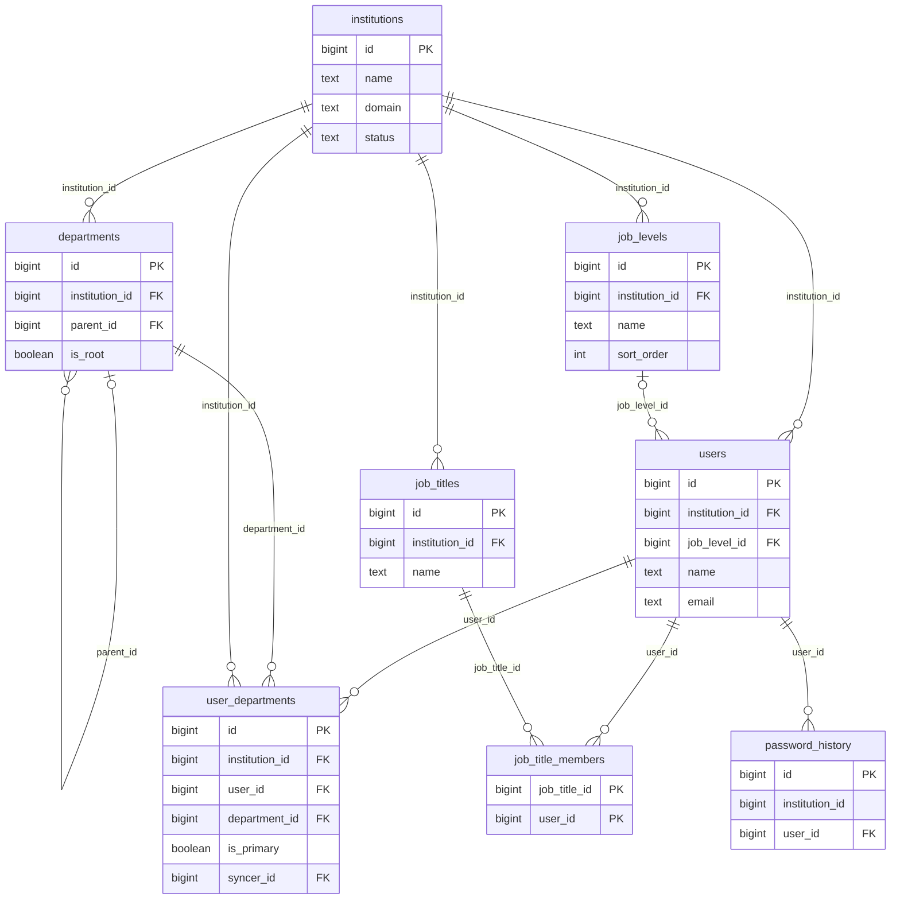
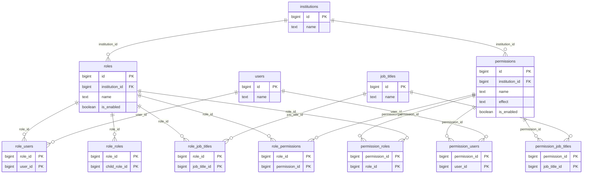
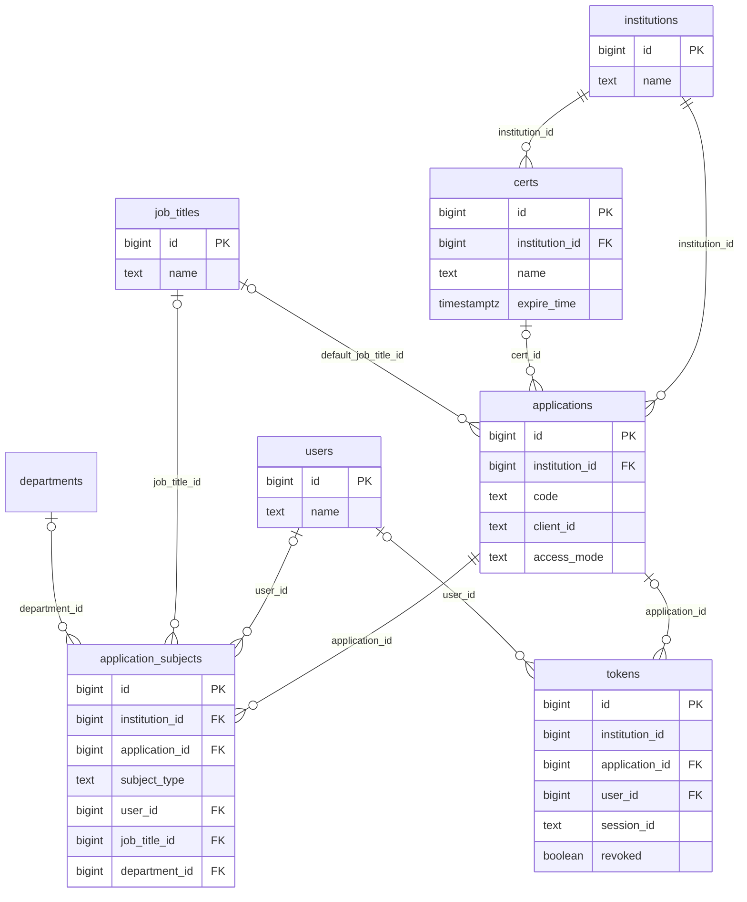
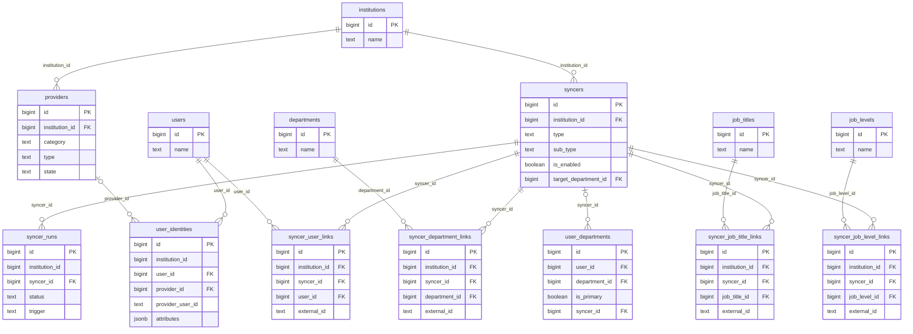
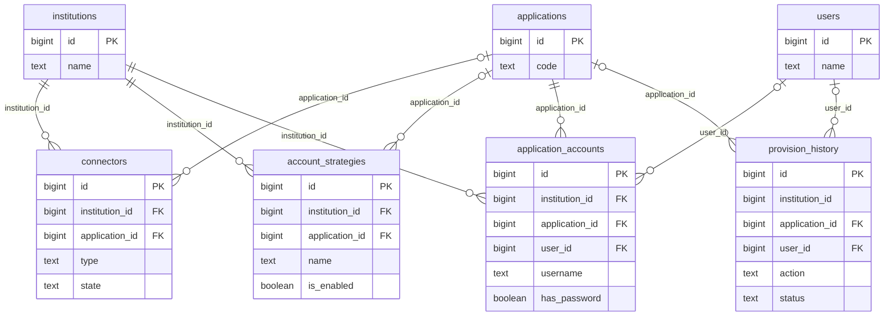
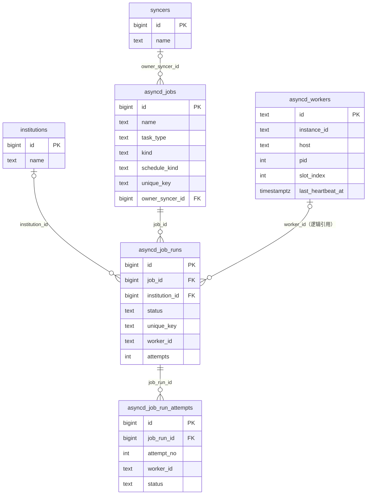
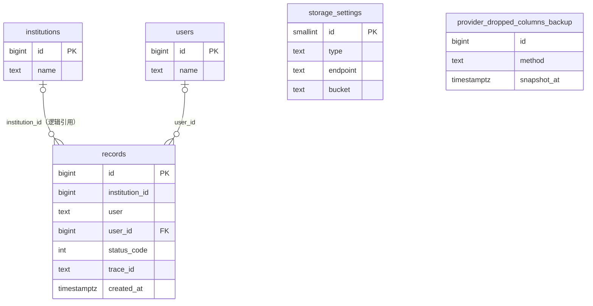

# 数据库表结构与 ER 图

> **适用版本**：迁移 `001`–`047`（整理日期：2026-10-18）
>
> **事实来源**：在空 PostgreSQL 库中顺序执行 `migrations/*.up.sql` 后，从 `information_schema` / `pg_catalog` 读取的实际结构。本文只描述 PostgreSQL 业务库；Redis 中的会话、OAuth state 与限流计数不在本文范围内。
>
> **覆盖范围**：`public` 架构下 40 张表、511 个字段、138 个索引，包含迁移 `027` 产生的 `provider_dropped_columns_backup` 备份表；迁移器内部元数据表 `schema_migrations` 不属于业务数据模型，不在本文列出。
>
> **维护规则**：新增迁移后同步更新本文件；迁移文件一旦发布不可修改，表结构以最新迁移执行结果为准。

## 1. 阅读约定

- `PK`：主键；`FK`：外键；`UQ`：单列唯一约束。复合唯一键、部分唯一索引与外键级联规则在每张表的「键、约束与索引」中完整列出。
- 组织内资源主表通常带 `institution_id`；纯关联表通过父实体间接归属。`asyncd_jobs` / `asyncd_workers` 是平台级对象，`institutions`、`storage_settings` 与迁移备份表也不按组织隔离。
- 关联统一使用主键 + 外键（`AGENTS.md` §3.8）；尚未完成的多态引用会单独标注。
- 敏感字段（密码哈希、MFA 密钥、私钥、客户端密钥、令牌明文）只允许服务端使用，API 响应必须经 DTO 剥离。
- 表名使用完整单词；历史迁移中保留的缩写表已通过 `042` 等迁移改名。

## 2. 数据域总览

| 数据域 | 表 | 说明 |
|---|---|---|
| 租户与身份目录 | `institutions`、`departments`、`users`、`user_departments`、`job_levels`、`job_titles`、`job_title_members`、`password_history` | 租户、部门树、用户、多部门归属、职务/职级与密码历史 |
| RBAC 与授权 | `roles`、`permissions`、`role_users`、`role_roles`、`role_job_titles`、`role_permissions`、`permission_users`、`permission_roles`、`permission_job_titles` | 角色嵌套、角色/权限/用户/职务绑定 |
| 应用、令牌与证书 | `applications`、`application_subjects`、`certs`、`tokens` | OIDC/OAuth 客户端、访问名单、签名证书、令牌记录 |
| 提供商与身份连接 | `providers`、`user_identities`、`syncers`、`syncer_runs`、`syncer_user_links`、`syncer_department_links`、`syncer_job_title_links`、`syncer_job_level_links` | 外部身份提供方、身份绑定、入方向同步 |
| 出方向账号供给 | `connectors`、`account_strategies`、`application_accounts`、`provision_history` | 下游连接器、账号策略、账号台账、供给历史 |
| 异步与定时任务 | `asyncd_jobs`、`asyncd_job_runs`、`asyncd_job_run_attempts`、`asyncd_workers` | 任务定义、执行实例、尝试明细、执行器心跳 |
| 审计与系统设置 | `records`、`storage_settings`、`provider_dropped_columns_backup` | append-only 审计、单行存储配置、迁移备份 |

---

## 3. ER 图

ER 图按数据域拆分，避免单张大图不可读。图中只展示关键字段；完整字段见第 4 节。

### 3.1 租户与身份目录

> `user_departments` 是用户多部门归属与主部门（`is_primary`）的唯一真相。`job_title_members` 为复合主键，两个字段同时是 PK 与 FK。

### 3.2 RBAC 与授权

> RBAC 关联全部使用主键与外键；名称只在 DTO 与查询结果中用于展示。

### 3.3 应用、令牌与证书

> `application_subjects` 以 `user_id` / `job_title_id` / `department_id` 三列表达多态主体，并由 `subject_type` 与 `CHECK` 约束保证恰好一列非空。`applications.cert_id` 与 `applications.default_job_title_id` 均为外键；名称只用于查询结果展示。

### 3.4 提供商与入方向身份连接

### 3.5 出方向账号供给

### 3.6 异步与定时任务

### 3.7 审计与系统设置

> `records.institution_id` 是可空的归属快照，没有外键；审计记录按 append-only 处理，机构或用户删除后仍保留。`storage_settings` 是 `id = 1` 的单行系统配置。

---

## 4. 表结构明细

### 4.1 租户与身份目录

#### `institutions`

租户 / 组织根实体。`name` 全局唯一，是全部组织内资源的归属与隔离维度。

**键、约束与索引**

- 主键：`id`
- 唯一约束：`UNIQUE (name)`
- 检查约束：无（MFA 策略已下沉到应用登录方式与 MFA 提供商）
- 索引：`institutions_domain_key` UNIQUE (lower(domain)) WHERE (domain <> ''::text)；`institutions_name_key` UNIQUE (name)；`institutions_pkey` UNIQUE (id)

| 字段 | 类型 | 可空 | 默认 | 说明 |
|---|---|---|---|---|
| `id` **PK** | BIGINT | 否 | 自增 | 主键 |
| `name` **UQ** | TEXT | 否 | — | 名称 / 标识 |
| `display_name` | TEXT | 否 | '' | 展示名称 |
| `domain` | TEXT | 否 | '' | 唯一域名；按 Host 解析租户，空值不参与匹配 |
| `website_url` | TEXT | 否 | '' | 官网地址 |
| `logo` | TEXT | 否 | '' | 组织 Logo |
| `favicon` | TEXT | 否 | '' | 站点图标 |
| `description` | TEXT | 否 | '' | 描述 |
| `captcha` | TEXT | 否 | '' | 人机校验策略（NONE / TEXT / ARITHMETIC 等） |
| `password_type` | TEXT | 否 | 'bcrypt' | 密码算法（默认 bcrypt） |
| `password_options` | TEXT[] | 否 | '{}' | 密码复杂度选项 |
| `password_expire_days` | INTEGER | 否 | 0 | 密码有效期（天，0 = 不过期） |
| `password_history_count` | INTEGER | 否 | 0 | 禁止复用的历史密码数量 |
| `token_retention_days` | INTEGER | 否 | 30 | 令牌保留天数 |
| `record_retention_days` | INTEGER | 否 | 30 | 审计记录保留天数 |
| `default_application` | TEXT | 否 | '' | 默认应用 code（逻辑引用） |
| `default_password_enc` | TEXT | 否 | '' | 新建用户默认密码的 AES-GCM 密文（敏感配置） |
| `use_email_as_username` | BOOLEAN | 否 | false | 是否用邮箱作为用户名 |
| `disable_signin` | BOOLEAN | 否 | false | 是否禁用组织登录 |
| `status` | TEXT | 否 | 'active' | 状态 |
| `created_at` | TIMESTAMPTZ | 否 | NOW() | 创建时间 |
| `updated_at` | TIMESTAMPTZ | 否 | NOW() | 更新时间 |
| `password_salt` | TEXT | 否 | '' | 组织级密码盐 / 胡椒（敏感，响应不下发） |

---

#### `departments`

组织内的部门树。部分唯一索引保证每个组织至多有一个 `is_root = TRUE` 的根节点；`parent_id_chain` 存祖先主键链，`code_path` / `name_path` / `level` 由查询时递归 CTE 计算，不落库。

**键、约束与索引**

- 主键：`id`
- 外键：`institution_id` → `institutions(id)` ON DELETE CASCADE；`parent_id` → `departments(id)` ON DELETE SET NULL
- 唯一约束：`UNIQUE (institution_id, name)`
- 索引：`departments_inst_name_key` UNIQUE (institution_id, name)；`departments_institution_id_idx` (institution_id)；`departments_parent_idx` (parent_id)；`departments_pkey` UNIQUE (id)；`departments_root_key` UNIQUE (institution_id) WHERE is_root

| 字段 | 类型 | 可空 | 默认 | 说明 |
|---|---|---|---|---|
| `id` **PK** | BIGINT | 否 | 自增 | 主键 |
| `name` | TEXT | 否 | — | 名称 / 标识 |
| `display_name` | TEXT | 否 | '' | 展示名称 |
| `description` | TEXT | 否 | '' | 描述 |
| `created_at` | TIMESTAMPTZ | 否 | NOW() | 创建时间 |
| `updated_at` | TIMESTAMPTZ | 否 | NOW() | 更新时间 |
| `parent_id` **FK** | BIGINT | 是 | — | 父部门；根部门为空 |
| `parent_id_chain` | BIGINT[] | 否 | '{}' | 祖先主键链（根→父，不含自身） |
| `has_child` | BOOLEAN | 否 | false | 派生：是否存在子部门 |
| `sort_index` | INTEGER | 否 | 0 | 组织内排序值 |
| `institution_id` **FK** | BIGINT | 否 | — | 所属组织（租户隔离键） |
| `is_root` | BOOLEAN | 否 | false | 是否组织根节点（每组织唯一） |

---

#### `users`

本地用户账号。组织内 `name` 唯一；密码、MFA 密钥等敏感字段只允许经 DTO 以 `has_*` 形式对外表达。

**键、约束与索引**

- 主键：`id`
- 外键：`institution_id` → `institutions(id)` ON DELETE CASCADE；`job_level_id` → `job_levels(id)` ON DELETE SET NULL
- 唯一约束：`UNIQUE (institution_id, name)`
- 索引：`users_email_idx` (email)；`users_inst_email_key` UNIQUE (institution_id, lower(email)) WHERE (email <> ''::text)；`users_inst_name_key` UNIQUE (institution_id, name)；`users_inst_phone_key` UNIQUE (institution_id, phone) WHERE (phone <> ''::text)；`users_institution_flags_idx` (institution_id, is_deleted, is_forbidden)；`users_institution_id_idx` (institution_id)；`users_job_level_idx` (institution_id, job_level_id)；`users_pkey` UNIQUE (id)；`users_uid_key` UNIQUE (uid) WHERE (uid <> ''::text)

| 字段 | 类型 | 可空 | 默认 | 说明 |
|---|---|---|---|---|
| `id` **PK** | BIGINT | 否 | 自增 | 主键 |
| `uid` | TEXT | 否 | '' | 稳定 UID（非空时全局唯一） |
| `name` | TEXT | 否 | — | 名称 / 标识 |
| `type` | TEXT | 否 | 'normal' | 用户类型（normal / admin） |
| `password_hash` | TEXT | 否 | '' | 密码哈希（敏感） |
| `password_salt` | TEXT | 否 | '' | 单用户密码盐（敏感） |
| `password_type` | TEXT | 否 | 'bcrypt' | 密码算法 |
| `display_name` | TEXT | 否 | '' | 展示名称 |
| `first_name` | TEXT | 否 | '' | 名 |
| `last_name` | TEXT | 否 | '' | 姓 |
| `avatar` | TEXT | 否 | '' | 头像 URL |
| `email` | TEXT | 否 | '' | 邮箱 |
| `email_verified` | BOOLEAN | 否 | false | 邮箱是否已验证 |
| `phone` | TEXT | 否 | '' | 手机号 |
| `country_code` | TEXT | 否 | '' | 国家 / 区号 |
| `location` | TEXT | 否 | '' | 所在地 |
| `address` | TEXT | 否 | '' | 地址 |
| `affiliation` | TEXT | 否 | '' | 所属单位 |
| `title` | TEXT | 否 | '' | 头衔 |
| `homepage` | TEXT | 否 | '' | 个人主页 |
| `bio` | TEXT | 否 | '' | 个人简介 |
| `language` | TEXT | 否 | '' | 语言 |
| `gender` | TEXT | 否 | '' | 性别 |
| `birthday` | TEXT | 否 | '' | 生日 |
| `education` | TEXT | 否 | '' | 教育经历 |
| `score` | INTEGER | 否 | 0 | 积分 / 评分 |
| `is_admin` | BOOLEAN | 否 | false | 是否管理员 |
| `is_forbidden` | BOOLEAN | 否 | false | 是否被禁用 |
| `is_deleted` | BOOLEAN | 否 | false | 是否软删除 |
| `is_online` | BOOLEAN | 否 | false | 是否在线（派生快照） |
| `signup_application` | TEXT | 否 | '' | 注册来源应用 |
| `register_type` | TEXT | 否 | '' | 注册类型 |
| `register_source` | TEXT | 否 | '' | 注册来源 |
| `created_ip` | TEXT | 否 | '' | 注册来源 IP |
| `last_signin_time` | TIMESTAMPTZ | 是 | — | 最后登录时间 |
| `last_signin_ip` | TEXT | 否 | '' | 最后登录 IP |
| `password_updated_at` | TIMESTAMPTZ | 是 | — | 密码最后更新时间 |
| `mfa_enabled` | BOOLEAN | 否 | false | 是否启用 MFA |
| `mfa_type` | TEXT | 否 | '' | MFA 类型 |
| `mfa_secret` | TEXT | 否 | '' | MFA 密钥（敏感） |
| `mfa_recovery_codes` | TEXT[] | 否 | '{}' | MFA 恢复码（敏感） |
| `created_at` | TIMESTAMPTZ | 否 | NOW() | 创建时间 |
| `updated_at` | TIMESTAMPTZ | 否 | NOW() | 更新时间 |
| `phone_verified` | BOOLEAN | 否 | false | 手机号是否已验证 |
| `institution_id` **FK** | BIGINT | 否 | — | 所属组织（租户隔离键） |
| `job_level_id` **FK** | BIGINT | 是 | — | 职级 |

---

#### `user_departments`

用户与部门的多值归属关系。`is_primary` 标记主部门，每名用户至多一个主部门。

**键、约束与索引**

- 主键：`id`
- 外键：`department_id` → `departments(id)` ON DELETE CASCADE；`institution_id` → `institutions(id)` ON DELETE CASCADE；`syncer_id` → `syncers(id)` ON DELETE SET NULL；`user_id` → `users(id)` ON DELETE CASCADE
- 唯一约束：`UNIQUE (user_id, department_id)`
- 索引：`user_departments_dept_idx` (institution_id, department_id)；`user_departments_key` UNIQUE (user_id, department_id)；`user_departments_pkey` UNIQUE (id)；`user_departments_primary_key` UNIQUE (user_id) WHERE is_primary

| 字段 | 类型 | 可空 | 默认 | 说明 |
|---|---|---|---|---|
| `id` **PK** | BIGINT | 否 | 自增 | 主键 |
| `institution_id` **FK** | BIGINT | 否 | — | 所属组织（租户隔离键） |
| `user_id` **FK** | BIGINT | 否 | — | 用户 |
| `department_id` **FK** | BIGINT | 否 | — | 部门 |
| `is_primary` | BOOLEAN | 否 | false | 是否主部门（每用户至多一个） |
| `syncer_id` **FK** | BIGINT | 是 | — | 最近写入该归属的身份连接 |
| `created_at` | TIMESTAMPTZ | 否 | NOW() | 创建时间 |
| `updated_at` | TIMESTAMPTZ | 否 | NOW() | 更新时间 |

---

#### `job_levels`

职级字典。仅用于展示、筛选与统计，不参与授权判定。

**键、约束与索引**

- 主键：`id`
- 外键：`institution_id` → `institutions(id)` ON DELETE CASCADE
- 唯一约束：`UNIQUE (institution_id, name)`
- 索引：`job_levels_inst_idx` (institution_id, sort_order)；`job_levels_inst_name_key` UNIQUE (institution_id, name)；`job_levels_pkey` UNIQUE (id)

| 字段 | 类型 | 可空 | 默认 | 说明 |
|---|---|---|---|---|
| `id` **PK** | BIGINT | 否 | 自增 | 主键 |
| `institution_id` **FK** | BIGINT | 否 | — | 所属组织（租户隔离键） |
| `name` | TEXT | 否 | — | 名称 / 标识 |
| `description` | TEXT | 否 | '' | 描述 |
| `sort_order` | INTEGER | 否 | 100 | 展示排序（越小越靠前） |
| `is_enabled` | BOOLEAN | 否 | true | 是否启用 |
| `created_at` | TIMESTAMPTZ | 否 | NOW() | 创建时间 |
| `updated_at` | TIMESTAMPTZ | 否 | NOW() | 更新时间 |

---

#### `job_titles`

职务字典（由历史 `groups` 表改名而来）。职务是批量授权的载体，不做层级。

**键、约束与索引**

- 主键：`id`
- 外键：`institution_id` → `institutions(id)` ON DELETE CASCADE
- 唯一约束：`UNIQUE (institution_id, name)`
- 索引：`job_titles_inst_name_key` UNIQUE (institution_id, name)；`job_titles_institution_id_idx` (institution_id)；`job_titles_pkey` UNIQUE (id)

| 字段 | 类型 | 可空 | 默认 | 说明 |
|---|---|---|---|---|
| `id` **PK** | BIGINT | 否 | 自增 | 主键 |
| `name` | TEXT | 否 | — | 名称 / 标识 |
| `display_name` | TEXT | 否 | '' | 展示名称 |
| `manager` | TEXT | 否 | '' | 负责人 |
| `contact_email` | TEXT | 否 | '' | 联系邮箱 |
| `is_enabled` | BOOLEAN | 否 | true | 是否启用 |
| `created_at` | TIMESTAMPTZ | 否 | NOW() | 创建时间 |
| `updated_at` | TIMESTAMPTZ | 否 | NOW() | 更新时间 |
| `institution_id` **FK** | BIGINT | 否 | — | 所属组织（租户隔离键） |

---

#### `job_title_members`

用户与职务的多对多关系（复合主键）。

**键、约束与索引**

- 主键：`job_title_id, user_id`
- 外键：`job_title_id` → `job_titles(id)` ON DELETE CASCADE；`user_id` → `users(id)` ON DELETE CASCADE
- 索引：`job_title_members_pkey` UNIQUE (job_title_id, user_id)；`job_title_members_user_idx` (user_id)

| 字段 | 类型 | 可空 | 默认 | 说明 |
|---|---|---|---|---|
| `job_title_id` **PK/FK** | BIGINT | 否 | — | 职务 |
| `user_id` **PK/FK** | BIGINT | 否 | — | 用户 |

---

#### `password_history`

用户历史密码哈希。用于组织级“禁止复用最近 N 次密码”策略。

**键、约束与索引**

- 主键：`id`
- 外键：`user_id` → `users(id)` ON DELETE CASCADE
- 索引：`password_history_institution_id_idx` (institution_id)；`password_history_pkey` UNIQUE (id)；`password_history_user_idx` (user_id, created_at DESC)

| 字段 | 类型 | 可空 | 默认 | 说明 |
|---|---|---|---|---|
| `id` **PK** | BIGINT | 否 | 自增 | 主键 |
| `password_hash` | TEXT | 否 | — | 历史密码哈希（敏感） |
| `created_at` | TIMESTAMPTZ | 否 | NOW() | 创建时间 |
| `institution_id` | BIGINT | 是 | — | 所属组织（租户隔离键） |
| `user_id` **FK** | BIGINT | 否 | — | 用户 |

---

### 4.2 RBAC 与授权

#### `roles`

角色定义。组织内 `name` 唯一，支持嵌套继承子角色。

**键、约束与索引**

- 主键：`id`
- 外键：`institution_id` → `institutions(id)` ON DELETE CASCADE
- 唯一约束：`UNIQUE (institution_id, name)`
- 索引：`roles_inst_name_key` UNIQUE (institution_id, name)；`roles_institution_id_idx` (institution_id)；`roles_pkey` UNIQUE (id)

| 字段 | 类型 | 可空 | 默认 | 说明 |
|---|---|---|---|---|
| `id` **PK** | BIGINT | 否 | 自增 | 主键 |
| `name` | TEXT | 否 | — | 名称 / 标识 |
| `display_name` | TEXT | 否 | '' | 展示名称 |
| `description` | TEXT | 否 | '' | 描述 |
| `is_enabled` | BOOLEAN | 否 | true | 是否启用 |
| `is_system` | BOOLEAN | 否 | false | 是否系统内置角色（不可删除） |
| `created_at` | TIMESTAMPTZ | 否 | NOW() | 创建时间 |
| `updated_at` | TIMESTAMPTZ | 否 | NOW() | 更新时间 |
| `institution_id` **FK** | BIGINT | 否 | — | 所属组织（租户隔离键） |

---

#### `permissions`

权限定义。以资源 / 动作 / Allow|Deny 表达策略，组织内 `name` 唯一。

**键、约束与索引**

- 主键：`id`
- 外键：`institution_id` → `institutions(id)` ON DELETE CASCADE
- 唯一约束：`UNIQUE (institution_id, name)`
- 索引：`permissions_inst_name_key` UNIQUE (institution_id, name)；`permissions_institution_id_idx` (institution_id)；`permissions_pkey` UNIQUE (id)

| 字段 | 类型 | 可空 | 默认 | 说明 |
|---|---|---|---|---|
| `id` **PK** | BIGINT | 否 | 自增 | 主键 |
| `name` | TEXT | 否 | — | 名称 / 标识 |
| `display_name` | TEXT | 否 | '' | 展示名称 |
| `description` | TEXT | 否 | '' | 描述 |
| `resource_type` | TEXT | 否 | '' | 资源类型 |
| `resources` | TEXT[] | 否 | '{}' | 资源表达式列表（支持 *） |
| `actions` | TEXT[] | 否 | '{}' | 动作列表（支持 *） |
| `effect` | TEXT | 否 | 'Allow' | Allow \| Deny（Deny 优先） |
| `is_enabled` | BOOLEAN | 否 | true | 是否启用 |
| `expire_time` | TIMESTAMPTZ | 是 | — | 权限过期时间 |
| `submitter` | TEXT | 否 | '' | 提交人 |
| `approver` | TEXT | 否 | '' | 审批人 |
| `approve_time` | TIMESTAMPTZ | 是 | — | 审批时间 |
| `state` | TEXT | 否 | 'Approved' | 审批状态（Approved / Pending / Rejected） |
| `created_at` | TIMESTAMPTZ | 否 | NOW() | 创建时间 |
| `updated_at` | TIMESTAMPTZ | 否 | NOW() | 更新时间 |
| `institution_id` **FK** | BIGINT | 否 | — | 所属组织（租户隔离键） |

---

#### `role_users`

角色直接成员（角色 × 用户）。

**键、约束与索引**

- 主键：`role_id, user_id`
- 外键：`role_id` → `roles(id)` ON DELETE CASCADE；`user_id` → `users(id)` ON DELETE CASCADE
- 索引：`role_users_pkey` UNIQUE (role_id, user_id)；`role_users_user_idx` (user_id)

| 字段 | 类型 | 可空 | 默认 | 说明 |
|---|---|---|---|---|
| `role_id` **PK/FK** | BIGINT | 否 | — | 角色 |
| `user_id` **PK/FK** | BIGINT | 否 | — | 用户 |

---

#### `role_roles`

角色嵌套关系：`role_id` 继承 `child_role_id`。

**键、约束与索引**

- 主键：`role_id, child_role_id`
- 外键：`role_id` → `roles(id)`；`child_role_id` → `roles(id)`，均 ON DELETE CASCADE
- 索引：`role_roles_pkey` UNIQUE (role_id, child_role_id)；`role_roles_child_role_idx` (child_role_id)

| 字段 | 类型 | 可空 | 默认 | 说明 |
|---|---|---|---|---|
| `role_id` **PK/FK** | BIGINT | 否 | — | 父角色 |
| `child_role_id` **PK/FK** | BIGINT | 否 | — | 被继承的子角色 |

---

#### `role_job_titles`

角色与职务的关联。

**键、约束与索引**

- 主键：`role_id, job_title_id`
- 外键：`role_id` → `roles(id)`；`job_title_id` → `job_titles(id)`，均 ON DELETE CASCADE
- 索引：`role_job_titles_pkey` UNIQUE (role_id, job_title_id)；`role_job_titles_job_title_idx` (job_title_id)

| 字段 | 类型 | 可空 | 默认 | 说明 |
|---|---|---|---|---|
| `role_id` **PK/FK** | BIGINT | 否 | — | 角色 |
| `job_title_id` **PK/FK** | BIGINT | 否 | — | 职务 |

---

#### `role_permissions`

角色与权限的关联。

**键、约束与索引**

- 主键：`role_id, permission_id`
- 外键：`role_id` → `roles(id)`；`permission_id` → `permissions(id)`，均 ON DELETE CASCADE
- 索引：`role_permissions_pkey` UNIQUE (role_id, permission_id)；`role_permissions_permission_idx` (permission_id)

| 字段 | 类型 | 可空 | 默认 | 说明 |
|---|---|---|---|---|
| `role_id` **PK/FK** | BIGINT | 否 | — | 角色 |
| `permission_id` **PK/FK** | BIGINT | 否 | — | 权限 |

---

#### `permission_users`

权限直接授予用户（权限 × 用户）。

**键、约束与索引**

- 主键：`permission_id, user_id`
- 外键：`permission_id` → `permissions(id)` ON DELETE CASCADE；`user_id` → `users(id)` ON DELETE CASCADE
- 索引：`permission_users_pkey` UNIQUE (permission_id, user_id)；`permission_users_user_idx` (user_id)

| 字段 | 类型 | 可空 | 默认 | 说明 |
|---|---|---|---|---|
| `permission_id` **PK/FK** | BIGINT | 否 | — | 权限 |
| `user_id` **PK/FK** | BIGINT | 否 | — | 用户 |

---

#### `permission_roles`

权限授予角色。

**键、约束与索引**

- 主键：`permission_id, role_id`
- 外键：`permission_id` → `permissions(id)`；`role_id` → `roles(id)`，均 ON DELETE CASCADE
- 索引：`permission_roles_pkey` UNIQUE (permission_id, role_id)；`permission_roles_role_idx` (role_id)

| 字段 | 类型 | 可空 | 默认 | 说明 |
|---|---|---|---|---|
| `permission_id` **PK/FK** | BIGINT | 否 | — | 权限 |
| `role_id` **PK/FK** | BIGINT | 否 | — | 角色 |

---

#### `permission_job_titles`

权限授予职务。

**键、约束与索引**

- 主键：`permission_id, job_title_id`
- 外键：`permission_id` → `permissions(id)`；`job_title_id` → `job_titles(id)`，均 ON DELETE CASCADE
- 索引：`permission_job_titles_pkey` UNIQUE (permission_id, job_title_id)；`permission_job_titles_job_title_idx` (job_title_id)

| 字段 | 类型 | 可空 | 默认 | 说明 |
|---|---|---|---|---|
| `permission_id` **PK/FK** | BIGINT | 否 | — | 权限 |
| `job_title_id` **PK/FK** | BIGINT | 否 | — | 职务 |

---

### 4.3 应用、令牌与证书

#### `applications`

OAuth2 / OIDC 应用（客户端）及其登录、注册、令牌、会话、访问控制策略。`code` 是稳定业务标识；`client_secret_hash` 只保存客户端密钥哈希。

**键、约束与索引**

- 主键：`id`
- 外键：`institution_id` → `institutions(id)` ON DELETE CASCADE；`cert_id` → `certs(id)` ON DELETE SET NULL；`default_job_title_id` → `job_titles(id)` ON DELETE SET NULL
- 唯一约束：`UNIQUE (institution_id, code)`
- 检查约束：`CHECK ((access_mode = ANY (ARRAY['all'::text, 'restricted'::text])))`；`CHECK ((adapter = ANY (ARRAY['default'::text, 'custom'::text])))`；`CHECK ((signin_error_limit >= 0))`；`CHECK ((signin_retry_wait_minutes >= 0))`
- 索引：`applications_client_id_key` UNIQUE (client_id) WHERE (client_id <> ''::text)；`applications_inst_code_key` UNIQUE (institution_id, code)；`applications_institution_id_idx` (institution_id)；`applications_pkey` UNIQUE (id)

| 字段 | 类型 | 可空 | 默认 | 说明 |
|---|---|---|---|---|
| `id` **PK** | BIGINT | 否 | 自增 | 主键 |
| `code` | TEXT | 否 | — | 稳定应用标识（进 URL 与外部集成，创建后不可改） |
| `name` | TEXT | 否 | '' | 名称 / 标识 |
| `category` | TEXT | 否 | 'default' | 应用类别 |
| `type` | TEXT | 否 | 'oidc' | 应用类型 |
| `logo` | TEXT | 否 | '' | 浅色 Logo |
| `title` | TEXT | 否 | '' | 登录页标题 |
| `description` | TEXT | 否 | '' | 描述 |
| `homepage_url` | TEXT | 否 | '' | 主页地址 |
| `sort_order` | INTEGER | 否 | 0 | 排序值 |
| `cert_id` **FK** | BIGINT | 是 | — | 签名证书主键（`certs.id`，删除证书时置空） |
| `default_job_title_id` **FK** | BIGINT | 是 | — | 默认职务主键（`job_titles.id`，删除职务时置空） |
| `max_sessions` | INTEGER | 否 | 0 | 会话上限：0 不限，1 独占，N 最多 N 个 |
| `grant_types` | TEXT[] | 否 | '{authorization_code,password,refresh_token,client_credentials}' | 允许的 OAuth grant types |
| `redirect_uris` | TEXT[] | 否 | '{}' | 已登记回调地址 |
| `providers` | JSONB | 否 | '[]' | 登录提供方配置（JSONB） |
| `scopes` | JSONB | 否 | '[]' | scope 定义（JSONB） |
| `client_id` | TEXT | 否 | '' | OAuth client_id |
| `client_secret_hash` | TEXT | 否 | '' | OAuth client_secret 哈希（敏感，禁止下发） |
| `token_format` | TEXT | 否 | 'jwt' | 令牌格式（当前 jwt） |
| `token_signing_method` | TEXT | 否 | 'RS256' | 签名算法（如 RS256） |
| `expire_in_hours` | DOUBLE PRECISION | 否 | 1 | access token 有效期（小时） |
| `refresh_expire_in_hours` | DOUBLE PRECISION | 否 | 24 | refresh token 有效期（小时） |
| `cookie_expire_in_hours` | BIGINT | 否 | 720 | 会话 Cookie 有效期（小时） |
| `state` | TEXT | 否 | 'active' | 状态 |
| `created_at` | TIMESTAMPTZ | 否 | NOW() | 创建时间 |
| `updated_at` | TIMESTAMPTZ | 否 | NOW() | 更新时间 |
| `logo_dark` | TEXT | 否 | '' | 深色 Logo |
| `favicon` | TEXT | 否 | '' | 站点图标 |
| `tags` | TEXT[] | 否 | '{}' | 应用标签 |
| `org_choice_mode` | TEXT | 否 | '' | 组织选择模式 |
| `ip_restriction` | TEXT | 否 | '' | IP 限制模式 |
| `ip_whitelist` | TEXT | 否 | '' | IP 白名单 |
| `signup_url` | TEXT | 否 | '' | 注册地址 |
| `terms_of_use` | TEXT | 否 | '' | 使用条款 |
| `forced_redirect_origin` | TEXT | 否 | '' | 强制回跳来源 |
| `backchannel_logout_uri` | TEXT | 否 | '' | OIDC Back-Channel Logout 地址 |
| `token_attributes` | JSONB | 否 | '[]' | access_token 自定义 claim（name/category/value/type） |
| `disable_refresh_rotation` | BOOLEAN | 否 | false | 是否关闭 refresh token 轮换 |
| `signin_methods` | JSONB | 否 | '[]' | 登录方式声明（JSONB，唯一数据源） |
| `signup_items` | JSONB | 否 | '[]' | 注册字段编排（JSONB） |
| `theme_data` | JSONB | 是 | — | 应用级品牌主题（JSONB） |
| `adapter` | TEXT | 否 | 'default' | OIDC claim 适配器：default \| custom |
| `adapter_config` | JSONB | 是 | — | 自定义适配器配置（JSONB） |
| `self_signup_enabled` | BOOLEAN | 否 | false | 是否开放自助注册 |
| `signup_auto_signin` | BOOLEAN | 否 | true | 注册后是否自动登录 |
| `email_code_ttl_seconds` | INTEGER | 否 | 300 | 邮箱验证码有效期（秒） |
| `sms_code_ttl_seconds` | INTEGER | 否 | 300 | 短信验证码有效期（秒） |
| `magic_link_ttl_seconds` | INTEGER | 否 | 600 | 魔法链接有效期（秒） |
| `institution_id` **FK** | BIGINT | 否 | — | 所属组织（租户隔离键） |
| `signin_error_limit` | INTEGER | 否 | 0 | 登录失败次数上限（0 = 平台默认） |
| `signin_retry_wait_minutes` | INTEGER | 否 | 0 | 达到失败上限后的等待分钟数（0 = 平台默认） |
| `access_mode` | TEXT | 否 | 'all' | 访问模式：all \| restricted |

---

#### `application_subjects`

受限应用（`access_mode = restricted`）的授权主体名单。主体类型为用户 / 职务 / 部门，三个可空外键列由 `subject_type` 决定唯一有效列。

**键、约束与索引**

- 主键：`id`
- 外键：`application_id` / `institution_id` / `user_id` / `job_title_id` / `department_id` 全部 `ON DELETE CASCADE`
- 唯一索引：`UNIQUE (application_id, user_id) WHERE user_id IS NOT NULL`；职务与部门使用同构部分唯一索引
- 检查约束：`subject_type IN ('user', 'job_title', 'department')`，且对应主体列恰好一列非空
- 索引：`application_subjects_app_idx`、三个主体列部分索引与三个应用内部分唯一索引

| 字段 | 类型 | 可空 | 默认 | 说明 |
|---|---|---|---|---|
| `id` **PK** | BIGINT | 否 | 自增 | 主键 |
| `institution_id` **FK** | BIGINT | 否 | — | 所属组织（租户隔离键） |
| `application_id` **FK** | BIGINT | 否 | — | 应用 |
| `subject_type` | TEXT | 否 | — | 主体类型：user \| job_title \| department |
| `user_id` **FK** | BIGINT | 是 | — | 用户主体主键（仅 user 类型） |
| `job_title_id` **FK** | BIGINT | 是 | — | 职务主体主键（仅 job_title 类型） |
| `department_id` **FK** | BIGINT | 是 | — | 部门主体主键（仅 department 类型） |
| `created_at` | TIMESTAMPTZ | 否 | NOW() | 创建时间 |

---

#### `certs`

证书与密钥对。`private_key` 为 AES-GCM 密文，任何响应都不得下发。

**键、约束与索引**

- 主键：`id`
- 外键：`institution_id` → `institutions(id)` ON DELETE CASCADE
- 唯一约束：`UNIQUE (institution_id, name)`
- 索引：`certs_inst_name_key` UNIQUE (institution_id, name)；`certs_institution_id_idx` (institution_id)；`certs_pkey` UNIQUE (id)

| 字段 | 类型 | 可空 | 默认 | 说明 |
|---|---|---|---|---|
| `id` **PK** | BIGINT | 否 | 自增 | 主键 |
| `name` | TEXT | 否 | — | 名称 / 标识 |
| `display_name` | TEXT | 否 | '' | 展示名称 |
| `scope` | TEXT | 否 | 'JWT' | 证书作用域 |
| `type` | TEXT | 否 | 'x509' | 证书类型 |
| `crypto_algorithm` | TEXT | 否 | 'RSA' | 加密算法 |
| `bit_size` | INTEGER | 否 | 2048 | 密钥位数 |
| `expire_in_years` | INTEGER | 否 | 10 | 有效年限 |
| `certificate` | TEXT | 否 | '' | 证书 PEM |
| `private_key` | TEXT | 否 | '' | 私钥 AES-GCM 密文（敏感，禁止下发） |
| `expire_time` | TIMESTAMPTZ | 是 | — | 到期时间 |
| `is_system` | BOOLEAN | 否 | false | 是否系统内置证书 |
| `created_at` | TIMESTAMPTZ | 否 | NOW() | 创建时间 |
| `updated_at` | TIMESTAMPTZ | 否 | NOW() | 更新时间 |
| `institution_id` **FK** | BIGINT | 否 | — | 所属组织（租户隔离键） |

---

#### `tokens`

授权码与 access / refresh / id token 记录。数据库只保存哈希，明文仅存在于签发时的内存与
一次性响应中，用于服务端查找、内省、轮换与吊销。

**键、约束与索引**

- 主键：`id`
- 外键：`application_id` → `applications(id)` ON DELETE SET NULL；`user_id` → `users(id)` ON DELETE SET NULL
- 索引：`tokens_access_hash_key` UNIQUE (access_token_hash) WHERE (access_token_hash <> ''::text)；`tokens_app_user_idx` (institution_id, application_id, user_id)；`tokens_code_hash_key` UNIQUE (code_hash) WHERE (code_hash <> ''::text)；`tokens_institution_id_idx` (institution_id)；`tokens_pkey` UNIQUE (id)；`tokens_refresh_hash_key` UNIQUE (refresh_token_hash) WHERE (refresh_token_hash <> ''::text)

| 字段 | 类型 | 可空 | 默认 | 说明 |
|---|---|---|---|---|
| `id` **PK** | BIGINT | 否 | 自增 | 主键 |
| `name` | TEXT | 否 | — | 名称 / 标识 |
| `code_hash` | TEXT | 否 | '' | 授权码哈希 |
| `code_challenge` | TEXT | 否 | '' | PKCE code_challenge |
| `code_challenge_method` | TEXT | 否 | '' | PKCE 方法（S256 / plain） |
| `code_is_used` | BOOLEAN | 否 | false | 授权码是否已消费 |
| `code_expire_in` | BIGINT | 否 | 0 | 授权码有效期（秒） |
| `code_scope` | TEXT | 否 | '' | 授权码 scope |
| `code_redirect_uri` | TEXT | 否 | '' | 授权码绑定的 redirect_uri |
| `code_nonce` | TEXT | 否 | '' | 授权请求 nonce（写回 id_token） |
| `access_token_hash` | TEXT | 否 | '' | access token 哈希（敏感） |
| `refresh_token_hash` | TEXT | 否 | '' | refresh token 哈希（敏感） |
| `id_token_hash` | TEXT | 否 | '' | id token 哈希（敏感） |
| `expires_in` | INTEGER | 否 | 0 | 令牌有效期（秒） |
| `scope` | TEXT | 否 | '' | 授权 scope |
| `token_type` | TEXT | 否 | 'Bearer' | 令牌类型 |
| `grant_type` | TEXT | 否 | '' | 签发时的 grant type |
| `resource` | TEXT | 否 | '' | 资源标识 |
| `session_id` | TEXT | 否 | '' | 关联 Redis 会话 ID |
| `revoked` | BOOLEAN | 否 | false | 是否已吊销 |
| `expire_time` | TIMESTAMPTZ | 是 | — | 过期时间 |
| `created_at` | TIMESTAMPTZ | 否 | NOW() | 创建时间 |
| `institution_id` | BIGINT | 是 | — | 所属组织（租户隔离键） |
| `application_id` **FK** | BIGINT | 是 | — | 应用 |
| `user_id` **FK** | BIGINT | 是 | — | 用户 |

---

### 4.4 提供商与身份连接

#### `providers`

提供商公共主表（`oauth` / `email` / `sms` / `captcha` / `storage` / `mfa`）。类型专属字段在 `provider_<category>` 子表；
敏感值以 AES-GCM 密文入库。消息模板分为 `provider_email_templates` 与 `provider_sms_templates`。

**键、约束与索引**

- 主键：`id`
- 外键：`institution_id` → `institutions(id)` ON DELETE CASCADE
- 唯一约束：`UNIQUE (institution_id, name)`
- 索引：`providers_inst_name_key` UNIQUE (institution_id, name)；`providers_institution_category_idx` (institution_id, category)；`providers_institution_id_idx` (institution_id)；`providers_pkey` UNIQUE (id)；`providers_singleton_active_key` UNIQUE (institution_id, category) WHERE ((state = 'active'::text) AND (category = ANY (ARRAY['captcha'::text, 'storage'::text])))

| 字段 | 类型 | 可空 | 默认 | 说明 |
|---|---|---|---|---|
| `id` **PK** | BIGINT | 否 | 自增 | 主键 |
| `name` | TEXT | 否 | — | 名称 / 标识 |
| `display_name` | TEXT | 否 | '' | 展示名称 |
| `category` | TEXT | 否 | 'oauth' | 提供商类别：oauth \| email \| sms \| captcha \| storage \| mfa |
| `type` | TEXT | 否 | 'oidc' | 类别下的类型 key（见 provider/catalog.go） |
| `state` | TEXT | 否 | 'active' | 状态 |
| `created_at` | TIMESTAMPTZ | 否 | NOW() | 创建时间 |
| `updated_at` | TIMESTAMPTZ | 否 | NOW() | 更新时间 |
| `institution_id` **FK** | BIGINT | 否 | — | 所属组织（租户隔离键） |

类别配置子表（均以 `(provider_id, institution_id)` 引用主表）：

| 子表 | 主要字段 |
|---|---|
| `provider_oauth` | client_id / client_secret / issuer_url / scopes / PKCE；SSO 匹配使用 `match_type`、`match_local_field`、`match_syncer_id`、`match_syncer_field`、`match_provider_field`；自动建号字段映射使用 `provision_username_field` / `provision_name_field` / `provision_email_field` / `provision_phone_field` / `provision_avatar_field`；身份连接引用带同租户外键与 `ON DELETE RESTRICT` |
| `provider_email` | host / port / ssl_mode / from_address / SMTP 凭据 / receiver |
| `provider_sms` | region_id / sign_name / 短信凭据 / endpoint / receiver |
| `provider_captcha` | site key / secret key |
| `provider_storage` | endpoint / domain / bucket / path_prefix / 存储凭据 |
| `provider_mfa` | issuer / digits / period / algorithm / sms_provider_id / sms_template_id / TTL / remember_hours |

消息模板子表：

| 子表 | 说明 |
|---|---|
| `provider_email_templates` | `subject` / `content`，scene 仅 login_code / magic_link |
| `provider_sms_templates` | `template_code` / `template_params`，scene 仅 login_code / mfa_code |

#### `user_mfa_credentials`

用户与 MFA 提供商的一对一绑定（同一 `user_id + provider_id` 唯一）。`type` 为 `totp` / `sms`，
`status` 为 `pending` / `active` / `disabled`；TOTP 密钥以 AES-GCM 密文存储，恢复码只存哈希。

---

#### `user_identities`

外部身份绑定：本地用户 × 提供商 × 源端用户标识。唯一键为 `(institution_id, provider_id, provider_user_id)`。

`attributes` 保存提供商侧的原始身份字段（unionid / openid / sub / email / mobile / nick / avatar 等，键名与提供商目录一致），
供"同源身份连接"的反向认领使用：同步侧按连接源字段取值后，用它找回 SSO 此前自动建号的同一用户。

**键、约束与索引**

- 主键：`id`
- 外键：`provider_id` → `providers(id)` ON DELETE SET NULL；`user_id` → `users(id)` ON DELETE CASCADE
- 唯一约束：`UNIQUE (institution_id, provider_id, provider_user_id)`
- 索引：`user_identities_inst_provider_key` UNIQUE (institution_id, provider_id, provider_user_id)；`user_identities_inst_user_idx` (institution_id, user_id)；`user_identities_institution_id_idx` (institution_id)；`user_identities_provider_idx` (institution_id, provider_id)；`user_identities_attributes_idx` GIN (attributes)；`user_identities_pkey` UNIQUE (id)；`user_identities_user_idx` (user_id)

| 字段 | 类型 | 可空 | 默认 | 说明 |
|---|---|---|---|---|
| `id` **PK** | BIGINT | 否 | 自增 | 主键 |
| `provider_user_id` | TEXT | 否 | — | 源端用户唯一标识 |
| `email` | TEXT | 否 | '' | 源端邮箱快照 |
| `attributes` | JSONB | 否 | '{}' | 提供商侧原始身份字段（反向认领用） |
| `created_at` | TIMESTAMPTZ | 否 | NOW() | 创建时间 |
| `updated_at` | TIMESTAMPTZ | 否 | NOW() | 更新时间 |
| `institution_id` | BIGINT | 是 | — | 所属组织（租户隔离键） |
| `user_id` **FK** | BIGINT | 否 | — | 用户 |
| `provider_id` **FK** | BIGINT | 是 | — | 提供商 |

---

#### `syncers`

入方向身份连接（钉钉 / 飞书 / 企业微信 / LDAP / 数据库等）。`config` 为非敏感配置，`secrets` 为密文凭据。

**键、约束与索引**

- 主键：`id`
- 外键：`institution_id` → `institutions(id)` ON DELETE CASCADE；`target_department_id` → `departments(id)` ON DELETE SET NULL
- 唯一约束：`UNIQUE (institution_id, name)`
- 索引：`syncers_inst_name_key` UNIQUE (institution_id, name)；`syncers_institution_id_idx` (institution_id)；`syncers_pkey` UNIQUE (id)

| 字段 | 类型 | 可空 | 默认 | 说明 |
|---|---|---|---|---|
| `id` **PK** | BIGINT | 否 | 自增 | 主键 |
| `name` | TEXT | 否 | — | 名称 / 标识 |
| `display_name` | TEXT | 否 | '' | 展示名称 |
| `type` | TEXT | 否 | — | 连接类型（dingtalk / lark / wecom / ldap / database 等） |
| `sub_type` | TEXT | 否 | '' | 接入变体 |
| `is_enabled` | BOOLEAN | 否 | false | 是否启用 |
| `schedule` | TEXT | 否 | '' | 历史间隔配置（秒；新计划在 sync_config） |
| `sync_users` | BOOLEAN | 否 | true | 是否同步用户 |
| `sync_groups` | BOOLEAN | 否 | false | 是否同步组织 / 职务数据 |
| `soft_delete` | BOOLEAN | 否 | false | 源端缺失时是否软删除本地用户 |
| `last_run_time` | TIMESTAMPTZ | 是 | — | 最后执行时间 |
| `last_status` | TEXT | 否 | 'idle' | 最后执行状态 |
| `last_message` | TEXT | 否 | '' | 最后执行消息 |
| `last_counts` | JSONB | 是 | — | 最后执行统计（JSONB） |
| `created_at` | TIMESTAMPTZ | 否 | NOW() | 创建时间 |
| `updated_at` | TIMESTAMPTZ | 否 | NOW() | 更新时间 |
| `institution_id` **FK** | BIGINT | 否 | — | 所属组织（租户隔离键） |
| `config` | JSONB | 否 | '{}' | 非敏感连接配置（host / app_id / corp_id 等） |
| `secrets` | JSONB | 否 | '{}' | 连接凭据密文（密码 / app_secret） |
| `field_mapping` | JSONB | 否 | '{}' | 分离的 `account` / `department` / `job_title` 字段映射 |
| `sync_config` | JSONB | 否 | '{}' | 同步配置（增量、计划、保护阈值） |
| `target_department_id` **FK** | BIGINT | 是 | — | 同步目标部门（空 = 组织根） |

---

#### `syncer_runs`

身份连接的一次同步执行历史，记录触发方式、耗时、统计与逐条错误。

**键、约束与索引**

- 主键：`id`
- 外键：`syncer_id` → `syncers(id)` ON DELETE CASCADE
- 索引：`syncer_runs_institution_id_idx` (institution_id)；`syncer_runs_pkey` UNIQUE (id)；`syncer_runs_syncer_idx` (syncer_id, started_at DESC)；`syncer_runs_syncer_started_idx` (syncer_id, started_at DESC)

| 字段 | 类型 | 可空 | 默认 | 说明 |
|---|---|---|---|---|
| `id` **PK** | BIGINT | 否 | 自增 | 主键 |
| `syncer_id` **FK** | BIGINT | 否 | — | 身份连接 |
| `status` | TEXT | 否 | '' | 状态 |
| `message` | TEXT | 否 | '' | 执行摘要 |
| `counts` | JSONB | 是 | — | 本次统计（JSONB） |
| `started_at` | TIMESTAMPTZ | 否 | NOW() | 开始时间 |
| `finished_at` | TIMESTAMPTZ | 否 | NOW() | 结束时间 |
| `institution_id` | BIGINT | 是 | — | 所属组织（租户隔离键） |
| `trigger` | TEXT | 否 | 'manual' | 触发方式：manual \| schedule \| retry |
| `duration_ms` | INTEGER | 否 | 0 | 耗时（毫秒） |
| `errors` | JSONB | 否 | '[]' | 逐条错误（JSONB） |

---

#### `syncer_user_links`

身份连接的外部用户标识 → 本地用户映射，`raw` 保存源端原始报文用于排障。

**键、约束与索引**

- 主键：`id`
- 外键：`institution_id` → `institutions(id)` ON DELETE CASCADE；`syncer_id` → `syncers(id)` ON DELETE CASCADE；`user_id` → `users(id)` ON DELETE CASCADE
- 唯一约束：`UNIQUE (syncer_id, external_id)`；`UNIQUE (syncer_id, user_id)`
- 索引：`syncer_user_links_key` UNIQUE (syncer_id, external_id)；`syncer_user_links_pkey` UNIQUE (id)；`syncer_user_links_user_idx` (institution_id, user_id)；`syncer_user_links_user_key` UNIQUE (syncer_id, user_id)

| 字段 | 类型 | 可空 | 默认 | 说明 |
|---|---|---|---|---|
| `id` **PK** | BIGINT | 否 | 自增 | 主键 |
| `institution_id` **FK** | BIGINT | 否 | — | 所属组织（租户隔离键） |
| `syncer_id` **FK** | BIGINT | 否 | — | 身份连接 |
| `user_id` **FK** | BIGINT | 否 | — | 本地用户 |
| `external_id` | TEXT | 否 | — | 源端用户 ID |
| `raw` | JSONB | 否 | '{}' | 源端原始报文（排障用） |
| `created_at` | TIMESTAMPTZ | 否 | NOW() | 创建时间 |
| `updated_at` | TIMESTAMPTZ | 否 | NOW() | 更新时间 |

---

#### `syncer_department_links`

身份连接的外部部门标识 → 本地部门映射。

**键、约束与索引**

- 主键：`id`
- 外键：`department_id` → `departments(id)` ON DELETE CASCADE；`institution_id` → `institutions(id)` ON DELETE CASCADE；`syncer_id` → `syncers(id)` ON DELETE CASCADE
- 唯一约束：`UNIQUE (syncer_id, department_id)`；`UNIQUE (syncer_id, external_id)`
- 索引：`syncer_department_links_department_key` UNIQUE (syncer_id, department_id)；`syncer_department_links_dept_idx` (institution_id, department_id)；`syncer_department_links_key` UNIQUE (syncer_id, external_id)；`syncer_department_links_pkey` UNIQUE (id)

| 字段 | 类型 | 可空 | 默认 | 说明 |
|---|---|---|---|---|
| `id` **PK** | BIGINT | 否 | 自增 | 主键 |
| `institution_id` **FK** | BIGINT | 否 | — | 所属组织（租户隔离键） |
| `syncer_id` **FK** | BIGINT | 否 | — | 身份连接 |
| `department_id` **FK** | BIGINT | 否 | — | 本地部门 |
| `external_id` | TEXT | 否 | — | 源端部门 ID |
| `raw` | JSONB | 否 | '{}' | 源端原始报文（排障用） |
| `created_at` | TIMESTAMPTZ | 否 | NOW() | 创建时间 |
| `updated_at` | TIMESTAMPTZ | 否 | NOW() | 更新时间 |

---

#### `syncer_job_title_links`

身份连接的外部职务标识 → 本地职务映射。

**键、约束与索引**

- 主键：`id`
- 外键：`institution_id` → `institutions(id)` ON DELETE CASCADE；`job_title_id` → `job_titles(id)` ON DELETE CASCADE；`syncer_id` → `syncers(id)` ON DELETE CASCADE
- 唯一约束：`UNIQUE (syncer_id, job_title_id)`；`UNIQUE (syncer_id, external_id)`
- 索引：`syncer_job_title_links_job_idx` (institution_id, job_title_id)；`syncer_job_title_links_job_title_key` UNIQUE (syncer_id, job_title_id)；`syncer_job_title_links_key` UNIQUE (syncer_id, external_id)；`syncer_job_title_links_pkey` UNIQUE (id)

| 字段 | 类型 | 可空 | 默认 | 说明 |
|---|---|---|---|---|
| `id` **PK** | BIGINT | 否 | 自增 | 主键 |
| `institution_id` **FK** | BIGINT | 否 | — | 所属组织（租户隔离键） |
| `syncer_id` **FK** | BIGINT | 否 | — | 身份连接 |
| `job_title_id` **FK** | BIGINT | 否 | — | 本地职务 |
| `external_id` | TEXT | 否 | — | 源端职务 ID |
| `raw` | JSONB | 否 | '{}' | 源端原始报文（排障用） |
| `created_at` | TIMESTAMPTZ | 否 | NOW() | 创建时间 |
| `updated_at` | TIMESTAMPTZ | 否 | NOW() | 更新时间 |

---

#### `syncer_job_level_links`

身份连接的外部职级标识 → 本地职级映射。

**键、约束与索引**

- 主键：`id`
- 外键：`institution_id` → `institutions(id)` ON DELETE CASCADE；`job_level_id` → `job_levels(id)` ON DELETE CASCADE；`syncer_id` → `syncers(id)` ON DELETE CASCADE
- 唯一约束：`UNIQUE (syncer_id, job_level_id)`；`UNIQUE (syncer_id, external_id)`
- 索引：`syncer_job_level_links_job_level_key` UNIQUE (syncer_id, job_level_id)；`syncer_job_level_links_key` UNIQUE (syncer_id, external_id)；`syncer_job_level_links_level_idx` (institution_id, job_level_id)；`syncer_job_level_links_pkey` UNIQUE (id)

| 字段 | 类型 | 可空 | 默认 | 说明 |
|---|---|---|---|---|
| `id` **PK** | BIGINT | 否 | 自增 | 主键 |
| `institution_id` **FK** | BIGINT | 否 | — | 所属组织（租户隔离键） |
| `syncer_id` **FK** | BIGINT | 否 | — | 身份连接 |
| `job_level_id` **FK** | BIGINT | 否 | — | 本地职级 |
| `external_id` | TEXT | 否 | — | 源端职级 ID |
| `raw` | JSONB | 否 | '{}' | 源端原始报文（排障用） |
| `created_at` | TIMESTAMPTZ | 否 | NOW() | 创建时间 |
| `updated_at` | TIMESTAMPTZ | 否 | NOW() | 更新时间 |

---

### 4.5 出方向账号供给

#### `connectors`

出方向账号供给连接器。`application_id` 为空表示组织级通用连接器；`secrets` 为密文。

**键、约束与索引**

- 主键：`id`
- 外键：`application_id` → `applications(id)` ON DELETE CASCADE；`institution_id` → `institutions(id)` ON DELETE CASCADE
- 唯一约束：`UNIQUE (institution_id, name)`
- 索引：`connectors_application_idx` (institution_id, application_id)；`connectors_inst_name_key` UNIQUE (institution_id, name)；`connectors_institution_id_idx` (institution_id)；`connectors_pkey` UNIQUE (id)

| 字段 | 类型 | 可空 | 默认 | 说明 |
|---|---|---|---|---|
| `id` **PK** | BIGINT | 否 | 自增 | 主键 |
| `name` | TEXT | 否 | — | 名称 / 标识 |
| `display_name` | TEXT | 否 | '' | 展示名称 |
| `state` | TEXT | 否 | 'active' | 状态 |
| `last_run_time` | TIMESTAMPTZ | 是 | — | 最后执行时间 |
| `last_status` | TEXT | 否 | 'idle' | 最后执行状态 |
| `last_message` | TEXT | 否 | '' | 最后执行消息 |
| `created_at` | TIMESTAMPTZ | 否 | NOW() | 创建时间 |
| `updated_at` | TIMESTAMPTZ | 否 | NOW() | 更新时间 |
| `institution_id` **FK** | BIGINT | 否 | — | 所属组织（租户隔离键） |
| `type` | TEXT | 否 | 'http' | 连接器类型（如 http） |
| `config` | JSONB | 否 | '{}' | 非敏感连接配置 |
| `secrets` | JSONB | 否 | '{}' | 连接凭据密文 |
| `application_id` **FK** | BIGINT | 是 | — | 绑定应用（空 = 组织通用） |

---

#### `account_strategies`

下游账号策略（账号命名、属性和生命周期规则）。`application_id` 为空表示组织默认策略。

**键、约束与索引**

- 主键：`id`
- 外键：`application_id` → `applications(id)` ON DELETE CASCADE；`institution_id` → `institutions(id)` ON DELETE CASCADE
- 唯一约束：`UNIQUE (institution_id, name)`
- 索引：`account_strategies_application_idx` (institution_id, application_id)；`account_strategies_inst_name_key` UNIQUE (institution_id, name)；`account_strategies_institution_id_idx` (institution_id)；`account_strategies_pkey` UNIQUE (id)

| 字段 | 类型 | 可空 | 默认 | 说明 |
|---|---|---|---|---|
| `id` **PK** | BIGINT | 否 | 自增 | 主键 |
| `name` | TEXT | 否 | — | 名称 / 标识 |
| `display_name` | TEXT | 否 | '' | 展示名称 |
| `is_enabled` | BOOLEAN | 否 | true | 是否启用 |
| `mapping` | JSONB | 否 | '{}' | 账号字段映射（JSONB） |
| `policy` | JSONB | 否 | '{}' | 账号生命周期策略（JSONB） |
| `created_at` | TIMESTAMPTZ | 否 | NOW() | 创建时间 |
| `updated_at` | TIMESTAMPTZ | 否 | NOW() | 更新时间 |
| `institution_id` **FK** | BIGINT | 否 | — | 所属组织（租户隔离键） |
| `application_id` **FK** | BIGINT | 是 | — | 绑定应用（空 = 组织默认策略） |

---

#### `application_accounts`

本地用户 × 应用 → 下游账号台账。唯一键为 `(institution_id, application_id, user_id)`。

**键、约束与索引**

- 主键：`id`
- 外键：`application_id` → `applications(id)` ON DELETE CASCADE；`institution_id` → `institutions(id)` ON DELETE CASCADE；`user_id` → `users(id)` ON DELETE CASCADE
- 唯一约束：`UNIQUE (institution_id, application_id, user_id)`
- 索引：`application_accounts_inst_app_user_key` UNIQUE (institution_id, application_id, user_id)；`application_accounts_institution_id_idx` (institution_id)；`application_accounts_pkey` UNIQUE (id)；`application_accounts_user_idx` (institution_id, user_id)

| 字段 | 类型 | 可空 | 默认 | 说明 |
|---|---|---|---|---|
| `id` **PK** | BIGINT | 否 | 自增 | 主键 |
| `username` | TEXT | 否 | '' | 下游账号名 |
| `related_username` | TEXT | 否 | '' | 关联账号名 |
| `create_type` | TEXT | 否 | 'automatic' | 创建方式（automatic / manual 等） |
| `status` | TEXT | 否 | 'active' | 状态 |
| `created_at` | TIMESTAMPTZ | 否 | NOW() | 创建时间 |
| `updated_at` | TIMESTAMPTZ | 否 | NOW() | 更新时间 |
| `institution_id` **FK** | BIGINT | 否 | — | 所属组织（租户隔离键） |
| `has_password` | BOOLEAN | 否 | false | 下游是否已设置密码（不存明文） |
| `application_id` **FK** | BIGINT | 是 | — | 应用 |
| `user_id` **FK** | BIGINT | 是 | — | 用户 |

---

#### `provision_history`

账号供给操作历史。应用 / 用户删除后主键置空，保留历史快照字段。

**键、约束与索引**

- 主键：`id`
- 外键：`application_id` → `applications(id)` ON DELETE SET NULL；`user_id` → `users(id)` ON DELETE SET NULL
- 索引：`provision_history_created_idx` (created_at DESC)；`provision_history_institution_id_idx` (institution_id)；`provision_history_pkey` UNIQUE (id)；`provision_history_user_idx` (institution_id, user_id)

| 字段 | 类型 | 可空 | 默认 | 说明 |
|---|---|---|---|---|
| `id` **PK** | BIGINT | 否 | 自增 | 主键 |
| `connector` | TEXT | 否 | '' | 连接器名称快照 |
| `action` | TEXT | 否 | — | 供给动作 |
| `status` | TEXT | 否 | — | 状态 |
| `message` | TEXT | 否 | '' | 结果消息 |
| `created_at` | TIMESTAMPTZ | 否 | NOW() | 创建时间 |
| `institution_id` | BIGINT | 是 | — | 所属组织（租户隔离键） |
| `application_id` **FK** | BIGINT | 是 | — | 应用 |
| `user_id` **FK** | BIGINT | 是 | — | 用户 |

---

### 4.6 异步与定时任务

#### `asyncd_jobs`

asyncd 任务定义：`kind = async` 为业务异步任务，`kind = scheduled` 为定时任务；身份连接的计划通过 `owner_syncer_id` 归属。

**键、约束与索引**

- 主键：`id`
- 外键：`owner_syncer_id` → `syncers(id)` ON DELETE CASCADE
- 唯一约束：`UNIQUE (name)`
- 检查约束：`CHECK (((kind <> 'async'::text) OR (schedule_kind = ''::text)))`；`CHECK (((schedule_kind <> 'cron'::text) OR (cron_expr <> ''::text)))`；`CHECK (((schedule_kind <> 'daily'::text) OR ((cardinality(daily_times) >= 1) AND (cardinality(daily_times) <= 24))))`；`CHECK (((schedule_kind <> 'interval'::text) OR (interval_seconds > 0)))`；`CHECK ((kind = ANY (ARRAY['async'::text, 'scheduled'::text])))`；`CHECK (((owner_syncer_id IS NULL) OR (kind = 'scheduled'::text)))`；`CHECK ((schedule_kind = ANY (ARRAY[''::text, 'interval'::text, 'daily'::text, 'cron'::text])))`；`CHECK (((kind <> 'scheduled'::text) OR (schedule_kind <> ''::text)))`
- 索引：`asyncd_jobs_due_idx` (next_run_at) WHERE (enabled AND (kind = 'scheduled'::text) AND (retired_at IS NULL))；`asyncd_jobs_name_key` UNIQUE (name)；`asyncd_jobs_owner_syncer_idx` (owner_syncer_id) WHERE (retired_at IS NULL)；`asyncd_jobs_owner_syncer_key` UNIQUE (owner_syncer_id) WHERE (owner_syncer_id IS NOT NULL)；`asyncd_jobs_pkey` UNIQUE (id)

| 字段 | 类型 | 可空 | 默认 | 说明 |
|---|---|---|---|---|
| `id` **PK** | BIGINT | 否 | 自增 | 主键 |
| `name` **UQ** | TEXT | 否 | — | 名称 / 标识 |
| `task_type` | TEXT | 否 | — | 处理器类型（由代码注册） |
| `payload` | JSONB | 否 | '{}' | 默认入队载荷 |
| `schedule_kind` | TEXT | 否 | — | 调度规则：空 / interval / daily / cron |
| `interval_seconds` | INTEGER | 否 | 0 | 间隔秒数（interval 模式） |
| `daily_times` | TEXT[] | 否 | '{}' | 每日执行时刻数组（daily 模式） |
| `window_minutes` | INTEGER | 否 | 30 | 到点后的执行窗口（分钟） |
| `enabled` | BOOLEAN | 否 | true | 是否启用计划 |
| `next_run_at` | TIMESTAMPTZ | 否 | NOW() | 下次计划执行时间 |
| `last_run_at` | TIMESTAMPTZ | 是 | — | 上次执行时间 |
| `last_status` | TEXT | 否 | 'idle' | 最后调度状态（idle / queued / skipped / failed） |
| `created_at` | TIMESTAMPTZ | 否 | NOW() | 创建时间 |
| `updated_at` | TIMESTAMPTZ | 否 | NOW() | 更新时间 |
| `kind` | TEXT | 否 | 'scheduled' | 任务类型：async \| scheduled |
| `cron_expr` | TEXT | 否 | '' | 5 段 cron 表达式 |
| `unique_key` | TEXT | 否 | '' | 声明式单飞键（连接计划用 syncer:<id>） |
| `owner_syncer_id` **FK** | BIGINT | 是 | — | 归属身份连接（非空 = 连接持有计划） |
| `retired_at` | TIMESTAMPTZ | 是 | — | 代码声明退役时间（保留历史） |

---

#### `asyncd_job_runs`

asyncd 执行实例：队列、状态机、重试、租约与单飞键。一次执行一行。

**键、约束与索引**

- 主键：`id`
- 外键：`job_id` → `asyncd_jobs(id)` ON DELETE CASCADE；`institution_id` → `institutions(id)` ON DELETE CASCADE
- 检查约束：`CHECK ((status = ANY (ARRAY['queued'::text, 'running'::text, 'succeeded'::text, 'dead'::text])))`
- 索引：`asyncd_job_runs_finished_idx` (finished_at) WHERE (finished_at IS NOT NULL)；`asyncd_job_runs_job_id_idx` (job_id, status, id DESC)；`asyncd_job_runs_lease_idx` (lease_expires_at) WHERE (status = 'running'::text)；`asyncd_job_runs_pkey` UNIQUE (id)；`asyncd_job_runs_ready_idx` (priority DESC, next_attempt_at) WHERE (status = 'queued'::text)；`asyncd_job_runs_unique_key_idx` UNIQUE (unique_key) WHERE ((unique_key <> ''::text) AND (status = ANY (ARRAY['queued'::text, 'running'::text])))；`asyncd_job_runs_worker_idx` (worker_id, status) WHERE (worker_id <> ''::text)

| 字段 | 类型 | 可空 | 默认 | 说明 |
|---|---|---|---|---|
| `id` **PK** | BIGINT | 否 | 自增 | 主键 |
| `payload` | JSONB | 否 | '{}' | 本次执行载荷 |
| `payload_version` | INTEGER | 否 | 1 | 载荷版本 |
| `status` | TEXT | 否 | 'pending' | 状态 |
| `priority` | INTEGER | 否 | 0 | 优先级 |
| `attempts` | INTEGER | 否 | 0 | 已尝试次数 |
| `max_attempts` | INTEGER | 否 | 8 | 最大尝试次数 |
| `next_attempt_at` | TIMESTAMPTZ | 否 | NOW() | 下次可领取时间 |
| `deadline` | TIMESTAMPTZ | 是 | — | 任务级截止时间 |
| `unique_key` | TEXT | 否 | '' | 单飞键 |
| `worker_id` | TEXT | 否 | '' | 领取者槽位 ID（逻辑引用 asyncd_workers.id） |
| `lease_expires_at` | TIMESTAMPTZ | 是 | — | 租约到期时间 |
| `last_error` | TEXT | 否 | '' | 最后一次错误 |
| `institution_id` **FK** | BIGINT | 是 | — | 所属组织（租户隔离键） |
| `created_at` | TIMESTAMPTZ | 否 | NOW() | 创建时间 |
| `updated_at` | TIMESTAMPTZ | 否 | NOW() | 更新时间 |
| `finished_at` | TIMESTAMPTZ | 是 | — | 完成时间 |
| `job_id` **FK** | BIGINT | 否 | — | 任务定义 |

---

#### `asyncd_job_run_attempts`

asyncd 执行尝试明细：每次尝试一行，append-only，用于回答“第几次为什么失败”。

**键、约束与索引**

- 主键：`id`
- 外键：`job_run_id` → `asyncd_job_runs(id)` ON DELETE CASCADE
- 唯一约束：`UNIQUE (job_run_id, attempt_no)`
- 检查约束：`CHECK ((status = ANY (ARRAY['running'::text, 'succeeded'::text, 'failed'::text, 'lease_lost'::text])))`
- 索引：`asyncd_job_run_attempts_job_run_idx` (job_run_id, attempt_no)；`asyncd_job_run_attempts_no_key` UNIQUE (job_run_id, attempt_no)；`asyncd_job_run_attempts_open_idx` (started_at) WHERE (status = 'running'::text)；`asyncd_job_run_attempts_pkey` UNIQUE (id)

| 字段 | 类型 | 可空 | 默认 | 说明 |
|---|---|---|---|---|
| `id` **PK** | BIGINT | 否 | 自增 | 主键 |
| `job_run_id` **FK** | BIGINT | 否 | — | 执行实例 |
| `attempt_no` | INTEGER | 否 | — | 第几次尝试 |
| `worker_id` | TEXT | 否 | — | 执行槽位 |
| `status` | TEXT | 否 | 'running' | 状态 |
| `started_at` | TIMESTAMPTZ | 否 | NOW() | 开始时间 |
| `finished_at` | TIMESTAMPTZ | 是 | — | 结束时间 |
| `duration_ms` | INTEGER | 否 | 0 | 本次耗时（毫秒） |
| `error` | TEXT | 否 | '' | 本次错误 |

---

#### `asyncd_workers`

asyncd 执行器槽位注册与心跳。在线 / 离线状态按心跳时间计算，不落派生列。

**键、约束与索引**

- 主键：`id`
- 索引：`asyncd_workers_heartbeat_idx` (last_heartbeat_at DESC)；`asyncd_workers_pkey` UNIQUE (id)

| 字段 | 类型 | 可空 | 默认 | 说明 |
|---|---|---|---|---|
| `id` **PK** | TEXT | 否 | — | 槽位 ID：<host>-<pid>#<slot> |
| `instance_id` | TEXT | 否 | — | 进程实例 ID：<host>-<pid> |
| `host` | TEXT | 否 | — | 主机名 |
| `pid` | INTEGER | 否 | — | 进程号 |
| `slot_index` | INTEGER | 否 | — | 槽位序号 |
| `started_at` | TIMESTAMPTZ | 否 | NOW() | 启动时间 |
| `last_heartbeat_at` | TIMESTAMPTZ | 否 | NOW() | 最后心跳时间 |
| `stopped_at` | TIMESTAMPTZ | 是 | — | 优雅退出时间 |
| `created_at` | TIMESTAMPTZ | 否 | NOW() | 创建时间 |
| `updated_at` | TIMESTAMPTZ | 否 | NOW() | 更新时间 |

---

### 4.7 审计与系统设置

#### `records`

审计记录（append-only）。`user` 是事件发生时的名称快照，`user_id` 是可空主键关联；用户删除后审计仍保留。

**键、约束与索引**

- 主键：`id`
- 外键：`user_id` → `users(id)` ON DELETE SET NULL
- 索引：`records_created_idx` (created_at DESC)；`records_institution_id_idx` (institution_id)；`records_pkey` UNIQUE (id)；`records_user_id_idx` (institution_id, user_id)

| 字段 | 类型 | 可空 | 默认 | 说明 |
|---|---|---|---|---|
| `id` **PK** | BIGINT | 否 | 自增 | 主键 |
| `name` | TEXT | 否 | '' | 名称 / 标识 |
| `client_ip` | TEXT | 否 | '' | 请求来源 IP |
| `user` | TEXT | 否 | '' | 操作者名称快照 |
| `method` | TEXT | 否 | '' | HTTP 方法 |
| `request_uri` | TEXT | 否 | '' | 请求 URI |
| `action` | TEXT | 否 | '' | 审计动作 |
| `language` | TEXT | 否 | '' | 语言 |
| `object` | TEXT | 否 | '' | 操作对象 |
| `response` | TEXT | 否 | '' | 响应摘要 |
| `status_code` | INTEGER | 否 | 0 | HTTP 状态码 |
| `detail` | TEXT | 否 | '' | 详情 |
| `is_triggered` | BOOLEAN | 否 | false | 是否为触发型事件 |
| `trace_id` | TEXT | 否 | '' | OpenTelemetry trace ID |
| `created_at` | TIMESTAMPTZ | 否 | NOW() | 创建时间 |
| `institution_id` | BIGINT | 是 | — | 所属组织（租户隔离键） |
| `user_id` **FK** | BIGINT | 是 | — | 用户 |

---

#### `storage_settings`

系统级对象存储配置，单行表（`id = 1`）。`secret_key_enc` 为敏感密文。

**键、约束与索引**

- 主键：`id`
- 检查约束：`CHECK ((id = 1))`
- 索引：`storage_settings_pkey` UNIQUE (id)

| 字段 | 类型 | 可空 | 默认 | 说明 |
|---|---|---|---|---|
| `id` **PK** | SMALLINT | 否 | 1 | 主键 |
| `type` | TEXT | 否 | '' | 存储类型：空 = 未配置，local \| s3 \| minio |
| `endpoint` | TEXT | 否 | '' | 对象存储端点 |
| `region` | TEXT | 否 | '' | 区域 |
| `bucket` | TEXT | 否 | '' | 桶名 |
| `access_key` | TEXT | 否 | '' | Access Key |
| `secret_key_enc` | TEXT | 否 | '' | Secret Key 密文（敏感） |
| `path_prefix` | TEXT | 否 | '' | 对象键前缀 |
| `domain` | TEXT | 否 | '' | 公开访问域名 |
| `root_path` | TEXT | 否 | '' | 本地存储根目录 |
| `public_base` | TEXT | 否 | '' | 本地存储公开访问前缀 |
| `path_style` | BOOLEAN | 否 | false | S3 是否使用 path-style |
| `updated_at` | TIMESTAMPTZ | 否 | NOW() | 更新时间 |

---

#### `provider_dropped_columns_backup`

历史迁移快照不属于当前业务数据模型，也不包含在新的 `001_init` 基线中；如旧环境仍保留该表，应单独清理。

| 字段 | 类型 | 可空 | 默认 | 说明 |
|---|---|---|---|---|
| `id` | BIGINT | 是 | — | 主键 |
| `method` | TEXT | 是 | — | 旧提供商认证方法 |
| `cert` | TEXT | 是 | — | 旧证书字段 |
| `client_id2` | TEXT | 是 | — | 旧第二客户端 ID |
| `client_secret2` | TEXT | 是 | — | 旧第二客户端密钥（可能含敏感数据） |
| `email_regex` | TEXT | 是 | — | 旧邮箱正则 |
| `enable_proxy` | BOOLEAN | 是 | — | 旧代理开关 |
| `http_headers` | JSONB | 是 | — | 旧 HTTP 头 |
| `user_mapping` | JSONB | 是 | — | 旧用户映射 |
| `custom_logout_url` | TEXT | 是 | — | 旧登出地址 |
| `sub_type` | TEXT | 是 | — | 旧子类型 |
| `snapshot_at` | TIMESTAMPTZ | 是 | — | 快照时间 |

---

## 5. 关键设计约束

1. **租户隔离**：组织内资源主表都带 `institution_id`，核心资源通过 `institutions(id) ON DELETE CASCADE` 归属组织；历史 / 审计 / 令牌等记录可保留可空 `institution_id` 快照而不建机构外键，以支持实体删除后的追溯；纯关联表通过父实体归属，`asyncd_jobs` / `asyncd_workers` 为平台级对象。
2. **主键关联**：用户、应用、提供商、部门、职务、职级、身份连接、角色、权限等核心实体均以 `BIGINT` 主键关联；部分历史 RBAC 关联列仍按名称引用，改造方向见 `AGENTS.md` §3.8。
3. **软删除与快照**：用户通过 `is_deleted` / `is_forbidden` 表达状态；审计 `records.user`、供给历史 `provision_history.connector` 等保留事件发生时的名称快照。
4. **敏感数据**：密码哈希、MFA 密钥、证书私钥、提供商/同步器/存储密钥、令牌明文只允许在服务端处理；响应必须经 DTO 转换为 `has_*` 布尔或一次性展示结果。
5. **配置即生效**：新增列必须同时接入仓库映射、服务运行时读取点、DTO 与迁移；仅入库未接线的字段不得作为正式能力发布。
6. **索引与唯一性**：组织内同名资源通过 `UNIQUE (institution_id, name/code)` 保证；用户邮箱/手机号使用部分唯一索引（仅非空值参与）；asyncd 使用部分唯一索引实现单飞键与连接计划的单例约束。

---

## 6. 维护检查清单

新增或修改表结构时：

- [ ] 新增迁移（`NNNN_name.up.sql` / `.down.sql`），禁止修改已发布迁移。
- [ ] 同步更新本文的 ER 图、字段表、键/索引说明。
- [ ] 实体新增字段同步仓库 CRUD、DTO、前端类型与测试。
- [ ] 检查 `NOT NULL` 集合字段在仓库层使用 `orEmpty` / `orEmptyMap`。
- [ ] 检查新关联列使用主键 + 外键，不使用业务名称做关联。
- [ ] 涉及敏感字段时确认响应 DTO 不下发明文。
