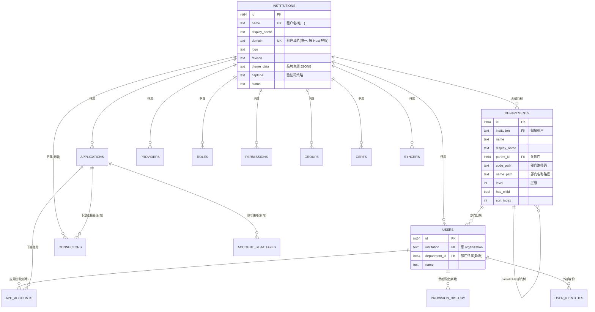
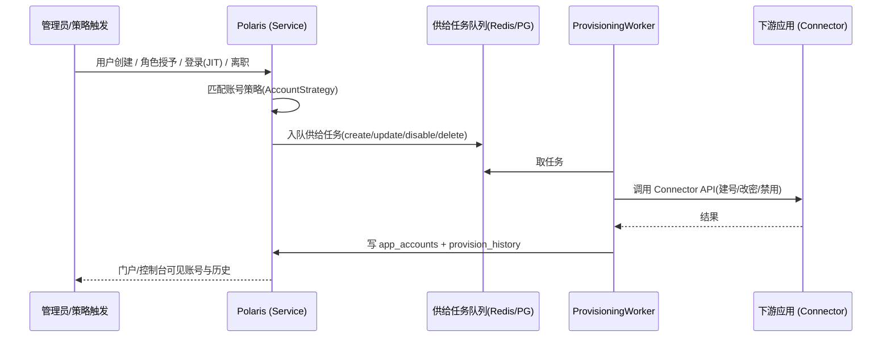

# Polaris 租户模型重构与 MaxKey 借鉴 · 设计与实施 Spec

> 状态：**已定稿（决策完整，无待定项）** · 创建：2026-10-10 14:36 · 依据：[MaxKey](https://github.com/dromara/MaxKey) 对标分析
> 范围：组织/租户模型重构、信息架构优化、应用账号供给与生命周期、用户自助门户、OIDC 深化与接入生态、CI/CD 基线
> 本文是后续实现的**唯一依据**。所有决策已收敛至 §2.1 ADR（D1–D8）。

---

## 1. 背景与目标

Polaris（原 Siming）是自研统一身份认证与访问管理平台（IAM / IdP），功能面参照 Casdoor，
工程规范参照 SkyPivot。当前存在三类问题（用户反馈）：

1. **缺关键业务功能**：只有"能登录"（SSO/OIDC），缺"能管账号"（应用账号供给与生命周期）、
   缺用户自助门户、缺真实接入生态（适配器 / 示例 / 文档）。
2. **交互 / IA 不好用**：资源归属维度与管理入口的组织方式需优化。
3. **工程完备性不足**：部署、发布链路不完整，无法作为产品交付。

本轮以 [MaxKey](https://github.com/dromara/MaxKey)（Dromara，Apache-2.0，Java/Spring 生态，42 张表）
为目标对标物，**借鉴其合理设计**并落地到 Polaris。

### 1.1 目标

1. **租户模型对齐 MaxKey**：引入**租户层（Institution）**作为隔离边界与资源归属维度；
   现有 `Organization` 降级为租户内的**部门树**。
2. **信息架构优化**：资源（用户 / 应用 / 组 / 角色 / 权限…）按租户维度收敛，交互路径清晰、可分享、可回退。
3. **补齐账号生命周期**：应用账号供给（建号 / 同步 / 离职回收）+ 账号策略 + 下游应用连接器。
4. **用户自助门户**：独立终端用户门户（应用中心 / 密码自助 / MFA / 社交绑定 / 会话 / 个人审计）。
5. **OIDC 深化 + 接入生态**：应用适配器（claim/属性映射）、真实接入示例、开发与接入文档。
6. **发布基线**：GitHub Actions CI + 打包发布到 Docker Hub。

### 1.2 非目标（本轮明确不做）

- **不引入 SAML 2.0 / CAS**：维持 OAuth2 / OIDC 协议矩阵（用户明确决策）。
- 不做 Casdoor 商业模块（产品 / 订单 / 支付 / 定价 / 套餐 / 优惠券 / 订阅 / 交易 / 余额）。
- 不做 Forms / Tickets / Webhooks（沿用现有边界，除非后续单独立项）。
- 不做应用内的**资源目录式细粒度授权**（`mxk_resources` + `mxk_permission`）——本轮**不选**，
  见 §2 澄清记录；如后续需要，作为独立 Spec。

### 1.3 与 MaxKey 的关系

借鉴**设计思想与能力面**，**不移植代码**（MaxKey 为 Java/Spring 技术栈，Polaris 为 Go/Gin）。
所有落地方案须符合 Polaris 现有架构红线（见 AGENTS.md §3.1：Handler→Service→Repository、
构造注入、DTO 脱敏、配置即生效、迁移不可变等）。

---

## 2. 问题澄清

> 本节记录澄清过程与用户的选择（决策依据）。提问工具：`AskUserQuestion`。
> 澄清后的**确定决策**统一收敛在 §2.1 的 ADR（D1–D8），全文不再保留待定项。

### 澄清问题 1：Polaris「无法生产可用」最卡的是哪一类？
- **提问方式**：AskUserQuestion（多选）
- **用户选择**：**交互 / IA 不好用**、**工程完备性不足**、**缺关键业务功能**
- **含义**：三个维度都要动，但功能以"补齐关键能力"为主、不做全面铺开。

### 澄清问题 2：本轮优先借鉴 MaxKey 的哪些能力？
- **提问方式**：AskUserQuestion（多选）
- **用户选择**：**应用账号供给与生命周期**、**用户自助与体验**、**多协议与接入生态**
- **含义**：三项进本轮；细粒度授权（`mxk_resources`/`mxk_permission`）未选，本轮不做。

### 澄清问题 3：组织层级模型怎么定？
- **提问方式**：AskUserQuestion（单选）
- **用户选择**：**拆出租户层（Institution）**，把 Organization 降级为部门树

### 澄清问题 4：多协议范围？
- **提问方式**：AskUserQuestion（单选）
- **用户选择**：**维持 OAuth2 / OIDC**（松绑 SAML/CAS 的问题被否决）
- **含义**：「接入生态」= OIDC 深化 + 适配器 / 示例 / 文档，而非新增协议。

### 澄清问题 5：资源到底挂在哪个维度？（第一决策）
- **提问方式**：AskUserQuestion（单选，含 URL/模型预览）
- **用户选择**：**A. 租户 > 部门（拆 Institution）**——资源归属到租户，Organization 变为部门树。

### 澄清问题 6：交付方式？
- **提问方式**：AskUserQuestion（单选）
- **用户选择**：**分期交付**（总纲 + 分阶段，逐期验收）

### 澄清问题 7：生产可用基线必须项？
- **提问方式**：AskUserQuestion（多选）
- **用户选择（自由文本）**：**"提供 github ci 发布，打包到 docker hub 就好了"**
- **含义**：工程完备性本轮的验收就是 **GitHub CI + Docker Hub 发布**；
  测试 / K8s / 可观测性本轮**不作为硬性必须项**（可在 CI 中顺带跑现有测试，但不作为验收门槛）。

### 2.1 决策记录（ADR，已裁决 · 无待定项）

> 本节把此前遗留的模糊点全部收敛为**确定决策**，作为实现的唯一口径；不再存在"待确认/如需要/或"。

**D1 · 术语分层与命名映射（终结"organization 到底指什么"的歧义）**

| 层 | 租户（Tenant） | 部门（树节点） |
|----|----------------|----------------|
| 数据库表 | `institutions` | `departments`（由 `organizations` 降级改名而来） |
| 归属外键列 | `institution` | （部门自身挂在 institution 下） |
| REST API / JSON 字段 | `institution` | `department` / `department_id` |
| URL 段 | `/institutions/:inst/...` | `/institutions/:inst/departments` |
| 中文 UI 文案 | 「组织」 | 「部门」 |
| 英文 UI 文案 | Organization | Department |

- 决策 A 已明确"资源归属到**租户**、Organization 降级为部门树"，因此 URL/API/schema 一律采用精确名
  `institution` / `department`，**不再保留 `organization` 作为租户的同义名**（避免"同名两义"的半成品）。
- 用户既有的「组织」一词作为**租户的中文 UI 标签**保留（一个租户＝用户眼中的"组织"，自然且贴合直觉）；
  英文/标识层统一为 `institution`。标识与标签的这层映射是**固定且一次性**的，非临时妥协。
- 旧地址 `/organizations/*` 由前端路由**整体重定向**到 `/institutions/*`（保留租户名与子路径），
  既有书签不失效——重定向是永久实现，不是过渡补丁。

**D2 · 部门不参与权限范围（本轮范围切割）**

- 部门仅作为**用户归属 + 列表筛选 / 统计**维度。
- **不引入**按部门继承权限、也不引入按部门的数据行级范围（RLS）。权限仍由「用户 / 角色 / 用户组」三者并集决定（与现状一致）。
- 理由：P1 聚焦"两级组织模型"本身；把权限继承混入会显著放大破坏性迁移（005）的风险面，且需要独立的权限语义设计。
  该能力列为**后续独立课题**，与本轮不耦合。

**D3 · 按域名解析租户（多租户入口）**

- `institutions.domain` **全局唯一**，存小写化主机名。
- 解析规则：取请求 `Host` 头（去除 `:port` 并小写化）→ 精确匹配 `institutions.domain` → 命中即该租户；
  未命中回退配置项 `auth.oauth.default_institution`（默认 `built-in`）。
- 理由：对齐 MaxKey `mxk_institutions.DOMAIN`，支撑"一次部署服务多个租户、各用独立域名"。
- 边界：单一组织部署时该机制透明（无 domain 记录即走默认租户）；域名解析**只决定租户**，不改变登录/建号策略。

**D4 · 配置键与前端存储键随重命名对齐**

- 配置：`auth.oauth.default_organization` → `auth.oauth.default_institution`，
  新增环境变量 `POLARIS_DEFAULT_INSTITUTION`（按 AGENTS §3.5，新配置项一律支持 env 覆盖）。
- 前端：`localStorage['polaris.organization']` → `polaris.institution`，读取时做一次旧键一次性迁移。
- 理由：杜绝"新模型仍留旧键"的错位。

**D5 · Connectors 独立成页（与 Syncers 分列）**

- Syncers（上游目录**拉取**，已存在）与 Connectors（下游应用**推送**供给，P2 新增）是两类资源，**各自独立**。
- 新页：`/institutions/:inst/connectors`。原"并入或新增"的含糊表述作废。

**D6 · 应用适配器取值范围（消除"可选"）**

- `applications.adapter` ∈ `{ default, custom }`。
- `adapter = "custom"` 时，`applications.adapter_config`（JSONB，结构 `{"claimMap": {"<claim>": "<userAttr>"}}`）生效；
  `default` 时忽略 `adapter_config`。
- 生效点：`service/oidc_service.go` 的 userinfo / id_token 签发路径（配置即生效，须接线）。

**D7 · 迁移 005 的验收门禁（把"建议"变为硬性 DoD）**

- `005_*.{up,down}.sql` 必须各在两种库验证通过：**(a) 空库**；**(b) 含存量数据**（≥2 个组织、跨组织同名用户、含角色/权限/用户组关联表数据）。
- 验证内容：迁移后各资源按租户隔离正确；`down` 可完全回滚到迁移前结构且**数据不丢**
  （`down` 由 `institution`/`departments` 还原出 `organization` 列与 `organizations` 表名、租户级属性列迁回原表）。
- 归入 P1 的 DoD 硬项（见 §4）。

**D8 · 术语裁定：`organizations` 表去向**

- `organizations` **改名并降级**为 `departments`（不保留旧表名）——保留旧名会让"organizations 其实是部门"长期误导维护者。
- 每个 institution 迁移时自动生成一个同名**根部门**，现有用户 `department_id` 回填指向该根部门；部门树由此起步。

**D9 · 角色 / 权限 / 安全管理 / 审计日志 提升为平台级（UI 重设计，2026-10-11 修订）**

- 依据新一轮原型（`frontend/web/tenant-console-prototype.html`）与用户裁定：**角色、权限、安全管理（证书 / 令牌 / 会话）、审计日志**在界面上作为**平台级（跨组织）一等资源**，置于顶部一级导航；不再作为组织内资源挂在 `/institutions/:inst/*` 下。
- 前端路由：`/roles`、`/permissions`、`/security/{certs,tokens,sessions}`、`/audit`（旧 `/certs|/tokens|/sessions|/records` 重定向到新地址）。
- 后端：列表端点新增 `scope=platform` 语义（`instOf` 返回空 `institution` 触达跨组织列表）；会话新增跨组织列举（Redis `SCAN polaris:session:*`）。
  **安全门禁**：`scope=platform` 仅对**平台管理员**（`is_admin` 或通配权限）生效，否则退回其所在组织，杜绝越权读取他组织数据。
- 组织内仍保留：用户 / 用户组 / 部门 / 应用 / 身份提供方 / 外部数据源 / 连接器 / 账号策略 / 应用账号 / 账号同步记录（工作区左侧导航）。
- 与 §3.2「租户内资源禁止做成全局菜单」的旧表述冲突处，以本 ADR 为准（该红线原意为"用户/应用等租户专属资源不得做成全局菜单"，角色/权限等平台治理资源不在此列）。
- 理由：角色/权限/证书常为跨组织统一治理对象，单组织部署下与"当前组织视角"等价，多组织下按平台视角呈现更贴合管理员心智。

---

## 3. 设计方案

### 3.1 目标领域模型（借用 MaxKey 的租户/部门分层）

MaxKey 的可借鉴点：`mxk_institutions`（**租户**，含独立域名 DOMAIN / 品牌 frontTitle / 验证码策略）
与 `mxk_organizations`（**部门树**，含 PARENTID / CODEPATH / LEVEL / HASCHILD / LDAPDN）分离。

Polaris 目标模型：



**关键变更**：

| 项 | 现状 | 目标 |
|----|------|------|
| 租户表 | 无 | 新增 `institutions`（多租户 + 域名 + 品牌 + 策略） |
| `organizations` | 租户 + 资源归属 | **改名降级**为 `departments`（部门树：parent_id / code_path / name_path / level / has_child / sort_index） |
| 资源表归属列 | `organization TEXT REFERENCES organizations(name)` | 改为 `institution TEXT REFERENCES institutions(name) ON DELETE CASCADE` |
| `users` | 无部门 | 新增 `department_id`（可空，指部门树节点；迁移时回填到所属根部门） |
| 登录租户解析 | 按 organization 名 / 默认组织 | 增加**按域名（Host / institutions.domain）解析租户**（D3） |
| 应用适配器 | 无 | 新增 `applications.adapter` + `applications.adapter_config`（D6，P4 生效） |

> 命名口径以 §2.1 ADR D1 为准：schema/API/URL 一律 `institution` + `department`；
> 仅**中文 UI 标签**把 institution 显示为「组织」（D1）。

**迁移策略（`migrations/005_tenant_institution.up.sql`）**：现有数据库仍处于开发态（v0.1），
采用**一次性结构迁移**（表名、列名一次到位，不留旧名残迹）：

1. 建 `institutions`；把每个 `organizations` 记录 1:1 复制为 institution
   （`name` / `display_name` / 品牌 `logo`·`favicon`·`theme_data` / 密码策略 / `mfa_items` / 会话与保留策略等
   租户级属性迁移过去）；`domain` 初始留空（由管理员配置，见 D3）。
2. `organizations` **改名为 `departments`**（`ALTER TABLE ... RENAME`）：新增 `institution` 外键列并回填
   （= 自身对应的 institution），新增 `parent_id` / `code_path` / `name_path` / `level` / `has_child` / `sort_index`
   （默认 0/空），并**移除**已迁往 institution 的租户级属性列；每个 institution 自动创建一个同名**根部门**（D8）。
3. 所有资源表（users / applications / providers / roles / permissions / groups / certs /
   tokens / records / syncers）新增 `institution` 列，从原 `organization` 回填，再补外键与索引，
   最后删除旧的 `organization` 列（回滚脚本中该列的还原见下）。
4. `users` 新增 `department_id` 并回填到所属根部门。
5. 种子数据（`internal/app/seed.go`）改为：内置租户 `built-in`（institution）+ 其根部门 + 管理员。

> 由于迁移不可变（AGENTS.md §5），以上全部在**新增迁移 005** 中完成，不修改 001–004。
> 回滚脚本 `005_*.down.sql` 必须可逆且**不丢数据**：`departments` 改回 `organizations`、
> 各资源表 `institution` 列改回 `organization` 并回填（由 institution 名还原），租户级属性列迁回。

### 3.2 信息架构（IA）优化

**目标：资源按租户维度收敛，交互路径清晰。**（URL 中的 `:inst` 即租户；中文 UI 标签显示为「组织」，见 D1）

```
PLATFORM（平台级，跨租户；顶部一级导航）
  Dashboard（跨租户总览）           /                             （按 institution 聚合）
  Organizations（租户列表）          /institutions                 （列表项 UI 文案：组织）
  Roles / Permissions              /roles | /permissions          （跨组织，D9）
  Security（安全管理）              /security/certs|tokens|sessions （跨组织，D9）
  Audit logs                       /audit                         （跨组织，D9）

<租户>（= 一个"组织"，数据层为 institution；左侧工作区导航）
  Overview                         /institutions/:inst
  Departments（部门树）             /institutions/:inst/departments
  Users / Groups                   /institutions/:inst/users|groups
  Applications / Providers         /institutions/:inst/applications|providers
  Syncers                          /institutions/:inst/syncers
  Connectors                       /institutions/:inst/connectors
  Account strategies               /institutions/:inst/account-strategies
  App accounts                     /institutions/:inst/app-accounts
  Provisioning history             /institutions/:inst/provisioning

PORTAL（终端用户门户，独立入口）   /portal/...
```

**交互约定（沿用并强化现有前端红线，见 AGENTS.md §7.4）**：

- 租户由 URL 承载：`/institutions/:inst/...`，可分享 / 可回退；切换租户保留当前子路径。
- 平台级资源由 URL 承载（`/roles`、`/security/*`、`/audit`），跨组织；后端以 `scope=platform` 表达（D9）。
- **旧地址兼容**：`/organizations/*` 由路由整体重定向到 `/institutions/*`（保留租户名与子路径）；
  旧 `/certs|/tokens|/sessions|/records` 重定向到 `/security/*` 与 `/audit`——永久实现，非过渡补丁（D1、D9）。
- 资源引用一律下拉：多选 `MultiSelect`、可搜索单选 `Combobox`（"部门""连接器"等引用同样遵循）。
- 单页分区表单（不用向导）；租户专属资源（用户/应用等）不得做成全局菜单（D9）。
- "部门树"页面：左侧树 + 右侧详情/成员，支持上下移动调整层级（parent/排序）。

### 3.3 应用账号供给与生命周期（P2，借鉴 MaxKey）

MaxKey 的可借鉴点：`mxk_accounts`（本地用户 × 应用 → 下游账号）、`AccountsStrategy`（账号策略）、
`mxk_connectors`（下游连接器，RESTful principal/credentials）、`ProvisioningThread`（异步供给）、
`mxk_history_provisions`（供给历史）、`mxk_synchronizers`（拉取，Polaris 已有同类 Syncer）。

**Polaris 落地：在现有 Syncer（拉取）之外，新增"推送型"供给（Provisioning）。**



**新增实体（`internal/repository/models.go`）**：

- `AppAccount`：institution、application、user、username（本地）、related_username（下游）、
  related_password（AES-GCM 加密）、create_type（automatic/manual）、status。唯一键 (institution, application, user)。
- `AccountStrategy`：institution、application、name、mapping（本地属性 → 下游属性，JSON）、
  policy（何时建号：手动 / 首次登录 JIT / 授权即建；何时回收：禁用 / 删除 / 离职）。
- `Connector`：institution、application、name、provider_url、principal、credentials（加密）、
  filters、just_in_time、schedule、状态。**复用**现有 `service/syncer/http.go` 的 HTTP 客户端基础设施。
- `ProvisionHistory`：institution、connector、app_account、action、status、message、时间。

**服务与接线（"配置即生效"）**：

- `service/provisioning_service.go`：任务编排 + 与用户/角色变更事件挂钩。
- 触发点必须接线：用户创建 / 状态变更（禁用、离职）/ 角色授予 / 登录成功的 JIT 分支。
- 异步执行：进程内工作池 + `scheduler` 兜底重试（对齐现有 scheduler 模式）；
  多实例去重问题在 §5「已知限制」中说明。
- 敏感字段（下游口令、连接器凭证）一律 AES-GCM 落库，接口只返回 `has_*`（对齐 AGENTS.md §3.1-7）。

### 3.4 用户自助门户（P3，借鉴 MaxKey web-app）

MaxKey 的可借鉴点：独立门户应用（`web-app`）——应用中心（应用网格 + 点击 SSO）、
密码自助（`config/password`）、MFA（`config/mfa`）、社交账号自助绑定（`config/socials-associate`）、
个人会话（`routes/access/sessions`）、个人审计（`routes/audit`）、凭据（`authz/credential`）。

**Polaris 落地：新增 `/portal` 前端区（与 `/institutions/...` 控制台并存，共享 API 与 shared/ui）。**

| 页面 | 能力 | 复用 |
|------|------|------|
| 应用中心（工作台） | 展示当前用户被授权访问的应用网格，点击即发起 OIDC SSO | 复用 `/auth/oauth/...` 与 app 列表 |
| 个人资料 | 已有 `profile-dialog` 升级为门户页 | 现有 `features/profile` |
| 密码自助 | 改密 | 现有 `/auth/change-password` |
| MFA | TOTP 设置 / 恢复码 | 现有 `/auth/mfa/*` |
| 社交 / 身份绑定 | 查看 / 解绑外部身份（+绑定入口） | 现有 `user identities` 接口 |
| 会话 | 查看 / 撤销自己的会话 | 现有 `/sessions` |
| 个人审计 | 自己的登录与操作记录 | 现有 `/records`（按当前用户过滤） |
| 我的应用账号 | 查看自己在各下游应用中的账号（P2 产物） | 新增只读接口 |

> 门户为**独立的终端用户入口**（不同导航与品牌氛围），但不新建技术栈：
> 复用 `frontend/web`，新增 `/portal` 路由组 + `<PortalLayout>`，页面懒加载（红线 §7.3-7）。

### 3.5 OIDC 深化 + 接入生态（P4）

**（a）应用适配器（Adapter）**：借鉴 `mxk_apps_adapters`——为应用挂一个"出口映射"，
决定 userinfo / id_token / access_token 的**属性与 claim 映射**。

- 新增 `applications.adapter` ∈ `{ default, custom }`；`custom` 时以 `applications.adapter_config`
  （JSONB，`{"claimMap": {"<claim>": "<userAttr>"}}`）驱动映射（D6）。
- `default`：标准 OIDC claims（现状行为）；`custom`：按 `claimMap` 覆盖 claim 值。
- 生效点：`service/oidc_service.go` 的 userinfo / id_token 签发路径（必须接线，配置即生效）。

**（b）OIDC 深化**：
- 前端 / 后端 channel 登出（`backchannel_logout_uri` 已建模，补齐实际发送）。
- JWKS **多密钥并存 + 平滑轮换**（当前"已知限制"）。
- 按 scope 更完整的 claim（profile / email / phone / roles / groups 已具雏形，补齐 offline_access 等）。

**（c）接入示例（`examples/`）**：Spring Boot OAuth2 Client（对照 MaxKey 的 `integrations/`）、
最小纯 OIDC 客户端各一，可跑通端到端登录。

**（d）文档（`docs/`）**：接入指南（如何把业务系统接成 OIDC 客户端）、
API 参考、部署手册、账号供给接入指南（Connector 契约）。

### 3.6 发布基线（P0，贯穿）

用户明确：**"提供 github ci 发布，打包到 docker hub 就好了"**。

- `.github/workflows/ci.yml`：`go vet` / `go test ./...` / 前端 `pnpm test`（typecheck + vitest + build）。
- `.github/workflows/release.yml`：打 tag → buildx 多架构（amd64/arm64）构建**一体镜像**（后端 + 前端静态 + nginx）
  → 推送 Docker Hub（已落地，见 §4 P0）。
- `Dockerfile`（多阶段：node 构建前端 → Go 构建后端 → nginx 运行镜像，单镜像承载全部）。
- 版本/标签策略：`latest` + `vX.Y.Z`；`docker-compose.yml` 引用发布镜像。

---

## 4. 实施计划（分期交付）

> 每期独立可验收；P0 贯穿。验收标准即"完成定义 (DoD)"。

### P0 · 发布基线（可最先交付，快速见效）
- [ ] 多阶段 `Dockerfile`（后端 + 前端静态资源）
- [ ] `.github/workflows/ci.yml`（vet + 后端测试 + 前端测试）
- [ ] `.github/workflows/release.yml`（tag → buildx → Docker Hub 推送）
- [ ] README 增补"用官方镜像部署"章节
- **DoD**：打一个 tag 后 Docker Hub 出现镜像，`docker compose` 能拉起可用实例。

### P1 · 租户层重构 + IA（已完成）
- [x] 迁移 005：`institutions` 建表；`organizations` **改名 `departments`** 并降级为部门树；
      资源表 `organization → institution`（列 + 外键 + 索引）；`users.department_id`；租户级属性迁往 institution
- [x] 迁移 005 **双向验证门禁（D7）**：空库 + 存量数据（2 组织、跨组织同名用户、含关联表）下 up 正确、down 无损；并由 Go migrator `-migrate-down/-migrate` 实测通过
- [x] 配置：`default_organization → default_institution` + `POLARIS_DEFAULT_INSTITUTION`（D4）
- [x] 仓储层：`institution_repo`（含 `GetByDomain`）；各资源仓储 `organization → institution`；新增 `department_repo`
- [x] 服务层：登录**按域名解析租户**（D3）；租户解析逻辑对齐
- [x] 前端：租户上下文（localStorage 键 `polaris.institution`，含旧键迁移，D4）、部门树页面；
      URL 改为 `/institutions/:inst/...` 并对旧 `/organizations/*` 做整体重定向（D1）
- [x] 种子数据改造（内置租户 + 根部门 + 管理员）；冒烟用例更新（含部门 CRUD）
- **DoD**：多租户下资源隔离正确；部门树可增删（移动=删建）；域名可定位租户；旧 URL 重定向生效；全部现有测试通过；迁移 005 双向门禁通过。
- **实测**：Go `build/vet/test` 全绿；前端 `typecheck + vitest(17) + build` 全绿；端到端冒烟 24 步全通过；
  Go migrator 在已初始化库上 down→up 往返成功且数据保留。

### P2 · 应用账号供给与生命周期（已完成）
- [x] 实体 + 迁移：`app_accounts` / `account_strategies` / `connectors` / `provision_history`（迁移 006，up/down 在空库与存量数据两场景验证通过）
- [x] 服务：`provisioning_service` + 工作池（进程内 4 worker）+ 触发点接线（创建 / 禁用 / 离职 / 角色 / JIT 登录）
- [x] 连接器：复用 `service/syncer` HTTP 基础设施，`provisioner` 包输出统一的"建号/改密/启用/禁用/删除"契约
- [x] 控制台页面：连接器、账号策略、应用账号、供给历史（含连通性自检与手动重试）
- [x] 门户"我的应用账号"只读视图（个人资料弹窗）
- **DoD**：本地用户在授权应用上自动建号；禁用/离职触发回收；全过程可在历史中追溯。
- **实测**：Go `build/vet/test` 全绿；前端 `typecheck + vitest(17) + build` 全绿；
  `scripts/smoke-test.sh` 80 项断言全通过；端到端（真实 Postgres + Redis + 模拟下游 HTTP 服务）验证：
  创建用户 → 自动建号（下游收到含解密凭证的 POST /accounts、应用账号 status=active、供给历史 create/success）→
  禁用用户 → 下游收到 disable、应用账号 status=disabled、供给历史 disable/success；连接器凭证 AES-GCM 加密落库（接口仅返回 `has_credentials`）。

### P3 · 用户自助门户
- [x] `/portal` 路由组 + `PortalLayout`（独立导航与品牌氛围）
- [x] 应用中心（应用网格 + 一键 SSO）；资料 / 改密 / MFA / 身份绑定 / 会话 / 个人审计- [x] 门户与既有 `profile` / `auth` 能力复用，删除重复入口
- **DoD**：终端用户无需进入管理控制台即可完成全部自助操作。
- **实测**：Go `go test ./...` 全绿；前端 `pnpm test`（typecheck + vitest 19 项 + build）全绿；
  新增个人身份/会话/审计接口的用户归属回归测试，以及门户应用入口 URL 安全测试。
- **实现说明**：门户会话、身份、审计、应用账号与应用列表均由后端从当前会话固定租户/用户范围；
  应用中心展示本人有效供给账号对应的启用应用，以及配置了启用 JIT 连接器的应用。身份绑定 state 绑定发起会话，
  解绑/会话管理/改密均只作用于本人。真实 OAuth 提供方与下游 OIDC 客户端的端到端跳转需在已配置环境验证。

### P4 · OIDC 深化 + 接入生态（已完成，examples 除外）
- [x] 应用适配器（default / custom）+ userinfo/id_token 生效接线（迁移 007：`applications.adapter` + `adapter_config`）
- [x] 前后端 channel 登出实际发送（`service/backchannel_logout.go`；logout_token 含 events，RS256 签名）；JWKS 多密钥轮换（CertManager 多密钥 + `POLARIS_OIDC_ADDITIONAL_KEY_CERT_NAMES`）
- [x] `offline_access` 生效：refresh_token 仅在 scope 含 `offline_access` 且应用允许刷新时下发（`shouldIssueRefresh`）
- [ ] `examples/`（Spring Boot OAuth2 Client / 最小 OIDC 客户端）——**本轮不做**（用户决定暂不提供）
- [x] 接入 / API / 部署 / 供给文档（`docs/oidc-integration.md`、`docs/api-reference.md`、`docs/deployment.md`、`docs/provisioning-connector.md`）
- **DoD**：示例可跑通端到端登录（本轮无示例，缺省）；文档可指导第三方独立接入（已满足）。
- **实测**：Go `build/vet/test` 全绿（新增 adapter/多密钥轮换/logout_token/后端登出投递测试）；
  前端 `typecheck + vitest + build` 全绿；迁移 007 双向门禁通过（空库 + 存量数据，down 无损、up 复原安全）。
  说明：`examples/` 未提供（用户本轮决定）；示例端到端登录留待后续。

### 登录/控制台/SSO 入口收敛（对齐 Casdoor）
- [x] 控制台准入：管理控制台仅对"有管理权限"者开放（系统管理员或委派管理员）；纯终端用户登录后落地 `/portal`（`RequireConsoleAccess`）
- [x] 登录页默认**不再显示组织选择器**：组织由域名/应用/后端自动解析；仅应用 `org_choice_mode=Select/Input` 或账号歧义（`INSTITUTION_REQUIRED`）时才展示
- [x] 租户解析：账号**唯一命中优先于默认租户**（多租户下非默认组织的用户才能免选登录）
- [x] 应用驱动登录页：`/oauth/authorize` 未登录时 **302 到 `/login` 并保留 OAuth 参数**；登录页按 `client_id` 渲染应用品牌，登录成功后**续走授权、回跳 `redirect_uri`**（对齐 Casdoor `/login/oauth/authorize`）
- **验证**：Go `build/vet/test` 全绿（新增解析优先级测试）；前端 typecheck + vitest(22) + build 全绿；
  端到端冒烟全通过，并实测"未登录 authorize → 302 到 /login"、"app-info?client_id 解析应用"。

### 补强（spec 复核后的 4 项 + 1 安全修复）
- [x] **安全**：连接器创建忽略实体 `credentials` 字段，凭证仅经 `credentials_plain` 加密入库（杜绝明文旁路）
- [x] **P2 触发点覆盖**：验证码登录与 SSO 回调也触发 JIT；SSO/验证码 JIT 建号后触发 `onCreate` 供给；组成员变更触发 `onGrant` 供给
- [x] **P3 门户应用中心一键 SSO**：应用网格改为发起 OIDC 授权请求（`buildAuthorizeURL` → `/oauth/authorize`）；后端 `/me/applications` 增补 `client_id`/`redirect_uri`
- [x] **P1 部门树**：左侧树 + 右侧详情/成员；同级上/下移动（`POST /departments/:name/reorder`，`sort_index` 落库）；成员视图（`GET /departments/:name/members`）
- [x] **P4 `offline_access`**：见上


### 当前进度
- 已完成：MaxKey 对标分析、需求澄清、本 Spec 撰写。
- 已完成：**P0 发布基线**（Dockerfile 一体镜像 + CI + Release + compose + README 部署章节）。
  - 交付物：`Dockerfile`、`.dockerignore`、`docker/nginx.conf`、`docker/entrypoint.sh`、
    `.github/workflows/ci.yml`、`.github/workflows/release.yml`、`docker-compose.yml`、`README.md`。
  - 附带修复：`internal/config/config.go` 补齐 `POLARIS_REDIS_HOST/_PORT/_DB` 环境变量覆盖（+测试）。
  - 验证：`go build ./...` / `go vet ./...` / `go test ./...` 全绿；前端 `pnpm test`（typecheck+vitest+build）通过；
    Dockerfile 后端构建复现成功（静态二进制 43MB）；compose 与 workflow YAML 解析通过。
  - 待人工验证（本机无 Docker）：实际 `docker compose up` 与镜像推送需在 CI/本地 Docker 环境确认。
- 已完成：**P1 租户层重构 + IA**（迁移 005、实体/仓储/服务/handler/DTO、域名解析租户、部门树页面、前端 URL 与上下文、冒烟与文档同步）。
  - 验证：Go build/vet/test 全绿；前端 typecheck + vitest + build 全绿；端到端冒烟 24 步通过；迁移 005 双向门禁（空库/存量数据/Go migrator 往返）通过。
- 已完成：**P2 应用账号供给与生命周期**（迁移 006 + `provisioner` 契约 + `provisioning_service` 工作池 + 触发点接线 + 4 个控制台页面 + 门户只读视图）。
  - 交付物：迁移 `006_provisioning.{up,down}.sql`；`internal/service/provisioner/`；
    `internal/service/provisioning_service.go`；`internal/repository/postgres/{connector,account_strategy,app_account,provision_history}_repo.go`；
    `internal/handler/provisioning_handler.go`；前端 `features/iam/pages/{connectors,account-strategies,app-accounts,provisioning}-page.tsx`。
  - 验证：Go build/vet/test 全绿（新增 provisioning/provisioner/DTO/columnExpr 回归测试）；前端 typecheck + vitest(17) + build 全绿；
    `scripts/smoke-test.sh` 80 项断言全通过；端到端（真实 PG+Redis+模拟下游）验证"自动建号 / 禁用回收 / 历史可追溯"。
- 已完成：**P3 用户自助门户**（独立 `/portal` 路由组、应用中心、个人资料与头像、改密/MFA、身份绑定/解绑、
  本人会话与个人审计、我的应用账号；侧栏资料入口转入门户并移除重复弹窗）。
  - 交付物：`frontend/web/src/features/portal/` 页面/API/布局；后端 `/me/applications`、
    `/me/identities`、`/me/sessions`、`/me/records` 自助路由；一次性会话绑定的外部身份绑定流程。
  - 验证：Go `go test ./...` 全绿；前端 typecheck + vitest(19) + build 全绿。
- 已完成：**P4 OIDC 深化 + 接入生态**（应用适配器、back-channel 登出、JWKS 多密钥轮换、四份接入/API/部署/供给文档；`examples/` 未做）。
  - 交付物：迁移 `007_application_adapter.{up,down}.sql`；`internal/service/application_policy.go`（`applyAdapter`）、
    `internal/service/backchannel_logout.go`、`internal/auth/oidc/{cert,issuer}.go`（多密钥 + logout_token）；
    `docs/{oidc-integration,api-reference,deployment,provisioning-connector}.md`；前端应用表单适配器分区 + i18n。
  - 验证：Go `build/vet/test` 全绿（adapter、多密钥轮换、logout_token 结构、后端登出投递测试）；
    前端 typecheck + vitest + build 全绿；迁移 007 up/down 双向门禁（空库 + 存量数据）通过。
- 已完成：**补强（spec 复核后的 4 项 + 1 安全修复）**。
  - 安全：连接器创建忽略实体 `credentials` 字段（`provisioning_service.CreateConnector`），凭证仅经 `credentials_plain` 加密入库；应用仓库 `normalizeApplication` 兜底 `adapter`。
  - 触发点：验证码登录 / SSO 回调触发 JIT；SSO/验证码 JIT 建号触发 `onCreate`；组成员变更触发 `onGrant`。
  - 门户：应用中心一键 SSO（`buildAuthorizeURL`），`/me/applications` 增补 `client_id`/`redirect_uri`。
  - 部门树：左树 + 右详情/成员 + 同级上/下移动（`department.reorder` + `SetSortIndex` + `department.members`）。
  - 验证：Go `build/vet/test` 全绿（新增连接器凭证安全、`shouldIssueRefresh`、部门 reorder 测试）；前端 typecheck + vitest(22) + build 全绿；
    端到端冒烟（真实 PG + Redis + 内置种子）全通过。
- 下一步：`examples/` 接入示例（Spring Boot OAuth2 Client / 最小 OIDC 客户端）为唯一遗留项，按用户决定留待后续。
- 阻塞：无。
- §2.1 遗留点已全部裁决为 ADR D1–D8（无待定项）。

### 前端重设计（原型驱动，2026-10-11）

- 依据新原型 `frontend/web/tenant-console-prototype.html` 重写控制台外壳与列表页视觉/交互（顶部平台级导航 + 左侧组织工作区导航 + 概况条 + 工具栏 + 表格 + 分页）。
- IA 调整（见 D9）：角色 / 权限 / 安全管理（证书 / 令牌 / 会话）/ 审计日志 提升为**平台级（跨组织）**。
  - 前端：新增平台级路由 `/roles`、`/permissions`、`/security/{certs,tokens,sessions}`、`/audit`；旧地址重定向。
  - 后端：列表端点 `scope=platform`（`instOf` 空机构 = 跨组织）+ 会话跨组织列举（Redis `SCAN`）；
    **仅平台管理员**可越过组织边界，非管理员退回本组织（`internal/handler/context.go`）。
- 交付物：设计令牌调整（`styles/globals.css`）；外壳 `widgets/layout/{app-layout,platform-layout,workspace-layout,top-bar,app-sidebar,nav-list,institution-switcher,account-menu,page-shell,summary-strip,list-toolbar,list-pagination,nav-config}`；
  共享件 `shared/components/status-pill.tsx`；平台页 `features/iam/pages/{roles,permissions,certs,tokens,sessions,records}-page.tsx` 与 `components/security-subnav.tsx`。
- 保留：深色模式、中英双语 i18n、终端用户门户 `/portal`。
- 验证：Go `build/vet/test` 全绿；前端 `typecheck + vitest(22) + build` 全绿；`scope=platform` 管理员门禁单测（`internal/handler/context_test.go`）。
- 参考实现的登录/入口模型对标 Casdoor（`/login/oauth/authorize` 应用驱动登录、控制台准入、组织不强制选择）。

---

## 5. 非功能需求

| 项 | 要求 |
|----|------|
| 架构红线 | 严守 AGENTS.md §3.1：分层、构造注入、DTO 脱敏、配置即生效、迁移不可变、权限变更即失效 |
| 多租户隔离 | 所有业务表以 institution 为归属维度并建外键 `ON DELETE CASCADE`；查询一律按 institution 收口 |
| 安全 | 下游口令 / 连接器凭证 AES-GCM 加密落库；接口仅返回 `has_*`；新增端点沿用限流与 CSRF 语义 |
| 兼容性 | 迁移 005 一次性结构变更（表名/列名一次到位），回滚脚本无损可逆；旧 URL `/organizations/*` 由前端路由重定向到 `/institutions/*`（D1） |
| 可观测 | 供给 / 同步 / 租户解析等关键链路带 trace_id（沿用现有 tracing），失败写审计 |
| 前端 | 页面懒加载；i18n 中英同步；资源引用用 MultiSelect/Combobox；不引入裸色值 |
| CI/CD | GitHub Actions：CI（vet+test）+ Release（buildx→Docker Hub） |
| 已知限制 | 进程内 scheduler 多实例会重复触发（供给/同步）→ 后续引入 PG advisory lock；本轮记录不解决 |

---

## 6. 风险与边界

1. **破坏性迁移**：P1 改动全部业务表的归属列。**门禁（D7）**：005 的 up/down 必须在空库与存量数据两种场景验证通过（P1 DoD 硬项，不再只是建议）。
2. **术语映射**：数据层 `institution`／UI 中文「组织」的映射是固定口径（D1）——定名一次到位，不留旧名残迹；实现者按 §2.1 D1 对照表执行即可，无歧义。
3. **体量大**：四期 + P0，需按序推进；本 Spec 为总纲，每期可再拆子任务。
4. **供给一致性**：下游建号失败需可重试且幂等（以 (institution, application, user) 为幂等键）。
5. **门户范围蔓延**：门户仅做"自助"，不做管理；避免与租户内资源页重复。

---

## 7. 附录

### 7.1 MaxKey → Polaris 借鉴对照

| MaxKey 概念 | 表/位置 | Polaris 落地 | 期 |
|-------------|---------|--------------|----|
| 租户 Institution | `mxk_institutions`（域名/品牌/验证码） | `institutions`（租户层） | P1 |
| 部门树 Organization | `mxk_organizations`（PARENTID/CODEPATH/LEVEL/LDAPDN） | `departments`（由 `organizations` 改名） | P1 |
| 应用账号 | `mxk_accounts` | `app_accounts` | P2 |
| 账号策略 | `AccountsStrategy` | `account_strategies` | P2 |
| 连接器 | `mxk_connectors` | `connectors` | P2 |
| 供给历史 | `mxk_history_provisions` | `provision_history` | P2 |
| 应用适配器 | `mxk_apps_adapters` | `applications.adapter` | P4 |
| 用户门户 | `web-app`（应用中心/自助） | `/portal` | P3 |
| 终端门户品牌 | `frontTitle`/`CONSOLETITLE` | 门户布局与品牌 | P3 |

### 7.2 明确不借鉴

- SAML 2.0 / CAS / FormBased / TokenBased / ExtendApi / EXT 协议（用户决策：维持 OAuth2/OIDC）。
- 资源目录式细粒度授权（`mxk_resources` / `mxk_permission`）——本轮未选。
- 商业模块、Forms、Tickets、Webhooks（沿用现有边界）。
- MaxKey 的 Java/Spring 实现细节（仅借鉴设计思想，不移植代码）。

### 7.3 参考

- Polaris：`README.md`、`AGENTS.md`、`docs/specs/polaris-iam-platform.md`
- MaxKey：`README_zh.md`、`sql/v4.1.6/maxkey.sql`、`maxkey-core/.../entity/`
