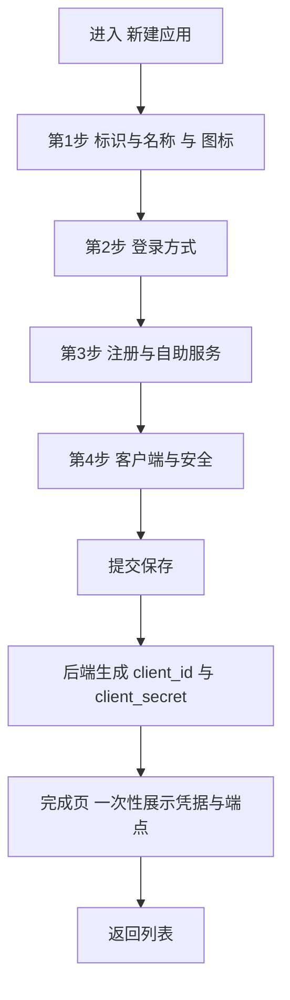
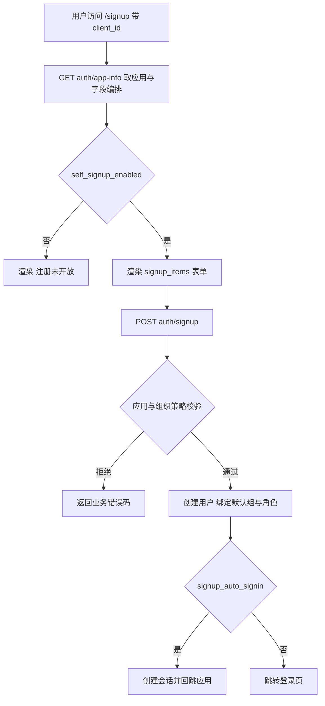
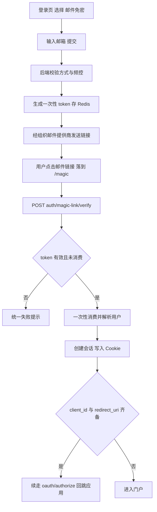
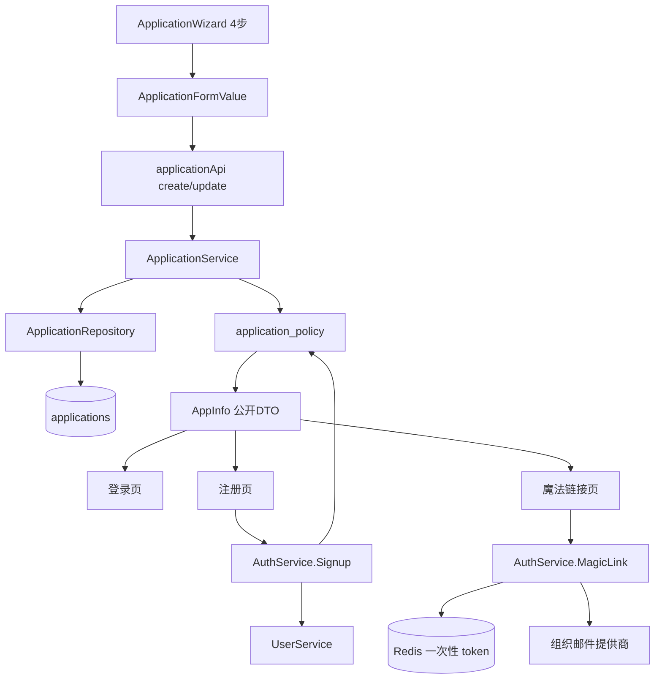

# 应用管理模块优化 · 第二阶段 Spec（登录方式重做 + 魔法链接 + 独立注册页 + 标识改名）

**创建**：2026-10-13 · **版本**：1.2 · **作者**：Agent
**状态**：**已完成（Completed）**（用户批准：2026-10-13「你来实施一版吧」）
**修订**：v1.1（2026-10-13）——纳入用户对 4 项决策的答复：确认托管注册页；魔法链接提前到本阶段；死配置前后端一并删除；应用标识改名为 `code`、`display_name` 改名为 `name`。
**修订**：v1.2（2026-10-13）——登录页预览改为**按需弹窗**（对齐组织创建/编辑），废弃右侧常驻卡片预览（FR-11）。

> 状态流转：`Draft` → `Awaiting Confirmation`（本文档已写出）→ `Confirmed`（用户批准）→ `In Progress` → `Completed`。
> 确认后如范围/设计变更，需递增版本号。
> 前置：第一阶段（组织模块）已完成，见 `docs/specs/261013-org-module-phase1.md`。
> 约束依据：`AGENTS.md` §1「配置即生效」、§3.1-7（敏感字段不得下发）、§3.1-10（禁止未接线死代码）、§4（认证授权流程）、§7.3/§7.4（前端红线与信息架构）、`docs/design-language.md` §4（表单与向导）。

---

## 1. 概述

本阶段把「应用（OAuth2/OIDC 客户端）」的新建与编辑，从"一屏罗列 Casdoor 遗留布尔开关"重构为**以「登录方式」为中心的向导**：管理员显式添加登录方式（密码 / 邮箱验证码 / 短信验证码 / **邮件魔法链接** / 第三方登录 / 访客登录），每种方式按需展开自己的配置字段；注册（自助注册）独立成一步配置，并配套一个**面向终端用户的托管注册页 `/signup`**；客户端凭据（`client_id` / `client_secret`）不再由人填写，保存后自动生成并**仅一次性展示**；回调地址改为可逐行增删的列表编辑器；应用标识字段改名为**标识（`code`）**（仅小写字母/数字/`-`/`_`，创建后不可修改），原「显示名称」改名为**名称（`name`）**。

交付后：组织管理员可在 1 分钟内、无需理解 OAuth 细节，配置出一个可被真实应用接入的登录入口；终端用户可自行注册、也可用邮箱魔法链接免密登录；后台**任何可见配置都在运行时真实生效**（清偿现存 5 处死配置与 1 处密钥下发缺陷）。

---

## 2. 背景

### 2.1 问题 / 上下文（来自用户反馈）

| # | 用户诉求 | 现状（代码事实） | 本阶段处理 |
|---|---|---|---|
| 1 | 第一部分「基本信息」应明确包含名称、Icon 等 | `application-wizard.tsx` 第 0 步混装了「类型 / 分类 / 元信息 / 品牌素材 / 描述」四个 `FormSection`，且 `logo / logo_dark / favicon` 为**纯文本输入框**，未接入第一阶段的 `UploadOrUrl` | FR-1 / FR-7 |
| 2 | 认证模块太蠢：同时出现 `Allow self sign-up` 与 `Disable self sign-up` 相悖开关 | `loginSwitches`（wizard 第 40–87 行）平铺 **10 个开关**；`enable_sign_up` 与 `disable_self_signup` 语义**直接冲突**（后端 `auth_service.go:767/770` 两者都必须为真才放行） | FR-2 / FR-3 |
| 2 | 希望「可以添加多种登录方式，每种方式按需展示对应字段」 | 后端**已有** `applications.signin_methods` JSONB 列（迁移 002）与 `repository.SigninMethod` 结构，但**全仓无任何运行时读取点**——只被 `buildAppInfo` 原样回显，前端登录页从不读它 | FR-2 |
| 2 | （补充）魔法链接现在就做 | 无魔法链接能力；但有可复用的邮箱提供商发送、限流与人机校验基建（`SendLoginCode`） | FR-9 |
| 3 | 注册应是单独的页面 | **前端不存在任何终端用户注册页**；`login-page.tsx` 不渲染注册入口；只有后端 `POST /api/v1/auth/signup` 与 `signup_url` 字段 | FR-4 |
| 4 | 客户端 ID 等不要自己填，保存后自动生成 | 后端 `application_service.go:36-41` 已在为空时生成随机值；但向导仍展示 `client_id` 输入框（只读 + "生成"占位符），制造"这该我填"的错觉 | FR-5 |
| 5 | 回调地址可填多个，一行一行加 | 现状是 `Textarea`，靠 `splitLines()` 按**换行与逗号**切分，无格式校验、无去重、无增删行交互 | FR-6 |
| 6 | （补充）字段换个叫法 | 现有「名称」实为标识、「显示名称」实为人类可读名，语义倒置 | FR-10 |
| 7 | （补充）登录页预览不要「现在这样」 | 应用向导用 `FormWizard` 的 `aside` 做**右侧常驻卡片预览**（`AppLoginPreview`）；而组织创建/编辑用的是**按需弹窗 + 整页等比还原**（`LoginPagePreview`） | FR-11 |

### 2.2 代码研究小结（澄清前已核实的代码事实）

**主要文件**

- 前端：`features/iam/pages/application-edit-page.tsx`（280 行）、`components/application-wizard.tsx`（708 行）、`components/application-form.tsx`（336 行，含 `ApplicationFormValue` 与双向映射）、`components/app-login-preview.tsx`、`pages/applications-page.tsx`、`features/auth/login-page.tsx`、`shared/api/types.ts`
- 后端：`service/application_service.go`、`service/application_policy.go`（登录/注册/会话/scope/claim 的运行时生效逻辑 + 公开 `AppInfo`）、`handler/application_handler.go`、`handler/dto_resource.go`（`applicationDTO`）、`service/auth_service.go`（`Signup` / 登录）、`service/auth_code.go`（`SendLoginCode`，含限流 + 人机校验 + 邮件发送）、`service/oidc_service.go`、`server/router.go`
- 数据：`migrations/001_init.up.sql`、`002_application_provider_extended.up.sql`（`signin_methods` / `signup_items` / `signin_items`）、`repository/models.go`、`repository/postgres/mapper.go`（反射式列映射）、`repository/redis/`（`state_store.go` / `code_store.go` / `ratelimit_repo.go`）

**已确认事实（复用点与约束）**

1. **反射式列映射已就绪**：`applications` 实体 >40 列，列清单由 `mapper.go` 依 `db` tag 推导（AGENTS.md §3.6）；新增/删除列**无需手写三元清单**，但**重命名列需同步改 `db` tag**。
2. **向导基元已就绪**：`FormWizard`（步骤条 + 吸底操作栏 + 右侧常驻栏）、`FormSection`、`SwitchField`、`StickyActionBar`、`Field`、`MultiSelect`、`Combobox`、`UploadOrUrl`（第一阶段产物）均已存在——重构是**重组既有基元**而非新建组件体系。
3. **登录页已由应用驱动**：`GET /api/v1/auth/app-info?client_id=...` → `AppInfoByClientID`；也可用 `?institution=&application=` 解析。注册页、魔法链接页可完全复用这条公开链路。
4. **发信基建可复用**：`auth_code.go` 的 `SendLoginCode` 已实现「组织级通知提供商解析 + 60 秒频率限制 + 小时级配额 + 人机校验 + `senderFor("email", ...)`」，魔法链接直接复用同一套。
5. **Redis 一次性凭据模式已存在**：`state_store.go` 的 `Save/Take`（OAuth state 一次性消费）即魔法链接 token 的现成范式。
6. **应用创建/编辑复用同一组件**，创建成功停留"完成页"展示凭据（`design-language.md` §4.3 已固化）。
7. **迁移不可变**：当前最大编号 `012`，本阶段新增迁移从 `013` 起（AGENTS.md §5）。
8. **i18n 有双重锁**：`i18n.test.ts` 锁中英 key 集合一致，`usage.test.ts` 锁源码引用有效；删开关/改字段名必须**同步改词条**。

**研究阶段新发现的缺陷（本阶段一并修复）**

| 缺陷 | 证据 | 影响 |
|---|---|---|
| **D1 客户端密钥下发到列表/详情接口** | `dto_resource.go:71` 无条件写入 `ClientSecret`，而 `List`/`Get` 都走该函数（`application_handler.go:29/39`） | 违反 §3.1-7；任何有 `application:read` 权限者都能批量导出全组织应用密钥 |
| **D2 `signin_methods` 配了不生效** | 全仓仅 `models.go:258`、`application_policy.go:35/90` 出现，无任何判定点 | 正是用户诉求 2 要解决的问题 |
| **D3 5 个纯死配置字段** | `EnableAutoSignin` / `EnableSigninSession` / `EnableLinkWithEmail` / `IsShared` / `DefaultTag` 除模型与 DTO 外**零引用** | 违反 §3.1-10 与「配置即生效」 |
| **D4 语义重复的禁用登录** | `enforceSigninPolicy` 同时判 `app.State != "active"` 与 `app.DisableSignin` | 两个开关表达同一件事，用户不知道关哪个 |
| **D5 注册无入口、字段编排未生效** | `signup_items` 只在 `AppInfo` 回显，无渲染方；`Signup` 只接受 `name/password/email` | 诉求 3 的前置障碍 |
| **D6 标识与名称语义倒置** | `applications.name` 是标识、`display_name` 是名称 | 表单里「名称 / 显示名称」两个标签无法让用户理解差异（诉求 6 的直接来源） |

**影响面（改名 `name` → `code` 的全部引用点，已核实）**

`handler/application_handler.go:66`（`pathParam(c,"name")`）、`handler/dto_resource.go:68`、`repository/postgres/application_repo.go`（`GetByName`）、`repository/iface.go`（应用仓库接口）、`service/application_policy.go`（`GetByName` 调用、`Session.Application`、`session.Application != app.Name`）、`service/oidc_service.go:115/216/246/417`、`service/auth_code.go:243`、`service/auth_service.go:779`、`app/seed.go`（内置应用）、`server/router.go`（`:name` 路由参数）、`institutions.default_application` / `users.signup_application` / `account_strategies.application` / `connectors.application`（**存的就是该标识值，语义不变，本轮不改列名**）。

---

## 3. 澄清记录

> 说明：本轮 `request_user_input` 工具在当前会话模式下不可用，故以文本形式提问并记录答复（原文保留）。

- **Q1**：「注册是单独的页面」具体指哪一种？（现状：前端完全没有终端用户注册页，只有后端 `POST /auth/signup`）
  **推荐**：两者都做——托管注册页 `/signup` + 控制台向导内独立配置步骤。
  **用户答复**：**「托管注册页」**（确认要做面向终端用户的托管注册页）。
  **采纳**：`/signup` 托管注册页为本阶段必交付（FR-4）；控制台侧注册配置一并从「登录方式」中独立为独立步骤（FR-1）。
  **日期**：2026-10-13

- **Q2**：本轮登录方式支持哪些？
  **推荐**：密码 / 邮箱验证码 / 短信验证码 / 第三方 SSO / 访客登录（5 类），扫码登录与魔法链接留待后续。
  **用户答复**：**「魔法链接现在就修」**。
  **采纳**：本阶段登录方式扩为 **6 类**，新增「邮件魔法链接」；此前"留待后续"的结论作废，并新增 FR-9（含 Redis 一次性 token、发信、校验换会话、前端 `/magic` 页）。扫码登录仍在范围外。
  **日期**：2026-10-13

- **Q3**：`enable_sign_up` / `disable_self_signup` 等相悖与死配置字段如何处理？
  **推荐**：新增迁移彻底删除（而非前端隐藏）。
  **用户答复**：**「前端不要 后端也不要」**。
  **采纳**：确认删除范围 = 库表列 + 实体 + DTO + 服务/策略读取点 + 前端表单 + i18n 词条，全链路清除（FR-3）。
  **日期**：2026-10-13

- **Q4**：应用标识字段是否改名？
  **推荐**：`name` 创建后不可改，`display_name` 可改。
  **用户答复**：**「要不换个叫法呢？叫标识/code 不能使用中文，创建后不可修改， 显示名称 直接改为名称」**。
  **采纳**：`applications.name` → **`code`**（标识；仅 `[a-z0-9-_]`，创建后不可修改）；`applications.display_name` → **`name`**（名称，人类可读，可修改）。前端标签同步为「标识」与「名称」（FR-10）。
  **日期**：2026-10-13

- **Q5**：应用向导里的「登录页预览」用什么形态？（现状：`FormWizard` 的 `aside` 右侧常驻卡片预览）
  **推荐**：对齐组织创建/编辑——改为**按需弹窗**预览，复用整页 `LoginPagePreview`，表单区不再被常驻栏挤压。
  **用户答复**：**「登录页预览，你参考 组织 创建/编辑中的 预览方式，不要现在这样的」**。
  **采纳**：应用向导移除 `aside` 常驻预览，改在页面操作区放「预览登录页」按钮，点击弹出 `Dialog` 承载整页预览（FR-11）；`AppLoginPreview` 废弃，能力并入 `LoginPagePreview`。
  **日期**：2026-10-13

---

## 4. 功能需求

### FR-1 四步向导（基本信息 / 登录方式 / 注册与自助服务 / 客户端与安全）

- **描述**：`ApplicationWizard` 由三步扩为四步；每步内按 `FormSection` 语义分区；步骤条可回跳；仅对"下一步"做必要门禁。
- **输入 / 输出**：`ApplicationFormValue`（前端表单状态）↔ `formToApplication()` / `applicationToForm()`（与后端实体一一映射）。
- **验收**：
  - 第 1 步必填仅有 `code`（正则 `^[a-z0-9][a-z0-9-_]{1,30}$`，**禁止中文/大写/空格**）与 `type`；`code` 在编辑态禁用且附"创建后不可修改"说明。
  - 第 2 步在"未添加任何登录方式"时阻止进入下一步，并给出明确提示。
  - 第 4 步当 `grant_types` 含 `authorization_code` 时，`redirect_uris` **至少 1 条**且全部通过 URL 校验。
  - 步骤切换不丢失已填内容（单一 `form` state）。
  - i18n：新增/删除 `applications.*` 词条中英同步，`i18n.test.ts` / `usage.test.ts` 通过。

### FR-2 登录方式（可增删列表，按方式展开字段）

- **描述**：以 `signin_methods`（后端 JSONB）为**唯一数据源**，前端渲染为"已添加的登录方式卡片列表"；密码方式为**默认内置且不可删除**（保证登录可用性基线）。
- **方式与专属字段（6 类）**：

| 方式（`name`） | 专属字段 | 前置条件（组织级） | 运行时生效点 |
|---|---|---|---|
| `Password` | 「忘记密码」链接（`forget_url`）；密码强度沿用**组织** `password_options`（只读展示） | 无 | `auth_service.Login`；`ForgetURL` |
| `EmailCode` | 验证码有效期 `email_code_ttl_seconds`（默认 300） | 需组织启用邮件提供商 | `SendLoginCode` / `CodeLogin` |
| `SMSCode` | 验证码有效期 `sms_code_ttl_seconds`（默认 300） | 需组织启用短信提供商 | `SendLoginCode` / `CodeLogin` |
| `MagicLink` | 链接有效期 `magic_link_ttl_seconds`（默认 600）、邮件标题/正文模板（可选） | 需组织启用邮件提供商 | 新增 `SendMagicLink` / `VerifyMagicLink`（FR-9） |
| `Provider` | `provider_names`（多选）；每个提供方按需展开 `canSignUp` / `canUnlink` | 需组织已配置提供方 | `OAuthAuthorize` / `OAuthCallback` |
| `Guest` | 默认用户组 `default_group`；访客会话有效期 | 无 | `EnableGuestSignin` 分支 |

- **输入 / 输出**：请求体 `signin_methods: [{name, displayName, rule, options?}]`；响应 `AppInfo.signin_methods`。
- **验收**：
  - 组织未配置对应提供商时，该方式在控制台**禁用并说明原因**，在登录页**不渲染**——绝不允许"配了不生效"。
  - 删除某方式后，登录页对应入口**立即消失**。
  - `signin_methods` 不再只回显：具备明确的后端判定点与前端渲染点（单测锁定）。

### FR-3 相悖开关与死配置清除（前后端一并删除）

- **描述**：删除下列 11 个字段的**库表列、实体字段、DTO 字段、服务/策略读取点、前端表单字段、i18n 词条**：
  `enable_sign_up`、`disable_self_signup`、`enable_password`、`enable_code_signin`、`enable_guest_signin`、`disable_signin`、`enable_auto_signin`、`enable_signin_session`、`enable_link_with_email`、`is_shared`、`default_tag`。
- **语义承接**：
  - 相悖的注册开关 → 单一 `self_signup_enabled`（注册步骤，FR-4）。
  - `disable_signin` → 既有 `state`（`state=disabled` 即禁止登录），`enforceSigninPolicy` 只判 `state`。
  - `enable_password` / `enable_code_signin` / `enable_guest_signin` → `signin_methods`（FR-2）。
- **验收**：
  - `applications` 表不再存在上述 11 列；`AppInfo` 不再下发 `disable_self_signup` 等字段。
  - 迁移 `013` **先回填再删列**（存量应用语义不丢）；`013.down.sql` 可回滚。
  - 仓库内 `grep` 不到残留引用（含前端 `types.ts`、i18n 词条）。

### FR-4 终端用户托管注册页 `/signup`

- **描述**：新增前端路由 `/signup`（懒加载、公开），由 `?client_id=` 驱动品牌与应用信息；表单字段由应用 `signup_items` **编排驱动**（`visible` / `required` 生效）；提交走 `POST /api/v1/auth/signup`；与登录页共用 `AuthShell`。
- **输入 / 输出**：`GET /api/v1/auth/app-info?client_id=`（复用）；`POST /api/v1/auth/signup {institution, application, client_id?, name, password, email, ...}`。
- **验收**：
  - 未开启 `self_signup_enabled` 的应用，`/signup` 渲染"注册未开放"态并隐藏表单。
  - 校验与 `signup_items[].required` / `regex` 一致；**未在编排中声明的字段一律拒绝**（防越权字段注入）。
  - 注册成功按 `signup_auto_signin`（新增，默认开启）自动登录，否则跳登录页。
  - 登录页在应用允许注册时展示"去注册"链接（`/signup?client_id=...`）。
  - 注册接口纳入失败计数限流（AGENTS.md §3.1-8）。

### FR-5 客户端凭据自动化与安全收敛

- **描述**：向导中**移除** `client_id` 输入框；`client_id` / `client_secret` 由后端生成，`client_secret` **仅在创建完成页与重置密钥后一次性展示**。修复 D1：`applicationDTO` 不再下发 `client_secret`，改 `has_client_secret`。
- **输入 / 输出**：`POST .../applications` 响应含明文 `client_secret`（唯一一次）；`GET` / `PUT` / `List` / `reset-secret` 之外一律不含。
- **验收**：
  - 列表与详情接口的 JSON 中**不存在** `client_secret` 字段（单测断言）。
  - 完成页展示 `issuer` / `authorize` / `token` / `userinfo` / `jwks` 五个绝对端点（基于请求 Host），均可一键复制。
  - 重置密钥后旧密钥立即失效（核验 `ResetSecret`；若未失效，本阶段补齐）。

### FR-6 回调地址行式编辑器（多值字段统一）

- **描述**：新增共享组件 `shared/components/repeatable-list.tsx`（行式增删 + 单行校验），用于 `redirect_uris`；同类多值字段（如 `ip_whitelist`）复用。校验：必须 `https://`（`http://localhost` / `127.0.0.1` 例外）、禁止 fragment、去重、单条长度上限。
- **输入 / 输出**：`redirect_uris: string[]`（前后端一致，废除 Textarea 文本切分）。
- **验收**：可增删行；空行忽略并提示；非法 URL 就地报错并阻止进入下一步/保存；与 OIDC `redirect_uri` **精确匹配**校验一致（AGENTS.md §4）。

### FR-7 基本信息步骤补全（Icon 等）

- **描述**：第 1 步重组为「标识与名称」「图标与品牌」「描述与分类」三个 `FormSection`；`logo` / `logo_dark` / `favicon` 接入 `UploadOrUrl`（复用第一阶段上传端点 `/api/v1/upload`，分类 `application`）。
- **验收**：图标支持"填 URL 或上传文件"并即时预览；右侧 `AppLoginPreview` 随图标/主色实时更新。

### FR-8 字段语义收敛

- **描述**：`type` 收敛为 `oidc` / `oauth`（SAML/CAS 属 AGENTS.md §1 范围外，表单不得出现）；`org_choice_mode`、`adapter` / `claim_map` 保留（已有生效实现）。
- **验收**：仓库内不存在"入库但无运行时读取点"的应用字段（grep 佐证 + 单测锁定）。

### FR-9 邮件魔法链接（Magic Link）

- **描述**：作为登录方式 `MagicLink`，实现免密登录。终端用户在登录页输入邮箱 → 后端生成**一次性** token 存 Redis → 通过组织邮件提供商发送含链接的邮件 → 用户点击链接 → 前端 `/magic` 页调后端校验并换取会话 → 按 `client_id` 续走 OAuth 授权或进入门户。
- **接口**：

| 方法 | 路径 | 说明 |
|---|---|---|
| `POST` | `/api/v1/auth/magic-link` | 发送魔法链接。请求 `{institution?, application?, client_id?, email, captcha_id?, captcha_code?, captcha_token?}` |
| `POST` | `/api/v1/auth/magic-link/verify` | 校验 token 并创建会话。请求 `{token, client_id?}` |

- **存储**：新增 `internal/repository/redis/magic_link_store.go`，键前缀 `polaris:magic:`，`Save` / `Take`（**一次性消费**，沿用 `state_store.go` 范式），TTL = 应用 `magic_link_ttl_seconds`（默认 600 秒）。
- **安全**：
  - **防用户枚举**：无论邮箱是否存在，`POST /magic-link` 恒返回 `{"status":"sent"}`（不泄露账号存在性）。
  - 复用 `SendLoginCode` 已有的「60 秒频控 + 小时级配额 + 人机校验」；`verify` 端点亦纳入限流。
  - token 随机且足够长（≥32 字节），一次性消费，校验失败统一返回同一业务码。
  - 邮件链接只指向本平台地址，携带的 `redirect` 必须是**站内相对路径**（AGENTS.md §4 对 `from` 的约束同样适用）。
- **验收**：
  - 应用未添加 `MagicLink` 方式时，登录页不出现魔法链接入口；后端发送/校验接口返回 `FORBIDDEN`。
  - 组织未配置邮件提供商时，该方式不可添加（控制台禁用并说明）。
  - 同一 token 第二次校验失败；过期 token 校验失败。
  - 登录成功后：`client_id + redirect_uri` 齐备则续走 `/oauth/authorize` 回跳应用，否则进入门户。
  - 审计记录（如 `auth.magic_link.send` / `auth.magic_link.signin`）不落明文 token。

### FR-10 字段改名：标识（`code`）与名称（`name`）

- **描述**：
  - `applications.name` → **`applications.code`**：应用**标识**，唯一（`UNIQUE (institution, code)`），仅允许 `[a-z0-9-_]`，首字符为字母或数字，长度 2–31，**创建后不可修改**；用于 URL、API 与外部引用。
  - `applications.display_name` → **`applications.name`**：应用**名称**，人类可读，可修改，允许中文。
- **接口影响**：路由 `/institutions/:inst/applications/:code`；JSON 字段 `code` / `name`；DTO、`AppInfo`、前端 `types.ts`、`applicationApi.get(code, institution)` 同步。
- **不改的引用列**：`institutions.default_application`、`users.signup_application`、`account_strategies.application`、`connectors.application` 的**列名保持**，其值语义即为应用 `code`（本轮不改，登记为已知命名不对称）。
- **验收**：
  - 迁移内先 `RENAME name → code`，再 `RENAME display_name → name`，并重命名唯一约束（(institution, code)）。
  - 前端表单标签为「标识」与「名称」，`code` 校验拒绝中文/大写/空格，编辑态禁用且附说明。
  - 登录页/注册页品牌标题优先取 `name`（名称），回退 `code`。

### FR-11 登录页 / 注册页预览（按需弹窗，对齐组织页）

- **描述**：废弃 `AppLoginPreview`（`FormWizard` 的 `aside` 常驻卡片式预览）；改为与组织创建/编辑一致的形态——页面操作区一个「预览登录页」按钮（`Button variant="outline"` + `Eye` 图标），点击打开 `Dialog`（`sm:max-w-4xl`、`innerClassName="p-0 gap-0"`、`onOpenAutoFocus` 阻止抢焦点），内部承载**整页等比还原**的预览组件。
- **预览组件统一**：把 `components/login-page-preview.tsx` 作为**唯一预览载体**并扩展可选入参（默认值保持组织页现状不变）：
  - `accentColor`：应用主色（来自 `theme_data.colorPrimary`），未配置则回退主题主色；
  - `methods`：已启用的登录方式（密码 / 邮箱验证码 / 短信验证码 / 魔法链接 / 第三方 / 访客），按顺序渲染对应入口；
  - `mode`：`signin` | `signup`——同一弹窗内用标签页在「登录页 / 注册页」间切换。
- **验收**：
  - 应用新建/编辑页不再出现右侧常驻预览栏，表单内容区占满整宽。
  - 预览按钮在四个步骤下均可点击，且随当前表单状态实时更新（方式增删、主色、图标、名称即时反映）。
  - 弹窗预览为纯展示（`pointer-events-none`），不抢焦点、不触发真实交互。
  - 组织创建/编辑页的预览行为与视觉**无回归**（同一组件、默认入参）。
  - `AppLoginPreview` 全仓不再有引用（红线：不留死代码）。

---

## 5. 设计

### 5.1 总体架构

**前端（`frontend/web/src/features/iam/`）**

```
components/
├── application-wizard.tsx          # 4 步编排（瘦身为"步骤 → 分区 → 字段组"装配层）
├── application-form.tsx            # ApplicationFormValue + 双向映射（唯一状态定义）
├── steps/
│   ├── step-basic.tsx              # FR-7/10 标识与名称、图标与品牌、描述与分类
│   ├── step-signin.tsx             # FR-2 登录方式列表 + 方式卡片
│   ├── step-signup.tsx             # FR-4 注册与自助服务（开关 + 字段编排）
│   └── step-client.tsx             # FR-5/6 客户端与安全（凭据只读 + 回调行编辑）
├── signin-method-card.tsx          # 单种登录方式的展开卡片（按 name 分发字段）
└── login-page-preview.tsx          # 预览唯一载体（扩展：主色/登录方式/登录|注册切换；取代 AppLoginPreview）
features/auth/
├── signup-page.tsx                 # 新增：/signup 托管注册页
├── magic-link-page.tsx             # 新增：/magic 魔法链接落地页
└── login-page.tsx                  # 改：按 signin_methods 渲染入口 + "去注册"/"邮件免密"入口
shared/components/
└── repeatable-list.tsx             # 新增：FR-6 行式多值编辑器
```

**后端（`internal/`）**

| 文件 | 改动 |
|---|---|
| `repository/models.go` | `Application`：`Name`→`Code`、`DisplayName`→`Name`；删除 11 个死字段；新增 `SelfSignupEnabled` / `SignupAutoSignin` / `EmailCodeTTLSeconds` / `SMSCodeTTLSeconds` / `MagicLinkTTLSeconds` |
| `repository/iface.go` | 应用仓库接口 `GetByName` → `GetByCode` |
| `repository/postgres/application_repo.go` | `GetByName` → `GetByCode`；`normalizeApplication` 同步（列名由 `db` tag 驱动） |
| `repository/redis/magic_link_store.go` | **新增**：一次性 token 存取（前缀 `polaris:magic:`） |
| `service/application_service.go` | 创建默认 `signin_methods=[Password]`；新增服务层校验：≥1 种登录方式、`authorization_code ⇒ ≥1 redirect_uri`、`code` 正则与不可变性 |
| `service/application_policy.go` | `AppInfo` 收敛（删相悖字段、增 `self_signup_enabled` / `signup_auto_signin`）；新增 `AllowedMethods(app, orgCapabilities)` 判定"方式在当前环境是否可用"；`enforceSigninPolicy` 只判 `state` |
| `service/auth_service.go` | `Signup` 按 `signup_items` 校验、按 `self_signup_enabled` 放行、支持 `client_id`、可选自动登录；`app.Name` → `app.Code` |
| `service/auth_code.go` | 抽出可复用的「发信 + 频控 + 人机校验」私有方法，供魔法链接调用 |
| `service/auth_magic_link.go` | **新增**：`SendMagicLink` / `VerifyMagicLink` |
| `service/oidc_service.go` / `auth_code.go` / `ape/seed.go` | `app.Name` → `app.Code`（会话、令牌记录、内置应用） |
| `handler/dto_resource.go` | `applicationDTO` 去 `client_secret` 改 `has_client_secret`；`code` / `name` 改名；删死字段；增注册相关字段 |
| `handler/application_handler.go` | `pathParam(c,"name")` → `"code"` |
| `handler/auth_handler.go` | 新增 `SendMagicLink` / `VerifyMagicLink`；`Signup` 请求体扩展 |
| `server/router.go` | 路由参数 `:name` → `:code`；新增两条 `/auth/magic-link*`（公开 + 限流） |
| `migrations/013_application_signin_methods_and_rename.up/down.sql` | 见 §5.4.1 |

### 5.2 流程图

**创建应用的配置流**



**终端用户注册流**



**魔法链接登录流**



### 5.3 架构图



### 5.4 数据设计

#### 5.4.1 数据库变更（迁移 013）

**新增列**

| 列 | 类型 | 说明 |
|---|---|---|
| `self_signup_enabled` | `BOOLEAN NOT NULL DEFAULT FALSE` | 唯一的"允许自助注册"开关 |
| `signup_auto_signin` | `BOOLEAN NOT NULL DEFAULT TRUE` | 注册成功后自动登录 |
| `email_code_ttl_seconds` | `INTEGER NOT NULL DEFAULT 300` | 邮箱验证码有效期 |
| `sms_code_ttl_seconds` | `INTEGER NOT NULL DEFAULT 300` | 短信验证码有效期 |
| `magic_link_ttl_seconds` | `INTEGER NOT NULL DEFAULT 600` | 魔法链接有效期 |

**重命名列（FR-10）**

```sql
ALTER TABLE applications RENAME COLUMN name TO code;
ALTER TABLE applications RENAME COLUMN display_name TO name;
ALTER TABLE applications RENAME CONSTRAINT applications_org_name_key TO applications_org_code_key;
```

**删除列（共 11 个）**：`enable_sign_up`、`disable_self_signup`、`enable_password`、`enable_code_signin`、`enable_guest_signin`、`disable_signin`、`enable_auto_signin`、`enable_signin_session`、`enable_link_with_email`、`is_shared`、`default_tag`。

**执行顺序（必须先回填，后删列）**

```sql
-- 1) 登录方式回填：由旧布尔推导（仅当当前为空，避免覆盖已配置数据）
UPDATE applications
SET signin_methods = (
        SELECT COALESCE(jsonb_agg(m ORDER BY ord), '[]'::jsonb)
        FROM (
            SELECT 1 AS ord, jsonb_build_object('name','Password','displayName','Password','rule','All') AS m
            WHERE enable_password
            UNION ALL
            SELECT 2, jsonb_build_object('name','EmailCode','displayName','Email code','rule','All')
            WHERE enable_code_signin
            UNION ALL
            SELECT 3, jsonb_build_object('name','Guest','displayName','Guest','rule','All')
            WHERE enable_guest_signin
        ) t
    )
WHERE signin_methods = '[]'::jsonb;

-- 2) 第三方登录方式回填
UPDATE applications
SET signin_methods = signin_methods || '[{"name":"Provider","displayName":"Third-party","rule":"All"}]'::jsonb
WHERE jsonb_array_length(providers) > 0
  AND NOT signin_methods @> '[{"name":"Provider"}]'::jsonb;

-- 3) 自助注册开关回填（旧逻辑 = enable_sign_up AND NOT disable_self_signup）
UPDATE applications
SET self_signup_enabled = (enable_sign_up AND NOT disable_self_signup);

-- 4) 最后删除死列
ALTER TABLE applications
    DROP COLUMN IF EXISTS enable_sign_up,
    DROP COLUMN IF EXISTS disable_self_signup;
    -- ... 其余 9 个同理
```

`013.down.sql` 反向：恢复 11 个列（默认值与 001 一致）、由 `signin_methods` / `self_signup_enabled` 反推旧布尔、把 `name`/`code` 换回原名、删除 5 个新增列。

#### 5.4.2 API 设计

| 方法 | 路径 | 说明 |
|---|---|---|
| `POST` | `/api/v1/institutions/:inst/applications` | 创建；请求体去 `client_id`/`client_secret`/死字段，新增 `signin_methods`、`self_signup_enabled`、`signup_auto_signin` 与三个 TTL；**响应一次性含明文 `client_secret`** |
| `GET` | `/api/v1/institutions/:inst/applications/:code` | 详情；**移除** `client_secret`，新增 `has_client_secret` |
| `GET` | `/api/v1/institutions/:inst/applications` | 列表；同上（修复 D1） |
| `PUT` | `/api/v1/institutions/:inst/applications/:code` | 更新；`code` / `client_id` / `client_secret` 不可写 |
| `POST` | `/api/v1/institutions/:inst/applications/:code/reset-secret` | 重置密钥；**响应一次性含明文** |
| `POST` | `/api/v1/auth/signup` | 扩展：`client_id?` + 编排字段校验；新增限流 |
| `POST` | `/api/v1/auth/magic-link` | 发送魔法链接（公开；频控 + 人机校验） |
| `POST` | `/api/v1/auth/magic-link/verify` | 校验 token 换会话（公开；限流） |

> 兼容说明：登录/注册侧的 `application` 查询或请求参数**保留名称不变**，其值即为应用 `code`；应用驱动仍优先用 `client_id`。

**创建请求示例**

```json
{
  "code": "portal",
  "name": "员工门户",
  "type": "oidc",
  "category": "web",
  "logo": "https://cdn.example.com/logo.png",
  "signin_methods": [
    {"name": "Password", "rule": "All"},
    {"name": "EmailCode", "rule": "All"},
    {"name": "MagicLink", "rule": "All"},
    {"name": "Provider", "options": ["dingtalk", "wechat"]}
  ],
  "self_signup_enabled": true,
  "signup_auto_signin": true,
  "signup_items": [
    {"name": "Username", "visible": true, "required": true},
    {"name": "Email", "visible": true, "required": true},
    {"name": "Password", "visible": true, "required": true}
  ],
  "grant_types": ["authorization_code", "refresh_token"],
  "redirect_uris": ["https://portal.example.com/oauth/callback"],
  "scopes": [{"name": "openid"}, {"name": "profile"}, {"name": "email"}]
}
```

**创建响应示例（唯一一次含密钥）**

```json
{
  "code": "OK",
  "message": "ok",
  "data": {
    "code": "portal",
    "name": "员工门户",
    "client_id": "3f9a2c1b7d",
    "client_secret": "kQ8...==",
    "has_client_secret": true,
    "endpoints": {
      "issuer": "https://id.example.com",
      "authorize": "https://id.example.com/oauth/authorize",
      "token": "https://id.example.com/oauth/token",
      "userinfo": "https://id.example.com/oauth/userinfo",
      "jwks": "https://id.example.com/.well-known/jwks"
    }
  }
}
```

### 5.5 关键实现细节

1. **配置即生效（核心）**：`signin_methods` 必须同时具备**读取点**（登录页渲染 + 后端放行判定）与**校验点**（不允许清空），否则禁止入库——本阶段验收主线。
2. **能力降级而非静默**：登录方式与组织能力（邮件/短信提供商）绑定；不可用方式在控制台**禁用并说明原因**、在登录页**不渲染**。
3. **密钥最小暴露（修 D1）**：明文 `client_secret` 只出现在两条响应路径（创建、重置）。密钥明文落库属已知技术债，本阶段**不改**（另立专项评估加密），但 DTO 层面必须止血。
4. **改名的原子性**：列重命名与 `db` tag、DTO、路由参数、前端类型**同批交付**；`default_application` / `signup_application` 等引用列不改名但值语义不变（已在 §2.2 登记）。
5. **魔法链接的三道闸**：① 方式必须已在应用 `signin_methods` 中启用；② 组织邮件提供商可用；③ 频控 + 人机校验通过。三道任一不满足即拒绝，且**不泄露账号是否存在**。
6. **一次性消费**：`magic_link_store.Take` 采用与 `state_store.Take` 相同的"读取即删除"语义；并发点击只允许一次成功。
7. **校验前置**：`authorization_code ⇒ redirect_uris ≥ 1`、`code` 正则与不可变性、登录方式非空等约束在**服务层**实现；DB 约束只承担唯一/外键/枚举（AGENTS.md §3.3 错误码单点声明）。
8. **审计**：创建/更新/重置密钥/删除沿用 `ApplicationService.audits`；魔法链接新增发送/登录审计（**不落明文 token**）。
9. **i18n**：删除开关词条与新增方式/字段词条同批提交；`applications.step*` 扩为 4 步；新增 `signup.*` 与 `magicLink.*` 命名空间；`i18n.test.ts` / `usage.test.ts` 必须通过。
10. **限流**：注册与魔法链接端点复用登录的失败计数限流（Redis），键按 `IP + 应用 code` 维度。
11. **预览单一载体（FR-11）**：预览逻辑只允许存在于 `login-page-preview.tsx`；`AppLoginPreview` 与 `FormWizard` 的 `aside` 预览用法随本阶段删除（该 `aside` 能力可保留给其他场景，但应用向导不再使用）。同步更新 `docs/design-language.md` §4.2 与 `AGENTS.md` §7.4 中「右侧常驻登录页实时预览」的表述为「按需弹窗预览」。

---

## 6. 实施计划

**任务清单**

- [ ] **任务 1**：迁移 `013`（新增 5 列 / 回填 / 重命名 `code`·`name` / 删除 11 列）+ `down` 回滚
  - 负责人：Agent ｜ 预估：1 天 ｜ 完成标准：`make migrate-up` / `make migrate-down` 均成功；存量应用 `signin_methods`、`self_signup_enabled`、`code`/`name` 语义正确 ｜ 依赖：无
- [ ] **任务 2**：后端实体 / 接口 / 仓库 / 服务 / 策略 / DTO 同步（改名 + 删死字段 + 密钥止血）
  - 负责人：Agent ｜ 预估：1.5 天 ｜ 完成标准：`go test ./...` 通过；新增单测断言列表/详情响应**不含** `client_secret` ｜ 依赖：任务 1
- [ ] **任务 3**：`signin_methods` 运行时生效（`AllowedMethods` + 登录页按方式渲染 + `AppInfo` 收敛）
  - 负责人：Agent ｜ 预估：1 天 ｜ 完成标准：方式增删后登录页入口立即变化；缺提供商的方式不可添加/不渲染 ｜ 依赖：任务 2
- [ ] **任务 4**：魔法链接后端（Redis 一次性 token + 复用发信/频控 + 两个公开端点 + 审计）
  - 负责人：Agent ｜ 预估：1 天 ｜ 完成标准：单测覆盖"未启用方式被拒 / token 二次消费失败 / 过期失败 / 邮箱不存在不泄露" ｜ 依赖：任务 2
- [ ] **任务 5**：注册链路后端（`signup_items` 校验 + `client_id` 解析 + 自动登录 + 限流）
  - 负责人：Agent ｜ 预估：1 天 ｜ 完成标准：单测覆盖"未开放注册被拒 / 必填缺失被拒 / 越权字段被拒 / 成功创建并绑定默认组" ｜ 依赖：任务 2
- [ ] **任务 6**：前端 `/signup` 注册页 + `/magic` 魔法链接落地页（懒加载路由 + `AuthShell`）
  - 负责人：Agent ｜ 预估：1.5 天 ｜ 完成标准：两页均可端到端跑通；路由已挂载并纳入 `usage.test.ts` 校验 ｜ 依赖：任务 4、任务 5
- [ ] **任务 7**：向导重构为 4 步 + 登录方式卡片 + 标识/名称改名 + 基本信息接 `UploadOrUrl`
  - 负责人：Agent ｜ 预估：2 天 ｜ 完成标准：新建与编辑复用同一向导；`code` 校验拒绝中文且编辑态禁用；未添加登录方式无法进入下一步；移除 `aside` 常驻预览（预览改为任务 12 的弹窗形态） ｜ 依赖：任务 2
- [ ] **任务 8**：`RepeatableList` 组件 + 回调地址/多值字段接入 + URL 校验
  - 负责人：Agent ｜ 预估：1 天 ｜ 完成标准：Vitest 覆盖增删行、去重、非法 URL 拦截 ｜ 依赖：无
- [ ] **任务 9**：完成页与详情页凭据呈现（端点清单 + 一次性密钥 + 重置）
  - 负责人：Agent ｜ 预估：0.5 天 ｜ 完成标准：创建完成页展示 5 个端点并可复制；详情页不再出现密钥明文 ｜ 依赖：任务 2、任务 7
- [ ] **任务 10**：i18n 词条同步（删旧增新，中英一致）
  - 负责人：Agent ｜ 预估：0.5 天 ｜ 完成标准：`pnpm test`（typecheck + vitest + build）通过 ｜ 依赖：任务 3–9
- [ ] **任务 11**：冒烟用例（创建应用 → 注册 → 魔法链接登录 → 密码登录 → 发令牌）与文档更新
  - 负责人：Agent ｜ 预估：0.5 天 ｜ 完成标准：`./scripts/smoke-test.sh` 覆盖新链路；README / `design-language.md` 同步 ｜ 依赖：任务 1–10

- [ ] **任务 12**：预览改按需弹窗（对齐组织页）+ 废弃 `AppLoginPreview` + 预览组件扩展（主色 / 登录方式 / 登录·注册切换）
  - 负责人：Agent ｜ 预估：1 天 ｜ 完成标准：应用向导与编辑页顶部出现「预览登录页」按钮并弹出整页预览；四步下均可点击且实时更新；组织页无回归；`AppLoginPreview` 无残留引用 ｜ 依赖：任务 2、任务 7
- [ ] **任务 13**：文档同步（`docs/design-language.md` §4.2、`AGENTS.md` §7.4「右侧常驻预览」→「按需弹窗预览」）
  - 负责人：Agent ｜ 预估：0.2 天 ｜ 完成标准：两处文档表述与实现一致 ｜ 依赖：任务 12

**预估合计**：约 13.7 人日。

**进度日志**（实施期间追加，不重写历史）

- 2026-10-13：Spec v1.0 写出，状态置「待确认」。
- 2026-10-13：用户答复 4 项决策；Spec 升 v1.1（新增魔法链接、确认删除范围、字段改名 `code`/`name`），仍为「待确认」。
- 2026-10-13：用户追加要求——登录页预览对齐组织创建/编辑的「按需弹窗」形态；Spec 升 v1.2（新增 FR-11、任务 12/13），仍为「待确认」。
- 2026-10-13：用户批准实施（「你来实施一版吧」），状态置为 In Progress；开始任务 1（迁移 013）。
- 2026-10-13：任务 1–13 全部落地；后端 `go test ./...` / `go vet ./...` 全绿，前端 `pnpm test`（typecheck + vitest + build）全绿。
- 2026-10-13：迁移在临时库完成 `up → down → up` 往返演练（旧列删除、`code`/`name` 改名、`signin_methods`/`self_signup_enabled` 回填全部正确），随后应用到开发库。
- 2026-10-13：新版本服务起在 :8101 跑通 `scripts/smoke-test.sh` 全量用例（含新增的 12/12b/12c：自动生成凭据、密钥不下发、登录方式下发、未启用魔法链接拒发、注册开关即生效）。

---

## 7. 非功能需求

- **安全**：客户端密钥不再经列表/详情接口下发（修复 D1）；魔法链接提供"防枚举 + 一次性消费 + 频控 + 人机校验"；注册端点限流；回调地址精确匹配；密钥明文落库为**已知遗留**，本阶段不扩大。
- **可用性**：登录方式与组织能力联动降级，杜绝"配了不生效"；错误提示中文化。
- **可维护性**：删除列无需手写 SQL 清单（反射映射器），但重命名列必须同批改 `db` tag；新增前端组件必须接线（路由 + 导航 + i18n）。
- **性能**：`AppInfo` 新增字段不引入额外查询；`AllowedMethods` 复用 `providerCapabilities` 既有结果；魔法链接仅一次 Redis 读写。

---

## 8. 假设与风险

- **假设**：组织级邮件/短信提供商配置（`providers` 表 `category=email/sms`）已可用，且能经 `providerCapabilities` 判定——已核实该方法存在。
- **风险 1**：迁移 `013` 同时做"新增列 + 重命名 + 删列"，**不可逆风险最高**。缓解：`down` 脚本 + 上线前在生产快照上演练 `up → down → up`。
- **风险 2**：`name → code` 改名为**破坏性 API 变更**（路由参数、JSON 字段、前端调用）。缓解：项目处于未上生产阶段，一次性切换；同批改 DTO、路由、`types.ts`、`i18n`，并用构建/测试兜底。
- **风险 3**：魔法链接绕过密码，成为新的账号接管面（邮箱被劫持即账号被接管）。缓解：短 TTL、一次性、频控、审计、可选人机校验；后续可叠加 MFA 策略。
- **风险 4**：四步向导信息密度上升，移动端体验退化。缓解：步骤内保持单列；`< md` 时右侧预览折叠到步骤下方。
- **风险 5**：`default_application` 等引用列仍叫 "application" 而目标列已改名 `code`，命名不对称可能误导后续开发者。缓解：本轮在 §2.2 与代码注释中登记，后续如需可另立迁移统一。

---

## 9. 验收标准

- [ ] `applications` 表不再存在 11 个相悖/死配置列；列已重命名为 `code`（标识）与 `name`（名称）；迁移可正反回滚（对应 FR-3 / FR-10）。
- [ ] 列表与详情接口的响应 JSON **不含** `client_secret`，改为 `has_client_secret`（对应 FR-5，单测锁定）。
- [ ] 向导为 4 步；第 1 步含「标识」（禁中文、创建后不可改）与「名称」、Icon（可上传或填 URL）（对应 FR-1 / FR-7 / FR-10）。
- [ ] 可添加/删除 **6 类**登录方式（含邮件魔法链接），每种方式展开各自字段；未添加登录方式无法进入下一步；登录页仅渲染已启用且可用的方式（对应 FR-2 / FR-9）。
- [ ] 注册为独立配置步骤 + 独立托管页 `/signup`，字段由 `signup_items` 驱动，注册成功可自动登录（对应 FR-4）。
- [ ] 魔法链接端到端可用：发送 → 邮件 → 点击 `/magic` → 换取会话 → 按 `client_id` 回跳应用；token 二次使用/过期均失败；邮箱不存在时不泄露（对应 FR-9）。
- [ ] `client_id` / `client_secret` 无处可填，保存后自动生成；密钥仅在创建完成页与重置后一次性展示（对应 FR-5）。
- [ ] 回调地址为可逐行增删的列表编辑器，含 URL 校验与去重（对应 FR-6）。
- [ ] 登录页预览已改为**按需弹窗**（与组织创建/编辑一致），向导内不再有右侧常驻预览栏；弹窗可在「登录页 / 注册页」间切换并随表单实时更新；`AppLoginPreview` 全仓无引用（对应 FR-11）。
- [ ] `pnpm test`（typecheck + vitest + build）与 `go test ./...` / `make lint` 全绿；`./scripts/smoke-test.sh` 覆盖"创建应用 → 终端注册 → 魔法链接登录 → 密码登录 → 获取令牌"端到端链路。
- [ ] 应用实体中不存在"入库但无运行时读取点"的字段（对应 FR-8）。

---

*依据 Spec Mode 生成：本文档由用户反馈与代码分析产出，是后续实施的唯一契约。*
*在 Status 变为 `Confirmed` 之前，不开始编码。*

---

## 10. 实施结果与偏差（2026-10-13 收官）

**已交付（与 §4 需求一一对应）**

| FR | 交付物 | 关键文件 |
|---|---|---|
| FR-1 | 四步向导（基本信息 / 登录方式 / 注册与自助服务 / 客户端与安全） | `frontend/web/src/features/iam/components/application-wizard.tsx` |
| FR-2 | `signin_methods` 成为唯一数据源：后端 `HasSigninMethod` 判定 + 按组织能力过滤下发；前端按方式渲染卡片 | `internal/repository/models.go`、`internal/service/application_policy.go` |
| FR-3 | 12 个相悖/死配置列全链路删除（含 `signin_items`） | `migrations/013_*`、实体/DTO/前端/词条 |
| FR-4 | 托管注册页 `/signup` + 字段编排驱动 + 自动登录 | `frontend/web/src/features/auth/signup-page.tsx`、`internal/service/auth_signup.go` |
| FR-5 | 凭据自动化 + 密钥止血（列表/详情改 `has_client_secret`，明文仅创建与重置各一次） | `internal/handler/dto_resource.go`、`application_handler.go` |
| FR-6 | `RepeatableList` 行式多值编辑器 + URL 校验 | `frontend/web/src/shared/components/repeatable-list.tsx` |
| FR-7 | 基本信息：标识/名称 + 图标接 `UploadOrUrl` | 同上 wizard |
| FR-9 | 邮件魔法链接：Redis 一次性 token + 发信 + `/magic` 落地页 | `internal/service/auth_magic_link.go`、`repository/redis/magic_link_store.go`、`features/auth/magic-link-page.tsx` |
| FR-10 | `name`→`code`、`display_name`→`name` 全链路改名 | 迁移 013 + 仓库/服务/DTO/路由/前端 |
| FR-11 | 预览改按需弹窗，`AppLoginPreview` 删除，`LoginPagePreview` 成唯一载体 | `features/iam/pages/application-edit-page.tsx` |

**实施中发现并一并修复的既有缺陷（§2.2 之外）**

- **D7 编辑即重置**：`applicationDTO` 漏了 `signup_items` / `theme_data` / `ip_whitelist` / `token_fields` / `forced_redirect_origin` / `backchannel_logout_uri` / `disable_refresh_rotation` 等字段，导致编辑任何应用都会把这些字段写成空值 → DTO 补齐为实体字段全集，并加回归测试 `TestApplicationDTOIncludesEditableFields`。

**与方案的有意偏差**

1. **不提供「访客登录」配置入口**：Guest 从未实现运行时（旧 `enable_guest_signin` 也是死配置）。为守住「配置即生效」，`implementedSigninMethods` 白名单把 Guest 过滤掉——即使被写入配置也不会下发。
2. **登录方式集合为 5 类**（密码 / 邮箱验证码 / 短信验证码 / 邮件魔法链接 / 第三方），而非方案中的 6 类（去掉 Guest，理由同上）。
3. **排序值保留**：`sort_order` 不在表单内，`Update` 对零值保留原值，避免"编辑即清零"。

**补充清理（收尾追加，迁移 014）**

用户质问「忘记密码地址为什么需要配置」后，对应用上的「外部跳转地址」族做了全量核查：
`forget_url` / `signin_url` / `affiliation_url` **三个字段仅入库/回显，没有任何运行时读取点**
（`signin_url`、`affiliation_url` 连 `/auth/app-info` 都没下发；平台也没有找回密码流程）。按「配置即生效」红线：

- **迁移 014**：删除 `applications.forget_url` / `signin_url` / `affiliation_url`（含实体、DTO、AppInfo、前端类型与词条）。
- **接线保留**：`signup_url` → 登录页「去注册」的目标（未配置则用托管 `/signup`，外链走 `<a>`）；
  `terms_of_use` → 注册页底部的用户协议链接。

**补充清理（收尾追加，迁移 015）**

用户质疑「最大同时登录会话数」与「独占登录」是否冲突——确认二者等价：`enforceSessionPolicy` 的
exclusive 分支就是"只保留最新会话"，等于 `max_sessions = 1`。按"不留相悖配置"处理：

- **迁移 015**：开启过独占的应用回填 `max_sessions = 1`，随后删除 `applications.enable_exclusive_signin`
  （实体 / DTO / 前端 / 词条同步），`enforceSessionPolicy` 收敛为单一字段的三种语义（0 不限制 / 1 独占 / N 上限）。
- **顺带修复**：`normalizeApplication` 曾把 `max_sessions = 0` 强行改写为 `1`，导致界面上"0 = 不限制"
  保存后变成独占（界面与实际不一致）。已移除该改写并补回归测试 `TestNormalizeApplicationKeepsZeroMaxSessions`。
- **另发现（未处理）**：**组织级** `max_sessions` / `enable_exclusive_signin` 同样无任何运行时读取点
  （仅入库与回显），且机构仓库使用手写列清单。建议另行确认后走一次精简迁移。

**补充清理（收尾追加，迁移 016 + UI 收尾）**

- **迁移 016**：删除**组织级** `max_sessions` / `enable_exclusive_signin`——两者同样没有任何运行时读取点
  （会话收敛只在应用级实现）。机构仓库使用手写列清单，已同步 `instColumns` / scan / INSERT / UPDATE。
- **向导由四步扩为五步**：基本信息（含品牌主题）→ 登录方式 → 注册与自助服务 →
  **客户端与端点**（凭据、签名证书、授权类型、回调地址、可申请的 scope）→
  **安全与令牌**（令牌有效期与字段、刷新轮换、IP 限制、强制回跳、后端登出、claims 适配器）。
  原来第四步把"端点 + 令牌 + 访问限制 + 适配器 + 主题"堆在一起，现已按语义拆开。
- **可申请的 scope 改为逐行编辑**：每行 = 名称（可选择常用值或输入自定义名称）/ 显示名称 / 描述 +
  上移·下移·删除，支持任意自定义 scope（实测 `user:read` 可授权、未登记的 `admin` 被拒为 `OAUTH_INVALID_SCOPE`）。
  为此给 `Combobox` 增加了 `allowCustom`（可选常用值、也可输入自定义值）。

**仍需在真实环境完成的验证**

- 邮件魔法链接的**真实投递**未在冒烟中打通（冒烟环境无可用 SMTP）；已验证的是"未启用方式拒绝发送 (403)"与 token 存储/一次性消费的单测。
- 组织页 `/institutions/:name/edit` 的预览行为未回归测试（同一组件、默认入参，风险低）。

---

## 11. 数据模型纠偏：引用一律用主键 id（expand / contract）

### 11.1 事实盘点（2026-10-13 直接查库）

**行身份没问题**：每张表都有 `BIGSERIAL PRIMARY KEY id`；关联表（`role_users` / `group_members` /
`permission_*` / `syncer_runs` / `users.department_id` / `departments.parent_id` / `groups.parent_id`）
**已经用 id**。

**问题在「租户列」与部分跨表引用**：

| 类别 | 现状 | 影响 |
|---|---|---|
| 租户列（12 张表） | `institution TEXT REFERENCES institutions(name)`：applications / users / departments / groups / roles / permissions / providers / certs / syncers / connectors / account_strategies / app_accounts | 组织改名要级联改引用；无法用主键做机器标识 |
| 跨表引用（无外键，按名字/code） | `applications.cert`(证书名)、`applications.default_group`(组名)、`institutions.default_application`(应用 code)、`connectors/account_strategies/app_accounts/provision_history/tokens.application`、`group_members.user`、`role_users.user`、`role_roles.child_role`、`permission_users.user`、`permission_roles.role`、`permission_groups.group`、`user_identities.user`、`syncers.user/table`、`app_accounts.user`、`password_history.user`、`records.user`、`provision_history.user`、`syncer_runs.user` | 引用完整性靠应用层兜底，改名即断链 |
| 快照类（可保留名字） | `records.institution/user`、`provision_history.*`、`syncer_runs.*` | 审计/历史是当时快照，保留可读名字更合理 |

### 11.2 分阶段计划

- ✅ **阶段 1（本批已交付，迁移 017，expand）**：12 张表新增 `institution_id BIGINT REFERENCES
  institutions(id) ON DELETE CASCADE`，从 `institutions.name` 回填，加索引与 NOT NULL；
  并加**过渡期同步触发器**（代码仍写 `institution` 名字时自动维护 `institution_id`，
  且不存在的组织名会被 NOT NULL 直接拒绝）。
  **零行为变更**，已用真实写入路径验证（冒烟后 21 个用户 / 5 个应用全部一致）。
- ⬜ **阶段 2（contract）**：把后端读写切到 `institution_id`（实体字段 `Institution` → `InstitutionID int64`；
  仓库 SQL 157 处、服务 332 处、handler 104 处），DTO/接口面同步；随后删除 `institution` 列与同步触发器。
  这一步约 800 处引用，按表推进（先 applications，再 users…），每表用冒烟验证。
- ⬜ **阶段 3**：跨表引用改 id（`cert_id` / `default_group_id` / `default_application_id` /
  `application_id` / 各关联表的 `*_id`），补齐外键约束。
- ⬜ **阶段 4**：前端去掉"URL 用 id → 调接口映射回名字"的过渡层（届时接口本身就是 id 语义）。

### 11.3 说明

用 id 做 URL/接口**不需要**数据迁移（只需在某处做 id↔name 翻译）；这里做的是更根本的一步：
**让数据库自己用主键做引用**，从而不再依赖名字。两者是独立的事，先前的表述把二者混为一谈，已更正。
