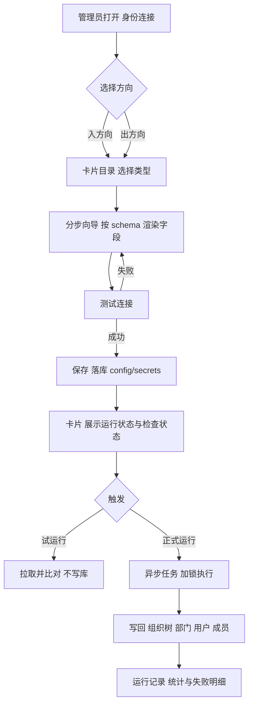
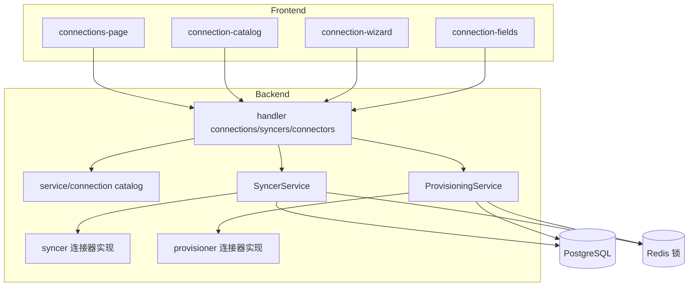

# 身份连接模块优化 · 第三阶段 Spec（外部数据源「入方向」+ 连接器「出方向」重构）

**创建**：2026-10-13 · **版本**：1.4 · **作者**：Agent
**状态**：**Confirmed（用户已答复 Q1–Q8，2026-10-13）**
**修订**：v1.4（2026-10-13）——**SCIM 2.0 本阶段不接入**（从入/出方向目录移除，出方向批次重排，见 §10）；图标素材补齐 AD / MySQL / PostgreSQL，Lark 复用飞书图标（`frontend/web/public/icons/connections/SOURCES.md`）。
**修订**：v1.3（2026-10-13）——图标素材改为**优先使用官方素材**：已按用户提供的原始地址收录钉钉 / 企业微信 / 飞书 / OpenLDAP / OIDC 五张官方图标（`frontend/web/public/icons/connections/`，来源见该目录 `SOURCES.md`），其余类型用代码内联矢量兜底；基底规范同步调整为中性底。
**修订**：v1.2（2026-10-13）——新增第 15 项功能需求（图标体系与卡片视觉语言）与 §5.6 实现规范，预览稿见 `docs/design/connections-ui-preview.html` / `.png`。
**修订**：v1.1（2026-10-13）——纳入用户对 Q1–Q8 的答复，并按用户补充的两张截图（阿里云 IDaaS「同步配置 / 字段映射」）新增：字段映射编辑器（账户/组织分组）、同步目标（组织树节点）、增量同步开关、定时校验（每天多时刻或 Cron，前后 30 分钟窗口）、同步保护（删除阈值熔断），并明确多实例并发语义。
**前置**：第一阶段（组织模块）与第二阶段（应用模块）已完成，见 `docs/specs/261013-org-module-phase1.md`、`docs/specs/261013-application-module-phase2.md`。
**参考产品**：阿里云 IDaaS「应用身份服务 → 身份资产 → 身份提供方」（入方向 / 出方向，用户提供的 3 张截图）。
**约束依据**：`AGENTS.md` §1（范围边界与「配置即生效」）、§3.1-6/7/9/10（事务、敏感字段、回归测试、禁止死代码）、§3.3（错误码与英文 message）、§3.5（配置与密钥）、§3.6（列清单不漂移）、§5（迁移不可变）、§7.3/§7.4（前端红线与信息架构）、`docs/design-language.md`（向导与表单基元）。

> 状态流转：`Draft` → `Awaiting Confirmation` → **`Confirmed`（已完成）** → `In Progress`（前置 Task 0 完成后置位）→ `Completed`。
> 确认后如范围/设计变更，需递增版本号。

---

## 1. 概述

把「外部数据源（Syncer，拉取型）」与「连接器（Connector，推送型）」从**两张各自为政的配置表 + 一屏罗列的模态框表单**，重构为统一的「**身份连接（Identity Connections）**」工作区：一个页面、两个方向（**入方向**=从外部系统拉取组织与账号；**出方向**=把本地账号推送给下游应用），每个方向都是「**卡片目录（添加）→ 类型专属分步向导 → 实例卡片（运行状态 / 检查状态 / 启停 / 定时 / 查看日志 / 触发 / 修改）**」，与成熟产品（阿里云 IDaaS）的操作心智一致。

同时把两个模块的**执行引擎做成可用于生产**：拉取同步改为**异步运行 + 单实例互斥 + 失败明细 + 试运行预览**；账号供给改为**持久化任务队列（outbox）+ 退避重试 + 死信**；并**清偿全部现存"配了不生效"的死配置与 3 处会让同步结果错误（甚至破坏本地数据）的缺陷**（详见 §2.4）。

交付后：管理员在控制台能看到"有哪些可接入的方向"，按向导 2 分钟内接通一个外部目录或一个下游应用；**任何表单里出现的字段都在运行时真实生效**；同步/供给的每一次执行都能在界面上看到状态、统计与失败原因；字段映射、定时校验与删除阈值保护可按截图形态配置，并在多实例部署下只执行一次、不误删数据。

---

## 2. 背景

### 2.1 用户诉求与参考产品

**用户诉求（原话）**：「第三阶段：我们需要优化一下外部数据源和连接器。我给你一些成熟产品的方案，你可以参考，然后给出你的重构方案。」

参考产品（阿里云 IDaaS）的关键形态：

| 参考产品元素 | 说明 | 对 Polaris 的启示 |
|---|---|---|
| 面包屑「身份资产 / 身份提供方」 | 入方向与出方向是**同一资产的两种方向**，而非两个不相干的菜单 | 合并为「身份连接」单页 + 方向标签 |
| 「入方向 / 出方向」标签 | 切换方向，下方是当前方向的实例列表 | 同一套卡片组件渲染两个方向 |
| 「添加」→ 类型目录页 | 每个类型一张卡片（图标 + 名称 + 一句话价值 + 「添加」按钮），如钉钉（三方/一方）、企业微信、飞书、AD、OpenLDAP、OIDC 身份提供方、SASE、Lark、SAML | 目录卡片由**后端类型元数据**下发，前端零硬编码 |
| 实例卡片（图 1） | 名称 + 标签（入方向/一方钉/导入成功）+ `CorpId` / `IdentityProviderId` + 「运行状态：可用 / 检查状态」+ 两个开关（认证登录 / 同步到 IDaaS 定时校验）+ 目标组织 + 「查看日志 / 触发同步 / 修改配置」 | 列表从「表格 + 编辑弹窗」升级为**卡片 + 就地操作** |
| 出方向目录（图 3） | 钉钉、AD、OpenLDAP、飞书、Lark、企业微信 | 下游连接器要**多类型**（现状只有一种通用 HTTP） |

### 2.2 与参考产品的能力对照（Polaris 现状 → 目标）

| 参考产品能力 | Polaris 现状 | 本阶段处置 |
|---|---|---|
| 入方向类型目录（卡片选择） | 单个「新建」按钮 + 弹窗内 `Type` 下拉（`syncers-page.tsx` 的 `typeOptions` 硬编码 6 项） | FR-1 / FR-2：后端目录 + 卡片页 |
| 类型专属配置字段 | 一个弹窗里**所有类型的字段全部铺开**，靠 `if (form.type === …)` 条件显示（与第二阶段判定的"应用向导反模式"同源） | FR-3：类型专属分步向导 |
| 实例卡片 + 「检查状态」 | 表格 + 行内菜单；**无**连通性自检端点（连接器有 `/test`，同步器没有） | FR-4：`test` 端点 + 卡片状态 |
| 「触发同步 / 查看日志」 | 有 `POST /syncers/:id/run`（**同步阻塞** HTTP）与运行记录弹窗（无失败明细、无 total） | FR-5：异步 run + 运行详情 |
| 「同步到 IDaaS 定时校验 + 目标组织」 | `schedule` 是"间隔秒数"字符串（`app.go:parseScheduleSeconds`）；**无目标部门/范围选择** | FR-6 / FR-7：类型化调度 + 目标范围 |
| 出方向多类型（钉钉/飞书/AD/OpenLDAP…） | `connectors` 表**没有 `type` 列**；`connectorProvisionerType()` 硬编码返回 `"http"`，`provisioner` 注册表只有 `HTTPProvisioner` 一个实现 | FR-8：多类型连接器 |
| 出方向定时校验 | `connectors.schedule` 列存在但**全仓无读取点** | FR-8 / FR-10：接线或删除 |
| 字段映射（账户 / 组织分组逐字段映射） | `user_mapping`/`group_mapping` 仅在 database/LDAP 连接器生效，**前端无编辑入口** | FR-13：映射编辑器（截图 1） |
| 同步目标（组织树节点选择） | 无（只能同步到组织根） | FR-7：`target_department_id` |
| 增量同步开关 | 无（每次全量） | FR-7：仅对声明支持增量的连接器开放 |
| 定时校验（每天多时刻 / Cron + 前后 30 分钟窗口） | `schedule` 只是「间隔秒数」，无窗口、无跳过语义 | FR-7（截图 2） |
| 同步保护（删除阈值熔断） | 无 | FR-14 |

### 2.3 代码研究小结（澄清前已核实的代码事实）

**入方向（外部数据源 / Syncer）**

- 后端：`internal/service/syncer_service.go`（配置管理 + 同步执行，365 行）、`internal/service/syncer/*.go`（`connector.go` 注册表 + `dingtalk/feishu/wecom/ldap/database/scim` 六个连接器 + `http.go` 共用 HTTP 基建）、`internal/repository/models.go:Syncer/SyncerRun`、`internal/repository/postgres/syncer_repo.go`、`internal/handler/syncer_handler.go`（无 `test` 端点）、`internal/app/app.go:runScheduledSyncers`（进程内 scheduler，1 分钟轮询）。
- 前端：`features/iam/pages/syncers-page.tsx`（481 行，单弹窗全字段 + 条件显示；`typeOptions`/`typeLabelKeys` 硬编码）。
- 数据流：`Connector.FetchUsers/FetchGroups` → `ExternalUser/ExternalGroup` 中立视图 → `SyncerService.upsertUsers/upsertGroups` 逐条写回（**无事务、无并发保护、无部门树**）。

**出方向（连接器 / 供给）**

- 后端：`internal/service/provisioning_service.go`（901 行，含进程内 worker 池）、`internal/service/provisioner/*.go`（`provisioner.go` 契约 + `http.go` 唯一实现）、`internal/repository/models.go:Connector/AccountStrategy/AppAccount/ProvisionHistory`、`internal/handler/provisioning_handler.go`、`internal/server/router.go`（`/connectors`、`/account-strategies`、`/app-accounts`、`/provisioning`）。
- 前端：`features/iam/pages/connectors-page.tsx`（353 行，弹窗仅 `provider_url/principal/credentials`）、`account-strategies-page.tsx`（文本域编辑 `mapping`）、`app-accounts-page.tsx`、`provisioning-page.tsx`。
- 事件触发：`TriggerUserProvisioning` / `TriggerRoleGranted` / `TriggerUserStatusChange` / `TriggerJIT` 由 `UserService`/`RoleService`/`AuthService` 调用；`scheduler` 每 2 分钟 `TriggerRetry` 全量重发失败账号。

**当前工作区的既存事实（必须作为前置条件，见 §8）**

- 正在进行中的「组织主键契约重构」（迁移 017/018：`institution`(name) → `institution_id`(bigint)）**尚未完成**：仓库层的 `syncer_repo.go`/`connector_repo.go` 已切到 `institution_id`，而 service/handler/model 层仍是旧签名，`go build ./...` 当前**不通过**。本阶段所有改动必须在该重构落地后再开始，迁移编号从 **019** 起。

### 2.4 缺陷与死配置清单（本阶段的清偿目标）

> 以下均为**代码事实核验结果**（2026-10-13）。「P0」= 会导致同步结果错误或数据破坏；「P1」= 生产可用性/安全问题；「P2」= 一致性与体验问题。

| # | 级别 | 现象 | 证据（文件::符号） | 处置 |
|---|---|---|---|---|
| D1 | P0 | 外部**用户↔组成员关系从不落库**：`ExternalUser.GroupIDs` 在 5 个连接器里都被赋值，但写回逻辑完全忽略它；组内成员仅由「组侧」驱动 | `syncer/dingtalk.go`、`feishu.go`、`wecom.go`、`ldap.go`、`scim.go`（`GroupIDs`）↔ `syncer_service.go::upsertUsers` | FR-6：按连接器能力声明建立成员关系，或删除该字段（禁止"赋值了没人读"） |
| D2 | P0 | **同步会把同名本地用户组清空**：钉钉/企业微信/飞书的 `FetchGroups` 返回的组不含成员，而 `upsertGroups` 无条件 `SetMembers(g.ID, members)`（该实现是"先 DELETE 再 INSERT"） | `syncer/dingtalk.go::FetchGroups`、`wecom.go::FetchGroups`、`feishu.go::FetchGroups` ↔ `syncer_service.go::upsertGroups` ↔ `postgres/group_repo.go::SetMembers` | FR-6：仅在连接器声明"组含成员"时做全量对齐；否则跳过并以用户侧归属反推 |
| D3 | P0 | `soft_delete` 开关**从不生效**（源端缺失用户不会被禁用/软删），但界面上一直可见可配 | `models.go:Syncer.SoftDelete`、`dto.go`（仅回显）↔ 全仓无读取点 | FR-6：接线并在运行统计中体现（`SyncCounts.Deleted` 已有字段但从未写入） |
| D4 | P1 | `database` 连接器的 **MySQL 分支必然运行失败**：`sql.Open("mysql", …)` 无驱动注册（`go-sql-driver/mysql` 仅为间接依赖，全仓无 blank import）；`sub_type/database_type/ssl_mode` 前端还发不出去 | `syncer/database.go::fetchMySQL` ↔ `go.mod`（indirect）↔ `syncers-page.tsx`（未提交这三个字段） | FR-6：修驱动注册 + 补齐字段；否则删除该分支 |
| D5 | P1 | LDAP/AD **无分页、无 LDAPS/StartTLS**：AD 默认 1000 条截断；`conn.Search` 无分页控件；协议固定 `ldap://` | `syncer/ldap.go::dial`（`ldap://`）、`::FetchUsers`/`::FetchGroups`（`conn.Search`） | FR-6：分页 + TLS 选项 |
| D6 | P1 | 同步 **同步阻塞 HTTP 请求**（`POST /syncers/:id/run` 内部全量拉取+逐条写回），大目录必超时；且**手动与定时可并发跑同一个同步器**（无互斥） | `syncer_handler.go::Run` ↔ `syncer_service.go::Run/RunOne` ↔ `app.go::runScheduledSyncers` | FR-5：异步 run + 互斥锁 |
| D7 | P1 | 供给任务队列是**进程内 channel，满即丢弃**（`Enqueue` 落到 `default` 分支只打日志）；失败重试是"每 2 分钟全量重发"，**无次数上限/无退避/无死信** | `provisioning_service.go::Enqueue`、`::TriggerRetry` | FR-9：outbox 表 + 退避 + 死信 |
| D8 | P1 | `app_accounts.related_password` **存储可解密的下游口令**（AES-GCM，可解回明文） | `models.go:AppAccount.RelatedPassword` ↔ `provisioning_service.go::saveRelatedPassword` | FR-11：不再落库（改一次性展示） |
| D9 | P1 | 连接器类型**是死注册表**：`connectorProvisionerType()` 硬编码 `"http"`；`connectors` 表无 `type` 列；`GET /connectors/types` 只会返回 `["http"]` | `provisioning_service.go::connectorProvisionerType`（注释即"当前统一为 http"）、`provisioner.go::registry` | FR-8 |
| D10 | P1 | 主连接器取「应用下首个启用连接器」，顺序不确定；同一应用可并存多个连接器 | `provisioning_service.go::primaryConnector` | FR-8：应用↔连接器 1:1 唯一约束 |
| D11 | P2 | 死配置：`syncers.agent_id`、`connectors.filters`、`connectors.schedule` 三处**无任何运行时读取点**（只被回显/落库） | `models.go:Syncer.AgentID`、`Connector.Filters`、`Connector.Schedule` | FR-10：接线或删除 |
| D12 | P2 | 语义冲突：`account_strategies.policy.createWhen="jit"` 在界面上可选，但 JIT 建号实际看的是 `connectors.just_in_time` 字段——**同一件事有两个开关，配错就"配了不生效"** | `provisioning_service.go::TriggerJIT`（读 `connector.JustInTime`）↔ `::autoCreateApplications`（只匹配 `onCreate`/`onGrant`） | FR-10：归并到策略侧，删除连接器上的重复字段 |
| D13 | P2 | 敏感字段处理违规：`maskSyncer` 把实体里的密文**改写为字面量 `"******"`**再返回（虽 DTO 用 `has_secret`，但服务层已污染实体，且 `Update` 依赖"前端不回传"这一隐含约定） | `syncer_service.go::maskSyncer`（`Get`/`List` 调用点） | FR-11：删除该函数，敏感表达只走 DTO 的 `has_*` |
| D14 | P2 | 错误语义违规：连接器错误（中文文案 + 底层细节）经 `bizerrors.New(CodeInvalidParams, err.Error())` **直接下发客户端**；同步器**没有**连通性自检端点 | `syncer_service.go::RunOne`、`syncer/connector.go::Get`、`syncer/ldap.go` 等中文 `fmt.Errorf` | FR-4 / FR-11 |
| D15 | P2 | 类型元数据硬编码三处（后端注册表、前端 `typeOptions`、前端 `typeLabelKeys`），新增一个类型要改 3 个文件且无编译期约束 | `syncer/connector.go::init`、`syncers-page.tsx` | FR-2 |
| D16 | P2 | 字段映射（`user_mapping`/`group_mapping`）只在 `database`/`ldap` 连接器生效，**前端无任何编辑入口**；钉钉/飞书/企业微信即便配上也不生效 | `models.go:Syncer.UserMapping` ↔ `syncer/database.go`、`syncer/ldap.go`（唯二读取点） | FR-6：接线为统一「字段映射」，不支持的连接器**不展示**该配置 |
| D17 | P2 | 死代码/未接线细节：`syncer_service.go:355` 的 `var _ = fmt.Sprintf`；`Runs` 不返回 `total`；`SyncerRun` 无触发来源与耗时字段；运行统计 `SyncCounts.Deleted` 从未写入 | `syncer_service.go`、`models.go:SyncerRun` | FR-5 |

**结论**：本阶段"重构"的重点不是把表单变好看，而是**先把这些"看起来能配、实际不生效/会算错"的地方清干净**（`AGENTS.md` §1「配置即生效」、§3.1-10「禁止未接线死代码」），再把交互对齐参考产品。

---

## 3. 澄清问答（已确认，Q1–Q8）

> 2026-10-13 用户以「1 合并 / 2 后端 schema / 3 迁入 / 4 部门树（需支持字段映射，参考截图）/ 5 本阶段全做 / 6 一次性展示 / 7 定时（参考截图，注意多实例并发）/ 8 异步 + 持久化」逐条答复，全部采纳推荐项，并追加两项设计输入（字段映射、定时校验与同步保护）。原文保留如下。

- **Q1**：信息架构——是否把「外部数据源」与「连接器」合并为一个「身份连接」页面（内容「入方向 / 出方向」两个标签），旧地址重定向？
  **推荐**：合并。
  **用户答复**：**「1 合并」**
  **采纳**：合并为 `/connections` 单页双标签，`/syncers`、`/connectors` 重定向（FR-1）。
  **日期**：2026-10-13

- **Q2**：类型与字段的单一来源——后端下发 schema 还是前端各写表单？
  **推荐**：后端声明式 schema。
  **用户答复**：**「2 后端 schema」**
  **采纳**：`GET /connections/catalog` 为唯一来源，前端按 schema 渲染（FR-2/FR-3）。
  **日期**：2026-10-13

- **Q3**：类型专属字段是否迁入 `config` / `secrets` JSONB？
  **推荐**：迁入。
  **用户答复**：**「3 迁入」**
  **采纳**：`config`（非敏感）+ `secrets`（AES-GCM 密文）+ `sync_config`（范围/调度/保护）+ `field_mapping`（映射），迁移 019–022（§5.4）。
  **日期**：2026-10-13

- **Q4**：外部组织落点——`departments` 部门树还是 `groups` 用户组？
  **推荐**：落 `departments`（部门树 + `users.department_id`），同步器不再触碰 `groups`。
  **用户答复**：**「4 部门树，但是要支持配置字段映射 参考截图」**
  **采纳**：外部组织 → `departments` 树（可指定「同步目标」节点作为导入根）；同时**必须提供字段映射配置界面**（截图 1 的「字段映射」标签页，按「账户 / 组织」分组逐字段映射），新增 FR-13。
  **日期**：2026-10-13

- **Q5**：出方向本阶段做哪些类型？
  **推荐**：HTTP + SCIM（3.4a）、钉钉/飞书/企业微信（3.4b）、AD/OpenLDAP（3.4c），分三小批全做。
  **用户答复**：**「5 本阶段全做」**
  **采纳**：出方向连接器全在本阶段交付（FR-8）。**2026-10-13 追加**：用户后续决定 **SCIM 2.0 本阶段不接入**（入/出方向均从目录移除，见 §10）。
  **日期**：2026-10-13

- **Q6**：下游账号口令是否还存可解密值？
  **推荐**：不再落库，建号时一次性展示。
  **用户答复**：**「6 一次性展示」**
  **采纳**：删除 `app_accounts.related_password`（迁移 022），改为建号成功时一次性展示 + 审计留痕（FR-11）。
  **日期**：2026-10-13

- **Q7**：定时策略形态——间隔秒数还是结构化 + Cron？
  **推荐**：结构化（`interval` 秒或 `cron`）。
  **用户答复**：**「7 定时，参考截图（注意多实例 并发问题）」**
  **采纳**：改为截图 2 的形态——**定时校验**（开关）+ **周期**（「每天」多时刻标签，上限 24 个 / 「Cron 表达式」二选一）+ **前后 30 分钟执行窗口** + 「数据量过大未完成则自动跳过」；并**显式解决多实例并发**：到点前用数据库原子抢占 `next_run_at`、每资源 Redis 互斥锁、运行中跳过并记 `skipped`（FR-7、§5.5）。
  **日期**：2026-10-13

- **Q8**：执行模型是否改为「持久化任务 + 异步 + 互斥」？
  **推荐**：是。
  **用户答复**：**「8 异步 + 持久化」**
  **采纳**：入方向 `syncer_runs` 异步运行 + 互斥（202 + run_id，前端轮询）；出方向 `provision_tasks` outbox + 退避 + 死信（FR-5/FR-9）。
  **日期**：2026-10-13

### 3.1 用户追加的两张参考截图（新增设计输入）

**截图 1「字段映射」标签页**（弹窗内两个标签：同步配置 / 字段映射）

| 参考元素 | Polaris 采纳方式 |
|---|---|
| 分区「账户」「组织」 | 映射按 `account` / `organization` 两组目标字段渲染（FR-13） |
| 表头：IDaaS 字段 / 映射规则 / 字段值 / 映射标识 / 操作 | 列：**目标字段**（名称 + 技术名，必填带 `*`）/ **映射规则**（选择字段；本阶段另支持固定值）/ **字段值**（源字段下拉，选项由连接器声明）/ **映射标识**（已映射 / 未映射 / 冲突）/ **操作**（添加备选源字段、更多） |
| 「未映射」开关 | 每个目标字段可单独关闭；**必填字段（账户名、组织名称）不允许关闭** |
| 顶部蓝色提示条 + 「了解更多」 | 向导内联提示（复用 `FormSection` 的 hint），文档链接指向新增的 `docs/identity-connections.md` |

**截图 2「同步配置」标签页**

| 参考元素 | Polaris 采纳方式 |
|---|---|
| 同步目标（选填） | 组织树节点选择器：外部组织导入到所选部门节点之下（`target_department_id`）；未选则导入组织根 |
| 增量同步（选填）开关 | `sync_config.incremental`；仅对声明支持增量的连接器可用（LDAP / 数据库），其余类型禁用并说明原因 |
| 定时校验（选填）开关 + 周期：每天 / Cron 表达式 | `sync_config.schedule = {mode: daily|cron, times: ["03:00","05:00"], cron: "…"}`；「每天」为多时刻标签（上限 24），与 Cron 二选一 |
| 「所选时间点的前后 30 分钟进行数据同步」 | `window_minutes`（默认 30）：窗口内首次触达即执行一次；窗口内已在运行则跳过 |
| 「数据量过大在较验周期内未完成同步，将自动跳过」 | 运行超时 + 窗口过期 → 记 `skipped`，下一周期再跑 |
| 同步保护：`30` 个及以上账户需删除 / `10` 个及以上组织需删除时取消任务 | `sync_config.guard = {max_user_deletes: 30, max_dept_deletes: 10}`：差异预演超过阈值 → **取消本次任务**并告警（新增 FR-14） |

---

## 4. 功能需求

### FR-1 统一「身份连接」页面（入方向 / 出方向）

- **描述**：新增工作区页面 `/institutions/:inst/connections`，顶部两个标签「入方向」（拉取同步，现 Syncer）/「出方向」（推送供给，现 Connector）。标签下方是当前方向的实例卡片列表 + 「添加」按钮。旧地址 `/syncers`、`/connectors` 重定向到对应标签（保留可回退、可分享的地址语义）。
- **输入 / 输出**：`GET /api/v1/syncers`、`GET /api/v1/connectors`（沿用现有资源路径，避免一次性大改 API）。
- **验收**：
  - 导航 `widgets/layout/nav-config.ts` 的「应用」分组中，`外部数据源` 与 `连接器` 两项合并为一项「身份连接」（`nav.connections`），旧 key 词条删除；`AGENTS.md` §7.4 的信息架构同步更新。
  - 访问 `/institutions/:inst/syncers` 时重定向到 `/institutions/:inst/connections?direction=in`；`/connectors` → `?direction=out`（参照既有"旧地址重定向到组织命名空间"的约定）。
  - 移动端抽屉复用同一 `nav-config`，不存在第二处维护。

### FR-2 连接器目录与字段 schema（后端单一来源）

- **描述**：新增 `GET /api/v1/connections/catalog`，返回两个方向的**类型目录**：`{ key, direction, vendor, displayName, description, icon, capabilities[], fields[], docsURL, implemented }`。字段 schema 描述 `key/label/type(string|password|number|switch|select|tags|map|department)/required/default/options/placeholder/hint/group/secret/condition`。
- **输入 / 输出**：请求无参；响应为目录 JSON（按 `direction` 分组）。前端**不再**硬编码 `typeOptions`/`typeLabelKeys`（删除 D15）；类型图标沿用 `shared/components/signin-method-icon.tsx` 的图标映射风格（新增 `connection-icons.tsx`，无需第三方资源）。
- **验收**：
  - 目录里出现的每个 `key` 都能被 `syncer.Get`/`provisioner.Get` 解析（单元测试遍历目录并断言实现存在，杜绝"目录里能选、后端没实现"）。**已实现**：`TestCatalogTypesAreImplemented`。
  - 说明：出方向目录**当前只有通用 HTTP**（其余类型随 3.4 批次落地后自动出现在目录中）——这是"目录=已实现"约束的必然结果。
  - **已停止接入的类型**（本阶段的 `scim`）：不出现在「添加」目录中；若存在历史实例，列表仍可显示（兜底图标 + 「本阶段不支持该类型」标签），编辑页只允许**停用或删除**，不允许新建。
  - 目录里声明的每个字段在该类型的**运行时读取点**都存在（`AGENTS.md` §1）；做不到的类型不进入目录（例如未实现的 SAML/扫码登录）。
  - `docs/api-reference.md` 增补该端点。

### FR-3 类型专属的分步向导

- **描述**：新建/编辑复用 `shared/components/form-wizard.tsx`（第二阶段产出的 `FormWizard`/`FormSection`/`SwitchField`/`TagInput` 基元），步骤：**① 基本信息**（名称/标识/方向/说明）→ **② 连接配置**（按类型 schema 渲染，含凭据与"测试连接"）→ **③ 同步/供给范围**（目标组织、目标部门、用户/组/部门开关、冲突策略）→ **④ 映射与计划**（字段映射、定时、启停）→ **⑤ 测试并保存**（保存前跑一次自检，失败给出可读原因）。吸顶头部承载步骤条与「上一步/下一步/提交」。
- **输入 / 输出**：`SyncerPayload` / `ConnectorPayload`（沿用现有字段名，新增 `config` 相关字段见 §5.4）。
- **验收**：
  - 同一屏内**只出现当前类型**的字段；切换类型时清空不属于新类型的值（避免"上一类型的残留值被静默落库"）。
  - 必填与格式校验前后端同源（后端按同一 schema 校验，返回 `INVALID_PARAMS` + `details.field`）。
  - i18n：标签全部走 `connections.*` 词条，中英同步；`shared/i18n/usage.test.ts` 通过。

### FR-4 连通性自检（新建前 + 卡片「检查状态」）

- **描述**：新增 `POST /api/v1/syncers/test`（用**未落库**的临时配置自检，供向导第 ② / ⑤ 步使用）与 `POST /api/v1/syncers/:id/test`（用已存配置自检）；连接器沿用 `POST /api/v1/connectors/:id/test` 并新增 `POST /api/v1/connectors/test`。自检语义：能连上、能鉴权、能读到最少一条数据（拉取类）/ 能健康探测（推送类）。
- **输入 / 输出**：请求体与创建体一致（`:id` 版无体）；响应 `{ ok, latency_ms, sample?, message }`；失败返回 `503 SERVICE_UNAVAILABLE`（沿用现有"不伪装成功"的冒烟约定）。
- **验收**：
  - 自检错误**不泄漏内部细节**：客户端只得到可读英文 `message`（如 `cannot connect to the data source`），底层 `err` 只进日志（§3.3、D14）。
  - 卡片展示「运行状态」（最近一次同步/供给结果）与「检查状态」（自检结果 + 相对时间）两个独立徽标。

### FR-5 运行可观测（异步 run + 运行详情）

- **描述**：`POST /api/v1/syncers/:id/run` 改为**异步**：立刻返回 `202 {run_id, status:"running"}`，实际执行走后台任务；新增 `GET /api/v1/syncers/:id/runs/:runId` 返回单次运行详情；`GET /api/v1/syncers/:id/runs` 补 `total`。前端：卡片「触发同步」后原地变为"运行中"，完成后刷新统计；「查看日志」打开抽屉展示历史运行 + **逐条失败明细**。
- **输入 / 输出**：`SyncerRun` 扩展 `trigger(manual|schedule)`、`duration_ms`、`errors JSONB`（最多保留 N=200 条：外部标识 + 原因）。
- **验收**：
  - 同一同步器**同时只允许一个运行**：第二个请求返回 `409 CONFLICT`（错误码语义见 §5.5），定时任务遇到运行中则跳过并记录。
  - 运行记录写入 `SyncCounts.Deleted`（配合 FR-6 的软删），不再永远为 0。
  - 试运行 `POST /api/v1/syncers/:id/dry-run`：只拉取+比对，**不写库**，返回"将创建/更新/禁用 N 条"与样例，供管理员确认后再正式触发。

### FR-6 拉取引擎正确性与生产可用（入方向）

- **描述**：修复 D1–D5、D16，并把"同步范围/冲突策略"显式化：
  1. **部门树同步**（Q4 采纳后）：外部组织 → `departments`（按外部组织路径 upsert 树、维护 `parent_id/code_path/level`），用户归属写 `users.department_id`；**不再写 `groups`**。
  2. **成员关系**：连接器按 `capabilities` 声明是否提供"组成员/用户所属部门"；仅声明提供时做全量对齐（先删后插），否则**跳过**（修 D2 的"清空本地组"）。
  3. **软删接线**：`soft_delete=true` 时，源端缺失的同步来源用户标记禁用（`is_forbidden`）/软删，并在统计里计入 `Deleted`（D3）。
  4. **冲突策略**：`conflict_policy ∈ {source-wins(默认), local-wins, skip}`，控制"同名用户的属性被覆盖 / 保留本地 / 跳过"；默认 `source-wins` 但**只覆盖非空外部值**（保持现有行为，避免把本地字段清空）。
  5. **字段映射**：统一为「目标字段 → 源字段」的可视化映射编辑器，按「账户 / 组织」分组逐字段配置（**FR-13**）；支持映射的类型在目录中声明 `capabilities.mapping=true`，未声明的类型**不展示**该配置（D16）。
  6. **LDAP/AD**：分页（`SimplePagedResults`，page size 可配）+ `ldaps://` / StartTLS + 超时；AD 的 `sAMAccountName`/`userPrincipalName` 作为账号来源（D5）。
  7. **数据库**：注册 MySQL 驱动（或删除该分支）+ 支持列选择/过滤条件/增量游标，不再 `SELECT *` 全表（D4）。
- **验收**：
  - 单元测试覆盖：软删（缺失用户被禁用）、组/部门成员对齐（**不提供成员信息的连接器不得改动成员**）、映射应用、LDAP 分页（用 `ldap` 的 in-memory server 或 httptest 替代）。
  - 冒烟：建一个"文件型/HTTP 假数据源"（见 §5.5 测试基建）跑通"试运行 → 正式运行 → 运行详情"。

### FR-7 同步范围、增量、定时校验与目标节点

- **描述**：完全对齐截图 2 的「同步配置」：
  1. **同步目标（选填）**：组织树节点选择器（复用 `Combobox` 的部门树变体）；外部拉取到的组织与账号**置于所选节点之下**，未选则挂在组织根。落库 `syncers.target_department_id`。
  2. **增量同步（选填）**：`sync_config.incremental`。仅当连接器声明 `capabilities.incremental=true`（LDAP / 数据库可按更新时间游标）时可用，其余类型**禁用并说明原因**（不出现"配了不生效"）。游标取上次成功运行的 `finished_at`。
  3. **定时校验（选填）**：开关 + 周期二选一：
     - 「每天」模式：多时刻标签（如 `3点`、`5点`，**上限 24 个**，界面显示 `n/24`）；
     - 「Cron 表达式」模式：标准 5/6 段表达式，保存时校验，非法拒绝入库（`INVALID_PARAMS`）。
  4. **执行窗口**：`window_minutes`（默认 30）。到点后**前后 30 分钟内首次触达即执行一次**；窗口内若该资源仍在运行 → **跳过**并记录 `skipped`；数据量过大导致窗口结束仍未完成 → 记 `skipped`，下一周期再跑（对应截图「将自动跳过」）。
  5. **同步保护**：`sync_config.guard = {max_user_deletes: 30, max_dept_deletes: 10}`（见 FR-14）。
- **输入 / 输出**：`sync_config`（JSONB）随同步器创建/更新提交；列表接口回传 `next_run_at`、`last_run_at`、最近一次运行状态。
- **验收**：
  - 调度解析单元测试：`daily` 多时刻展开、Cron 校验、非法表达式拒绝；`window_minutes` 边界（跨零点）。
  - **多实例并发**（Q7 的显式要求）：同一资源的到点执行由数据库原子抢占 `next_run_at` + 运行互斥锁保证"多实例下也只跑一次、不并发跑两次"；测试用两个进程/两个 Service 实例模拟，断言只产生一条运行记录。
  - 运行中到点 → 产生 `skipped` 记录（含原因），而不是排队堆积。
  - 界面显示「下次同步时间 / 上次同步时间」；「每天」与「Cron」两种模式**入/出方向共用同一组件**。

### FR-8 出方向多类型连接器

- **描述**：`connectors` 增加 `type`（`http|dingtalk|lark|wecom|ldap`，**不含 `scim`**，见 §10）与认证方式 `auth_type`（`basic|bearer|oauth2_client_credentials|api_key`），`provisioner` 注册表按 `type` 解析（删除 D9 的硬编码）；应用与连接器 **1:1**（`UNIQUE(institution_id, application)`，删除 D10 的非确定性取首个）；连接器目录（FR-2）驱动前端表单；`ConnectorInput` 校验类型存在（沿用现有 `provisioner.Get` 校验点）。
- **输入 / 输出**：新增 `provisioner.Provisioner` 实现：`DingTalkProvisioner`、`FeishuProvisioner`（`lark` 复用同一实现，仅端点域名不同）、`WeComProvisioner`、`LDAPProvisioner`（AD / OpenLDAP，`Add/Modify/Delete` + 密码重置）；现有 `HTTPProvisioner` 保留为通用 RESTful 契约；每个实现自带 `Capabilities()`（是否支持改密、是否支持禁用、是否需要 email 唯一）。
- **验收**：
  - 目录中的每个出方向类型都有对应实现与单元测试（httptest 假下游 / ldap mock），**不存在"目录能选但未实现"**。
  - 不支持的动作（如某下游不支持改密）在服务层**提前拒绝**并给出可读错误，而不是发请求后 500。
  - `docs/provisioning-connector.md` 更新为多类型契约说明。

### FR-9 供给任务生产化（outbox）

- **描述**：新增 `provision_tasks` 表与领取式 worker：`Enqueue` 变为**写库**（不再丢任务）；worker 用 `SELECT … FOR UPDATE SKIP LOCKED` 领取、`attempts/next_attempt_at` 指数退避、超过 `max_attempts` 置 `dead`（死信）并在界面可见可重试；`TriggerRetry` 从"全量重发"改为"扫描到期任务"；`scheduler` 保留为兜底扫描器。
- **验收**：
  - 队列满/进程重启**不丢任务**（测试：写入 100 条任务后中断 worker，重启后全部执行）。
  - 幂等键 `(institution, application, user)` 不因重试产生重复账号（沿用现有唯一约束 + 建号幂等契约）。
  - 界面可见：待处理 / 已成功 / 失败（含下次重试时间）/ 死信 四态计数与明细。

### FR-10 死配置清偿（配置即生效）

- **描述**：逐条处置 §2.4 的 D11/D12：`syncers.agent_id`（删除，无读取点）、`connectors.filters`（实现为"供给范围过滤"并让它生效，或删除）、`connectors.schedule`（接入 FR-7 的出方向定时对齐，或删除）、`just_in_time` 与策略 `createWhen=jit` 二选一（推荐归并到策略侧）。
- **验收**：
  - 新增的"死配置扫描"单测/脚本思路：目录 schema 中出现的每个字段必须在 `internal/service` 下有读取点（可先用人工清单 + 复查清单落在本文档 §5.5，不额外造轮子）。
  - 前端不再展示任何"配了不生效"的字段；被删除的字段同步从 DTO、`types.ts`、i18n 中清除（参考第二阶段的 FR-3 做法）。

### FR-11 安全与错误语义

- **描述**：(a) 删除 `maskSyncer`，敏感字段只通过 DTO 的 `has_*` 表达（D13）；(b) 连接器错误不下发内部细节，客户端只得英文 message（D14）；(c) `app_accounts.related_password` 不再存储可解密口令（Q6 采纳后，新增迁移删除列，建号口令一次性展示并写入审计）；(d) 所有新建/更新/删除/触发/自检操作写审计（沿用 `AuditRecorder`，补齐 `syncer.test`、`connector.test`、`app_account.reconcile` 等 action）。
- **验收**：
  - `internal/handler/dto_test.go` 扩展断言：同步器/连接器响应中不出现 `password`/`app_secret`/`credentials` 明文或 `"******"` 占位。
  - 错误响应体不含堆栈/中文底层错误（`errors.Middleware` 兜底行为覆盖测试）。

### FR-12 出方向定时对齐（dry-run 优先）

- **描述**：新增"对齐任务"：按策略/连接器定时比对「本地用户 × 应用」与「下游已有账号」，产出三类差异（应建号 / 应禁用 / 应删除），先 **dry-run 预览**，管理员确认后再执行；手动入口在连接器卡片（「对齐检查」）。
- **验收**：
  - dry-run 不产生任何下游副作用（测试用假下游断言零写请求）。
  - 执行后逐条写入 `provision_history`，可在界面看到差异明细。

### FR-13 字段映射编辑器（账户 / 组织分组，截图 1）

- **描述**：同步向导内新增「字段映射」标签页（与「同步配置」并列），按 **账户 / 组织** 两个分区，逐目标字段配置映射。
  - 目标字段来自**本地模型声明**（技术名用 Polaris 自己的模型，界面上同时展示中文名与技术名，即截图中的「目标字段 + `user.username`」列）：
    - **账户**：`user.name`（账号名，必填）、`user.display_name`、`user.email`、`user.phone`、`user.country_code`（对应截图「手机区号」）、`user.title`、`user.location`、`user.avatar`；
    - **组织**：`department.name`（组织名称，必填）、`department.display_name`、`department.parent_path`（父路径，决定部门树挂载位置）。
  - 每行的「字段值」下拉来自**连接器声明的源字段清单**：目录中每个类型提供 `source_fields[] = { key, label, sample, group(account|organization) }`（如钉钉：`手机号码`、`员工名称`、`国际电话区号`、`部门名称`、`工号`），并支持「获取源字段」实测（用已存配置拉一条样本，回填真实字段名与样例值）——这是"下拉里能选到、实际取得到"的保证。
  - 「映射规则」下拉：本阶段支持 **① 选择字段**（取源字段值）、**② 固定值**（常量）；表达式规则延后（§10）。
  - 「未映射」开关：单字段关闭；**必填目标字段（账户名、组织名称）不允许关闭**，关闭必填项时前端阻止并提示。
  - 「映射标识」列：`已映射 / 未映射 / 冲突`（冲突 = 同一源字段被两个必填目标字段占用，或必填目标字段未映射）。
  - 操作列：「添加」为该目标字段追加**备选源字段**（按顺序取第一个非空值）；「…」为清空 / 移除备选。
  - 未配置映射时使用**内置默认映射**（各连接器的默认值，如钉钉 `用户名←userid`、`显示名称←name`、`部门名称←部门名称`），保证"不配置也能跑通"。
- **输入 / 输出**：`field_mapping`（JSONB，结构见 §5.4.1）；`GET /api/v1/syncers/:id/source-fields` 返回可映射源字段（含样例）；保存走同步器更新接口（同样支持 `POST /api/v1/syncers/source-fields` 用临时配置实测）。
- **验收**：
  - 未声明 `capabilities.mapping` 的类型**不渲染**该标签页（如钉钉在 Polaris 的实现若不支持自定义映射，就不展示空表格）。
  - 必填目标字段未映射时保存被拒绝（后端 schema 校验 + 前端提示同源）。
  - 映射应用有单元测试：给定外部样本行 → 断言映射后的本地用户/部门字段；备选源字段的"首个非空"语义有测试。
  - 目录中每种类型的默认映射各有测试（钉钉 / 飞书 / Lark / 企业微信 / AD / OpenLDAP / 数据库），防止"默认映射写错但没人发现"。

### FR-14 同步保护（删除阈值熔断，截图 2）

- **描述**：同步/对齐在**写库前**先做差异预演，若"需要删除/禁用"的数量达到阈值（账户默认 30、组织默认 10，可配置，0 表示不限制），则**取消本次任务**：不写任何数据，运行记录置 `aborted`，`message` 说明"检测到 N 条账户将被删除（阈值 M），已取消"，并写审计与告警日志；前端运行详情给出"确认为误判则调整阈值或改为试运行"的引导。
- **验收**：
  - 单元测试：构造 31 条删除差异 → 断言零写入 + `aborted` 记录；阈值调大后再跑 → 正常执行。
  - 熔断不依赖 dry-run 开关（即"正式运行"也必须先预演），预演结果与正式执行使用同一差异计算函数（避免两套逻辑漂移）。
  - 该保护同时作用于出方向的对齐任务（FR-12）。

---

### FR-15 图标体系与卡片视觉语言

- **描述**：每个连接类型都有**专属图标**（入/出方向共用同一套），目录与实例一律用**卡片**而非表格，形态对齐用户提供的参考图；预览稿：`docs/design/connections-ui-preview.html`（图：`docs/design/connections-ui-preview.png`）。
  - **类型 → 图标**（纯矢量内联 SVG，无第三方依赖、无网络请求）：

    | 类型 key | 名称 | 素材 | 说明 |
    |---|---|---|---|
    | `dingtalk` | 钉钉 | `dingtalk.png`（官方） | 自带蓝色圆角底 |
    | `wecom` | 企业微信 | `wecom.png`（官方） | 透明底彩色气泡 |
    | `feishu` | 飞书 | `feishu.png`（官方） | 透明底纸飞机 |
    | `lark` | Lark（飞书国际版） | 复用 `feishu.png` | 用户确认与飞书同款（映射表内指向，不重复存文件） |
    | `ad` | AD 域控 | `ad.png`（官方，用户提供） | 四窗格标识 |
    | `ldap` | OpenLDAP | `openldap.png`（官方） | 透明底红色标识 |
    | `database` | 数据库 | 按子类型：`mysql.svg`（官方 SVG 裁切到海豚）/ `postgres.png`（官方新闻素材） | catalog 用 `icon_by_subtype` 声明，实例卡片显示实际子类型图标 |
    | `oidc` | OIDC 联合登录 | `oidc.png`（官方） | 透明底 OpenID 标识 |
    | `http` | 通用 HTTP | 内联矢量（地球） | 无官方标识，用中性兜底 |
    | `scim` | SCIM 2.0 | 内联矢量（双向箭头） | **本阶段不接入**，仅存量实例降级展示 |
    | 未知 | — | 内联矢量（插头/地球） | 绝不出现空白占位 |
  - **图标来源（优先级）**：
    1. **官方素材（已收录）**：钉钉 / 企业微信 / 飞书 / OpenLDAP / OIDC → `frontend/web/public/icons/connections/{key}.png`，来源与尺寸见该目录 `SOURCES.md`（2026-10-13 按用户提供的原始地址下载备存，均为带透明通道的 PNG）；
    2. **内联简化矢量兜底**：通用 HTTP（地球）、容器/未知类型（插头）、以及**仅用于存量实例**的 SCIM（双向箭头）——纯矢量、无外部文件。
  - **后端 catalog 仍只下发 `icon` key**（不传资源路径）；前端 `connection-icon.tsx` 是唯一映射处：`key → { file?: '...png', svg?: ReactNode }`，未知 key 回退兜底图形（绝不出现空白占位）。新增类型只需登记一处。
  - **基底规范**：统一**中性基底**——白底（暗色模式 `#2b2c43`）+ 1px 内描边 + 26% 圆角；官方素材按原始比例 `object-contain` 居中，**不裁切、不叠加品牌色底**（钉钉素材自带蓝底，其余为透明底彩色图形）。
  - **目录卡片**：响应式 3 列网格；卡片 = 40px 图标 + 名称 + 类型 key + 一句话描述（i18n）+ 「添加」主按钮；hover 抬升 1px + 描边转品牌淡色。
  - **实例卡片**：标题行（40px 图标 + 名称 + 标签组 + 右侧「可用 / 检查状态 / 修改 / 删除」）+ 元信息行（类型 · 目标组织或关联应用 · 上次执行时间）+ 双列主体（左=主能力开关与说明、右=定时/范围与说明，底部为「修改配置 / 查看日志 / 触发同步 / 试运行」等行内链接）。
  - **状态语义**：`可用`=成功（绿）、`部分失败 / N 条待重试`=警示（琥珀）、`未启用 / 从未运行`=中性（灰）；标签组用方向标签 + 接入方式标签 + 最近一次结果标签。
- **验收**：
  - 目录与实例卡片在**明暗两种模式**下均正常（品牌色块不反色，只换基底与描边），对比度 ≥ 4.5:1；40px / 32px / 24px / 16px 四档尺寸均清晰。
  - **不破坏前端红线**：颜色全部走 `globals.css` 令牌（禁止裸 hex 与任意色值）；卡片与字段渲染器只从 `@/shared/ui` 引组件；图标为纯装饰时 `aria-hidden`。
  - 未知类型（后端新增但前端未同步）不出现空白图标，而是兜底图形 + 名称仍可读。

---

## 5. 设计

### 5.1 总体架构

**后端**

| 组件 | 路径 | 职责 |
|---|---|---|
| 类型目录（单一来源） | `internal/service/connection/catalog.go`（新） | 声明入/出方向全部类型的能力与字段 schema；供 API 与后端校验共用 |
| 源字段清单 | 同上（`catalog.go` 的 `SourceFields`） | 每个类型声明可映射的源字段（`key/label/sample/group`），供 FR-13 的下拉与「获取源字段」实测 |
| 入方向连接器 | `internal/service/syncer/*.go`（现） | 拉取用户/部门/组；**新增 `Capabilities()`**（是否提供组成员、是否支持映射、是否支持增量） |
| 出方向连接器 | `internal/service/provisioner/*.go`（现，新增实现） | 推送建号/更新/启停/删除/自检；新增 `DingTalk/Feishu(=Lark)/WeCom/LDAP`（HTTP 契约保留） |
| 同步编排 | `internal/service/syncer_service.go`（改造） | 异步 run、互斥锁、试运行、部门树对齐、软删、统计与明细 |
| 供给编排 | `internal/service/provisioning_service.go`（改造） | outbox 入队/领取/退避/死信、主连接器唯一、对齐任务 |
| 运行锁 | `internal/repository/redis/*`（新增 `lock.go`） | 资源级互斥（`polaris:lock:syncer:{id}`，TTL 心跳），多实例安全 |
| 调度 | `internal/scheduler/scheduler.go` + `internal/app/app.go` | 每分钟扫描到期资源（不直接执行，改为入队） |

**前端**

| 组件 | 路径 | 职责 |
|---|---|---|
| 连接页 | `features/iam/pages/connections-page.tsx`（新，替代 `syncers-page.tsx`/`connectors-page.tsx`） | 方向标签 + 实例卡片 + 卡片内操作 |
| 类型图标 | `shared/components/connection-icon.tsx`（新） | 类型 key → 内联 SVG 的唯一映射（含兜底），门户/登录页也可复用 |
| 卡片 | `features/iam/components/connection-card.tsx`（新） | 目录卡片与实例卡片（状态药丸、开关、行内操作） |
| 类型目录 | `features/iam/components/connection-catalog.tsx`（新） | 「添加」时的卡片目录（按 direction 过滤） |
| 向导 | `features/iam/components/connection-wizard.tsx`（新） | 5 步向导，复用 `FormWizard`/`FormSection`/`SwitchField`/`TagInput` |
| 字段渲染器 | `features/iam/components/connection-fields.tsx`（新） | 按 schema 渲染字段；`widget=mapping` / `widget=department` 走专用控件 |
| 映射编辑器 | `features/iam/components/connection-mapping.tsx`（新） | 「账户 / 组织」分区表格：目标字段 + 映射规则 + 源字段下拉 + 未映射开关 + 映射标识（FR-13） |
| 同步配置 | `features/iam/components/connection-schedule.tsx`（新） | 同步目标（部门树）/ 增量开关 / 定时校验（每天多时刻 · Cron）/ 执行窗口 / 同步保护阈值（FR-7 / FR-14） |
| 运行详情 | `features/iam/components/connection-runs.tsx`（新） | 运行历史 + 失败明细 + 触发/试运行入口 |

### 5.2 主流程



### 5.3 组件关系



### 5.4 数据设计

#### 5.4.1 数据库变更（迁移 019+，均在组织主键重构落地后）

```sql
-- 019：入方向 syncers 收敛为「公共列 + config + secrets + sync_config + field_mapping」
ALTER TABLE syncers ADD COLUMN config  JSONB NOT NULL DEFAULT '{}'::jsonb;  -- 类型专属连接配置（非敏感）
ALTER TABLE syncers ADD COLUMN secrets JSONB NOT NULL DEFAULT '{}'::jsonb;  -- 类型专属凭据（AES-GCM 密文）
-- 回填：把现有类型专属列写入 config（敏感值以密文写入 secrets）
UPDATE syncers SET config = jsonb_strip_nulls(jsonb_build_object(
        'host', host, 'port', port, 'user', "user", 'database', database,
        'table_name', "table", 'database_type', COALESCE(NULLIF(database_type,''), sub_type),
        'ssl_mode', ssl_mode, 'app_id', app_id, 'corp_id', corp_id));
UPDATE syncers SET secrets = jsonb_strip_nulls(jsonb_build_object(
        'password', NULLIF(password,''), 'app_secret', NULLIF(app_secret,'')));
-- 同步范围 / 调度 / 保护 / 映射（截图 1 与截图 2）
ALTER TABLE syncers ADD COLUMN target_department_id BIGINT REFERENCES departments(id) ON DELETE SET NULL;
ALTER TABLE syncers ADD COLUMN sync_config JSONB NOT NULL DEFAULT '{}'::jsonb;
-- { "incremental": false,
--   "schedule": { "mode": "daily", "times": ["03:00","05:00"], "cron": "", "window_minutes": 30 },
--   "guard":    { "max_user_deletes": 30, "max_dept_deletes": 10 },
--   "conflict_policy": "source-wins" }
ALTER TABLE syncers ADD COLUMN field_mapping JSONB NOT NULL DEFAULT '{}'::jsonb;
-- { "account": { "user.name": { "rule":"field", "source":"userid", "required":true,
--                                  "unmapped":false, "fallbacks":["mobile"] },
--                  "user.display_name": { "rule":"field", "source":"name" }, ... },
--   "organization": { "department.name": { "rule":"field", "source":"dept_name", "required":true },
--                     "department.parent_path": { "rule":"field", "source":"dept_path" } } }
-- 旧映射迁入新结构（键名沿用现有 user_mapping 语义：本地字段 → 源字段）
UPDATE syncers SET field_mapping = jsonb_strip_nulls(jsonb_build_object(
        'account', COALESCE(user_mapping, '{}'::jsonb),
        'organization', COALESCE(group_mapping, '{}'::jsonb)));
ALTER TABLE syncers ADD COLUMN next_run_at TIMESTAMPTZ;
CREATE INDEX syncers_next_run_idx ON syncers(next_run_at) WHERE is_enabled;
-- 删除死字段与已迁走的列（agent_id 无读取点；其余已进 config）
-- 保留通用策略列：is_enabled / sync_users / sync_groups / soft_delete（跨类型通用，不迁入 config）
ALTER TABLE syncers DROP COLUMN agent_id, DROP COLUMN user_mapping, DROP COLUMN group_mapping,
  DROP COLUMN host, DROP COLUMN port, DROP COLUMN "user", DROP COLUMN password,
  DROP COLUMN database, DROP COLUMN "table", DROP COLUMN database_type, DROP COLUMN ssl_mode,
  DROP COLUMN app_id, DROP COLUMN app_secret, DROP COLUMN corp_id,
  DROP COLUMN sub_type, DROP COLUMN schedule;  -- schedule → sync_config.schedule

-- 020：出方向 connectors 多类型 + 认证 + 死配置清理
ALTER TABLE connectors ADD COLUMN type      TEXT NOT NULL DEFAULT 'http';  -- http|dingtalk|lark|wecom|ldap（不含 scim）
ALTER TABLE connectors ADD COLUMN auth_type TEXT NOT NULL DEFAULT 'basic';
ALTER TABLE connectors ADD COLUMN config  JSONB NOT NULL DEFAULT '{}'::jsonb;
ALTER TABLE connectors ADD COLUMN secrets JSONB NOT NULL DEFAULT '{}'::jsonb;
ALTER TABLE connectors ADD COLUMN sync_config JSONB NOT NULL DEFAULT '{}'::jsonb;  -- 与入方向同构（对齐任务的调度/保护）
ALTER TABLE connectors ADD COLUMN next_run_at TIMESTAMPTZ;
UPDATE connectors SET config = jsonb_build_object('provider_url', provider_url, 'principal', principal);
UPDATE connectors SET secrets = jsonb_strip_nulls(jsonb_build_object('credentials', NULLIF(credentials,'')));
ALTER TABLE connectors DROP COLUMN provider_url, DROP COLUMN principal, DROP COLUMN credentials,
  DROP COLUMN filters, DROP COLUMN schedule, DROP COLUMN just_in_time;
-- 应用 ↔ 连接器 1:1
CREATE UNIQUE INDEX connectors_app_unique ON connectors(institution_id, application) WHERE application <> '';

-- 021：运行明细与供给 outbox
-- status 语义扩展：running | success | failed | skipped（窗口内未执行或运行中跳过）| aborted（同步保护熔断）
ALTER TABLE syncer_runs ADD COLUMN trigger TEXT NOT NULL DEFAULT 'manual';  -- manual | schedule | retry
ALTER TABLE syncer_runs ADD COLUMN duration_ms INT NOT NULL DEFAULT 0;
ALTER TABLE syncer_runs ADD COLUMN errors JSONB NOT NULL DEFAULT '[]'::jsonb;        -- 逐条失败明细（上限 200）
ALTER TABLE syncer_runs ADD COLUMN stats  JSONB NOT NULL DEFAULT '{}'::jsonb;        -- 预演差异与熔断信息
ALTER TABLE connectors ADD COLUMN next_run_at TIMESTAMPTZ;

CREATE TABLE provision_tasks (
    id              BIGSERIAL PRIMARY KEY,
    institution_id  BIGINT NOT NULL REFERENCES institutions(id) ON DELETE CASCADE,
    application     TEXT   NOT NULL,
    user_name       TEXT   NOT NULL,
    action          TEXT   NOT NULL,
    status          TEXT   NOT NULL DEFAULT 'pending', -- pending|running|succeeded|failed|dead
    attempts        INT    NOT NULL DEFAULT 0,
    max_attempts    INT    NOT NULL DEFAULT 8,
    next_attempt_at TIMESTAMPTZ NOT NULL DEFAULT NOW(),
    last_error      TEXT   NOT NULL DEFAULT '',
    created_at      TIMESTAMPTZ NOT NULL DEFAULT NOW(),
    updated_at      TIMESTAMPTZ NOT NULL DEFAULT NOW()
);
CREATE INDEX provision_tasks_ready_idx ON provision_tasks(next_attempt_at) WHERE status = 'pending';

-- 022：不再存储可解密的下游口令（FR-11/Q6）
ALTER TABLE app_accounts DROP COLUMN related_password;
```

> 迁移文件遵循 §5「不可变」：已发布的 001–018 一律不改，全部以新增迁移表达；`NOT NULL` 的 JSONB 列在仓库层用 `orEmptyMap` 兜底。

> **实施偏差记录（2026-10-13，落地时更新）**
>
> 1. **迁移编号顺延**：021 / 022（019 / 020 被并行进行的「组织主键契约重构」占用）、**本基础能力为 025**（024 又被并行的「登录失败限流」占用）。后续新增迁移从 026 起。：019 / 020 已被并行进行的「组织主键契约重构」占用；后续新增迁移从 **023** 起。
> 2. **本轮未引入 `auth_type`**：当前只有 HTTP Basic 一种认证方式，加一列只有一个取值的字段属于"配了不生效"；待第二种认证方式实现时随同引入。
> 3. **`just_in_time` 暂留列**：它有真实读取点（JIT 建号），与账号策略 `createWhen=jit` 的归并放到 3.4；`filters`、`connectors.schedule` 两个无读取点的列已随 022 删除。
> 4. **`group_mapping` 删除**：全仓无读取点；组织（部门）映射随 3.3 的部门树同步在 `field_mapping.organization` 下提供。
> 6. **同步器不再写入用户组**：用户组在 Polaris 里是权限载体，只由管理员维护；外部"组/部门"一律落 `departments`（Q4 决策）。这同时根治了两个 P0——"组成员关系赋值后从不落库"与"同步会清空同名本地组"。`ExternalUser.GroupIDs` 相应改为 `DepartmentIDs`。
> 7. **同步保护本轮只提供账号阈值**：当前实现只"停用"不"删除"账号，组织也从不删除，因此 `max_dept_deletes` 不引入（避免又造一个"配了不生效"的字段）；待组织层级收敛（含删除）落地时再补。
> 8. **异步运行与定时窗口顺延**：本轮运行仍是同步 HTTP（差异计算已抽成可复用计划），异步 + Redis 资源锁 + `next_run_at` 原子抢占 + 窗口/Cron 语义在下一批交付（Task 6/14 的剩余部分）。
> 5. **顺延到后续批次**：`provision_tasks`（3.4 outbox）、`syncer_runs` 的 `trigger/duration_ms/errors`（3.3）、`app_accounts.related_password` 删除（3.4）。

#### 5.4.2 接口设计

| Method | Path | 说明 |
|---|---|---|
| GET | `/api/v1/connections/catalog` | 类型目录（两方向，含字段 schema 与能力） |
| POST | `/api/v1/syncers/test` | 用临时配置做连通性自检（不落库） |
| POST | `/api/v1/syncers/:id/test` | 用已存配置自检 |
| POST | `/api/v1/syncers/:id/run` | 异步触发同步 → `202 {run_id, status}` |
| POST | `/api/v1/syncers/:id/dry-run` | 试运行（不写库，返回差异预览） |
| GET | `/api/v1/connections/source-fields?type=<key>` | 用临时配置实测并返回该类型可映射源字段（含样例值） |
| GET | `/api/v1/syncers/:id/source-fields` | 用已存配置返回可映射源字段（字段映射编辑器下拉） |
| PUT | `/api/v1/syncers/:id/mapping` | 保存字段映射（account/organization 分组 + 必填校验） |
| GET | `/api/v1/syncers/:id/runs/:runId` | 单次运行详情（含失败明细） |
| GET | `/api/v1/syncers/:id/runs` | 运行列表（补 `total`） |
| POST | `/api/v1/connectors/test` | 临时配置自检 |
| POST | `/api/v1/connectors/:id/reconcile` | 出方向对齐（`dry_run=true|false`） |
| GET | `/api/v1/provisioning/tasks` | outbox 队列（四态计数 + 明细） |
| POST | `/api/v1/provisioning/tasks/:id/retry` | 手动重试某个死信任务 |

权限沿用既有资源码（`syncer.*`、`connector.*`、`app_account.*`、`provision_history.*`），不新增权限资源，避免破坏已有授权数据；`connections/catalog` 用 `syncer:read`（或任一方向的 read 权限）。

### 5.5 关键实现细节

- **互斥与多实例**：`internal/repository/redis` 新增 `TryLock(ctx, key, ttl)`/`Unlock`；运行前 `SET NX PX`，心跳续期，运行中再触发返回 `409`。新增错误码 `RESOURCE_BUSY`（`internal/errors/codes.go`，单点声明 + `codes_test.go` 唯一性自动覆盖）。
- **状态机**：`syncer_runs.status ∈ {running, success, failed}`；`provision_tasks.status ∈ {pending, running, succeeded, failed, dead}`。状态迁移集中在一处函数，禁止散落 `Update` 调用。
- **退避**：`next_attempt_at = now + min(2^attempts, 3600)s`，`attempts >= max_attempts` → `dead`（界面可见，手动重试清零 attempts）。
- **字段 schema 即校验**：后端 `Create/Update` 先按目录 schema 做"未知字段拒绝 + 必填校验 + 类型转换"，再落 `config/secrets`；因此"前端发了目录里没有的字段"会在 API 层被拒（防脏数据）。
- **敏感值**：`secrets` 中的每个值单独 AES-GCM 加密（`auth.SecretCipher`），DTO 只暴露 `has_<key>`；更新时"空 = 保留原值"（保持现有语义，但不再用 `"******"` 占位）。
- **部门树对齐**：以外部组织的**路径**（各段名拼接）为幂等键 upsert `departments`（`code_path` 唯一），并维护 `parent_id/level`；本地手工部门**不删**（只做增/改 + 可选停用），删除动作默认不执行（避免误删）。用户归属写 `users.department_id`。
- **错误语义**：连接器内部错误一律英文 + 归一化（`cannot connect`、`authentication failed`、`upstream returned 401`），通过 `errors.Wrap(code, msg, err)` 包装，底层 err 只进日志。
- **多实例并发与定时校验语义（Q7 的显式要求）**：
  1. **到点只需跑一次**：调度器每分钟扫描 `next_run_at <= now() 且 is_enabled`，用**单条原子 UPDATE 抢占**（`UPDATE syncers SET next_run_at = <下一周期> WHERE id = $1 AND next_run_at <= now() RETURNING id`）——抢到者才执行，多实例下天然只有一个赢家。
  2. **执行期互斥**：Redis 锁（`SET NX PX`，心跳续期）按资源维度加锁，防"抢占成功但上一轮还在跑"；抢锁失败 → 记 `skipped`（原因 `busy`）。
  3. **窗口语义**：`window_minutes`（默认 30）内首次触达即执行；窗口已过仍未执行 → 记 `skipped`（原因 `window_expired`）并推进到下一周期，绝不补跑堆积。
  4. **超长任务的跳过**：任务内部带 ctx 超时（默认与实际数据量相关，可配），超时即终止并记 `skipped`（对应截图"数据量过大在较验周期内未完成同步，将自动跳过"）。
  5. **消费幂等**：运行记录以 `(syncer_id, 周期槽位)` 去重，重复入队不产生第二条运行记录。
- **同步保护（FR-14）**：差异预演与正式执行**共用同一差异计算函数**（`diff(ctx, syncer) (Diff, error)`），写库前校验 `len(diff.DeleteUsers) >= guard.max_user_deletes` 或 `len(diff.DeleteDepts) >= guard.max_dept_deletes` → 直接 `aborted`，零写入，写审计 + `logger.Error`（便于接入告警）。阈值 `0 = 不限制`。
- **字段映射的数据结构与校验（FR-13）**：`field_mapping.account["user.name"]`、`field_mapping.organization["department.name"]` 这类**目标字段键**由本地模型常量声明（`internal/service/connection/target_fields.go`），映射写入时逐键校验：键必须在允许集合内（拒绝未知键，避免脏配置）、必填目标字段必须 `unmapped=false` 且 `source` 非空、`source` 必须在该类型的 `source_fields` 声明内（防"选了个不存在的源字段"）。渲染与校验共用同一份声明（后端 schema + 前端 `connection-fields.tsx`）。

- **测试基建**：新增 `internal/service/syncer/fakedir_test.go` 与 `internal/service/provisioner/fakedownstream_test.go`（`httptest.Server` 假目录/假下游），让"试运行 → 正式运行 → 明细"与"建号/改密/禁用/删除/自检"可在冒烟脚本里真实跑通（替换现在只有 `127.0.0.1:9` 不可达用例的写法）。
- **死配置复查清单**（FR-10 的人工验收依据，落地时逐条勾掉；括号内为**已定决策**）：
  - `syncers.agent_id` → **删**（无读取点，企业微信不需要）；
  - `syncers.user_mapping/group_mapping` → **接线**（迁入 `field_mapping`，由 FR-13 编辑器维护）；
  - `syncers.sub_type/database_type/ssl_mode` → **接线**（进 `config`，向导中按类型渲染）；
  - `syncers.schedule` → **接线**（迁入 `sync_config.schedule`，FR-7）；
  - `connectors.filters` → **删**（供给范围改由「账号策略 + 应用」表达，避免第三套过滤语义）；
  - `connectors.schedule` → **接线**（对齐任务调度，复用 FR-7 组件）；
  - `connectors.just_in_time` → **删**（归并到账号策略 `createWhen=jit`，消除同一件事两个开关）；
  - `app_accounts.related_password` → **删**（迁移 022，改为一次性展示）。

---

### 5.7 asyncd —— 异步与定时基础（DB 版 asynq 语义；多实例安全）

> 决策（2026-10-13，用户确认）：**需要多实例**，因此异步/定时必须有基础设施，而不是各模块自己造轮子。
> 现状是三套并存且各缺一块：`scheduler`（进程内 ticker，单实例、重启即丢）、`ProvisioningService` 的 channel 队列（**队列满直接丢任务**）、`SyncerService` 的同步阻塞 HTTP（无互斥）。
> 参考 asynq 的**语义**（任务状态机 + 重试退避 + 死信 + 单飞 + 定时入队），但**落在 PostgreSQL**：这样任务入队能与业务写入**同事务**（outbox），而这正是 Redis/外部 MQ 方案给不了的。

**1. 任务状态机**（`async_tasks`）

```
pending ──claim──▶ active ──ok──▶ completed ──(retain 到期)──▶ 清理
   ▲                 │
   │                 ├──err & attempts < max──▶ retry（next_attempt_at = now + backoff+jitter）──▶ pending
   │                 ├──err & attempts >= max ─▶ archived（死信，可人工重试）
   │                 └──lease 到期（worker 崩溃）──▶ pending（attempts+1，等价 asynq 的 in-flight recoverer）
   └── 定时器/人工触发/业务事件入队（支持 unique_key 单飞、run_at 延迟执行、deadline 超期作废）
```

| 列 | 语义（对应 asynq 概念） |
|---|---|
| `type` / `payload` / `payload_version` | 任务类型与载荷（JSONB；每类任务自带 schema 校验，避免"上帝表"） |
| `status` | `pending / active / completed / archived`（`retry` 即 `pending` + `next_attempt_at`） |
| `attempts` / `max_attempts` | 重试计数与上限（超限进死信，不再无限重试） |
| `next_attempt_at` | 可见时间：延迟执行与退避都靠它（`ORDER BY priority DESC, next_attempt_at`） |
| `priority` | 高优先任务先被领取（默认 0） |
| `unique_key` | 单飞：`pending/active` 状态下的**部分唯一索引**，重复入队直接返回既有任务（等价 asynq `TaskID` 去重） |
| `lease_expires_at` / `locked_by` | 租约：worker 领取后定期续期；到期由别的实例回收（**崩溃恢复**） |
| `deadline` | 任务级超时：worker 用带超时的 ctx 执行，超期按失败处理 |
| `institution_id` | 多租户过滤与界面可见性 |
| `last_error` | 失败原因（配合 `errors` 明细由任务处理器自行写入业务表） |

**2. 调度（`job_schedules`）：定时任务 = 定时入队**
调度器**不直接执行业务逻辑**，只按 `next_run_at` 把"任务"写进 `async_tasks`（asynq Scheduler 的做法）。执行路径因此只有一条：worker 领取 → 处理器执行。支持 `interval`（秒）与 `daily`（每天多时刻，正是「同步配置」需要的形态；Cron 表达式随下一批补）。扫描循环用**原子抢占**推进 `next_run_at`，多实例下同一时刻只有一个实例入队。
**"窗口语义"**（截图里"所选时间点前后 30 分钟执行"）由 `run_at` + 单飞键实现：窗口内首次触发入队一次，窗口内已有 pending/active 任务则跳过。

**3. 预留的能力（本轮实现，避免以后重写）**：`retain_completed`（完成记录保留时长，清理任务按此回收）、`max_attempts` 退避策略（指数 + 抖动）、优雅停机（停止领取、等在途任务收尾）、死信人工重试、按状态计数与最老 pending 时长的可观测指标。

**4. 明确不做**：不引入 Redis 作为任务存储（会与业务事务割裂）、不引入 asynq/machinery 等外部框架（多一层依赖与运维面，且同样给不了事务性入队）、不做多队列权重调度（IAM 场景用 `priority` 足够）；`LISTEN/NOTIFY` 作为后续可选的降延迟优化（默认 1s 轮询足够）。

**5. 命名与落地位置**（用户 2026-10-13 定名 **asyncd**；遵守 §3.1-1 注入式装配的红线）：
包 `internal/service/asyncd`（`Service` 入队、`Worker` 领取循环、`Scheduler` 扫描、`Registry` 处理器注册表）；
表 `asyncd_tasks` / `asyncd_schedules`（迁移 `025_asyncd_tasks_and_schedules`）；
仓储 `internal/repository/postgres/asyncd_task_repo.go` / `asyncd_schedule_repo.go`；
管理端点 `internal/handler/asyncd_handler.go`（`GET /api/v1/asyncd/tasks`、`POST /api/v1/asyncd/tasks/:id/retry`、`GET /api/v1/asyncd/schedules`、`PUT /api/v1/asyncd/schedules/:name`，平台管理员）；
`app.go` 负责装配与启停；进程内 `internal/scheduler` 包已删除。同步器与供给器的定时任务、维护任务（token/record 清理）都迁到 `job_schedules`，`scheduler` 包退化为该扫描器。

### 5.6 图标与视觉实现规范

- **落点**：`shared/components/connection-icon.tsx` 导出 `ConnectionIcon({ type, size })`（`size ∈ 16|24|32|40`）+ `ConnectionTile`（40px 圆角中性基底，用于目录/实例标题）。
- **素材优先**：映射表 `TYPE_ICONS: Record<string, { file?: string; svg?: ReactNode; bySubType?: Record<string, string> }>` —— 有官方素材的类型渲染 `" width={size} height={size}>`（`loading="lazy"`、`decoding="async"`；PNG 与 SVG 走同一路径），无素材的渲染内联 SVG；两者都走同一个中性基底容器，视觉高度一致。
- **子类型图标**：`database` 通过 `bySubType` 区分 `mysql` / `postgres`（`sub_type` 为空或未知时回退通用矢量库柱体）；`lark` 直接复用 `feishu.png`。
- **颜色**：内联矢量的兜底图标使用 `currentColor`，需要品牌色时引用 `globals.css` 的 `--brand-*` 令牌（**明暗双值**，禁止组件内写 hex）；官方素材自带颜色，不再套令牌。
- **尺寸策略**：目录与实例统一 32–40px；行内最小 24px；**16px 仅用于形状简单的图标**（如钉钉），复杂标识（企业微信 / OIDC）不使用 16px，避免糊成一团。
- **SVG 约定**：`viewBox="0 0 24 24"`、无 `width/height` 属性（由外层尺寸控制）、`shape-rendering` 默认；渐变 `id` 带前缀避免同一页面多实例冲突（如 `polaris-brand-dingtalk`）。
- **语义与无障碍**：图标纯装饰时 `aria-hidden="true"`；卡片标题文字承担语义；键盘可达（卡片整体为 `button`/`a`，不用 div 模拟）。
- **布局**：目录网格 `grid-cols-1 sm:grid-cols-2 xl:grid-cols-3`；实例卡片列表单列，窄屏把双列主体折叠为纵向堆叠（移动端抽屉同源）。
- **文案**：类型名称与描述走 i18n（`connections.types.<key>.name` / `.desc`），中英同步；`shared/i18n/usage.test.ts` 覆盖。
- **商标**：图标为**简化几何表达**（不复刻官方徽标细节）；若后续需要官方矢量素材，需另行走品牌资源与合规确认（列入 §10 待定项）。
- **视觉回归**：`shared/components/connection-icon.test.tsx` 锁定三件事——目录/后端 catalog 里出现的每个 key 都有图标（官方素材文件存在或存在内联 SVG）；未知 key 回退兜底（不渲染空白）；`size` 只接受 16/24/32/40。

## 6. 实施计划

**批次概览**（每批可独立验收、独立合并）

| 批次 | 内容 | FR | 交付物 |
|---|---|---|---|
| 3.1 | 目录与向导（后端 catalog + 图标体系 + 连接页/向导/字段渲染器 + 字段映射与同步配置两页签 + 旧路由重定向 + i18n） | FR-1/2/3/4/13/15/7(UI) | 参考产品形态可点可用（后端仍走旧字段） |
| 3.2 | 数据模型收敛（迁移 019–022 + 实体/DTO/仓库/服务签名；删除死字段） | FR-10 | 宽表消失，配置入 `config/secrets` |
| 3.3 | 入方向引擎（异步 run + 多实例锁 + 明细 + 试运行 + 部门树/成员 + 软删 + 映射落地 + 定时校验/窗口 + 同步保护 + LDAP/DB 修复） | FR-5/6/7/14 | 同步可用于生产 |
| 3.4 | 出方向引擎（outbox + 多类型 provisioner（HTTP → 钉钉·飞书·Lark·企微 → AD·OpenLDAP）+ 认证方式 + 口令不落库 + 对齐任务） | FR-8/9/11/12 | 供给可用于生产 |
| 3.5 | 收尾（文档、AGENTS §7.4、冒烟、单测、i18n 全量核对） | 全部 | 全部验收标准通过 |

**任务清单**

- [ ] **Task 0（前置）**：等待工作区「`institution_id` 契约重构」合并并使 `go build ./...` 通过（当前不通过，见 §8）。
  - 完成标准：`make test` / `make vet` 通过；本阶段分支从该提交切出。 依赖：无
- [x] **Task 1**：`service/connection/catalog.go` 类型目录 + 字段 schema + 目录/实现一致性单测（3.1）✅ 2026-10-13
  - 完成标准：`GET /connections/catalog` 返回两方向目录；单测断言每个 key 都有实现。 依赖：Task 0
- [x] **Task 2**：前端 `connections-page` + `connection-catalog` + 旧路由重定向 + 导航合并 + i18n（3.1）✅ 2026-10-13（实例卡片 / 日志抽屉见下）
  - 完成标准：`/syncers`、`/connectors` 重定向；目录卡片可进入向导；中英词条齐全。 依赖：Task 1
- [x] **Task 3**：连接向导（**整页**，非弹窗）+ `connection-fields`（schema 驱动）（3.1）✅ 2026-10-13（字段映射/同步配置页签见下）
  - 完成标准：切换类型只显示该类型字段；提交体只含该类型字段。 依赖：Task 2
- [x] **Task 4**：迁移 `021_syncer_config_jsonb` / `022_connector_type_config`（config/secrets/field_mapping、死字段清理、连接器 1:1）（3.2）✅ 2026-10-13（编号顺延见 §5.4「实施偏差记录」）
  - 完成标准：`migrate-up`/`migrate-down` 均可回滚；回填不丢配置。 依赖：Task 1
- [x] **Task 5**：实体/DTO/仓库切到 `config/secrets`（对外契约不变）；删除 `maskSyncer`/`maskConnector`，敏感字段从请求绑定中摘除 ✅ 2026-10-13
  - 完成标准：`dto_test.go` 断言无敏感明文/占位符；`make vet` 通过。 依赖：Task 4
- [~] **Task 6**：运行明细（迁移 023）✅ / 异步 run + 运行锁 + `RESOURCE_BUSY` ⏳（下一批）
  - 完成标准：并发触发返回 409；运行详情含明细与耗时。 依赖：Task 5
- [~] **Task 7**：部门树 ✅ / 软删 ✅ / 字段映射 ✅ / 不再写用户组 ✅ / 试运行 ✅ ；LDAP 分页·TLS 与 MySQL 驱动 ⏳（下一批）
  - 完成标准：§4 FR-6 的单元测试全绿；假数据源冒烟通过。 依赖：Task 6
- [ ] **Task 8**：出方向 outbox + 退避/死信 + 队列可见性 API/UI（3.4）
  - 完成标准：重启不丢任务；死信可见可重试。 依赖：Task 5
- [ ] **Task 9**：出方向多类型 provisioner（通用 HTTP 类型化 → 钉钉·飞书·Lark·企微 → AD·OpenLDAP）+ 认证方式 + 应用↔连接器 1:1（3.4；SCIM 不在本阶段）
  - 完成标准：每个目录类型有实现与单测；`provisioning-connector.md` 更新。 依赖：Task 8
- [x] **Task 10**：下游口令不再落库（**迁移 026**：密文列 → `has_password` 布尔）✅；审计/日志均不写口令 ⏳（本阶段不写，因为写入即等于换个地方泄漏）
  - 完成标准：库中无该列；界面上一次性展示口令；审计记录到位。 依赖：Task 9
- [x] **Task 11**：出方向对齐检查（保守方向 + 三态判定 + dry-run 预览 + 补建号入队）✅
  - 完成标准：dry-run 零写入；执行写 `provision_history`。 依赖：Task 9
- [ ] **Task 12**：文档（`api-reference.md`、新增 `docs/identity-connections.md`）、`AGENTS.md` §7.4、`scripts/smoke-test.sh` 扩展、i18n 全量核对（3.5）
  - 完成标准：冒烟脚本覆盖 §9 全部新用例并通过。 依赖：Task 3–11、13–15
- [x] **Task 15**：图标体系与卡片（FR-15）——图标组件/素材/目录卡片/实例卡片全部落地并接入页面 ✅ 2026-10-13
  - 完成标准：§5.6 全部约定落地；明暗模式与四档尺寸通过；预览稿与实际实现一致。 依赖：Task 2
- [ ] **Task 13**：字段映射编辑器（FR-13）——`target_fields.go` 目标字段声明 + `source_fields` 实测接口 + 映射写入校验 + 六类型默认映射（3.1 前端 / 3.3 落地）
  - 完成标准：必填未映射被拒；未知目标键/源字段被拒；默认映射单测通过。 依赖：Task 1、3
- [x] **Task 14**：同步保护熔断 ✅、定时校验（每天多时刻 + 执行窗口）✅、**Cron 表达式 ✅**、多实例抢占 ✅（asyncd 的调度抢占 + 单飞键）；**组织删除阈值仍只提供账号阈值**（见 §5.4 偏差 7）——`sync_config` 结构 + 「每天多时刻 / Cron」+ 前后 30 分钟窗口 + 多实例原子抢占与互斥 + 删除阈值熔断（3.3）
  - 完成标准：两实例并发只产生一条运行记录；运行中到点记 `skipped`；超阈值 `aborted` 且零写入。 依赖：Task 6

**进度日志**（实施期追加，不回溯修改）

- 2026-10-13：第三阶段 Spec 完成，状态置为 `Awaiting Confirmation`。
- 2026-10-13：用户答复 Q1–Q8（全部采纳推荐项）并追加两张截图（字段映射、同步配置）；Spec 升至 v1.1，新增 FR-13/FR-14，重写 FR-7，状态置为 `Confirmed`。
- 2026-10-13：用户补充官方图标素材（钉钉/企微/飞书/OpenLDAP/OIDC/AD/MySQL/PostgreSQL），Spec 升至 v1.3/v1.4；SCIM 移出本阶段范围。
- 2026-10-13 18:09：前置 Task 0 完成——`institution_id` 契约重构已由并行线程完成，`go build ./...` / `go test ./...` 全绿，状态置 `In Progress`。
- 2026-10-13 18:17：**Task 1 完成**——新增 `internal/service/connection/catalog.go`（类型/字段/能力/源字段/图标的单一来源，仅暴露已实现类型）+ `catalog_test.go`（目录与实现一致、SCIM 不在目录、字段声明自洽、变体一致、出方向必带 application、目标字段必填项）；新增 `GET /api/v1/connections/catalog`（`RequireAnyPermission("read","syncer","connector")`）并补 `router_test` 路由断言与 `middleware_permission_test`（Deny 优先/任一资源/管理员直通）。
- 2026-10-13 18:27：**Task 2 / Task 3 完成**——`/connections?direction=in|out`（方向标签 + 类型卡片目录 + 实例卡片 + 删除确认）、`/connections/new`、`/connections/:id` 三张**整页**（用户确认：不使用弹窗，复用「新增应用」的整页向导），`connection-catalog.tsx`（变体展开 + i18n 词条回退）、`connection-card.tsx`（状态药丸 + 双列主体 + 行内操作）、`connection-fields.tsx`（按 schema 渲染，含 `show_when` 条件展示与敏感字段"留空即不修改"）；导航合并为「身份连接」一项，`/syncers`、`/connectors` 旧地址重定向到对应方向；中英词条全量补齐（`connections.*` 含字段标签/提示、类型与变体文案）。
- 2026-10-13 18:33：**3.1 收尾（部分）**——新增 `connection-mapping.tsx`（字段映射表：账户分区、目标字段 + 技术名、源字段下拉、映射标识、清除）与 `connection-runs.tsx`（同步记录抽屉，含统计）；向导在类型声明支持映射时**动态多出「字段映射」一步**（不支持的类型不渲染空表格）；实例卡片增加「查看日志」。后端同步运行记录新增 DTO（`counts` 由 base64 解码为计数对象，不再下发原始 JSONB 字节）；目录的目标字段改为**连接器真正读取的本地键**（`name/displayName/email/phone/title/location/id`），组织字段映射留待 3.3 部门同步一并提供。
- 2026-10-13 18:45：**3.2 完成**——迁移 `021_syncer_config_jsonb`（syncers 收敛为「公共列 + config + secrets + field_mapping」，删除 host/port/user/password/database/table/database_type/ssl_mode/app_id/app_secret/agent_id/corp_id/user_mapping/group_mapping）与 `022_connector_type_config`（新增 `type`/`config`/`secrets`、删除无读取点的 `filters`/`schedule`、建立「应用↔连接器」唯一索引）。实体改为「JSONB 存储 + 运行期扁平视图」，仓储层 `expand/shrink` 负责转换，**对外 API/DTO 契约不变**（冒烟脚本无需改动）。同时删除 `maskSyncer`/`maskConnector`（敏感值只由 DTO 的 `has_*` 表达）、把密码/密钥字段从请求绑定摘除（`json:"-"`，只能经 `secret`/`app_secret_plain`/`credentials_plain` 提交）、`connectorProvisionerType` 改为读 `connectors.type`。
- 2026-10-13 19:00：**3.3（入方向引擎）第一批完成**——同步执行重写为「计划 → 保护校验 → 落地 → 运行记录」：`buildPlan` 与试运行**共用同一份差异计算**（防两套逻辑漂移），产出的计划包含账号增/改/跳过/停用与组织增/改。要点：① 外部组织落 `departments`（父先子后、父节点缺失即挂到「同步目标」节点下、按 `CodePath/NamePath/Level` 维护层级），钉钉/企业微信/飞书补齐父部门（`parentid` / 部门遍历），LDAP 由 DN 推导父节点，`users.department_id` 随账号写入；② **同步器不再写用户组**（根治"清空本地组"与"组成员关系不落库"两个 P0，`GroupIDs` 改名 `DepartmentIDs`）；③ 软删接线：`soft_delete=true` 时，**只把"由本数据源同步而来"且源端已消失的账号停用**（`is_forbidden`），绝不触碰管理员手工创建的账号，并计入 `counts.deleted`；④ 同步保护熔断：待停用账号数达到阈值即取消任务（零写入 + `aborted` 运行记录 + 审计 + 新业务码 `SYNC_GUARD_TRIPPED`）；⑤ 运行记录写入触发来源/耗时/逐条失败明细（最多 200 条），前端日志抽屉展示耗时与失败原因；⑥ 实例卡片新增「试运行」（`POST /syncers/:id/dry-run`），返回将创建/更新/停用/组织变更的数量与告警，触发保护时前端明确提示。
- 2026-10-13 19:50：**异步与定时基础能力落地（Spec §5.7，DB 版 asynq 语义）**——① 迁移 `025_async_tasks_and_schedules`：`async_tasks`（状态机 pending/active/completed/archived + 优先级 + 退避可见时间 + 截止时间 + **单飞键部分唯一索引** + **租约** + 尝试计数 + 归属组织）与 `job_schedules`（interval / 每天多时刻 + 执行窗口 + 启停 + 下次执行时间）；② 仓储：领取用 `FOR UPDATE SKIP LOCKED`、单飞入队撞唯一索引时**复用既有任务**、租约续期、失败退避回 pending / 超限入死信、**租约过期回收**（worker 崩溃恢复）、状态计数与列表、死信人工重试；调度仓库的抢占用一条 `UPDATE … RETURNING` 推进 `next_run_at`（多实例同一周期只入队一次）；③ 服务内核 `internal/service/task`：`Registry`（任务类型→处理器，未注册类型**拒绝入队**）、`Worker`（并发领取 + 心跳续租 + 任务级超时 + 退避重试 + 死信 + 优雅停机）、`Scheduler`（**只入队**，执行路径唯一）、退避与"下一次执行时间"策略为纯函数并带单测；④ 装配：`app.go` 注册 4 个任务处理器（token/record 清理、同步器定时扫描、供给兜底重试）并声明同名调度项（幂等 upsert），启动 worker + 调度器、停机顺序收尾；**删除进程内 `internal/scheduler` 包**（原地 ticker、单实例、重启即丢调度）。
- 2026-10-13 19:50：**基础能力已在真实 PostgreSQL 上验证**——claim 置 active/尝试计数+租约、单飞唯一索引拒绝重复入队、失败退避回 pending、**租约过期被回收**、状态计数、调度抢占推进 `next_run_at` 且同一时刻只有一个实例拿到、死信人工重试回到 pending；全部通过（临时容器跑完即删）。
- 2026-10-13 19:55：**命名定为 asyncd**（用户决定）——包 `internal/service/asyncd`、表 `asyncd_tasks` / `asyncd_schedules`、仓储与实体同步改名（迁移 `025_asyncd_tasks_and_schedules`）；改名后重新在真实 PostgreSQL 上验证：迁移全量应用到 025、`asyncd_*` 两张表就位、claim 置 active/租约、调度抢占均通过。
- 2026-10-13 19:55：**同步器改为走 asyncd 异步执行（Task 6 的异步部分完成）**——`POST /api/v1/syncers/:id/run` 不再同步跑全量同步，改为**入队并立即返回 202 + 任务 id**（`status=queued`；若同一数据源已有任务则返回 `status=running`，即单飞复用）；新增任务类型 `syncer.run`（载荷含 syncer_id/institution_id/trigger，处理器调用 `RunWithTrigger`），**删除服务层的同步执行入口**（`Run`/`RunOne`），只保留一条执行路径；定时扫描（`syncer.schedule`）同样改为**按数据源入队**（单飞键 `syncer:<id>` 保证"运行中不重复入队"，等价截图里的"运行中跳过"）。前端：触发后提示"已加入队列/正在同步"，并**按 2.5s 轮询**列表直到出结果（最多约 1 分钟），界面如实反映"入队 → 运行中 → 成功/失败"。
- 2026-10-13 20:15：**asyncd 控制台页面落地**（Task 6 收尾）——新增平台级页面「任务中心」`/asyncd`：顶部四项计数（等待中/执行中/已完成/死信）、按状态筛选、任务列表（类型、唯一键、尝试次数、下次尝试时间、租约归属、失败原因）与**死信人工重试**；下方是**定时调度**清单（间隔 / 每天时刻与窗口 / 下次执行 / 上次执行）与**启停开关**（维护窗口临时停用）。导航与路由已接线，中英词条齐全——按 §3.1-10「公开 API 不得已实现但从未被调用」，此前新增的 asyncd 四个端点现在都有真实调用点。
- 2026-10-13 22:00：**按官方文档核对第三方对接（用户要求）**——逐个查官方文档/官方 SDK 并修正差异：① **企业微信**：官方「创建成员/更新成员」文档确认存在 `enable` 字段（1 启用 / 0 禁用）→ 之前"企微不支持停用"的判断是错的，现改为**支持停用/启用**（走 `user/update`），并显式在建号时 `enable: 1`；同时核对全局错误码 `60111 = UserID不存在`（与实现一致）与删除成员的权限限制（官方标注仅通讯录同步助手/第三方应用可调用，已写入文档）。② **飞书**：按官方 Go SDK 的 contact v3 资源定义核对——路径 `/open-apis/contact/v3/users[/:user_id]`、`user_id_type=user_id`、请求体即 `User` 对象（`user_id`/`name`/`mobile`/`email`/`department_ids`/`job_title`/`city`/`employee_no`）全部一致；并补上按策略映射透传 `job_title`/`city`/`employee_no`。③ **钉钉**：官方新版 Java SDK 全量清单里 contact/hrm **没有"创建员工"接口**（只有离职/终止流程），因此创建员工走服务端 API `topapi/v2/user/create` 是正确选择；`user/get` 的"用户不存在"错误码（现按 60121）标记为**待真实环境确认**——映射错误只会得到 `unknown`（不会误建号）。④ 三家统一新增**属性透传白名单**（`applyAttributes`）：策略映射里配到目标端真实存在的字段（钉钉 title/work_place/job_number、飞书 job_title/city/employee_no、企微 position/telephone/address/alias）会原样带上，其余键不会污染请求体。测试新增/更新 2 例（企微 `enable` 0/1 的请求体断言、能力声明随文档修正）。
- 2026-10-13 21:30：**口令不再落库（Task 10）**——迁移 `026_app_account_has_password`：删除 `app_accounts.related_password`（可解密的下游口令），改为 `has_password` 布尔，只表达"建号时设置过初始口令"这一事实。理由：本地没有任何场景需要该口令（建号由下游消费、改密由下游负责），而"可解密存储"意味着一次库泄露 = 所有下游账号被接管；审计与日志同样**不写口令明文**（写进去等于换个地方泄漏）。实体/仓储/DTO/服务同步收敛，前端本来就是按 `has_password` 展示，无需改动。
- 2026-10-13 21:30：**出方向对齐检查（Task 11 / FR-12）**——新增 `ExistsUser` 可选能力（`ExistsReporter`）与 `POST /connectors/:id/reconcile`：逐个核对"本地已有应用账号"在下游是否真实存在，输出**三态**结果——`ok`（确认存在）/ `missing`（确认缺失）/ `unknown`（无法判定，附下游错误码）。三条安全取舍：① **只做保守方向**（确认缺失 → 补建号入队；**不做"下游有、本地没有就删除"**，那需要可靠的全量枚举，一旦不全就是误删）；② **`unknown` 绝不当作缺失**（权限不足/接口变更不会导致重复建号）；③ **默认 dry-run**，只在显式 `dry_run=false` 时才入队补建号（复用供给任务与单飞键，重复点击不会重复建号）。判定实现：通用 HTTP 用 `GET {base}/accounts/{username}`（2xx/404，契约已写入接入指南）、钉钉 60121、企业微信 60111、飞书 43004 视为"不存在"，其余错误码一律"无法判定"；目录服务用 RDN 过滤搜索（可靠判定，过滤器经转义防注入）。前端在出方向实例卡片上提供「对齐检查」：弹窗展示计数与逐条结果，「补建号（N）」一键入队；「无法判定」单独标红并给出可读原因。测试新增 6 例（钉钉/企微/HTTP 的三态判定、LDAP 过滤器转义、对齐报告计数、通用 HTTP 契约）。
- 2026-10-13 21:00：**「同步配置」补齐 Cron 表达式**——① 自研 5 段 Cron 解析器 `internal/service/cron`（支持 `*` / 数值 / 列表 / 区间 / 步长，日与周"同时受限取或"的标准语义，周日可写 0 或 7），无第三方依赖，带 3 组单测（常见表达式下一次触发时间、非法表达式拒绝、周日别名）；② 接入两条链路：保存时 `validateSyncSchedule` 校验表达式（非法拒绝入库），运行时 `DueForSync` 按"上次执行之后的下一次触发时间"判断该不该跑（非法表达式一律不触发，绝不 panic 或误触发），并有单测覆盖"从未执行/上次在昨天/本周期已跑/非法表达式"四种情形；③ 目录新增「Cron 表达式」字段（按 `schedule_mode` 条件展示，落库 `sync_config.schedule.cron`），前端按 5 段做同源校验——**至此界面上的定时校验三种形态（间隔 / 每天多时刻 + 窗口 / Cron）全部有真实运行时读取点**。
- 2026-10-13 21:30：**3.4 完成（出方向五类连接器）**——飞书·Lark、企业微信、目录服务（AD / OpenLDAP）逐个落地，与钉钉同一套做法：类型目录声明字段与能力 → 目录里自动多一张卡片（前端零改动）。要点：① **能力可依赖配置**（接口改为 `Capabilities(cfg)`）：同为 `ldap` 类型，**AD 支持停用/启用**（写 `userAccountControl` 的 ACCOUNTDISABLE 位），**OpenLDAP 没有等价语义**因此声明不支持并在运行时返回 `ErrUnsupported`；② **目录服务是唯一支持口令的下游**（`userPassword` / AD 的 `unicodePwd`，且 **AD 设置口令强制要求加密连接**，否则直接拒绝而不是把口令明文发出去），口令下发链路在它上面才真正生效；③ 共享拨号基建：把入方向的 LDAP 拨号抽为 `syncer.DialLDAP`（明文 / StartTLS / LDAPS 统一语义，StartTLS 一定先于 Bind），出方向直接复用；④ 飞书国际版（Lark）通过 `base_url` 指向 `open.larksuite.com`。测试新增 12 例（含假钉钉/假飞书/假企微服务器上的建号·更新·删除全流程、AD 与 OpenLDAP 的能力与口令策略差异、DN 转义、AD 口令编码）。
- 2026-10-13 21:30：**连接器配置契约改成 schema 驱动（消除"静默丢配置"）**——此前连接器请求靠实体上的固定字段绑定，新增类型（飞书的 `base_url`、目录服务的整套连接参数）**传上去也会被丢弃**，等于"配了不生效"。现在：请求体为「通用字段 + `config`（非敏感）+ `secrets`（明文敏感值）」，键由 `/connections/catalog` 声明并**逐键校验**（未声明键拒绝、敏感键混进 `config` 拒绝、必填校验、留空即保留原值），服务层统一加密敏感值，响应只下发 `config` 与 `has_secrets`。因此**新增一种下游连接器不再需要改表、改实体或改 handler**。同步更新：冒烟脚本的连接器用例、`docs/provisioning-connector.md`（配置项与能力表）、`docs/api-reference.md`，以及前端载荷组装与编辑态回填（出方向从 `connector.config` 回填、敏感键不回填明文）。
- 2026-10-13 21:00：**3.4 第一枪：钉钉出方向连接器**——① 连接器契约升级：`Config` 增加 `Values`（类型专属配置 + 已解密凭据的合并视图，键与目录字段一致）与 `Value()` 兼容读取；新增 **`Capabilities()` 能力声明并加入接口**（`Password` / `Update` / `Disable` / `Delete`），服务层据此**提前拒绝**不支持的动作；新增哨兵错误 `ErrUnsupported`。② `DingTalkProvisioner`：AppKey/AppSecret 换 token → `topapi/v2/user/create|update|delete`，支持默认部门（`dept_id`）；**如实声明能力**（钉钉是 SSO 场景 → 无口令；通讯录没有停用态 → 不支持停用，停用时返回 `ErrUnsupported`）。③ 服务层：口令**只在声明支持的类型上生成与保存**（否则会存一个下游用不到的密钥、界面显示假的 `has_password`）；不支持的动作用新状态 **`skipped`** 记入供给历史并结束（既不假装成功，也不无限重试）。④ 连接器存储与入方向同构：实体补 `app_id`/`dept_id`（config）与 `app_secret`（secrets 密文，仅经 `app_secret_plain` 提交），DTO 只下发 `has_app_secret`。⑤ 目录登记钉钉出方向类型（字段 schema 与能力与实现一致），**出方向目录自动多出一张卡片**，前端零改动。⑥ 测试 5 例：能力声明与实现一致、停用返回 `ErrUnsupported`、假钉钉服务器上的建号/更新/删除全流程、凭据错误如实上报、`Config.Value` 兼容读取；另加服务层 1 例锁定"下游不支持口令则不生成不保存"。
- 2026-10-13 20:40：**3.3 尾款完成（LDAP 生产可用 + MySQL 驱动）**——① **LDAP/AD 分页**：`FetchUsers` / `FetchGroups` 改用 `SearchWithPaging`（页大小 500）；AD 默认单次上限 1000 条，此前大目录会被静默截断。② **连接加密**：新增 `LDAPTLSMode`（明文 / StartTLS / LDAPS，默认端口随之 389 / 636）并在拨号与 StartTLS 时统一 `MinVersion=TLS1.2` + `ServerName` 校验；目录里 ldap 类型新增「连接加密」下拉（`ssl_mode`），**有真实读取点**（此前只支持 `ldap://` 明文）。③ **MySQL 驱动注册**：`database` 连接器的 MySQL 分支此前 `sql.Open("mysql", …)` 必然失败（`go-sql-driver/mysql` 只是间接依赖、全仓无 blank import），现已显式引入并 `go mod tidy`（该依赖转为**直接依赖**）；顺带确认 tidy 未误伤（`validator` 仍作为 gin 的间接依赖保留）。④ 新增单测：`LDAPTLSMode`（含默认端口与大小写）与 `ParentDN`（由 DN 推导父节点，用于组织树层级还原）。**说明**：分页与 TLS 的端到端验证需要真实 AD/OpenLDAP 环境，本地仅完成编译、单元测试与配置接线。
- 2026-10-13 20:30：**供给收编到 asyncd（Task 8 的前半完成）**——删除 `ProvisioningService` 的进程内 channel 队列与 worker 池（**队列满直接丢任务**的根因），改为把每个供给动作入队为 `provision.account` 任务：单飞键 `provision:<机构>:<应用>:<用户>`（与 `app_accounts` 的幂等键一致的**账号级单飞**），失败按 asyncd 退避重试、超限进死信并可在「任务中心」人工重试；执行入口改为 `ProcessTask(ctx, task)`（由 asyncd 处理器调用，任务级超时由 asyncd 统一施加），`TriggerUserProvisioning` / `TriggerRoleGranted` / `TriggerUserStatusChange` / `TriggerJIT` / `TriggerRetry` 全部改为入队；`app.go` 不再启停 worker，只注册处理器与注入 asyncd。新增单测锁定单飞键格式与任务载荷解析。**至此"队列满丢任务"与"进程内队列多实例不一致"两个生产隐患均已消除**（`provision_tasks` 表不再需要，统一收敛进 `asyncd_tasks`）。
- 2026-10-13 20:15：**文档同步**——`docs/api-reference.md` 补齐本轮新增端点（`/connections/catalog`、`syncers` 的异步触发与 `dry-run`、`/asyncd/*`、`/system/oauth`，并写明"run 返回 202 + 任务 id""dry-run 不写数据"等语义）；`AGENTS.md` 目录树移除已删除的 `scheduler/`、改为 `service/asyncd/`（架构决策已获用户确认）。
- 2026-10-13 20:05：**「同步配置」落地（截图 2 的形态）**——① 目录新增跨类型策略字段（`Field.Store` 声明落库路径）：**同步目标**（组织树下拉 → `target_department_id`）、**定时校验**（模式：不自动 / 每隔一段时间 / 每天定时 → `sync_config.schedule`）、**执行时刻**（多值标签，上限 24，到点前后 30 分钟窗口内只执行一次）、**删除保护**（账号阈值 → `sync_config.guard.max_user_deletes`，0 = 不限制）；② 运行时接线：新增 `service.DueForSync`（daily 窗口 / interval / 历史间隔字段三种规则的统一判定，带单测），`asyncd` 的定时扫描任务改为**按该规则决定是否入队**，"窗口内只跑一次"由单飞键保证；③ 两端同源校验：服务端 `validateSyncSchedule` 校验模式与参数（interval 必须正数、daily 必须 1–24 个 HH:MM），界面同样拦截；④ 新增控件类型 `tags` 与 `department`（后者复用组织列表），`Field.ShowWhenMode` 让"间隔"与"时刻"按模式互斥展示；⑤ **如实修正能力声明**：连接器尚未实现增量游标，目录里 `incremental` 一律为 false（此前 LDAP/数据库声明为 true 属于"声明了但运行时读不到"）；⑥ 间隔字段用**秒**（不做隐式单位换算，避免经典的单位错误）。
- 2026-10-13 19:55：**asyncd 管理端点**——任务列表（含死信、按类型/状态筛选、状态计数、payload 解码下发）与人工重试、调度项列表与启停；平台管理员权限；补路由注册断言。（控制台页面留待下一批与「同步配置」页签一起做，避免半成品入口。）
- 2026-10-13 19:50：新增单测 3 例（退避单调/有上限/带抖动、`NextOccurrence` 的 interval·daily·窗口内补跑·跨天顺延、注册表拒绝未注册类型与重复注册 panic）。
- 2026-10-13 19:27：**「开发信息」补齐 + CorpId 结论**——对照阿里云 IDaaS 的钉钉接入面板：① 其「CorpId」是**组织级**标识（旧版扫码登录用它拼授权地址），Polaris 走**新版扫码登录**（`login.dingtalk.com/oauth2/auth` + `client_id`）且通讯录同步只用 AppKey/AppSecret，**两处都不读 corpId**，故钉钉表单不展示该字段（企业微信才需要，其连接器确实读取）；② 新增「身份提供方 → 开发信息」区块：只读展示**回调地址**与**应用首页地址**并支持复制，取值来自后端 `AuthService.OAuthPlatformInfo()`（与登录链路共用 `resolveRedirectURI`，界面与真实链路同源）；按用户要求**不提供 IP 白名单**（Polaris 不限制来源 IP，展示只会误导）。新增接口 `GET /api/v1/system/oauth`（平台管理员）与 `TestOAuthPlatformInfo`、路由注册断言。
- 2026-10-13 19:20：**字段映射交互重做（对齐参考产品的交互，但不照抄版式）**——原实现有两个硬伤：① 向导内容区固定 672px 却硬塞 5 列表格；② 「映射标识」列同时放了状态文字、徽标与开关，窄列里全部竖排换行。重做后：每个本地字段**一行**（左侧字段名 + 技术名 + 说明；中间「映射规则（选择字段/固定值）+ 字段值」；右侧「已映射/未映射 开关 + 添加备选 + ⋯」），控件固定宽度 + `whitespace-nowrap`，窄屏自然换行；映射步骤内容区放宽到 1024px；**源字段下拉同时显示名称与源字段键**（如 `手机号码 · mobile`），样例值移到悬停提示。示意稿：`docs/design/mapping-ui-v2.html` / `.png`。
- 2026-10-13 19:20：**源字段清单补齐到"连接器真正取得到"的集合**——钉钉新增 用户 ID/UnionID/国际电话区号/分机号/企业邮箱/工号/头像/工作地，企业微信新增 别名/座机/地址/职务/头像，飞书新增 英文名/工号/城市/头像；中立视图与本地模型补 `country_code`（手机区号）并随账号写入/比较；新增测试 `TestInboundSourceFieldsMatchConnectors` 锁定"目录声明的源字段 == 连接器 raw 集合"（两个方向都不许漂移：既不能列了取不到，也不能取得到却选不到）。同时修掉一个自身不稳的测试（`MappingSourceFields` 按 map 遍历顺序比较，已改为按集合比较）。
- 2026-10-13 19:16：**向导字段归位 + 字段映射补齐**——两个问题：① 后端目录把「通用字段（标识/名称/启用）」与「同步范围字段」一起塞进了每个类型的字段列表，向导照单渲染，于是"标识/名称"在「基本信息」和「连接配置」里各出现一次；② 字段映射步骤只在 LDAP/数据库出现（其余连接器当时并没有读取映射的实现），用户看不到它。修复：给 `Field` 增加 `group`（**后端声明的单一来源**：basic / connection / scope），`Build()` 里统一归组，前端按组渲染各步骤，并新增测试锁定"字段必须有归属步骤 + 通用/范围字段不得跨步"；同时把 `user_mapping` 接到钉钉 / 企业微信 / 飞书·Lark（按 `source_fields` 声明的源字段统一取值，`PickMapped` 支持默认字段、备选源字段与固定值），目录中这些类型的能力声明改为 `mapping=true`——**入方向所有类型现在都有真实的字段映射**，界面上「字段映射」步骤不再缺失。
- 2026-10-13 19:12：**i18n 缺陷修复**——字段标签曾被写成嵌套对象（`connections.field.name = { label, hint }`），而代码按字符串取用，界面直接渲染出 `key 'connections.field.name (zh)' returned an object instead of string`。修复：按组件约定**平铺**为 `connections.field.<key>`（标签）与 `connections.field.<key>Hint`（提示）；并新增两条防回归测试——① 整个 `connections.field.*` 子树的值必须是字符串；② 源码中按字符串取用的静态 key 必须解析为字符串（后者覆盖未来同类写法）。已反向验证：把嵌套写回时测试确实失败。
- 2026-10-13 19:10：**UI 修复**——列表页把「选择接入方式」内联展开，导致目录卡片与空状态卡片同屏出现。改为：**新增一律进入整页选择页**（`/connections/new?direction=in|out`，带返回），列表页只渲染实例卡片与自己的空状态；同时移除了列表页里那次多余的目录请求（选择页自己会拉）。
- 2026-10-13 19:00：**迁移 023 已在真实 PostgreSQL 上验证**——`syncers` 新增 `sync_config`（JSONB，含增量/调度/保护）与 `target_department_id`（FK → departments，ON DELETE SET NULL）；`syncer_runs` 新增 `trigger`/`duration_ms`/`errors` 与 `(syncer_id, started_at DESC)` 索引；断言写入含 `schedule` 触发来源、失败明细与耗时的运行记录可正常回读；down 脚本回滚后再前滚成功。
- 2026-10-13 19:00：**引擎单测 6 例**（阈值边界与 0=不限、组织树构建与父节点变化检测、预览计数、字段比对不会清空本地数据、未解析组织不写归属）；`go test ./...` 全绿；前端 `typecheck` + 17 文件 57 例 + 构建全绿。
- 2026-10-13 18:45：**迁移已在真实 PostgreSQL 上验证**——临时容器从 001 顺序应用至 022，插入"历史形态"数据（2 条 syncers、3 条 connectors 含重复应用绑定）后断言：配置/密文/字段映射回填正确（`database_type` 为空时按 `sub_type` 兜底、端口 0 不写入）、类型专属列已删除、连接器 `type` 默认 `http`、重复应用绑定被确定性收敛为 0 条；随后执行 022/021 的 down 脚本（列与数据完整还原）并再次前滚成功。
- 2026-10-13 18:33：**删除旧页面**——`syncers-page.tsx` / `connectors-page.tsx` 及其路由、`syncers.*` / `connectors.*` / `nav.syncers` / `nav.connectors` 词条一并移除（组织详情页快捷入口改指「身份连接」）。至此"外部数据源 + 连接器"只剩一套入口。
- 2026-10-13 18:27：**旧页面暂留**（`syncers-page.tsx` / `connectors-page.tsx` 仍在路由上，不是死代码）：其「运行日志」与「编辑弹窗」能力尚未在新页面复刻，3.1 收尾时一并删除。
- 2026-10-13 18:17：**Task 15（部分）**——`shared/components/connection-icon.tsx`（官方素材优先 + 子类型图标 + Lark 复用飞书 + 内联矢量兜底）与单测 5 例通过；已接入现有「外部数据源 / 连接器」列表页的类型列（先让能力可见可用），卡片组件待 3.1 页面落地。
- 验证：`go test ./...` 全绿；`pnpm typecheck` + `vitest`（12 文件 41 例）+ `vite build` 全绿。

---

## 7. 非功能需求

- **性能**：单次拉取同步支持 10 万级外部账号（分页 + 批量写 + 单事务批处理）；运行不占用 HTTP 连接（异步）；供给任务单实例吞吐 ≥ 20 条/秒。
- **安全**：敏感配置一律密文存储且不下发；自检/错误响应不含内部细节与堆栈；跨组织访问一律按 `institution_id` 校验（沿用现有 `NameByID` 归属校验模式）；日志中对凭据脱敏。
- **可用性**：多实例部署下到点任务**只执行一次**（数据库原子抢占 `next_run_at` + Redis 资源锁）；运行中到点记 `skipped` 而非堆积；任务重启后续跑；同步失败不清空本地数据（FR-14 熔断兜底）。
- **可观测**：每次运行/任务都有状态、统计、耗时与失败明细；审计覆盖全部写操作。
- **兼容性**：旧 API 路径与字段尽量保留（前端聚合页 + 迁移期字段兼容），旧前端地址重定向。

## 8. 假设与风险

- **假设 1**：本阶段在「`institution_id` 契约重构」之后实施（迁移编号 019+）。
- **假设 2**：`groups` 语义确定为"本地手工/权限组"，外部组织一律落 `departments`（Q4 采纳前提）。
- **风险 1（高）**：**当前工作区不编译**——组织主键重构（017/018 迁移已提交，代码切换未完成）正在进行；若在其完成前动手，必然产生大规模冲突。**缓解**：Task 0 作为硬前置。
- **风险 2（高）**：配置迁入 JSONB 是一次性大迁移（DTO/仓库/测试全动）。**缓解**：3.2 单独成批 + 迁移回滚脚本 + 回填后行数/字段数一致性校验；沿用「不可变迁移」原则。
- **风险 3（中）**：部门树对齐可能误删/误改本地手工部门。**缓解**：默认只增改不删；**FR-14 删除阈值熔断**（默认账户 30 / 组织 10 即取消本次任务）；dry-run 预览先看差异。
- **风险 4（中）**：多类型出方向连接器需要真实下游联调（钉钉/飞书/企业微信/AD 语义差异大）。**缓解**：先把通用 HTTP 契约类型化（可用 `httptest` 假下游自测），厂商类型逐个交付并各自带 `Capabilities()` 声明，界面按能力隐藏不支持的动作。
- **风险 5（低）**：`related_password` 删除会影响"查看下游口令"的既有使用习惯。**缓解**：改为一次性展示 + 审计留痕；如确需可逆，改为仅存哈希并明确"不可找回"。

## 9. 验收标准

- [ ] 导航中「外部数据源」「连接器」合并为「身份连接」，旧地址重定向成功；移动端抽屉一致。
- [ ] 每个连接类型都有专属图标（§FR-15 表：官方素材 8 类 + 兜底矢量 2 类），目录与实例均为卡片形态；`database` 按 `sub_type` 显示 MySQL / PostgreSQL 图标，`lark` 与飞书同图；未知类型有兜底图标；明暗模式与 24/32/40px 均正常；内联矢量不使用裸色值（走 `--brand-*` 令牌）。
- [ ] 目录中**不出现** SCIM 2.0；若库中存在历史 `scim` 实例，列表以兜底图标 + 说明展示且不可新建。
- [ ] 入/出方向各有卡片式类型目录；**目录中的每个类型都有后端实现**（单测断言）。
- [ ] 向导按 schema 渲染，同一屏只出现当前类型的字段；切换类型不残留脏值。
- [ ] 保存前可"测试连接"；实例卡片同时展示「运行状态」与「检查状态」。
- [ ] 触发同步为异步（`202`），同一资源并发触发返回 `409`；运行详情含统计、耗时与失败明细。
- [ ] 试运行不写库且能给出"将创建/更新/禁用 N 条"的预览。
- [ ] `soft_delete` 真实生效（统计含 `Deleted`）；外部组织落 `departments` 并写入 `users.department_id`；**不提供成员信息的连接器不会改动本地组成员**（回归测试锁定）。
- [ ] 「字段映射」页签按「账户 / 组织」分组渲染（截图 1 形态）：目标字段 + 映射规则 + 源字段下拉 + 未映射开关 + 映射标识；**必填字段（账户名、组织名称）不允许关闭**；未声明 `capabilities.mapping` 的类型不渲染该页签。
- [ ] 「同步配置」页签按截图 2 形态落位：同步目标（部门树节点）、增量同步开关（不支持的类型禁用并说明原因）、定时校验（每天多时刻 · 上限 24 · 或 Cron 表达式）、执行窗口（默认前后 30 分钟）、同步保护阈值（账户 30 / 组织 10）。
- [ ] **多实例并发**：两个实例同时到点，只产生一条运行记录；运行中到点记 `skipped`；窗口内未完成自动跳过并进入下一周期。
- [ ] **同步保护熔断**：删除差异达到阈值时任务 `aborted`、零写入、审计可见；阈值调大后可正常执行；预演与正式执行共用同一差异计算函数。
- [ ] LDAP 支持分页与 `ldaps://`/StartTLS；`database` 连接的 MySQL 分支可用（或该分支已删除且目录中不出现）。
- [ ] 出方向实现覆盖 HTTP / 钉钉 / 飞书·Lark / 企业微信 / AD / OpenLDAP（**不含 SCIM**），应用与连接器 1:1；`type` 目录与实现一一对应。
- [ ] 供给任务落库、可重试、有死信；进程重启不丢任务。
- [ ] 响应体与日志中均无敏感明文；`dto_test.go` 覆盖；`app_accounts` 不再存可解密口令。
- [ ] 死配置清单（§5.5）逐条勾掉：要么接线生效，要么从库/实体/DTO/前端/i18n 中彻底删除。
- [ ] `make test`、`make vet`、`pnpm test`（typecheck + vitest + build）通过；`scripts/smoke-test.sh` 覆盖全部新端点并通过。
- [ ] 文档更新：`docs/api-reference.md`、`docs/provisioning-connector.md`、新增 `docs/identity-connections.md`、`AGENTS.md` §7.4。

## 10. 范围外（延期项）

- **SCIM 2.0 接入（入方向与出方向均不接入）**——用户 2026-10-13 决定。代码库中既有的 `syncer/scim.go` 保留（历史实例可继续运行），但**不出现在新目录中**，也不再新增 `SCIMProvisioner`。
- 钉钉「三方应用（应用市场）」接入方式（本阶段只落地自建应用；目录中**不展示**该类型）。
- 扫码登录、WebAuthn、SAML / CAS、联合凭证（FederatedCredentials）——沿用 `AGENTS.md` §1 边界。
- 下游密码回写到本地（双向口令同步）、SCIM 增量 `delta`/`ETag`、下游账号的批量导入向导。
- 供给/同步的可视化报表与指标大盘（本阶段只做运行记录与队列可见性）。
- 通用 HTTP（无官方标识）与 SCIM（若日后重新接入）的素材；以及全部素材在对外发布前的合规确认（素材来源见 `frontend/web/public/icons/connections/SOURCES.md`）。

---

*Auto-generated via Spec Mode from user clarification and Agent analysis. Update this document when scope or design changes.*
*Do not start implementation until Status is Confirmed.*
