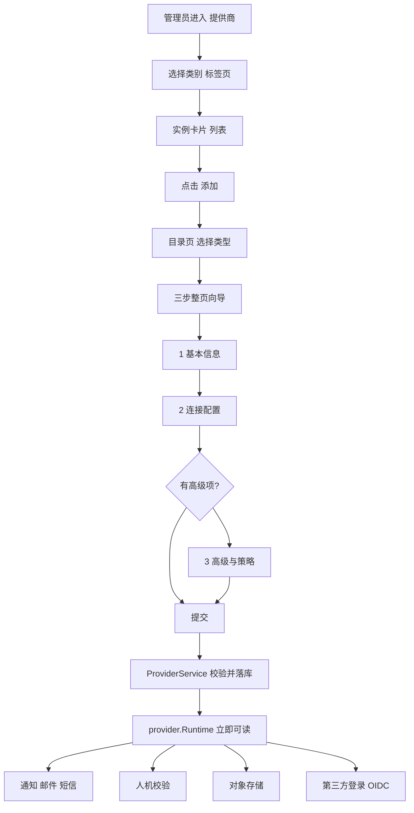
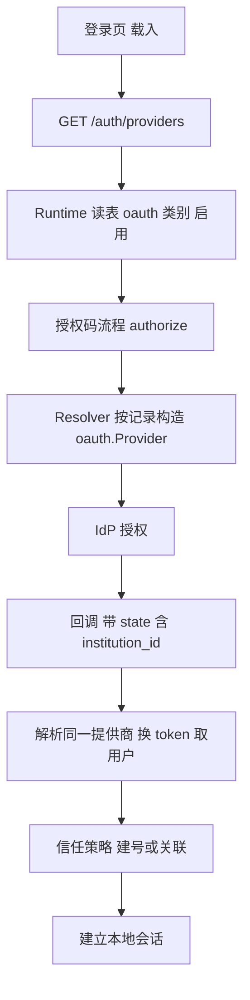
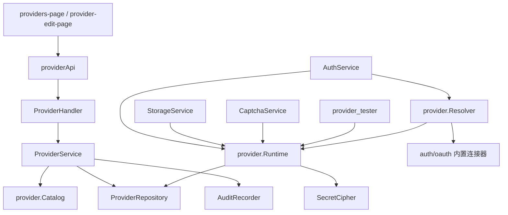

# 提供商模块优化 · 第四阶段 Spec（「身份提供方」→「提供商」改名 + 目录 schema 驱动 + 整页向导 + 外部 IdP 接线）

**创建**：2026-10-13 · **版本**：2.7 · **作者**：Agent
**状态**：**Completed（2026-10-13 实施完毕并全量验证，待用户验收）**
**前置**：第一阶段（组织）、第二阶段（应用）、第三阶段（身份连接）已完成，见 `docs/specs/261013-org-module-phase1.md`、`docs/specs/261013-application-module-phase2.md`、`docs/specs/261013-identity-connections-phase3.md`。
**参考形态**：第三阶段「身份连接」——后端 schema 目录（`internal/service/connection/catalog.go`）+ 目录页选类型 + `FormWizard` 分步整页向导 + 实例卡片。
**约束依据**：`AGENTS.md` §1（范围边界与「配置即生效」）、§2.2（目录结构）、§3.1-1/6/7/9/10/11（注入、事务、敏感字段、回归测试、禁止死代码、权限变更失效）、§3.3（错误码与英文 message）、§3.5（配置与密钥）、§3.6（列清单不漂移）、§3.7（DTO 化）、§5（迁移不可变）、§7.3/§7.4（前端红线与信息架构）、`docs/design-language.md`。

> 状态流转：`Draft` → `Awaiting Confirmation` → **`Confirmed`（2026-10-13 用户确认）** → `In Progress` → **`Completed`（2026-10-13）**。
> 确认后范围/设计变更需递增版本号（见文末「§11 实施记录与偏差」）。

---

## 1. 概述

把「身份提供方」模块重构为**名副其实的「提供商（Providers）」工作区**。

当前该模块名为「身份提供方」，实际覆盖四类运行时能力（**通知**：邮件/短信；**人机校验**；**对象存储**）外加两类**完全没有运行时读取点**的配置（第三方登录 / 标准 OIDC，其真正权威来源是 `configs/app.yaml` 的 `auth.oauth.providers`）。同时它的新增/编辑是 520 行的弹窗，字段按类别在**前端手写**，密钥**明文入库**，并且携带 9 个从未被任何代码读取的死字段。

本阶段交付四件事：

1. **改名与信息架构**：界面、导航、i18n 统一为「提供商」（英文 Providers），路由收敛到 `/institutions/:inst/providers`，新增/编辑改为**整页**（`/providers/new`、`/providers/:id`），废弃弹窗。
2. **目录 schema 驱动（后端单一来源）**：新增 `internal/service/provider/catalog.go`，在后端声明「类别 → 类型 → 字段（含校验/敏感/落库路径）+ 图标 + 能力」，前端按目录渲染，新增一个类型不再需要改前端。
3. **外部身份提供方接线（清偿最大一处「配了不生效」）**：第三方登录 / OIDC 的配置从 `configs/app.yaml` 迁入 `providers` 表并由运行时读取（含 SSO 信任策略、回调覆盖、字段映射），控制台成为唯一入口。
4. **生产化清偿**：密钥加密入库、删除死字段/死列、修复大小写缺陷、错误语义与 DTO 合规、补齐回归与冒烟用例。

交付后：管理员在「提供商」里按类别接入钉钉/飞书/OIDC/邮件/短信/人机校验/对象存储，**表单里出现的每个字段都在运行时真实生效**；页面上不再存在"能配但不生效"的字段。

---

## 2. 背景

### 2.1 用户诉求（原话）

> 「第四阶段：我们需要完成提供方的重构（现在叫身份提供方）。叫身份提供方不合理（因为还包括了短信、邮箱、对象存储等），应该改为提供商。你来规划设计一下，新增、编辑不要使用弹窗了，参考身份连接模块的。」

### 2.2 代码研究小结（澄清前已核实的代码事实）

**已核对文件**：`internal/repository/models.go`、`internal/repository/postgres/provider_repo.go`、`internal/service/provider_service.go`、`internal/service/provider_tester.go`、`internal/service/{auth_service,auth_code,application_policy,captcha,storage_service}.go`、`internal/service/notify/*`、`internal/service/connection/catalog.go`、`internal/auth/oauth/*`、`internal/config/config.go`、`internal/app/app.go`、`internal/server/router.go`、`internal/handler/{provider_handler,dto_resource}.go`、`frontend/web/src/features/iam/{pages,components}/*`、`frontend/web/src/{Router.tsx,widgets/layout/nav-config.ts}`、`frontend/web/src/shared/i18n/locales/*.json`、`migrations/001,002,017,019`、`scripts/smoke-test.sh`。

| # | 事实 | 证据 |
|---|---|---|
| F1 | 实体 `Provider` 41 列，覆盖 OAuth/OIDC/Email/SMS/Captcha/Storage 六类别；仓库已走反射映射（`insertReturningID`/`selectOne`/`updateEntity`），列清单不漂移 | `internal/repository/models.go:327`、`provider_repo.go` |
| F2 | 运行时**真实读取**的字段只有：通知（`category=Email/SMS`）、存储（`category=Storage`）、人机校验（`category=Captcha`）+ 通用 `state/name/type` | `auth_code.go:268`、`storage_service.go:68`、`captcha.go:60`、`provider_tester.go:56` |
| F3 | **`category=OAuth/OIDC` 的记录没有任何运行时读取点**：第三方登录/OIDC 由启动时从 `configs/app.yaml` 注册到内存 `oauth.Manager`，登录页提供方列表来自该内存注册表 | `app.go:265-293`、`auth_service.go:427`、`oauth/manager.go` |
| F4 | 因此控制台与登录链路**两处真相**：应用向导的「第三方登录」下拉读 `providers` 表（`providerApi.list`），而 `Authorize/Callback/provision` 走的是 yaml 注册的同名 provider | `application-edit-page.tsx:73`、`auth_service.go:510,633` |
| F5 | SSO 信任策略（`mode/default_role/auto_create/link_by_email/allowed_domains`）挂在 **yaml** 的 `auth.oauth.providers.<name>.provisioning` 上，且在登录时由 `oauth.Provisioning(name)` 读取 | `config.go:110-134`、`app.go:288-292`、`auth_service.go:633` |
| F6 | 密钥**明文入库**：`providers.client_secret` 直接由实体写入，无 `auth.SecretCipher` 参与；而用户 TOTP、同步器密钥、存储设置密钥、供给口令均已加密 | `provider_service.go:56` vs `syncer_service.go:119`、`storage_service.go:243`、`user_service.go:281` |
| F7 | Handler **直接把实体绑进请求体**（`bindJSON(c, &p)` on `repository.Provider`），未走 DTO；`Update` 依赖"前端不回传密钥"的隐含约定 | `provider_handler.go:44,61` |
| F8 | DTO 下发 `client_id2`/`has_client_secret2`/`cert`/`http_headers`/`user_mapping` 等**无读取点字段**，等于把配置面暴露给前端却不生效 | `dto_resource.go:164-180` |
| F9 | 前端向导判断 `p.category === 'email'`（小写），后端存的是 `Email`/`SMS` → 「邮件/短信提供商是否存在」的判定**恒为假** | `application-wizard.tsx:144-145` vs `provider_service.go:ProviderCategories()` |
| F10 | 类别/类型元数据硬编码在**三处**：后端 `ProviderCategories()` 字符串、前端 `categoryTypes`、前端按类别手写的差异字段；新增类型要改 3 个文件且无编译期约束 | `provider_service.go:31`、`provider-form.tsx:66`、`provider-form.tsx` 全文 |
| F11 | `sub_type` 只有存储与验证码读取（`normalizeStorageType(provider.SubType)`、`kindOf` 读 `SubType`），短信/存储/验证码的类型语义被拆到两列，前端还要同时提交 `type` 与 `sub_type` | `storage_service.go:100,285,319`、`captcha.go:76` |
| F12 | 连通性自检已有真实实现（SMTP 连接、阿里云/HTTP 短信、本地图形码、S3 写入探测、OAuth 必填校验），但只在**编辑态弹窗**里可用，列表页无入口 | `provider_tester.go`、`provider-form.tsx` 页脚 |
| F13 | 参考形态就绪：连接模块的目录 schema（字段带 `group/store/secret/show_when` + 能力声明）与整页向导可直接复用同一套前端基元（`FormWizard`/`SchemaFields`/目录网格） | `connection/catalog.go`、`connection-edit-page.tsx`、`connection-catalog.tsx` |

### 2.3 缺陷与死配置清单（本阶段的清偿目标）

| # | 级别 | 问题 | 证据 | 对应需求 |
|---|---|---|---|---|
| P1 | P0 | 第三方登录/OIDC 在 `providers` 表里"能配但不生效"（控制台与登录链路两处真相） | F3/F4 | FR-6 |
| P2 | P0 | 提供商密钥明文入库 | F6 | FR-7 |
| P3 | P1 | Handler 直接绑定实体、DTO 下发无读取点字段；`Update` 靠隐含约定避免覆盖密钥 | F7/F8 | FR-5/FR-7 |
| P4 | P1 | 死字段 9 个：`method`、`cert`、`client_id2`、`client_secret2`、`email_regex`、`enable_proxy`、`http_headers`、`user_mapping`、`custom_logout_url`（全仓无读取点） | 全仓 grep | FR-8 |
| P5 | P1 | 前端"是否存在邮件/短信提供商"判定因大小写恒为假 | F9 | FR-9 |
| P6 | P2 | 类别/类型/字段三处硬编码，新增类型要改 3 个文件 | F10 | FR-2/FR-3 |
| P7 | P2 | `type` 与 `sub_type` 语义重叠（存储/验证码/短信各拆一半） | F11 | FR-9 |
| P8 | P2 | 自检能力只在弹窗内可用；列表页看不到"是否连通" | F12 | FR-4 |
| P9 | P2 | `oauth` 包内错误为中文 `fmt.Errorf`（如"OIDC discovery 失败"）：既有登录路径已用 `bizerrors.Wrap` 正确包装（只进日志），但**新增的 Resolver/自检路径必须沿用同一约定**，谨防 `err.Error()` 下发 | `oauth/oidc.go:28`、`auth_service.go:Callback`（`bizerrors.Wrap` 现状） | FR-10 |

**结论**：本阶段的"重构"重点不是把弹窗换成页面，而是先让**「提供商」这个名字成立**——把第三方登录/OIDC 真正接到运行时（P1），把密钥与 DTO 收敛到规范（P2/P3），把配了不生效的字段与列清干净（P4/P7），再用目录 schema 把"字段从哪来、落在哪一步、怎么落库"变成**一份声明**（P6）。

---

## 3. 澄清与决策记录

> 说明：本轮在 Default 模式下无法交互式提问（`request_user_input` 不可用），故按代码事实给出**三项决策的推荐项 + 备选**，由用户在确认环节一次性确认或改判。三项决策互不依赖，可独立替换。

- **Q1**：第三方登录 / 标准 OIDC 的权威来源如何收敛？（现状：yaml 权威、表内死配置）
  **推荐**：**A. 迁入 `providers` 表并接线**——控制台成为唯一入口，OAuth/OIDC 配置入库、登录链路改读表并即时生效，`configs/app.yaml` 仅保留"启动期迁移兜底"。
  理由：① 这是本模块最大的一处「配了不生效」，不解决则"提供商"改名只是装饰；② yaml 里的 provider 是**启动期一次性注册**，改一行配置要重启进程，与"控制台可管理"直接冲突；③ 迁入后 `institution_id` 天然回答了 SSO 建号的落地组织（现在要额外配 `default_institution`）。
  **备选**：B. 保留 yaml 权威，提供商页面只保留邮件/短信/人机校验/对象存储四类，并删除 OAuth/OIDC 类别与死字段；C. 双来源（表可配、yaml 优先）——不推荐，仍是两处真相。

- **Q2**：字段契约是否改为 schema 驱动（请求体 `config` 非敏感 + `secrets` 敏感明文，字段落库路径由后端目录声明）？
  **推荐**：**A. 接口层 schema 驱动**——对齐第三阶段连接器的对外契约，**但落库仍映射到既有扁平列**（目录声明 `store` 路径），因此不需要改动通知/存储/验证码/登录四处读取点的存储形态，风险可控；新增类型在复用既有列时**零迁移**。
  **备选**：B. 彻底 JSONB 化（`providers.config` + `providers.secrets`），与 `connectors` 完全一致——最干净，但要改 4 处读取点 + 存量迁移；C. 维持现状（前端按类别拼字段、后端绑实体）。

- **Q3**：列表页形态？
  **推荐**：**A. 全面对齐身份连接**——列表按**类别标签页 + 实例卡片**（图标 / 名称 / 类型 / 状态 / 端点摘要 / 操作），新增走「目录页选类型 → 3 步整页向导」。
  理由：与身份连接同一心智，用户无需学两套；卡片天然承载"检查连通性 / 启停 / 修改"三个动作（表格需要折叠菜单）。
  **备选**：B. 列表保留表格，仅新增/编辑改整页向导；C. 列表保留表格 + 2 步向导（高级项折叠进第二步）。

---

## 4. 功能需求

### FR-1 命名与信息架构：统一为「提供商」
- **Description**：界面文案、导航、i18n 中英词条统一为「提供商 / Providers」；实体与包名保持 `Provider`（不做无收益的重命名）；路由收敛为组织命名空间下的 `/institutions/:inst/providers`，新增 `/providers/new` 与 `/providers/:id` 两个整页路由；旧地址 `/providers`（无组织前缀）继续由 `LegacyRedirect` 重定向到"上次访问组织"。
- **Input / Output**：无接口变化；`nav.providers`、`providers.title`、`providers.subtitle`、`dashboard.providers` 等词条更新；应用向导中作为**登录方式**引用时用「登录提供方」以避免与模块名混淆。
- **Acceptance criteria**：界面任意位置不再出现「身份提供方」指代**模块名**；中英词条一致（`i18n.test.ts` 通过）；`usage.test.ts` 通过；弹窗组件 `provider-form.tsx` 删除。

### FR-2 提供商目录（后端 schema 单一来源）
- **Description**：新增 `internal/service/provider/catalog.go`，声明 `类别 → 类型 → 字段` 全量 schema，含：显示名、说明、图标 key、字段控件类型、是否必填、是否敏感、条件展示、默认值、落库路径（`store`）、能力声明（`signin`/`notify`/`captcha`/`storage`/`test`）。
  类别固定为五类：`oauth`（外部身份提供方：第三方登录 + OIDC，**合并原 OAuth 与 OIDC 两个类别**，类型 `dingtalk|wechat|feishu|lark|oidc`）、`email`（`smtp`）、`sms`（`aliyun|http`）、`captcha`（`image|hcaptcha|recaptcha|turnstile`）、`storage`（`local|s3|minio`）。
- **Input / Output**：`GET /api/v1/providers/catalog` → `{ categories: [...] }`（替换原 `GET /providers/categories`，同步前端与冒烟用例）。
- **Acceptance criteria**：前端不存在任何硬编码的类别/类型/字段清单；`catalog_test.go` 断言每个类型的必填/敏感字段齐备、类别与类型 key 唯一、每个字段的 `store` 路径在实体上存在（反射校验，防止"声明了但列不存在"）。

### FR-3 类型专属的三步整页向导
- **Description**：新建/编辑一律整页。未带类型时先经**目录页**（按类别分节的卡片网格：图标 + 名称 + 一句话说明 + 「添加」）；选定后进入 `FormWizard`：
  - 步骤 1「基本信息」：`name`（创建后不可改，`^[a-z0-9][a-z0-9-_]{1,30}$`）、`display_name`、类别/类型只读标识、`state`；
  - 步骤 2「连接配置」：目录中 `group=connection` 的字段（按类型渲染，敏感字段留空 = 不修改）；
  - 步骤 3「高级与策略」：`group=advanced` 的字段（OAuth/OIDC：`scopes`、自定义端点、PKCE、字段映射、SSO 信任策略；其余类别无该步字段时**该步不出现**）。
  步骤内容必须写在**步骤条件内**，禁止把"接入方/上下文卡片"渲染到每一步（沿用第三阶段教训与 `application-wizard.test.tsx` 的断言方式）。
- **Input / Output**：路由 `/institutions/:inst/providers/new?category=oauth`、`/institutions/:inst/providers/:id`；提交调用 `POST/PUT /api/v1/providers`。
- **Acceptance criteria**：新增与编辑复用同一向导；任一步骤不出现与本步无关的字段；`provider-wizard.test.tsx` 锁定"字段只出现在所属步骤"。

### FR-4 连通性自检（列表卡片 + 向导内）
- **Description**：`POST /providers/:id/test` 保留并按类别执行真实探测（SMTP 连接、短信配置完整性/真实发送、验证码本地生成或远端站点密钥校验、存储写入探测、外部 IdP 端点可达性）；列表卡片提供「检查连通性」，向导编辑态底部提供同一动作（新建态保存后可用）。检查结果写审计并在卡片上以状态标签呈现（成功/失败 + 时间）。
- **Input / Output**：`POST /api/v1/providers/:id/test` → `{status:"ok"}`；失败返回 `PROVIDER_UNAVAILABLE`（英文 message，底层细节只进日志）。
- **Acceptance criteria**：SMTP 不可达时返回 503 而非伪装成功（沿用现有冒烟断言）；卡片可见最近一次检查结果。

### FR-5 提供商 API 契约（config + secrets + policy）
- **Description**：`POST /providers`、`PUT /providers/:id` 请求体统一为：

```json
{
  "institution_id": 1,
  "name": "corp-sso",
  "display_name": "企业单点登录",
  "category": "oauth",
  "type": "oidc",
  "state": "active",
  "config": { "issuer_url": "https://idp.example.com", "client_id": "...", "scopes": ["openid", "profile"], "enable_pkce": "true" },
  "secrets": { "client_secret": "***" },
  "policy": { "mode": "jit", "default_role": "user", "auto_create": "true", "link_by_email": "true", "allowed_domains": ["corp.example.com"] }
}
```

  逐键校验：未知键 → `INVALID_PARAMS`；敏感键混入 `config` → 拒绝（对齐 `connector_config_test.go` 既有语义）；`type` 必须属于该类别的目录声明，否则拒绝；`secrets` 缺省或空串 = 不修改。
  落库由目录的 `store` 路径映射到既有扁平列（`config`/`secrets`/`policy` 仅是**对外契约**，不改变存储形态，见 §5.4）。
- **Input / Output**：响应 DTO 改为 `config`（非敏感，回显）+ `has_secrets` 布尔（按目录中 `secret:true` 的键聚合），不再回显任何明文。
- **Acceptance criteria**：`provider_handler` 不再绑定 `repository.Provider`；新增"未知键/敏感键混入/未知类型"三组负向用例；同一份请求体在创建与更新路径等价。

### FR-6 外部身份提供方接线（OAuth / OIDC 成为真配置）
- **Description**：
  1. 运行时新增 `provider.Runtime`（见 §5.1）：按 `(institution_id, name)` 读取提供商行、解密密钥，作为通知/存储/验证码/登录**四处**的统一读取入口（替换各自直接调用 `providers.List(...)` 的写法）。
  2. 登录链路改为**按记录解析**：`Authorize(ctx, institution, provider, ...)` / `Callback` 由 state 中携带的 `institution_id` + `provider` 解析出 `oauth.Provider`（钉钉/微信/飞书/企业微信/Lark/OIDC），`oauth.Provider` 实例按行构造（廉价），**OIDC discovery 文档按 issuer 缓存（TTL 5 分钟）**——因此 `client_id/client_secret/scopes/端点` 的修改即时生效，只有 issuer 元数据有 TTL。
  3. 登录页提供方列表（`GET /auth/providers`）改为读表：`category='oauth' and state='active'`，`institution`/`client_id` 定位组织后过滤，应用 `providers` 白名单过滤逻辑保留。
  4. SSO 信任策略改由行承载（新增列 `provision_mode/default_role/auto_create/link_by_email/allowed_domains` + `redirect_uri` 覆盖），SSO 建号的落地组织改由 `providers.institution_id` 决定（不再依赖 `auth.oauth.default_institution`）。
  5. `configs/app.yaml` 的 `auth.oauth.providers` 降级为**迁移兜底**：启动时若目标组织尚无对应提供商行则种子写入（可用 `POLARIS_*` 关闭），并打印一次告警；文档更新为"控制台管理"。
- **Input / Output**：`GET /auth/providers?institution=&application=` 与 `?client_id=`；`GET /auth/oauth/:provider/authorize?institution=&from=`；回调 `GET /oauth/:provider/callback?code=&state=`（state 内含 institution_id，一次性消费不变）。
- **Acceptance criteria**：在控制台新建一个 `type=oidc` 的提供商并启用后，**无需重启进程**即可在登录页看到并以该 IdP 完成一次登录（冒烟用例覆盖：提供方列表出现 + authorize 返回真实授权地址）；修改 `client_secret` 后新会话使用新值；停用后登录页不再展示。

### FR-7 密钥加密入库（生产红线）
- **Description**：`providers.client_secret` 等敏感字段使用 `auth.SecretCipher` 加密后入库（与同步器、存储设置、TOTP 一致），读取时解密；DTO 一律只给 `has_*`；审计与日志不打明文。
  需要加密的键由目录的 `secret:true` 声明（当前为 `client_secret`）。
- **Input / Output**：`POST/PUT` 收到明文 → 加密落库；响应不含明文；`GET` 只回 `has_secrets`。
- **Acceptance criteria**：直连数据库查询不到明文密钥（冒烟用例断言 `SELECT client_secret` 不等于提交值且可被服务层解密使用）；`PROVIDER_SECRET` 任一接口响应中不出现。

### FR-8 死字段/死列清偿（配置即生效）
- **Description**：删除 9 个无读取点字段与其列：`method`、`cert`、`client_id2`、`client_secret2`、`email_regex`、`enable_proxy`、`http_headers`、`user_mapping`、`custom_logout_url`；同步删除 DTO 字段、前端类型 `Provider`、i18n 词条。
  **保留并接线**（本阶段赋予真实读取点，否则一并删除）：`issuer_url`、`scopes`、`enable_pkce`（OIDC 授权码 + PKCE）、`custom_auth_url`/`custom_token_url`/`custom_user_info_url`（非 discovery 的自定义端点）。
- **Input / Output**：新增迁移 027（见 §5.4.1）；实体、仓库、DTO、前端 `types.ts` 同步收敛。
- **Acceptance criteria**：全仓 grep 不再出现被删字段；`catalog_test.go` 断言"目录里声明的每个字段都有运行时读取点"（以服务层读取点为白名单的显式清单）。

### FR-9 类别与类型语义收敛
- **Description**：`category` 统一为小写枚举（`oauth|email|sms|captcha|storage`），存量数据迁移时归一化；`type` 成为唯一类型判别（合并 `sub_type` 语义），服务层按 `provider.Kind(p)` 归一化（`type` 优先，`sub_type` 兜底至迁移完成），迁移后删除 `sub_type` 列；后端把类别常量集中在目录包，替换 `auth_code.go`/`storage_service.go`/`captcha.go` 里的字面量（`"Email"`/`"Storage"`/`"Captcha"`）。
- **Input / Output**：无对外变化（既有前端字段 `category/type` 语义不变，取值改小写）。
- **Acceptance criteria**：前端"是否存在邮件/短信提供商"的判定恢复正确（`application-wizard.test.tsx` 新增用例，构造 `category:'email'` 的提供商断言按钮可用）；`captcha`/`storage` 的类型判定在新旧数据上均正确。

### FR-10 错误语义与 DTO 合规
- **Description**：`oauth` 包等底层的中文 `fmt.Errorf` 一律只进日志（现状：`Callback` 已用 `bizerrors.Wrap`，属正确写法，需保持）；本阶段**新增**的 `provider.Runtime`/`Resolver`/自检路径对外错误经 `errors.Code`（`INVALID_PARAMS` / `PROVIDER_UNAVAILABLE` / `OAUTH_PROVIDER_ERROR`），message 为英文，**禁止** `bizerrors.New(code, err.Error())` 这类写法；新增业务码在 `codes.go` 单点声明并通过唯一性测试。
- **Input / Output**：响应体不出现堆栈、底层错误文本、中文文案。
- **Acceptance criteria**：负向用例断言错误响应体为英文且不含底层细节；`codes_test.go` 通过。

### FR-11 前端基元复用（避免第二套渲染器）
- **Description**：把 `connection-fields.tsx` 的 schema 渲染器泛化为 `shared/components/schema-fields.tsx`（参数化 i18n 前缀与部门可选项），`ConnectionFields` 保留为薄包装；提供商向导直接复用；字段标签词条走 `providers.field.<key>`（不存在时回退目录 `label`，与连接模块一致）。
- **Input / Output**：无接口变化。
- **Acceptance criteria**：提供商与连接两个向导共用同一渲染器；`connection-edit-page.test.tsx` 全绿（回归）；新增词条经 `usage.test.ts` 校验存在。

### FR-12 应用向导联动修复
- **Description**：应用向导「第三方登录」选择器的数据源改为 `category='oauth' and state='active'` 的提供商（不再是含邮件/短信的整表），置灰判定大小写缺陷修复（FR-9），空态文案指向「提供商」页面。
- **Input / Output**：`application-edit-page.tsx` 的 `providerApi.list` 调用改为带类别过滤；`applications.providers`/`providersHint`/`providersEmpty` 文案对齐新命名。
- **Acceptance criteria**：仅存在邮件提供商时不误判为"有第三方登录可选"；断言见 `application-wizard.test.tsx`。

---

## 5. 设计

### 5.1 总体架构

```
internal/service/provider/            ← 新增包：提供商的"声明 + 运行时"单一来源
├── catalog.go        类别/类型/字段/图标/能力的唯一声明（对齐 connection/catalog.go）
├── catalog_test.go   目录自检（字段↔列、必填/敏感齐备、读取点白名单）
├── runtime.go        Runtime：按 (institution_id, category|name) 取提供商并解密密钥
└── resolver.go       Resolver：把提供商行构造为 oauth.Provider（OIDC discovery 缓存）

internal/service/provider_service.go   ← 改为薄封装：校验 + 目录驱动的 create/update + 审计
internal/service/provider_tester.go    ← 改为从 Runtime 取解密后的配置后探测
internal/service/{auth_code,auth_service,storage_service,captcha}.go
                                       ← 4 处读取点统一改经 provider.Runtime
internal/handler/provider_handler.go   ← 不再绑定实体；请求 DTO（config/secrets/policy）+ 响应 DTO
internal/service/connection/catalog.go ← 不变（身份连接）
frontend/web/src/features/iam/
├── pages/providers-page.tsx           ← 类别标签页 + 实例卡片
├── pages/provider-edit-page.tsx       ← 目录页 + 三步整页向导（新增）
├── components/provider-catalog.tsx    ← 目录网格（复用 ConnectionCatalogGrid 的视觉语言）
└── components/provider-form.tsx       ← 删除（弹窗）
frontend/web/src/shared/components/schema-fields.tsx  ← 从 connection-fields 泛化（新增）
```

**依赖方向（无环）**：
`handler → service → provider(catalog+runtime) → repository`；
`handler → service`；`provider.Runtime` 只依赖 `repository.ProviderRepository` + `auth.SecretCipher`；
`auth/oauth` 不依赖 `service`（由 `provider.Resolver` 反向构造），因此 `ProviderService → CaptchaService/StorageService`（自检用）不会形成环。

### 5.2 主流程



登录链路（外部 IdP）：



### 5.3 组件关系



### 5.4 数据设计

#### 5.4.1 数据库变更（迁移 `027_provider_catalog_contract`，up/down 成对；迁移不可变，不回改 001/002）

```sql
-- 1. 类别归一化为小写枚举（消除前后端大小写陷阱，见 P5）
UPDATE providers SET category = lower(category);

-- 2. 类型收敛：sub_type 的语义合并进 type（仅这三个类别曾用 sub_type 表达厂商能力）
UPDATE providers SET type = lower(sub_type)
 WHERE category IN ('sms', 'captcha', 'storage') AND sub_type <> '';
UPDATE providers SET type = lower(type);

-- 3. 删除死列（全仓无读取点）与冗余列
ALTER TABLE providers
    DROP COLUMN IF EXISTS method,
    DROP COLUMN IF EXISTS cert,
    DROP COLUMN IF EXISTS client_id2,
    DROP COLUMN IF EXISTS client_secret2,
    DROP COLUMN IF EXISTS email_regex,
    DROP COLUMN IF EXISTS enable_proxy,
    DROP COLUMN IF EXISTS http_headers,
    DROP COLUMN IF EXISTS user_mapping,
    DROP COLUMN IF EXISTS custom_logout_url,
    DROP COLUMN IF EXISTS sub_type;

-- 4. 外部身份提供方（SSO）信任策略 + 回调覆盖（原在 yaml 的 auth.oauth.providers[].provisioning / redirect_uri）
ALTER TABLE providers
    ADD COLUMN auto_create     BOOLEAN NOT NULL DEFAULT TRUE,
    ADD COLUMN link_by_email   BOOLEAN NOT NULL DEFAULT TRUE,
    ADD COLUMN allowed_domains TEXT[]  NOT NULL DEFAULT '{}',
    ADD COLUMN redirect_uri    TEXT    NOT NULL DEFAULT '';

-- 5. 提供商密钥加密（存量明文 → 密文由应用层一次性回填任务处理，见 FR-7 实施说明）
COMMENT ON COLUMN providers.client_secret IS 'AES-GCM 密文（SecretCipher），空串表示未配置';
```

`027_provider_catalog_contract.down.sql` 反向重建被删列（`sub_type` 由 `type` 回填，死列以默认值重建）——仅供开发回滚，数据不保证还原。

**实施时的两处调整**（详见 §11）：① `provision_mode` / `default_role` **未落地**——它们在原 yaml 配置里也从未被读取过（`provision()` 只读 `allowed_domains`/`link_by_email`/`auto_create`），按「配置即生效」不再引入死配置；② 被删列在删除前先采样到 `provider_dropped_columns_backup` 表留痕。

**密钥存量迁移**：迁移只改结构；存量明文由 `cmd/polaris -rotate-provider-secrets`（一次性子命令，幂等：能被 `SecretCipher` 解密则跳过）加密回填，并在 README/部署文档记录。若用户选择不迁移存量，则保留"读时兼容：解密失败即视为明文"的过渡逻辑，并在下一版本移除（需在 Spec 确认时选定）。

#### 5.4.2 接口设计

| Method | Path | 说明 |
|---|---|---|
| GET | /api/v1/providers | 列表（DTO：`config` 非敏感 + `has_secrets` + `last_check`） |
| GET | /api/v1/providers/catalog | **新增/替换** categories：类别→类型→字段 schema |
| GET | /api/v1/providers/:id | 详情 |
| POST | /api/v1/providers | 创建（`config`/`secrets`/`policy` + 逐键校验） |
| PUT | /api/v1/providers/:id | 更新（`name`/`institution_id` 不可变；`secrets` 留空=不修改） |
| DELETE | /api/v1/providers/:id | 删除（同时失效 Resolver 缓存） |
| POST | /api/v1/providers/:id/test | 连通性自检 |
| GET | /api/v1/auth/providers | 登录页提供方列表（读表 + 应用白名单过滤） |
| GET | /api/v1/auth/oauth/:provider/authorize | 发起 SSO（`?institution=`；state 内含 institution_id） |

**创建示例**：
```json
{
  "institution_id": 1,
  "name": "corp-sso",
  "display_name": "企业单点登录",
  "category": "oauth",
  "type": "oidc",
  "state": "active",
  "config": {
    "issuer_url": "https://idp.example.com",
    "client_id": "polaris",
    "scopes": ["openid", "profile", "email"],
    "enable_pkce": "true"
  },
  "secrets": { "client_secret": "s3cr3t" },
  "policy": { "mode": "jit", "default_role": "user", "auto_create": "true", "link_by_email": "true", "allowed_domains": ["corp.example.com"] }
}
```

**响应示例**：
```json
{
  "code": "OK",
  "message": "ok",
  "data": {
    "id": 7,
    "institution_id": 1,
    "name": "corp-sso",
    "display_name": "企业单点登录",
    "category": "oauth",
    "type": "oidc",
    "state": "active",
    "config": { "issuer_url": "https://idp.example.com", "client_id": "polaris", "scopes": ["openid", "profile", "email"], "enable_pkce": true },
    "has_secrets": true,
    "policy": { "mode": "jit", "default_role": "user", "auto_create": true, "link_by_email": true, "allowed_domains": ["corp.example.com"] }
  }
}
```

### 5.5 关键实现细节

1. **字段控制方式**：目录 `Field.Type ∈ {text,password,number,switch,select,tags,taglist,endpoint}`；`secret:true` 的字段只在 `secrets` 中提交、DTO 只回 `has_*`；`show_when` 支持按同类型另一字段取值条件展示（如存储 `type=s3` 才显示 bucket/region）。
2. **落库映射**：`store` 路径（点分）→ 既有扁平列；`policy.*` 落到新增策略列；`scopes`/`allowed_domains` 为 `TEXT[]`，nil 一律经 `orEmpty` 归一化（`AGENTS.md` §5 教训）。
3. **解密位置**：仅在 `provider.Runtime` 内解密并把明文交回调用方（内存），Repository 层不做加解密（保持租户/映射职责单一）；`ProviderService.Get/List` 返回的是**已剥离密钥**的实体（密钥字段置空 + `HasSecrets` 标记），杜绝"实体出服务层带明文"。
4. **Resolver 与缓存**：`oauth.Provider` 每次按行构造；OIDC discovery 文档按 `issuer_url`（或自定义端点组合）缓存 5 分钟；`Update`/`Delete`/`state=disabled` 时本实例立即失效，跨实例靠 TTL。
5. **多实例一致性**：`Runtime` 每次请求读库（无长缓存），因此配置变更在多实例下**立即生效**；只有 IdP 元数据有 TTL。
6. **权限**：沿用 `provider` 资源与 `read/create/update/delete` 动作；「检查连通性」沿用 `update` 动作。提供商归属组织变更（FR-6 中启用/停用 SSO）不涉及用户会话，但**停用提供商后其作为登录方式的应用需重新校验**（`application_policy` 的可用提供方判定改为读表，天然生效）。
7. **配置与密钥**：新增配置项 `providers.discovery_cache_seconds`（默认 300）与 `providers.seed_from_config`（默认 true，迁移兜底），一律支持 `POLARIS_*` 覆盖（`AGENTS.md` §3.5）。
8. **删除弹窗的连带**：`provider-form.tsx` 与其测试删除；`providers-page.tsx` 重写为卡片；新增 `provider-edit-page.tsx` + `provider-wizard.test.tsx`。
9. **i18n**：新增 `providers.catalog.*`、`providers.step.*`、`providers.field.*`、`providers.policy.*` 词条（中英同步）；`i18n.test.ts`（中英一致）与 `usage.test.ts`（引用有效）必须通过。

---

## 6. 实施计划

- [x] **Task 0：Spec 确认与基线**（Owner: Agent / 0.2 天 / 完成标准：用户确认 §3 三项决策，状态置 `Confirmed` → `In Progress` / 依赖：无）
- [x] **Task 1：目录 schema（后端单一来源）**（1 天 / `internal/service/provider/catalog.go` + `catalog_test.go`，五类别全部类型与字段齐备、`store` 路径反射校验通过、`GET /providers/catalog` 返回全量 / 依赖：Task 0）
- [x] **Task 2：迁移 027 + 实体/仓库收敛**（0.5 天 / 迁移 up/down 成对；实体删除死列、新增策略列；`make migrate-up`/`migrate-down` 往返通过；`mapper_test.go` 通过 / 依赖：Task 0）
- [x] **Task 3：`provider.Runtime` + 密钥加密**（1 天 / 通知/存储/验证码/自检四处读取点改经 Runtime；密钥加密入库、DTO 只回 `has_secrets`；负向用例 + 冒烟"库里非明文"断言 / 依赖：Task 1、Task 2）
- [x] **Task 4：Provider API 契约（config/secrets/policy）**（1 天 / Handler 不再绑实体；三组负向用例（未知键/敏感键混入 config/未知类型）；创建与更新等价 / 依赖：Task 3）
- [x] **Task 5：外部身份提供方接线**（2 天 / `provider.Resolver` + discovery 缓存；`Authorize/Callback/ListAppProviders` 读表；信任策略落列；yaml 降级为种子；冒烟覆盖"新建 OIDC 提供商 → 无需重启即可登录" / 依赖：Task 3、Task 4）
- [x] **Task 6：前端整页向导与目录页**（1.5 天 / `provider-edit-page.tsx` + `provider-catalog.tsx`；`SchemaFields` 泛化复用；弹窗删除 / 依赖：Task 1、Task 4）
- [x] **Task 7：前端列表卡片 + 命名/i18n 收敛**（1 天 / `providers-page.tsx` 卡片化；`nav.providers`/`providers.*`/`applications.providers` 词条更新；应用向导类别过滤与置灰缺陷修复 / 依赖：Task 6）
- [x] **Task 8：死配置清偿与文档**（0.5 天 / 删除 DTO 字段与前端类型；README/deployment.md 更新"提供商由控制台管理 + yaml 仅种子"；`rotate-provider-secrets` 子命令 / 依赖：Task 3、Task 5）
- [x] **Task 9：回归与冒烟**（1 天 / `make test`、`make vet`、`pnpm test`、`scripts/smoke-test.sh` 全绿；新增用例：向导步骤归属、目录↔列一致性、密钥非明文、SSO 免重启生效、大小写修复 / 依赖：Task 1–8）

**进度日志**（实施期间追加，不重写历史）：
- 2026-10-13：Spec v1.0 完成，状态 `Awaiting Confirmation`。
- 2026-10-13：用户确认并指示「你先实施吧」，状态 → `Confirmed` → `In Progress`。
- 2026-10-13：Task 1–9 全部完成（详见 §11.1），后端 16 包测试、前端 60 用例、端到端冒烟**全部通过**；顺带清偿 3 处第三阶段遗留缺陷（§11.3）。

---

## 7. 非功能需求

- **安全**：密钥 AES-GCM 加密入库；DTO 只下发 `has_*`；错误响应不含堆栈与底层细节；SSO state 一次性消费；`redirect_uri` 覆盖值必须是站内相对路径或注册值（沿用第三阶段约定）。
- **性能**：`Runtime` 每请求读库（索引 `providers_institution_id_idx` + `providers_category_idx` 覆盖）；OIDC discovery 缓存 5 分钟，避免登录页/授权入口的重复外呼。
- **可用性**：外部 IdP 不可达时返回 `PROVIDER_UNAVAILABLE`，不影响本地密码/验证码登录。
- **兼容性**：`GET /providers/categories` 由 `GET /providers/catalog` 替换（同步前端与冒烟），旧地址 `/providers` 的前端路由重定向保留。

---

## 8. 假设与风险

- **假设**：① 用户采纳 §3 的推荐项（A/A/A）；② 现有 `providers` 表数据量小，迁移与存量密钥回填可在一次发布内完成；③ 应用 `providers` 白名单继续以**名称**引用提供商（沿用现状，本阶段不改为主键引用）。
- **风险 1**：SSO 接线把"配置读取"从启动期移到请求期，可能引入 OIDC discovery 失败导致的登录失败。**缓解**：缓存 + 明确的 `PROVIDER_UNAVAILABLE` 错误 + 保留 yaml 种子兜底开关。
- **风险 2**：`sub_type` 删除影响存储/验证码类型判定。**缓解**：迁移先回填 `type`，服务层 `Kind()` 兼容读，冒烟覆盖新旧数据。
- **风险 3**：提供商密钥加密后，若运维忘记执行回填命令，存量行会解密失败。**缓解**：过渡期"解密失败视为明文"的兼容读取 + 启动告警 + 文档强调。
- **风险 4**：`provider.Runtime` 被 4 处消费，改动面较大。**缓解**：先在 Task 3 完成"读取点切换但行为不变"（回归全绿），再在 Task 5 接 SSO。

---

## 9. 验收标准

- [ ] 界面无「身份提供方」指代模块名；导航、标题、空态、应用向导文案均为「提供商 / 登录提供方」；中英词条一致。
- [ ] `/institutions/:inst/providers` 为类别标签页 + 实例卡片；新增/编辑为**整页**（`/providers/new`、`/providers/:id`），仓库中不再存在弹窗组件。
- [ ] 前端不存在硬编码的类别/类型/字段清单；`GET /providers/catalog` 为唯一来源；新增一个类型（复用既有列）不需要改前端。
- [ ] 目录声明的每个字段都有运行时读取点；`method/cert/client_id2/client_secret2/email_regex/enable_proxy/http_headers/user_mapping/custom_logout_url/sub_type` 在代码与 DTO 中不再出现。
- [ ] 密钥在数据库中为密文，接口响应中无明文；`has_secrets` 正确表达"是否已配置"；留空提交不覆盖原值。
- [ ] 新建并启用一个 OIDC 提供商后，**无需重启**即可在登录页出现并完成一次 SSO 登录；停用后立即消失；信任策略（`auto_create`/`link_by_email`/`allowed_domains`/`default_role`）按行生效。
- [ ] 邮件/短信/人机校验/存储四类既有能力不回归（冒烟第 19–22 步全绿）。
- [ ] 应用向导「第三方登录」只列出 `category=oauth` 的启用提供商；仅有邮件提供商时不误判。
- [ ] `make test`、`make vet`、`pnpm test`、`scripts/smoke-test.sh` 全绿；新增/修改逻辑均有回归测试（`AGENTS.md` §3.1-9）。

---

## 10. 范围外（延期项）

- SAML / CAS、WebAuthn、联合凭证（沿用 `AGENTS.md` §1 范围边界）。
- 提供商配置的**版本历史与回滚**。
- **短信多模板（按场景）**：当前一个短信提供商只有一套签名 + 一个模板（`template_code`），
  且全仓**只有一个发码使用点**（`POST /auth/codes`，登录/注册验证码共用；注册页不发码、
  绑定手机/找回密码无本地入口、管理员重置密码不发通知）。要做"一个提供商挂多个模板"，
  必须先有第二个**真实**场景，否则模板就是死配置（§1）。届时的扩展点：
  `provider_templates(provider_id, scene, template_code, template_params[])` 子表 + `UNIQUE(provider_id, scene)`，
  场景集合（`signin` / `signup` / `bind` / `reset` / `notify`）在目录包单点声明，
  发码接口带 `scene`，找不到场景模板时回落提供商的默认 `template_code`。
- 提供商级别的**出方向供给连接器**（属第三阶段"身份连接"领域）。
- 平台级「系统默认存储」与组织级存储提供商的统一（现有 `storage_settings` 与 `providers(storage)` 双层结构保留）。
- 跨实例的缓存主动失效（当前用 TTL 兜底；如后续要求"秒级全局一致"，再引入 Redis 版本号）。

---

*本 Spec 由 Spec Mode 依据用户澄清与代码研究生成。范围/设计变更时同步更新版本号。**确认前不进入实施。***

---

## 11. 实施记录与偏差（2026-10-13）

### 11.1 落地内容（已完成）

| 任务 | 内容 | 关键文件 |
|---|---|---|
| Task 1 | 提供商目录（类别/类型/字段 schema/图标/能力）单一来源 + 自检 | `internal/service/provider/catalog.go`、`catalog_test.go` |
| Task 2 | 迁移 027（类别归一化、`sub_type` 并入 `type`、删死列、策略列、索引）+ 实体收敛 | `migrations/027_provider_catalog_contract.*`、`internal/repository/models.go` |
| Task 3 | `provider.Runtime`（统一读取 + 密钥加解密）/ `Resolver`（按行构造连接器，cache key 含配置指纹）/ 密钥 AES-GCM 入库 / 四处读取点切换 | `internal/service/provider/{runtime,resolver,pkce}.go`、`auth_code.go`、`storage_service.go`、`captcha.go`、`provider_tester.go` |
| Task 4 | API 契约改为 `config` + `secrets` + `policy`（逐键校验、未知键拒绝）；DTO 只回 `has_secret` | `internal/handler/provider_handler.go`、`dto_resource.go`、`dto_test.go` |
| Task 5 | 外部身份提供方接线：登录链路读表、OIDC discovery/静态端点 + PKCE、信任策略落到行、yaml 降级为种子 | `internal/service/auth_service.go`、`internal/auth/oauth/oidc.go`、`internal/app/app.go`（`seedOAuthProviders`） |
| Task 6 | 整页向导（目录页 + 3 步）+ 共享 schema 渲染器 | `frontend/.../pages/provider-edit-page.tsx`、`components/provider-catalog.tsx`、`shared/components/schema-fields.tsx` |
| Task 7 | 列表改卡片 + 命名/i18n 收敛 + 应用向导类别过滤与大小写缺陷修复 | `frontend/.../pages/providers-page.tsx`、`locales/*.json`、`application-wizard.tsx`、`application-edit-page.tsx` |
| Task 8 | 密钥回填命令 + 文档 | `cmd/polaris/main.go`（`-rotate-provider-secrets`）、`README.md`、`docs/deployment.md` |
| Task 9 | 回归与冒烟 | 后端 16 包全绿、前端 17 文件 60 用例全绿、冒烟新增「控制台新建 → 登录页立即可见」用例并通过 |

### 11.2 与初版 Spec 的偏差

1. **不引入 `provision_mode` / `default_role`**：两者在原 yaml 配置里也从未被读取（`provision()` 只读 `allowed_domains`/`link_by_email`/`auto_create`），按「配置即生效」不再引入；如需"默认角色"，应作为独立需求（涉及角色授予与会话失效）另议。
2. **DTO 不含 `last_check`**：自检结果目前没有持久化，故不下发"最近一次检查结果"字段（避免又一处"配了不生效"的展示）。
3. **迁移号 021 → 027**：`021` 已被第三阶段的 `syncer_config_jsonb` 占用。
4. **仍按名称引用**：应用的 `providers` 白名单继续以提供商**名称**引用（沿用现状，本阶段不改主键引用）。
5. **`custom_logout_url` 删除**：未接线 RP-initiated logout，故随死字段一并删除；OIDC 的授权/令牌/用户信息三项自定义端点则**保留并接线**。

### 11.3 顺带清偿的第三阶段遗留缺陷（阻塞冒烟门禁）

| 缺陷 | 影响 | 处置 |
|---|---|---|
| `asyncd` 服务在 handlers 之后构造 → handler 持有 nil 服务 | `GET /asyncd/tasks` 500（空指针 panic） | `internal/app/app.go`：把 asyncd 构造提前到 handlers 之前 |
| `asyncd_schedules.daily_times` 为 NOT NULL，插入时传 nil 切片 | 4 个定时任务注册全部失败 → 定时同步/清理不运行 | `asyncd_schedule_repo.go` 用 `orEmpty` 兜底（AGENTS §5） |
| 迁移 026 删除了 `app_accounts.related_password`，但仓库仍读写该列 | `GET /app-accounts`、`/connectors/:id/reconcile`、供给写号全部 500/失败 | `app_account_repo.go` 改回 `has_password` |
| 冒烟断言 `map[credentials:true]` 与当前 `json_field` 输出格式不符 | 冒烟在 23 步必失败 | `scripts/smoke-test.sh` 改为按响应体断言 |

### 11.4 验证记录

- `go build ./...`、`go vet ./...`、`go test ./...`（16 包）全绿；
- `pnpm test`（typecheck + vitest 61 用例 + build，最大分包 225KB < 500KB 红线）全绿；
- `scripts/smoke-test.sh` 端到端全绿，含新增 22b：**在控制台创建 OIDC 提供商后，`GET /auth/providers` 立即可见**（证明"改配置无需重启"）；
- 迁移 027 已在开发库应用（`-migrate` 输出 `已应用迁移: [27]`）；
- `-rotate-provider-secrets` 实测：明文 → 密文（可解回原文），幂等跳过已加密行；
- `seedOAuthProviders` 实测：`enabled: true` 的 yaml provider 被写入一次，重复启动跳过。

### 11.5 收尾：工程规范同步（AGENTS.md）

| 变更 | 位置 |
|---|---|
| 新增 §2.3「提供商（Provider）模块约定」：目录单一来源、`config`/`secrets`/`policy` 契约、Runtime/Resolver 运行时、密钥与 `-rotate-provider-secrets` | `AGENTS.md` §2.3 |
| 后端目录树补 `service/provider/`（catalog/runtime/resolver）与 `service/connection/` | `AGENTS.md` §2.2 |
| 工程教训表新增 4 行：**装配顺序**（asyncd 晚于 handlers → nil 服务）、**迁移改列必须同批改仓库列清单**（`app_accounts.related_password` → `has_password`）、**门禁长期红的连带损失**（冒烟第 9 步失败掩盖 19–24 步）、**「配置即生效」同样适用于配置文件**（yaml 里的 `provision_mode`/`default_role` 也从未被读取） | `AGENTS.md` §8 |
| 命名与术语统一为「提供商 / 登录提供方」：能力面、存储分层表、信息架构、资源引用规则 | `AGENTS.md` §1 / §2.1 / §7.4 |
| API 文档同步：`/providers/catalog`、`:id` 语义、`/auth/providers` 数据源说明 | `docs/api-reference.md`、`README.md` |

### 11.6 验收期修复（v1.1，2026-10-13）

用户在界面验收时发现**字段标签显示 i18n 报错原文**：

> `key 'providers.field.name (zh)' returned an object instead of string.`

**根因**：生成词条时把 `providers.field.<key>` 写成了对象（`{"name": "标识", "nameHint": "…"}`），
正确形态应是同级的两个字符串 `providers.field.name` / `providers.field.nameHint`。
i18next 解析到对象即抛错，前端把该错误串当成标签渲染；而既有前端用例用 `i18n.t(key)` 做断言，
**页面与断言拿到同一条报错字符串**，因此"自证通过"（既有 `i18n.test.ts` 只校验中英一致与非空，
对象子树被当作命名空间，同样漏过）。

**修复**：
1. 拉平 `providers.field.*`（zh/en 各 45 条），并补上测试立刻查出的缺失词条 `region_idHint`；
2. 新增后端回归 `internal/service/provider/i18n_test.go`：按目录声明逐个校验
   `providers.field.<key>` / `<key>Hint` 与 `providers.category.<key>` 在**中英两侧都存在且是字符串**——
   目录是这些 key 的声明处，故把"目录 ↔ 词条"的同步锁在 `go test` 里；
3. 前端用例改为断言**字面量**（英文 'Identifier'、中文 `zh.providers.field.name`），不再用 `i18n.t` 自证；
4. 全仓扫描：`*.field.*` / `*Hint` 词条已无任何非字符串值，`upload.upload` 之外的"同名嵌套"为 0；
5. `AGENTS.md` 工程教训补一行（词条对象化 + 测试自证的组合陷阱）。

### 11.7 验收期修复（v1.2，2026-10-13）：标签语义、上传组织、错误实例

1. **字段标签不再是"多义拼盘"**（用户反馈：阿里云短信的高级步出现「端点 / 根目录 / 网关地址」）
   —— 根因是同一列名 `endpoint` 在不同类型下含义不同，却被我写成一条通用词条，把存储根目录、S3 端点、
   短信网关三种语义拼在一起。修复：
   - `SchemaFields` 支持**类型维度**词条，解析顺序固定为 `providers.field.<type>.<key>` → `providers.field.<key>` → 目录声明；
   - i18n 通用词条只保留"多数类型下都成立"的含义（`endpoint` = 端点），并按类型补 `<type>` 专属词条
     （`local.endpoint` = 存储根目录、`aliyun.endpoint` = 接口地址、`http.endpoint` = 网关地址、`smtp.client_id` = 账号、
     `hcaptcha/recaptcha/turnstile` = Site Key / Secret Key、`s3/minio` = AccessKey）；
   - 后端守卫测试同步升级：按「类型专属 → 通用」判定，并校验类型专属命名空间内的每一项都是字符串。
2. **目录收敛**：通用 HTTP 短信网关的发送契约（JSON POST `phone/code/signName/template`）**不读取任何凭据**，
   故不再声明 `client_id`/`client_secret`（否则又是一处"配了不生效"）；阿里云短信的 AccessKey 转为必填。
3. **上传落到当前工作区组织**（用户反馈：在组织 2 建了本地存储，上传仍报 `PROVIDER_UNAVAILABLE`）
   —— 根因：`POST /upload` 用的是**会话所属组织**（id=1），而提供商建在工作区组织（id=2）。
   修复：新增 `uploadInstitution`，按 `?institution=`（`instID`）解析并校验租户隔离（非平台管理员不得写入他组织）；
   前端 `api.upload` 支持 query，`UploadOrURL` 透传 `institution`（组织编辑页用被编辑组织、应用向导用当前工作区组织）。
4. **错误实例不再被共享污染**：`ErrProviderUnavailable` 等包级错误是**共享实例**，`WithDetail` 直接写其 `Details`
   导致不同调用点的细节互相叠加（响应里同时出现登录链路的 `category` 与存储链路的 `hint`）。
   修复：`WithDetail`/`WithError` 返回副本；`PROVIDER_UNAVAILABLE` 文案由 "notification provider unavailable"
   改为中性的 "provider unavailable"（它现在同时承载通知/人机校验/对象存储/外部 IdP）。

### 11.8 验收期修复（v1.3，2026-10-13）：开发环境静态资源裂图

用户反馈应用编辑页的**站点图标缩略图裂图**（值为 `/static/storage/favicons/2/….png`）。逐层核对：

| 检查 | 结果 |
|---|---|
| 文件是否落盘（本地存储根 `/Users/kkcheng/download/test`） | ✅ `favicons/2/7691cff0-….png`（41,808 字节） |
| 直连后端 `:8100/static/storage/...` | ✅ 200 |
| 经 Vite `:5173/static/storage/...` | ❌ 200 但返回 **SPA index.html**（`` 拿到 HTML → 裂图） |
| 生产 `docker/nginx.conf` | ✅ 已映射 `/static/` |

**根因**：`frontend/web/vite.config.mjs` 的开发代理只有 `/api`、`/oauth`、`/.well-known`，**漏了 `/static`**。
上传类字段（头像 / Logo / 站点图标）返回的都是相对地址，开发环境因此命中 SPA 回退。

**修复**：开发代理补 `/static`；新增 `vite.proxy.test.ts` 锁定"后端自有前缀必须全部被代理"，
README 的启动说明同步补全前缀清单。此问题与提供商模块无关，但同属"配置不一致导致的功能看起来坏掉"，
故记入 `AGENTS.md` 工程教训。

### 11.9 验收期调整（v1.4，2026-10-13）：类别图标 + 「对象存储」改名「存储」

用户反馈两点，均按"目录即单一来源"实现：

1. **类别菜单加图标**：`CategoryInfo` 新增 `Icon` 字段（`signin` / `email` / `sms` / `captcha` / `storage`），
   前端 `ProviderIcon` 统一渲染——图标 key 由后端目录声明，前端不另起一份映射；列表页标签页与"新增"页的
   分组标题都带图标。`catalog_test.go` 断言类别必须声明图标（缺失即测试失败）。
2. **「对象存储」改名「存储」**：该类别同时包含本地目录（local）与 S3 兼容对象存储（s3 / minio），
   叫"对象存储"名不副实。改动点：目录 `CategoryInfo.Name` 与描述、i18n `providers.category.storage`（中英）、
   页面副标题、README / AGENTS 的类别列举。
   注意**保留**技术语境下的"对象存储"（`storage/s3.go`、`S3Store`、系统级默认对象存储设置等）——
   改的是**类别名**，不是技术概念。
3. 前端回归：新增 `providers-page.test.tsx` 锁定"五个类别菜单各带图标"与"存储"命名；
   前端断言中英两侧（`zh.providers.category.storage === '存储'`、`i18n.t(...) === 'Storage'`）。

### 11.10 验收期修复（v1.5，2026-10-13）：多个同类提供商时"到底用哪个"

**用户提问**：一个组织配置了多个存储提供商时，上传图片用哪一个？

**当时的答案（缺陷）**：`StorageService.activeStorageProvider` → `provider.Runtime.Active` →
仓库 `ORDER BY category ASC, name ASC` 取**第一个启用项**。也就是说"用哪个"由**名称字典序**决定，
界面上完全看不出来；同类问题也存在于邮件/短信（`notificationProvider`）与人机校验（`ActiveProvider`）。

**修复**：把隐式规则变成显式规则 + 数据库约束。

1. 目录新增 `CategoryInfo.Singleton`：`email` / `sms` / `captcha` / `storage` 为 `true`
   （运行时"取一个"），`oauth` 为 `false`（运行时"列出全部启用项供登录页选择"，允许多个）；
2. 服务层在 `Create` / `Update` / `SetState` 三处校验：单例类别若已有其它启用项 → `409 CONFLICT`
   （英文 message + `details.active_provider` 指出当前生效的是谁）；
3. 迁移 **028**：存量收敛（每个 (组织, 单例类别) 只保留**名称最小**的启用项——与运行时既有选择一致，
   因此不改变当前实际生效者；其余置为 disabled）+ 部分唯一索引
   `providers_singleton_active_key (institution_id, category) WHERE state='active' AND category IN (...)`；
4. 新增 `POST /providers/:id/state`（只切状态）：列表卡片提供「启用 / 停用」快捷开关，
   单例类别里启用中的卡片显示「当前生效」徽标。**不复用 PUT**——`Update` 是整表语义，只带 `state` 会把名称冲掉；
5. 回归：服务层用例（第二个启用被拒 / 切换状态不动其它字段 / oauth 可并存）、
   冒烟用例（第二个启用 → 409、停用后启用另一个 → 201、已有一个生效项时切回启用 → 409）、
   前端用例（「当前生效」徽标 + 停用入口）。

### 11.11 验收期增强（v1.6，2026-10-13）：短信模板变量按声明装配

**用户提问**：一个短信提供商能不能下挂多个模板、并指定模板支持哪些参数？

**回答（现状核对）**：
- 一个提供商 = 一套签名 + **一个**模板，发送时参数**硬编码** `TemplateParam={"code": ...}`；
- 全仓**只有一个发码使用点**（`POST /auth/codes`），注册页不发码、绑定手机/找回密码无本地入口、
  管理员重置密码不发通知 → **此时引入"多模板"会立刻变成死配置**（§1），故本期不做，
  只把"多模板"的扩展点与解锁条件写入 §10。

**本期落地（参数声明，因为它对应真实缺陷）**：阿里云 `SendSms` 的 `TemplateParam` 与模板内容里的
`${变量}` 是**严格匹配**的（多一个、少一个、名字对不上都会被拒），所以此前像
「您的验证码 `${code}`，`${minutes}` 分钟内有效」这种模板**根本发不出去**。

1. `internal/service/provider/template.go`：封闭的内置变量集
   （`code` / `minutes` / `phone` / `institution` / `application`），单一来源；
2. 迁移 **029**：`providers.template_params TEXT[] NOT NULL DEFAULT '{}'`（空 = 历史行为只发 code）；
3. 目录：短信类型新增受限多选字段 `template_params`（新控件类型 `multiselect`，取值必须来自声明的 Options），
   `Bind` 对"有 Options 的字段"统一做白名单校验 → 未知变量名**落库前**即 `400`；
4. 发送链路：`notify.Config.TemplateParams` + `notify.Message.Vars`，
   阿里云按声明装配 `TemplateParam`、通用 HTTP 网关在固定契约之外追加声明过的变量；
   取值来源：验证码、应用配置的有效期、接收号码、组织标识、应用名；
5. 前端：`SchemaFields` 支持 `multiselect`（复用 `MultiSelect`），向导的高级步可增删变量；
6. 回归：`notify` 单测（只发声明过的变量、未声明时兼容历史行为、取不到值的变量不下发）、
   `Bind` 白名单用例、前端渲染与 `toPayload` 用例、冒烟新增两条（声明 code+minutes → 201 且回显；
   未知变量 → 400）。

### 11.12 验收期修复（v1.7，2026-10-14）：类型卡片在每一步重复出现

**用户反馈**：新建提供商页面「为什么每一步都有当前提供商的类型」。

**定性**：是实现 BUG，不是设计。而且违反的是**本仓库已经记过的规则**——
`AGENTS.md` §8「向导每一步都出现『品牌主题』/『接入方』」一行明确要求
"步骤内容必须写在步骤条件内"，本 Spec 的 FR-3 也写了"沿用第三阶段教训"，
但实现时把类型卡片放在了三个步骤条件之外，于是每步都渲染。

**为什么测试没拦住**：`provider-edit-page.test.tsx` 只断言了"各步应出现的**字段**"，
没有断言"只属于第一步的**上下文卡片**应当消失"——断言方向单边。

**修复**：
1. 类型卡片改为只在 `stepIds[step] === 'basic'` 时渲染（对齐身份连接的写法，创建态保留「更换类型」，
   编辑态只作标识展示）；
2. 回归测试补齐**反向断言**：切到第 2/3 步时类型名称与「更换类型」按钮必须消失，切回第一步必须重新出现。
   已验证该断言在改回错误写法时**确实失败**（先制造失败、再修复，避免"测试永远绿"）。

### 11.13 验收期修复（v1.8，2026-10-14）：应用「名称」被「标识」覆盖

**用户反馈**：应用编辑里「名称」填 `Net Bird`，提交后又变回标识 `net-bird`。

**根因（后端 handler 字段错位）**：

```go
app.InstitutionID = instID(c)
app.Name = h.codeByID(c)   // ← 把路径 id 解析出的**标识 code** 写进了 Name
```

第二阶段把 `applications` 拆成 `code`（标识，进 URL 与外部集成、创建后不可改）与 `name`（人类可读名称）
时，这行没有跟着改（此前 `name` 就是标识）。后果两条：
1. 任何保存都会把用户填的名称覆盖成标识——即用户看到的现象；
2. 请求体不带 `code` 时（如只改名称），服务层按空标识查库 → 直接 `404 NOT_FOUND`。

**修复**：`app.Code = h.codeByID(c)`。应用是全仓唯一"标识与名称分离"的资源，其余资源
（角色/用户组/用户/证书/提供商…）的 `name` 本身就是标识，写法保持不变（已全仓核对）。

**回归**：
- `internal/handler/application_handler_test.go`（新增）：内存仓库 + 真实 `ApplicationService`，
  断言"保存后 name 保留、code 不变"，以及"不带 code 的请求也能按路径标识定位到应用（不得 404）"；
  已验证改回错误写法时两条用例**确实失败**。
- 冒烟：新增「更新应用名称 → 回读 → 名称与标识各自独立」用例（E2E）。
- 存量数据：用户那条 `net-bird` 应用的名称已用修复后的实例改回 `Net Bird`
  （注意必须重启后端再改，否则旧代码会再次覆盖）。

### 11.14 验收期修复（v1.9，2026-10-14）：编辑提供商落到了"选择类型"页

**用户反馈**：提供商列表点「编辑」，进入的却是"提供商选择（目录）页"。

**根因（前端状态死锁）**：

```tsx
// 类型只能来自 URL 参数（新建时带 category/type；编辑地址只有 id）
const [typeKey, setTypeKey] = useState(params.get('type') ?? '')

// 取记录的 effect 却要求 typeInfo 已就绪
useEffect(() => {
  if (isCreate || providerID <= 0 || !institution || !typeInfo) return   // ← 死锁
  const data = await providerApi.get(providerID, institution)            // 永远不执行
  ...
}, [...])
```

死锁链条：编辑地址不带 `type` → `typeInfo` 为空 → 取记录的 effect 直接 return → 记录取不到、
类型也永远不会被设置 → `if (catalog && !typeInfo)` 命中，渲染"选类型"页。

**同样的写法在身份连接模块（`connection-edit-page.tsx`）里也存在**，即"编辑连接"同样会落到选类型页；
本次一并修复（先读代码确认，再各自补"编辑路径"回归用例验证）。

**修复（两页一致）**：
1. 拆成两个 effect：① 按 id 取记录 → **用记录里的 `category`/`type`（连接是 `type`/`sub_type`）定位类型**；
   ② 类型就绪后回填表单（密钥/敏感字段仍留空 = 不修改）；
2. "选类型"分支收紧为 `isCreate && !typeInfo`（编辑态的类型来自记录，不允许落到该分支）；
3. 编辑态记录取不到（404）时给出明确的"未找到 + 返回"状态，而不是空白向导或选类型页。

**顺带修复**：提供商标识（`name`）此前在编辑态看起来可改、实际存不下去（后端按路径标识定位，
`updateEntity` 也排除了该列）。目录新增 `Field.Immutable` 声明，`SchemaFields` 在编辑态置为只读——
与应用的 `code` 行为一致。

**回归**：`provider-edit-page.test.tsx` / `connection-edit-page.test.tsx` 各新增"编辑路径"用例
（断言直接进入向导、类型卡片可见、无"添加"按钮；提供商侧另断言标识只读、名称回填）。
两页均已用"改回旧写法 → 用例失败 → 恢复"验证过。

### 11.15 验收期修复（v2.0，2026-10-14）：公开面组织引用 `institution` vs `institution_id`

**用户反馈**：「新建应用后登录报密码错误；点钉钉登录也一样」，且贴出的请求体里 `institution` 是空串。

**追查结论（两处同族缺陷 + 一处语义混乱）**：

1. **请求 DTO 用了驼峰 tag**：`LoginRequest` / `CodeSendRequest` / `CodeLoginRequest` / `MagicLinkRequest` /
   `SignupRequest` 的 tag 都是 `json:"institutionID"`，而前端发的是 `institution`。
   Go 的 JSON 绑定**不是大小写模糊匹配**，键名不同即丢弃 → **公开面传上来的组织参数从未生效**，
   后端一直按"域名 → 唯一命中 → 默认组织"自动解析；多组织部署下这就表现为"账号密码正确却报错"。
2. **响应 DTO 同病**：`AppInfo.Institution` 的 tag 也是 `institutionID`（名字像 id、值却是组织 name），
   前端读 `info.institution` 永远 undefined → 登录页虽然渲染出了组织名/Logo，却始终不把组织带进后续请求。
3. **我的第四阶段缺陷**：`provider.Runtime.ListActive` 把 `institutionID == 0` 当作错误拒绝，
   而 `resolveSigninInstitutionID` 正是用 0 表示"跨组织按名称定位提供商" → 该能力成了死代码，
   "只带提供商名发起钉钉授权"必然 404。

**修复（统一为 id 权威 + 标识兼容，向第二阶段"引用一律用主键 id"收敛）**：
- `app-info` 同时下发 **`institution_id`（主键，权威）** 与 `institution`（组织标识，兼容）；
- 公开面请求支持 **`institution_id`**（主键）与 `institution`（标识），解析**主键优先**；
  给了主键却解析不到 → **直接 404，不回落**（否则会静默登进别的组织）；
- 覆盖端点：`/auth/login`、`/auth/codes`、`/auth/login/code`、`/auth/magic-link`、`/auth/signup`、
  `/auth/captcha`、`/auth/providers`、`/auth/app-info`、`/auth/oauth/:provider/authorize`；
- 前端登录页/注册页改为传 `institution_id`（`institution` 仅作展示与兼容）；
- `ListActive(0)` 语义修正为"跨组织"。

**语义澄清（写进 AGENTS）**：管理面 `?institution=` 是**主键**（`instID`），公开面过去同一个名字装的是**组织标识**；
公开面现以 `institution_id` 为准，`institution` 仅为兼容既有链接。`institutions` 表没有 `code` 列，`name` 即组织标识。

**回归**：冒烟新增「按 `institution_id` 登录 → 200」「错误主键 → 404（不回落）」
「`app-info` 必须下发 `institution_id`」「未指定组织仍能跨组织列出身份提供方」；
单测新增 `runtime_test.go::TestListActiveAcrossInstitutions` 与 `AppInfo` 字段名契约断言。

### 11.16 验收期修复（v2.1，2026-10-14）：登录页引导请求重复

**用户反馈**：打开登录页，`/auth/status` 请求了 4 次，`providers?client_id=` / `app-info?client_id=` 各 3 次，
`/auth/institutions` 2 次。

**根因（两条叠加）**：

1. **effect 自触发**：登录页的 `loadAppInfo` 会把解析出的组织写回 state（`setInstitution` / `setInstitutionID`），
   而 `loadProviders` / `loadAppInfo` 又把这些 state 放进依赖 → 依赖变化 → effect 再跑一轮 → 再请求一次。
   （`app-info` / `providers` 因此各 2 次，加上下一条共 3 次。）
2. **开发环境 StrictMode 双调用**：React 的 StrictMode 会 `effect() → cleanup() → effect()`，
   把每个引导请求再翻一倍（`institutions` / `status` 因此各 2 次；`status` 若再叠加一次挂载即为 4 次）。

**修复**：
- 登录页引入引导守卫：`bootstrapKeyRef`（应用驱动按 `client_id`、否则按"当前组织"，key 不变则不重复加载）
  与 `institutionsLoadedRef`；loader 通过 `institutionRef` / `institutionIDRef` 读取"最新组织"，
  不再把组织放进依赖——**组织选择器改选**时 key 真正变化，仍会正确重新加载；
- `AuthProvider` 引导只查一次会话（`bootstrappedRef`）；登录/登出/回调后的显式 `refresh()` 不受影响。

**回归**：新增 `login-page-requests.test.tsx`——在 **StrictMode** 下渲染登录页 + AuthProvider，
断言 `status` / `institutions` / `providers` / `appInfoByClientId` **各恰好 1 次**。
已验证撤掉守卫时该用例失败（`status: 2, appInfoByClientId: 3`，与用户截图现象一致）。

### 11.17 验收期收敛（v2.2，2026-10-14）：前端只传 `institution_id`

用户指出：登录接口传 `institution_id` 就够了，不该再同时传 `institution`。

**为什么这是对的**：同一请求里带两个组织来源（主键 + 标识）会立刻产生"谁是权威"的歧义，
且改一个忘一个就会静默走偏（正是前面几轮 bug 的温床）。故收敛为**一个权威来源**：

- 前端 `orgRef`（唯一出口）：**有主键就只传 `institution_id`**；仅当"组织下拉无候选、用户手输组织标识"
  这一旧路径上才退回 `institution`，两者不并存；
- 覆盖：`/auth/login`、`/auth/codes`、`/auth/magic-link`、`/auth/signup`、`/auth/captcha`、
  `/auth/providers`、`/auth/app-info`、`/auth/oauth/:provider/authorize`；
- 为让"用户在下拉里选组织"也能只传主键，`GET /auth/institutions` 补下发 **`id`**
  （公开面之前只给 name/display_name），登录页下拉改为按主键选择；
- 注册页同理：app-info 拿到主键就只传主键，否则退回 URL 里的组织标识。

**后端仍同时接受两者**（`institution_id` 优先、`institution` 兼容既有链接与外部集成），
但**前端不再两个都发**。

**回归**：`login-page-requests.test.tsx` 新增"应用驱动登录只传 `institution_id`"用例
（断言请求体含 `institution_id: 2` 且**不含** `institution`）；已验证若改回两个都传，该用例失败。

### 11.18 验收期改进（v2.3，2026-10-14）：二次验证改为「扫码为主」

**用户反馈**：登录后被要求绑定二次验证，但页面只给了一串密钥与 otpauth 链接——"一般不都是给二维码扫吗？"

**结论**：这是设计缺陷（绑定流程应当扫码为主）。同时发现标签本身也不可读。

**改动**：
1. 新增 `shared/components/qr-code.tsx`（`qrcode.react` 的 SVG 封装，矢量清晰且可被测试断言），
   `pnpm add qrcode.react`；
2. **登录强制绑定**与**门户自助绑定**（`portal/pages/security-page.tsx`）两处入口统一改为
   **二维码为主 + 手动兜底**（密钥与 otpauth 链接各一行、带复制按钮）；两处必须同批改，
   否则同一个能力在新旧入口表现不一致；
3. **otpauth 标签修正**：`GenerateTOTPSecret` 的 `AccountName` 由 `组织主键/用户名@平台名`
   改为 `<用户名>@<组织标识>`，发行方仍为平台名 —— 验证器里从「Polaris (2/ceshi@Polaris)」
   变成「Polaris (ceshi@测试)」；保留组织标识以区分跨组织同名用户（`auth/totp_test.go` 锁定）。

**回归**：`login-page-requests.test.tsx` 新增"绑定页必须给二维码"用例（断言 168×168 的 svg、
且密钥/链接仍作为兜底可见）；已验证移除二维码时该用例失败。

### 11.19 验收期重做（v2.4，2026-10-14）：登录第二因子改为独立一屏 + 绑定页重排版

**用户反馈**：① 输入账号密码后"又出了个动态码"，交互别扭；② 绑定 MFA 的页面 UI 差。
并要求参考 Casdoor 的做法。

**对照 Casdoor**（`web/src/components/auth/MfaVerify.tsx`、`mfa/MfaVerifySetupForm.tsx`）：
- 第二因子是**独立组件/独立一屏**：标题「多因素认证」+ 提示语 + 单个验证码输入（`autoFocus`、numeric、Enter 提交）
  + 「记住此账号 N 小时」+ 主按钮「验证」+ 「有问题？使用恢复码」；
- 绑定流程"扫码为主"：`QRCodeSVG` 展示二维码，密钥/链接作为兜底。

**改动**：
1. 登录页引入 `step: credentials | mfa | enroll` 三步：
   - 凭据屏提交后，`mfa.required` → 切到**第二因子屏**、`mfa.enroll` → 切到**绑定屏**；
   - 新增 `features/auth/components/mfa-verify-step.tsx`：自动聚焦、只收数字、**填满 6 位自动提交**、
     Enter 提交、「记住此设备 N 小时」（组织配置了时长才出现）、「使用恢复码」（后端 `verifySecondFactor`
     同样接受恢复码）、「返回上一步」；
   - 切屏时刷新一次性的人机校验挑战（captcha 一次性消费，第二次提交需要新挑战）。
2. 新增 `features/auth/components/mfa-enroll-step.tsx` 重排绑定页：二维码居中 →
   紧随"输入验证器显示的 6 位动态码" → 主按钮；密钥与 otpauth 链接收进「无法扫码？」折叠区，
   一屏只留扫码这条主路径。
3. 登录页从此不再在同一表单里塞动态码字段（`mfaRequired` / `mfaEnroll` / `mfaCode` / `enrollCode` 状态删除）。

**回归**：`login-page-requests.test.tsx`
- 新增「切屏要求动态码，填满 6 位自动提交并带上已保存的凭据」（断言凭据字段消失、验证码输入自动聚焦、
  请求体含 `mfa_code` 与保存的凭据）；
- 绑定页用例改为断言"二维码可见 + 手动密钥默认折叠、点开后可见"。

### 11.20 验收期调整（v2.5，2026-10-14）：动态码改为 6 格分段输入

用户要求：6 位动态码用「一格一格」的形式，而不是单个输入框。

- 新增 `shared/ui/components/input-otp.tsx`（shadcn `InputOTP` 形态，基于 `input-otp` 依赖；
  按 §7.3-1「页面只允许从 `@/shared/ui` 导入 UI 组件」放入封装层并从 `index.ts` 导出）；
- 登录第二因子屏与绑定屏的验证码输入都换成 6 格：位数一眼可见、自动跳格、支持整串粘贴、
  填满触发 `onComplete`（沿用"输完即提交"）；恢复码仍是普通输入框（长度不固定）；
- 回归：`login-page-requests.test.tsx` 断言 `[data-slot="input-otp-slot"]` 恰好 6 格
  （已验证"去掉一格即失败"），并保留自动聚焦 / 自动提交 / 携带已保存凭据的断言。

### 11.21 验收期改进（v2.6，2026-10-14）：第三方登录改为品牌 logo 按钮

用户要求：下方的第三方登录用 **logo** 形式。

**前置缺口**：公开提供方列表 `/auth/providers` 只下发 `name` / `display_name`，
前端拿不到**类型**就选不出 logo（此前只能整排文字按钮，且 display_name 里已含"登录"时
文案会重复成「使用 钉钉登录 登录」）。

**改动**：
1. `auth.OAuthProviderInfo` 增加 `type` + `icon`（icon 取自提供商目录声明），
   由 `ListSigninProviders` 填充；前端 `ProviderInfo` 同步；
2. 登录页第三方登录改为**品牌 logo 按钮**（`size="icon"` + `ProviderIcon`）：
   可访问名称/提示取**组织命名**（同类多个可区分），缺 `type`/`icon` 的老数据退化占位图形；
3. 补齐缺失素材：`wechat.png`（Casdoor 公开静态资源 `https://cdn.casbin.org/img/social_wechat.png`，
   Casdoor 登录页同款）登记进 `connection-icon.tsx` 的素材表与 `SOURCES.md` 来源清单；
4. 词条新增 `auth.providerName.<type>`（钉钉/微信/飞书/Lark/单点登录）作为无 display_name 时的兜底。

**回归**：前端新增用例——有 `type/icon` 时按钮内含 `/icons/connections/dingtalk.png` 且
`aria-label` 为组织命名；缺 `type/icon` 时不崩且仍带名称；断言旧的文字按钮文案不再出现。
冒烟新增：`/auth/providers` 必须含 `type`/`icon`。

### 11.22 验收期打磨（v2.7，2026-10-14）：动态码格子改为独立圆角块 + 第二因子屏收敛入口

用户反馈三点，逐条落地：

1. **格子不相连、各自圆角**：`InputOTPGroup` 加 `gap-2`，`InputOTPSlot` 去掉 `first:/last:` 的拼接边框逻辑，
   每格都是独立的 `rounded-md border` 圆角块；
2. **去掉格子上方的「动态码」标签**：标题「二次验证」+ 提示语「请输入身份验证器中显示的 6 位动态码」已说明
   要填什么，再摆一行重复标签显得多余；可访问名称仍由 `InputOTP` 的 `aria-label` 承担（测试仍可按名取到）。
   绑定屏同样去掉；**恢复码**保留标签（长度语义不同）；
3. **第二因子屏不显示第三方登录**：`或 + 第三方登录` 那一排在 `step !== 'credentials'` 时不再渲染——
   当前流程是"补完这一因子"，再摆一排第三方位会让人误以为可以绕开二次验证。

**回归**：`login-page-requests.test.tsx`
- 第二因子用例补断言：6 格存在、**第三方登录按钮与「或」分隔线都不出现**；
- 新增「返回上一步回到凭据屏并恢复第三方登录入口」用例。
