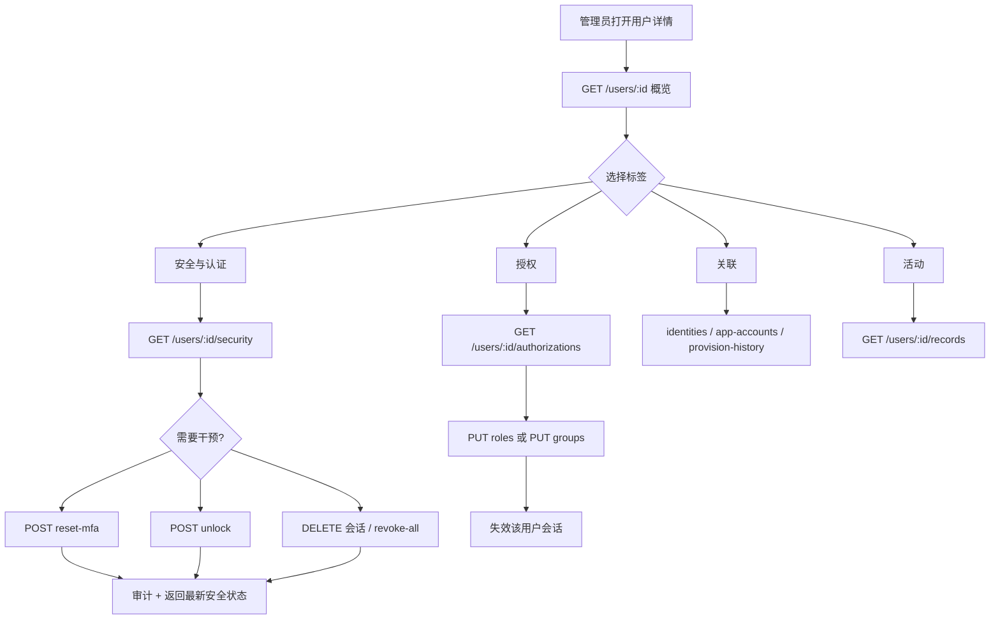
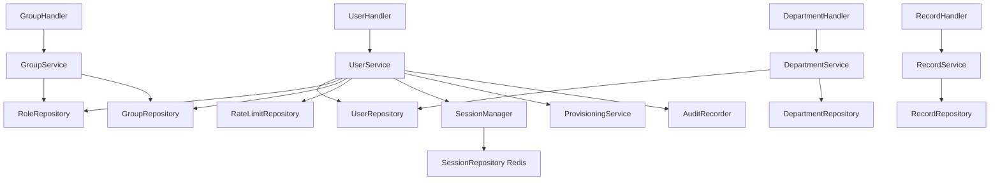

# 用户 / 用户组 / 部门模块优化 · 第五阶段 Spec（用户详情 + 管理动作 + 目录关系重构）

**Created**: 2026-10-14
**Version**: 1.5（验收期返工：用户表单改为单页多列分区；共享组件回滚）
**Author**: Agent
**Status**: Completed

> Status lifecycle: `Draft` → `Awaiting Confirmation`（Spec 已成文）→ `Confirmed`（用户批准）→ `In Progress` → `Completed`。确认后若范围/设计变化，请递增 Version。

## 1. 概述

第三、四阶段把「身份连接」「提供商」做成了可运维的形态，但**用户**这个 IAM 平台最核心的对象仍然只有一个列表页 + 6 个弹窗：看不到一个人的完整事实（会话、审计、授权来源、部门、下游账号），也无法做运维必须做的干预（重置 MFA、解除登录锁定、禁用/启用、改部门、调整角色与用户组）。

本阶段交付：**用户详情页**（独立路由 + 5 标签）与其背后的管理动作，并把「用户组」「部门」补齐到能支撑详情页与日常运维的深度——用户组的成员管理与角色关联、部门的成员归属管理、用户列表的部门/状态筛选，同时清偿一批已确认的缺陷（用户更新全量覆盖、部门归属无法设置、MFA 重置无入口、登录锁定无法解除、用户仓库手写 46 列清单违反 §3.6）。

## 2. 背景

### 2.1 用户诉求（原话）

> 第五阶段：用户 用户组 以及 部门的设计与重构。
> 目前的问题：用户模块过于简单，没有用户详情去查看用户当前的一些信息，以及关联信息，也无法进行比如重置 MFA、解除限制（比如密码输错多次导致的限制等）。

### 2.2 代码研究小结（澄清前已核实的代码事实）

- **后端用户能力面**：`internal/service/user_service.go` 仅有 `Create/Get/Update/Delete/List/SetPassword/ChangePassword/SetupMFA/VerifyMFA/DisableMFA/Identities/UnbindIdentity/NameByID`；`internal/server/router.go:112-121` 只有 10 条用户路由，**没有详情聚合、MFA 重置、禁用/启用、解锁、授权、归属**端点。
- **会话能力已就绪**：`SessionManager.UserSessions/InvalidateUser` 可按用户查询与强制下线；`GET /sessions?user=`、`DELETE /sessions/:sessionID`、`POST /sessions/revoke-all` 已存在（组织级 + 平台级）。
- **审计能力部分就绪**：`RecordService.ListForUser` 已按 `"user"` 精确过滤（门户自服务用），但管理面 `List` 只支持 `keyword` 模糊匹配。
- **登录失败锁定**：`auth_service.go:337` 键为 `polaris:login_fail:<组织标识>:<应用 code>:<账号>:<IP>`，`RateLimitRepository` 仅 `Incr/Get/Reset/Expire`，**无按前缀枚举/删除能力**；`redisclient.Client.Scan(ctx, match, count)` 已存在，可直接复用。
- **MFA**：`/auth/mfa/setup|verify|disable` 三个端点全部作用于**当前登录用户**；`UserService.DisableMFA` 已实现但**没有任何管理员调用点**（§3.1-10 死代码）。
- **部门**：`DepartmentService` 已有完整树操作（建/改/移动/排序/成员查询 `Members`），成员归属**只读**；`users.department_id` 在控制台**无任何写入路径**（用户表单没有该字段，部门页只有成员列表）。
- **用户组**：`GroupService.SetMembers` 已实现（整体替换 + 会话失效 + 供给触发），前端却是**逗号分隔文本框**；组与角色的关联（`role_groups`）没有任何展示入口。
- **用户仓库**：`internal/repository/postgres/user_repo.go` **手写 46 列清单**（SELECT/INSERT/UPDATE 三份），违反 §3.6（>40 列必须用反射映射）；`UserRepository.Delete`（物理删除）**无任何调用点**（死代码）。
- **Update 全量覆盖缺陷**：`user_handler.go Update` 把请求体直接 `bindJSON` 进 `repository.User`，服务层用整行 `UPDATE users SET display_name=..., department_id=...` 写回。前端只提交 8 个字段 → `avatar/first_name/last_name/bio/location/...` **每次保存都被清空**。与第四阶段「应用名称被标识覆盖」同类事故。
- **前端**：`frontend/web/src/features/iam/pages/users-page.tsx`（485 行、6 个弹窗）是唯一入口；`shared/ui` 已有 `Tabs / Dialog / MultiSelect / Combobox / Select / Switch`；`shared/api/types.ts:67` 的 `User` 类型与 DTO 逐字对应。

### 2.3 缺陷与死配置清单（本阶段的清偿目标）

| # | 缺陷 | 证据 | 处置 |
|---|---|---|---|
| D-1 | 用户更新全量覆盖（保存一次资料就清空头像/姓名等） | `user_handler.go Update` + `user_repo.go` 整行 UPDATE | FR-3 |
| D-2 | `users.department_id` 无写入路径（部门归属永远是 NULL） | `users-page.tsx` 表单无部门字段；`departments-page.tsx` 成员只读 | FR-4 |
| D-3 | MFA 重置无管理员入口 → 组织强制 MFA 时用户丢验证器即永久锁死 | `DisableMFA` 仅 `/auth/mfa/disable`（自己） | FR-5 |
| D-4 | 登录失败锁定无法解除（只能等 TTL，应用可配 30 分钟以上） | `RateLimitRepository` 无枚举/删除能力 | FR-6 |
| D-5 | `UserService.DisableMFA` 是死代码（无管理员调用点） | 全仓仅 `auth_handler` 自服务调用 | FR-5 接线 |
| D-6 | `UserRepository.Delete`（物理删除）无调用点 | 全仓无调用 | FR-13 删除 |
| D-7 | 用户仓库手写 46 列清单（§3.6 红线） | `user_repo.go` 三份列清单 | FR-13 |
| D-8 | 用户组成员用逗号文本框，无法反查"此人在哪些组" | `groups-page.tsx` `members: string` | FR-10 |
| D-9 | 无法查看"某人的权限从哪来"（直接 / 角色 / 用户组） | `PermissionsForUser` 只回并集，无来源 | FR-9 |
| D-10 | `is_admin` 与 `type` 双写不一致风险（前端各自传值） | `users-page.tsx` 同时传 `type` 与 `is_admin` | FR-3 |

## 3. 澄清与决策记录

- **Q1**: 用户详情用哪种承载形态？（独立路由页 / 右侧抽屉 / 沿用弹窗）
  **Recommendation**: 独立路由页 + 标签页 —— 与既有的应用向导、提供商编辑、身份连接一致；组织内资源地址由 URL 承载是 §7.4 红线；信息量与动作数远超弹窗容量。
  **User response**: 同意独立路由页 + 标签页。
  **Date**: 2026-10-14

- **Q2**: 详情页分成哪几个标签页、每页放什么？第 4 页是否包含「应用账号 / 供给历史」？
  **Recommendation**: 5 个标签（概览 / 安全与认证 / 授权 / 关联 / 活动），第 4 页包含应用账号（"关联信息"的答案）；活动页需要给审计查询补 `user` 维度过滤。
  **User response**: 5 个标签 + 第 4 页含应用账号。
  **Date**: 2026-10-14

- **Q3**: 管理员动作清单与权限 action 映射？（含"是否新增细粒度权限动作"与"防呆规则"）
  **Recommendation**: 动作清单见 §4；只新增 `user:reset_mfa`、`user:unlock` 两个权限动作，其余沿用 `user:update` / `role:update` / `session:delete`；防呆：内置 `admin` 不可删除/禁用/取消管理员，组织内最后一个 `is_admin` 不可被取消或禁用，重置 MFA 在 `mfa_policy=required` 组织要提示"下次登录强制重绑"；「发送邀请/重置密码邮件」列为范围外。
  **User response**: 「你继续吧」（视为接受推荐方案，未提出增删）。
  **Date**: 2026-10-14

- **Q5**（验收期修正）: 详情页概览**不应该可以直接改**——详情就是详情，修改走「编辑」；同时新建弹窗只填 5 个字段"像个玩具"，需要一并处理。
  **Recommendation**: 按项目既有约定改成本轮方案——① 概览标签**只读**（展示全部事实，含空值占位），所有写入移到独立的 `users/:id/edit` 整页表单；② 新建改为 `users/new` 整页表单，字段覆盖实体的全部可创建资料（基本信息 / 联系方式 / 归属 / 安全 / 个人资料分区），不再用弹窗；③ 后端创建 DTO 同步放宽到同一套字段（否则"表单能填、后端丢弃"= 第四阶段"配置被静默丢弃"同类事故）。
  **User response**: 「详情就是详情，修改走编辑」「新建弹窗太傻比了，像个玩具一样，就填哪几个字段」→ 采纳上述方案。
  **Date**: 2026-10-14

- **Q4**: 由 Agent 承接的其余设计决策（用户未反对即生效；任一项被否决则相应任务回退设计）
  **Recommendation / 决策**:
  1. **不新增 `status` 列**：`is_forbidden`（禁用）/`is_deleted`（软删）语义保留；`type` 列保留（`application_policy.go:391,449` 把它作为 `type` claim 下发给下游应用），但**写入点收敛**——服务层强制 `type = is_admin ? "admin" : "normal"`，handler 不再接受客户端传入的 `type`（清偿 D-10）。
  2. **解锁采用"扫描 + 精确段比对"**：不改登录链路的键结构（零回归风险），新增 `RateLimitRepository.Keys(pattern)`（Redis `SCAN`），服务层按 `polaris:login_fail:<组织标识>:*:<账号>:*` 扫描后**用分隔符切段严格比对**组织标识与账号（用户名含 `*`/`?` 时不误删）。
  3. **资料更新改为部分更新语义**：路径不变（`PUT /users/:id`），请求体改为显式 DTO，只更新"非 nil"字段；禁用/启用、部门、角色、用户组各自独立端点，彻底消除"整行覆盖"（清偿 D-1）。
  4. **详情页数据按标签分端点懒加载**（不做单一大聚合），避免列表页与详情页首屏拉一堆没用数据。
  5. ~~用户创建保持弹窗、编辑移入详情页内联表单~~ → **已被 Q5 推翻**：创建与编辑都改为独立整页表单（`users/new` / `users/:id/edit`），详情页概览只读。
  6. **组织成员选择器支持远程搜索**：为 `shared/ui` 的 `MultiSelect` 增加可选 `onSearch`（输入即查关键词），保证超过 200 人的组织也能选人（不改变现有受控 API）。
  7. **部门负责人（manager）字段不做**：当前无任何读取点，加列即死配置（§1「配置即生效」）→ 列入 §10 范围外。
  **User response**: 未反对（本轮"继续"即视为通过；实施前仍可在确认环节否决）。
  **Date**: 2026-10-14

## 4. 功能需求

### FR-1 用户详情页（独立路由 + 5 标签）

- Description: 新增 `/institutions/:inst/users/:id`，页内 5 个标签：概览 / 安全与认证 / 授权 / 关联 / 活动。列表页「查看详情」与点击行进入详情；详情页头部展示头像、账号名、显示名、状态徽标，右侧集中「更多」动作。
- Input / Output: 路由参数 `:inst`（组织主键 id）、`:id`（用户主键 id）。
- Acceptance: 详情页刷新/直接打开/浏览器回退均可用；切换标签不重新请求已加载过的组织上下文；未登录或越权访问返回 401/403 并被路由守卫拦下。

### FR-2 概览标签：身份、资料、归属、活跃度

- Description: **只读**展示资料全量分组（身份标识 / 资料 / 联系方式 / 归属 / 活跃度，空值显示 `-`）。写入一律走 `users/:id/edit` 与 `users/new`；详情页头部提供「编辑」主操作跳转。
- Input / Output: `GET /users/:id`（只读，DTO 扩 `department_path`）；写操作在编辑页：`PUT /users/:id`（部分更新）+ `PUT /users/:id/department`。
- Acceptance: 只改邮箱保存后，头像/姓名/部门等未提交字段**保持不变**（回归测试锁定）；非法邮箱/超长字段返回 `INVALID_PARAMS`；`type` 由 `is_admin` 派生，请求体里带 `type` 被忽略。

### FR-3 新建 / 编辑整页表单（修复全量覆盖）

- Description: 新增 `users/new` 与 `users/:id/edit` 两个整页表单（同一组件、同一套分组），字段覆盖实体全部可创建/可编辑资料；编辑沿用 `UpdateUserProfileInput`（指针字段表达"未提交"，服务层只覆盖非 nil 字段）；**创建 DTO 同步放宽到同一套字段**，并有反射测试锁定"创建与编辑的资料字段集合一致"（防止表单能填、后端丢弃）。
- Acceptance: 新建页可一次填完全部字段并在详情页完整回显；编辑页只提交改动字段（未提交字段不变）；`type` 与 `is_admin` 恒定一致；创建/编辑资料字段集合由反射测试锁定一致。

### FR-4 禁用 / 启用账号（含最后一名管理员防呆）

- Description: `POST /users/:id/disable`、`POST /users/:id/enable`。禁用即失效该用户全部会话（§3.1-11），并触发下游供给回收（沿用 `ProvisioningService.TriggerUserStatusChange`）。
- Acceptance: 禁用后该用户既有会话 401；内置 `admin` 被拒绝（`PROTECTED_OBJECT`）；取消/禁用组织内最后一个管理员被拒绝并给出可读错误；重复禁用幂等。

### FR-5 重置 MFA

- Description: `POST /users/:id/reset-mfa` 清空 `mfa_enabled/mfa_type/mfa_secret/mfa_recovery_codes`（复用并接线 `UserService.DisableMFA`），写审计 `user.mfa_reset`。若组织 `mfa_policy=required`，登录时该用户将进入"强制绑定"流程（既有能力）。
- Acceptance: 重置后 `GET /users/:id/security` 显示未绑定；用户下次登录重新走绑定（二维码）流程；需要 `user:reset_mfa` 权限（仅 `user:update` 的被授权者被拒绝）。

### FR-6 解除登录失败锁定

- Description: 详情页「安全」标签展示当前锁定条目（应用 / IP / 失败次数 / 剩余冻结时长），提供 `POST /users/:id/unlock` 清除该用户全部失败计数键（写审计 `user.unlock`）。
- Acceptance: 人为把某账号失败计数打到上限（登录返回 429）→ 详情页能看到条目 → 解锁后立即可登录；组织 A 的解锁不影响组织 B 同名用户；用户名含 `*` 时不误删其他键（单测锁定）。

### FR-7 强制下线（单条 / 全部）

- Description: 「安全」标签列出该用户活动会话（IP / UA / 应用 / 登录时间 / 过期时间），支持单条撤销与全部撤销，复用既有 `SessionService`。
- Acceptance: 撤销后该会话立即失效（401）；无法撤销其他组织用户的会话（越权返回 404）。

### FR-8 授权标签：来源可追溯

- Description: 展示直接角色、经用户组继承的角色、经角色嵌套继承的角色、直接绑定权限、所属用户组，以及**有效权限明细**（`resource × action × effect`，`Deny` 高亮）并标注来源（用户直接 / 角色 X / 用户组 Y）。
- Input / Output: `GET /users/:id/authorizations`；`PUT /users/:id/roles`（整体替换直接角色）；`PUT /users/:id/groups`（整体替换用户组归属）。
- Acceptance: 改角色/用户组后受影响用户会话立即失效（§3.1-11）；有效权限明细与 `SessionManager.EffectivePermissions`（登录时写入会话）**逐条一致**（回归测试用同一用户对比两处输出）。

### FR-9 关联标签：外部身份 + 应用账号 + 供给历史

- Description: 外部身份绑定列表（提供商 / 外部用户 ID / 邮箱 / 绑定时间 / 解绑）、下游应用账号（应用 / 下游账号名 / 状态 / 是否设过初始口令 / 建号方式 / 时间）、供给历史（连接器 / 动作 / 状态 / 消息 / 时间，分页）。
- Input / Output: `GET /users/:id/identities`（已有）、`GET /users/:id/app-accounts`、`GET /users/:id/provision-history`、`DELETE /users/:id/identities/:identityID`（已有）。
- Acceptance: 三个列表都为空时展示空态而非报错；无 `app_account:read` / `provision_history:read` 权限时对应卡片整体隐藏（不是报错）。

### FR-10 活动标签：该用户的审计时间线

- Description: 按 `user` 精确过滤的审计记录分页（登录、登录失败、改密、MFA 变更、授权与状态变更、解锁等），展示动作、对象、IP、结果、时间。
- Input / Output: `GET /users/:id/records`（服务层新增 `ListRecordsForUser` 管理面查询，权限 `record:read`）。
- Acceptance: 分页正确、总数为该用户记录数；不泄露 `detail` 中的敏感字段。

### FR-11 用户列表增强

- Description: 列表新增「部门」「账号状态」列；筛选支持关键词（已有）+ 部门（下拉）+ 状态（启用 / 已禁用 / 已删除）+ 是否绑定 MFA；行内动作收敛为「查看详情」+「更多」（重置密码 / 禁用 / 删除）。
- Input / Output: `GET /users?keyword=&department_id=&status=&mfa=&page=&size=`。
- Acceptance: 组合筛选结果正确；部门下拉来自当前组织部门树；`status` 取值非法返回 `INVALID_PARAMS`。

### FR-12 用户组：成员多选 + 关联角色/权限可见

- Description: 新增 `/institutions/:inst/groups/:id` 详情页：成员管理（远程搜索多选，即改即存）、组层级（父组）、关联角色（`role_groups`）与这些角色带来的权限（只读汇总）；列表页显示成员数、进入详情。
- Input / Output: `GET /groups/:id/detail`（组 + 成员 + 角色 + 权限）、`PUT /groups/:id/members`（已有，改整体替换语义不变）。
- Acceptance: 加/移成员后相关用户会话失效（已有行为保持）；成员数在列表与详情一致；继承角色只读展示且与 `/roles/:id` 的关联一致。

### FR-13 部门：成员归属可管理

- Description: 部门页右侧详情面板增加「添加成员 / 移出成员」（远程搜索多选），写入 `users.department_id`；用户详情页概览也可改部门（两处同一服务方法，事务内批量更新）。
- Input / Output: `PUT /departments/:id/members`（整体替换：`{users: [...]}`）。
- Acceptance: 把用户从部门 A 移到 B 后，两处成员列表都正确；移出成员后 `department_id` 置空；跨组织部门/用户被拒绝。

### FR-14 规范与死代码清偿

- Description: ① `user_repo.go` 迁移到 `mapper.go` 反射映射（§3.6）；② 删除无调用点的 `UserRepository.Delete`（§3.1-10）；③ 新增索引迁移（用户筛选、关系表反查）；④ 新增权限动作 `user:reset_mfa`、`user:unlock` 写入 README 权限说明；⑤ 在 `AGENTS.md` 教训表追加本阶段新发现的坑。
- Acceptance: `go test ./...` 与 `make lint` 通过；`mapper_test.go` 同类断言覆盖 User（id/时间列排除、空集合归一化）；grep 不到 `UserRepository.Delete`。

### FR-15 审计与限流

- Description: 所有新增管理动作写审计（`user.disable` / `user.enable` / `user.mfa_reset` / `user.unlock` / `user.set_roles` / `user.set_groups` / `user.set_department`），审计 `object` 为用户账号名。
- Acceptance: 每个动作在活动标签可见；审计不写入密码哈希、MFA 密钥、恢复码等敏感值。

## 5. 设计

### 5.1 总体架构

**后端**（保持 Handler → Service → Repository 单向，全部经 `internal/app/app.go` 装配）：

```
internal/handler/user_handler.go            用户 HTTP 处理器（新增详情子资源与动作端点）
internal/handler/group_handler.go           组详情端点
internal/handler/department_handler.go      部门成员整体替换
internal/handler/dto.go / dto_resource.go   详情 DTO（has_*/ 数量型字段，绝不下发敏感值）
        ↓
internal/service/user_service.go            资料部分更新、禁用/启用、MFA 重置、解锁、授权/归属整体替换、防呆规则
internal/service/group_service.go           组详情（成员 + 关联角色 + 汇总权限）
internal/service/department_service.go      部门成员整体替换（事务）
internal/service/unlock.go                  登录锁定枚举与清理（新文件，聚焦"锁定"这一件事）
internal/service/record_service.go          管理面按用户过滤的审计查询
        ↓
internal/repository/iface.go                接口扩展（User/Role/Group/Department/RateLimit/Record）
internal/repository/postgres/user_repo.go   迁移到反射映射 + 列表筛选
internal/repository/postgres/role_repo.go   DirectRolesForUser / PermissionBindingsForUser / RolesForGroup / PermissionsForGroup / SetDirectRoles
internal/repository/postgres/group_repo.go  按用户整体替换组归属（事务）
internal/repository/postgres/department_repo.go  批量改 department_id（事务）
internal/repository/redis/ratelimit_repo.go 新增 Keys(pattern)（Redis SCAN）
```

**前端**：

```
frontend/web/src/features/iam/pages/user-detail-page.tsx      详情页骨架（头部 + 5 标签 + 懒加载）
frontend/web/src/features/iam/components/user/
  ├── overview-tab.tsx        概览 + 资料编辑表单 + 部门选择
  ├── security-tab.tsx        密码状态 / MFA / 锁定条目 / 会话
  ├── authorization-tab.tsx   角色 / 用户组 / 有效权限（含来源）
  ├── relations-tab.tsx       外部身份 / 应用账号 / 供给历史
  └── activity-tab.tsx        审计时间线
frontend/web/src/features/iam/pages/group-detail-page.tsx     组详情（成员多选 + 关联角色）
frontend/web/src/features/iam/components/user-picker.tsx      远程搜索的用户多选（组 / 部门共用）
frontend/web/src/features/iam/pages/users-page.tsx            列表增强（筛选 + 详情入口 + 动作收敛）
frontend/web/src/Router.tsx                                   注册 users/:id、groups/:id 路由
frontend/web/src/shared/ui/components/multi-select.tsx        可选 onSearch（向后兼容）
```

### 5.2 主流程



### 5.3 组件关系



### 5.4 数据设计

#### 5.4.1 数据库变更（迁移 `030_user_directory_indexes`，up/down 成对；迁移不可变，不回改 001）

```sql
-- up
CREATE INDEX IF NOT EXISTS users_institution_flags_idx ON users (institution_id, is_deleted, is_forbidden);
CREATE INDEX IF NOT EXISTS users_institution_department_idx ON users (institution_id, department_id);
CREATE INDEX IF NOT EXISTS role_users_user_idx ON role_users ("user");
CREATE INDEX IF NOT EXISTS permission_users_user_idx ON permission_users ("user");

-- down
DROP INDEX IF EXISTS permission_users_user_idx;
DROP INDEX IF EXISTS role_users_user_idx;
DROP INDEX IF EXISTS users_institution_department_idx;
DROP INDEX IF EXISTS users_institution_flags_idx;
```

**无新表、无新列**：`type`/`is_admin`/`is_forbidden`/`is_deleted` 全部沿用现有列；`type` 语义收敛到应用层（FR-2/Q4-1），因此不需要迁移回填。

#### 5.4.2 接口设计

| 方法 | 路径 | 说明 | 权限 |
|------|------|------|------|
| GET | `/users` | 列表（新增 `department_id` / `status` / `mfa` 过滤） | `user:read` |
| GET | `/users/:id` | 详情概览（DTO 扩 `department_path`、`mfa_recovery_codes_left`、`password_expire_at`） | `user:read` |
| PUT | `/users/:id` | **资料部分更新**（语义变更：只改提交的字段） | `user:update` |
| PUT | `/users/:id/department` | 变更部门归属 `{"department_id": 12}`（null = 移出） | `user:update` |
| POST | `/users/:id/disable` / `/users/:id/enable` | 禁用 / 启用（含最后一名管理员防呆） | `user:update` |
| POST | `/users/:id/reset-password` | 重置密码（已有） | `user:update` |
| POST | `/users/:id/reset-mfa` | 重置 MFA（清空绑定） | **`user:reset_mfa`** |
| POST | `/users/:id/unlock` | 解除登录失败锁定 | **`user:unlock`** |
| GET | `/users/:id/security` | 安全概览（密码状态 / MFA 状态 / 锁定条目） | `user:read` |
| GET | `/users/:id/authorizations` | 直接角色 / 继承角色 / 用户组 / 直接权限 / 有效权限（含来源） | `user:read` |
| PUT | `/users/:id/roles` | 整体替换直接角色 `{"roles": ["r1"]}` | `role:update` |
| PUT | `/users/:id/groups` | 整体替换用户组归属 `{"groups": ["g1"]}` | `user:update` |
| GET | `/users/:id/app-accounts` | 该用户下游应用账号 | `app_account:read` |
| GET | `/users/:id/provision-history` | 该用户供给历史（分页） | `provision_history:read` |
| GET | `/users/:id/records` | 该用户审计记录（分页） | `record:read` |
| GET | `/users/:id/identities` | 外部身份绑定（已有） | `user:read` |
| DELETE | `/users/:id/identities/:identityID` | 解绑（已有） | `user:update` |
| POST | `/users/:id/api-keys` | 签发 API 令牌（已有） | `user:update` |
| DELETE | `/users/:id` | 删除（软删，已有） | `user:delete` |
| GET | `/groups/:id/detail` | 组详情（成员 + 继承角色 + 汇总权限） | `group:read` |
| PUT | `/groups/:id/members` | 组成员整体替换（已有） | `group:update` |
| PUT | `/departments/:id/members` | 部门成员整体替换 `{"users": [...]}` | `department:update` |

**请求/响应示例（安全概览）**：

```json
{
  "password": { "has_password": true, "updated_at": "2026-10-01T02:11:00Z", "expire_at": "2027-01-01T02:11:00Z" },
  "mfa": { "enabled": true, "type": "totp", "recovery_codes_left": 6 },
  "lockouts": [
    { "application": "polaris-app", "ip": "10.0.0.8", "failures": 5, "frozen_until": "2026-10-14T04:20:00Z", "frozen_seconds_left": 840 }
  ]
}
```

```json
{
  "direct_roles": ["role-x"],
  "inherited_roles": ["role-child"],
  "groups": ["built-in-group"],
  "direct_permissions": ["permission-self"],
  "effective_permissions": [
    { "name": "permission-all", "resource": "*", "action": "*", "effect": "Allow", "sources": ["role:admin"] }
  ]
}
```

**请求示例（资料部分更新；未出现的字段一律不改）**：

```json
{
  "display_name": "张三",
  "email": "zhangsan@example.com",
  "title": "工程师",
  "is_admin": true
}
```

### 5.5 关键实现细节

1. **部分更新合并**：`UpdateUserProfileInput` 全部使用指针字段；服务层 `mergeProfile(existing, in)` 只覆盖非 nil 字段。`type` 由 `is_admin` 派生：`type = is_admin ? "admin" : "normal"`，请求体中出现的 `type` 一律忽略。
2. **防呆规则集中一处**：`internal/service/user_guard.go` 暴露 `assertAdminSafety(ctx, org, target)`，规则：内置 `admin`（`repository.IsBuiltInAdmin`）不可禁用/删除/取消管理员；目标 `is_admin=false` 时若组织内启用状态的 `is_admin` 数量 ≤ 1 则拒绝（错误码 `CONFLICT` + 可读 message）。新增"组织内管理员数量"查询（`UserRepository.CountAdmins`）。
3. **解锁的精确匹配**：`loginRateKey` 结构为 `polaris:login_fail:<orgName>:<appCode>:<username>:<ip>`；实现按 `polaris:login_fail:%s:*:%s:*`（orgName、username）扫描，**拿到键后用 `strings.SplitN(key, ":", 6)` 回切并严格比对第 3 段与第 5 段**，命中才删；删除返回条数写审计 `{"count": N}`。组织标识取自 `orgs.GetByID` 的 `name`，避免主键/标识混用（第四阶段的教训）。
4. **授权整体替换**：
   - `SetDirectRoles(ctx, institutionID, user, roles)`：事务内 `DELETE FROM role_users WHERE "user"=$1 AND role_id IN (SELECT id FROM roles WHERE institution_id=$2)` 再插入；角色名在组织内不存在 → `INVALID_PARAMS`。
   - `SetUserGroups(ctx, institutionID, user, groups)`：事务内按组织定位组 id，先 `DELETE FROM group_members WHERE "user"=$1 AND group_id IN (...)` 再插入。
   - 两个方法都在服务层收尾"失效该用户会话 + 触发供给（新授权的组/角色 → `TriggerRoleGranted`）"。
5. **有效权限来源**：新增 `PermissionBindingsForUser`（一条 SQL 用 `UNION ALL` 三路来源：`permission_users` 直接、`role_users`/`role_groups`/`role_roles` 经角色、`group_members` 经用户组），返回 `(permission, source)`；服务层与 `EffectivePermissions` 结果做关联，产出 `sources` 数组。
6. **组详情汇总权限**：`RolesForGroup` + `PermissionsForGroup` 同构复用第 5 点的 SQL 思路（把"用户"替换为"组名"）。
7. **列表筛选**：`ListQuery` **新增** `Filters []ColumnFilter`（`{Field, Value}` 列表，经 `columnExpr` 加引号防保留字），保留既有 `Field/Value` 与 `Keyword`；用户仓库用映射器 + `queryBuilder` 拼条件。`status` 取值 → `active`（`NOT is_forbidden AND NOT is_deleted`）、`disabled`（`is_forbidden`）、`deleted`（`is_deleted`）；非法值 `INVALID_PARAMS`。
8. **详情 DTO 合规**：`password_expire_at` 由 `password_updated_at + org.password_expire_days` 计算（策略为 0 时不下发该字段）；`mfa_recovery_codes_left` 只回数量；锁定条目只回应用/IP/次数/剩余秒数，**不回 Redis 键名**。
9. **前端懒加载与请求守卫**：每个标签首次激活才请求（`useRef` 记录已加载标签，避免第四阶段"同一接口重复请求"的坑；StrictMode 下每接口恰好 1 次），并在标签测试中断言。
10. **错误与权限一致性**：前端按标签对应权限隐藏入口（`useAuth()` 的 `Enforce`），后端仍强制校验（前端隐藏≠越权放行）；跨组织访问按"未找到"处理（404），不泄露存在性。
11. **迁移与索引**：只新增索引，up/down 成对且幂等（`IF NOT EXISTS`）；不修改已发布迁移。

## 6. 实施计划

- [ ] **Task 1**：用户仓库与关系查询层
  - Owner: Agent
  - Estimated effort: 0.5–1 天
  - Completion criteria: `user_repo.go` 全部改用 `mapper.go`；`List/Count` 支持 `Filters`；新增 `CountAdmins`、`SetDepartmentForUsers`（事务）、`DirectRolesForUser`、`SetDirectRoles`、`PermissionBindingsForUser`、`RolesForGroup`、`PermissionsForGroup`、`SetUserGroups`；删除 `UserRepository.Delete`；`role_users`/`permission_users` 索引迁移 030 落地；`go test ./...` 通过
  - Depends on: none

- [ ] **Task 2**：锁定枚举与清理（Redis）
  - Owner: Agent
  - Estimated effort: 0.5 天
  - Completion criteria: `RateLimitRepository.Keys(pattern)` + Redis `SCAN` 实现；`service/unlock.go` 的 `LockoutEntries` / `UnlockUser` 就绪；单测锁定"含通配符用户名不误删""跨组织隔离"
  - Depends on: none

- [ ] **Task 3**：用户服务层动作与防呆
  - Owner: Agent
  - Estimated effort: 1 天
  - Completion criteria: 部分更新、禁用/启用、MFA 重置、解锁、部门/角色/用户组整体替换、`assertAdminSafety` 全部实现并写审计；单测覆盖 D-1 回归与防呆规则
  - Depends on: Task 1, Task 2

- [ ] **Task 4**：详情聚合端点与权限动作
  - Owner: Agent
  - Estimated effort: 0.5–1 天
  - Completion criteria: §5.4.2 全部端点注册并挂权限；DTO 合规（`has_*`/数量/无敏感值）；`user:reset_mfa`、`user:unlock` 生效；`RecordService.ListRecordsForUser`、`ProvisioningService.ListHistoryForUser`、`ProvisioningService.ListAppAccountsForUser` 接线
  - Depends on: Task 3

- [ ] **Task 5**：组详情与部门成员服务
  - Owner: Agent
  - Estimated effort: 0.5 天
  - Completion criteria: `GET /groups/:id/detail`、`PUT /departments/:id/members` 可用；跨组织校验与空集合归一化正确
  - Depends on: Task 1

- [ ] **Task 6**：前端共享基元
  - Owner: Agent
  - Estimated effort: 0.5 天
  - Completion criteria: `MultiSelect` 支持 `onSearch`（可搜索用户）；`user-picker.tsx` 落地；`types.ts` 补齐新 DTO；`multi-select` 既有用法与测试不回归
  - Depends on: none

- [ ] **Task 7**：用户详情页骨架 + 概览标签
  - Owner: Agent
  - Estimated effort: 1 天
  - Completion criteria: 路由 `/institutions/:inst/users/:id`、懒加载 5 标签、头部动作菜单、概览内联编辑与部门选择可用；i18n 中英同步
  - Depends on: Task 4, Task 6

- [ ] **Task 8**：安全 / 授权 / 关联 / 活动四标签
  - Owner: Agent
  - Estimated effort: 1–1.5 天
  - Completion criteria: 四个标签内容与动作全部接线（重置 MFA、解锁、强制下线、角色/用户组整体替换、解绑身份、API 令牌、只读列表 + 空态）；Vitest 锁定"每标签每接口恰好 1 次请求"与关键交互
  - Depends on: Task 7

- [ ] **Task 9**：列表页与组/部门页增强
  - Owner: Agent
  - Estimated effort: 0.5–1 天
  - Completion criteria: 用户列表筛选与列；组列表成员数 + 详情入口；组详情成员多选；部门页添加/移出成员
  - Depends on: Task 5, Task 6

- [ ] **Task 10**：测试、冒烟与文档
  - Owner: Agent
  - Estimated effort: 0.5–1 天
  - Completion criteria: `go test ./...`、`make lint`、`pnpm test`（typecheck + vitest + build）全绿；`scripts/smoke-test.sh` 新增用例（详情、禁用/启用、重置 MFA、解锁、授权、部门成员、组详情）通过；README 补充新权限动作；`AGENTS.md` 教训表追加本阶段发现；Spec 状态更新为 `Completed`
  - Depends on: Task 8, Task 9

**Progress log**（实施期间追加，不回改历史）：

- 2026-10-14：Spec 成文，等待确认
- 2026-10-14：用户确认 Spec（"按照 Spec 开始实施"），状态置为 Confirmed → In Progress，开始 Task 1
- 2026-10-14：Task 1 完成 —— `user_repo.go` 改为反射映射（46 列手写清单删除）、删除无调用点的 `UserRepository.Delete`、`ListQuery` 新增 `Filters`（类型安全的值）、新增 `CountAdmins / SetDepartment / ReplaceDepartmentMembers / ListByNames`、`role_repo` 新增 `DirectRolesForUser / SetDirectRoles / PermissionBindingsForUser / RolesForGroup / PermissionsForGroup`、`group_repo` 新增 `SetGroupsForUser / MemberCounts`、迁移 030 索引；`go test ./...` 通过
- 2026-10-14：Task 2/3/4/5 完成 —— `LoginLockoutService`（枚举 + 精确段比对清理，4 条单测）、`UpdateProfile` 部分更新、禁用/启用、`SetAdmin`、`SetDepartment`、`AdminResetMFA`、`SetDirectRoles`、`SetUserGroups`、`Authorizations`、`SecurityStatus`、`DepartmentLabels`；handler 与路由全部接线（新增 `user:reset_mfa` / `user:unlock`）；组详情 `GET /groups/:id/detail`、部门成员 `PUT /departments/:id/members`、组列表成员数
- 2026-10-14：Task 6–9 完成（前端）—— 用户详情页 + 5 标签（概览内联部分更新 / 安全与认证 / 授权 / 关联 / 活动）、用户列表目录筛选与详情入口、用户组详情页、组/部门成员用远程搜索多选（`UserPicker` + `MultiSelect.onSearch`）、`useOnceKey` 防重复加载、i18n 中英各补 160 条；`pnpm test`（typecheck + vitest + build）全绿
- 2026-10-14：验收期修正 v1.1 —— 详情页概览改为只读 + 新建/编辑改为整页分步表单（后端创建 DTO 同步放宽，反射测试锁定字段一致），并复跑全部门禁
- 2026-10-14：验收期返工 v1.5 —— 用户表单改为**单页多列分区**（不再用分步向导，删掉右栏说明卡）；**共享 `FormWizard` 已回滚**
- 2026-10-14：验收期修复 v1.4 —— 表单改两列 + 宽度约束 + 去重标题（`FormSection` 标题改可选），并修掉"工作区深链接被误弹回组织列表"的旧缺陷（`loading` 三态 + 不存在判定）；用 CDP 截图逐屏验证
- 2026-10-14：验收期修复 v1.3 —— "空的提供方列表 = 没有第三方入口"：修正读取侧与写入侧/下发侧的语义矛盾，`client_id` 与未知应用均改为 fail-closed，前端对齐 `signin_methods`，补三处回归（后端单测 / 前端用例 / 冒烟 22b）
- 2026-10-14：验收期修复 v1.2 —— "读不到被渲染成没有"：四个标签接入 `LoadError` 错误态、详情页区分 404 与其他错误、会话按工作区组织查询；补回归测试与 `common.loadFailed`/`common.retry` 词条
- 2026-10-14：Task 10 完成 —— 冒烟新增「10b. 用户详情与安全动作」共 45 条断言（全部通过）；README 补用户端点与 `user:reset_mfa` / `user:unlock` 权限动作；AGENTS.md 教训表新增 5 条、§3.6 补"INSERT 不写时间戳"约定
- 2026-10-14：端到端校验（本地 8102 实例，35/36 项通过）。**关键链路实测通过**：创建用户 → 详情 → 只提交 `title` 的部分更新（display_name/email 保持不变，D-1 回归闭合）→ 授权（直接角色 + 有效权限）→ 部门归属（`department_path` 补全）→ 5 次错误密码后 429 → 详情页看到 `blocked=true` 锁定条目 → 一键解除 → 立即登录成功；内置 admin 的禁用/取消管理员/删除均 403；普通用户调用 `reset-mfa`/`unlock` 均 403；`created_at` 已返回真实时间（零值时间戳缺陷闭合）
- 2026-10-14：决策补充 —— 内置 admin 的**禁用/删除/取消管理员**受保护，但**允许重置其 MFA**：那是超级账号丢失验证器时唯一的管理面恢复通道，且已由独立的 `user:reset_mfa` 权限守住（已实测 200 + 审计）
- 2026-10-14：**顺带修掉一个生产级缺陷（新发现）**：反射映射的 INSERT 把 `created_at/updated_at` 也写进去，Go 零值时间落库成 `0001-01-01`（应用与提供商实体中招，已在库里验证到 6 行脏数据）。改为 INSERT 不写时间戳列、由 `RETURNING created_at, updated_at` 回填实体；`mapper_test.go` 加回归断言。历史脏数据修复另行确认（见 §11 偏差记录）

## 7. 非功能需求

- **安全**：新增端点全部挂权限中间件；跨组织一律 404；响应体不出现密码哈希、MFA 密钥、恢复码、令牌明文（§3.1-7）；解锁的键匹配必须精确（避免误删他人计数）。
- **性能**：详情页按标签懒加载，单标签请求 ≤ 2 个；组/部门成员批量写入用单事务 + `ANY(...)` 参数化，避免 N 次往返；用户列表筛选走新增索引。
- **可用性**：危险动作（禁用、删除、重置 MFA、取消管理员）一律二次确认并说明影响（含"将下线 N 个会话"）。
- **可维护性**：不留死代码（§3.1-10）；新增权限动作必须同时出现在 README 与权限页可选项说明中。

## 8. 假设与风险

- **假设**：登录失败锁定键结构在实施期间不变（若变更需同步 `unlock.go` 与测试）；用户账号名不含 `:`（键解析依赖该假设，单测覆盖含 `*`/`?` 但不含 `:` 的情形）。
- **风险 1**："最后一个管理员"判定在并发下可能同时通过校验。**缓解**：校验与写入放在同一事务，并对组织级管理员集合加行级确认（`SELECT ... FOR UPDATE` 或 `CountAdmins` 在事务内复检）。
- **风险 2**：`user_repo.go` 迁移到反射映射可能改变列顺序/空集合归一化行为。**缓解**：迁移后立即跑用户相关既有测试 + 冒烟；补 `mapper` 层针对 `User` 的断言（含 `mfa_recovery_codes` 空数组归一化）。
- **风险 3**：整体替换语义（角色/用户组/部门成员）在并发下可能互相覆盖。**缓解**：UI 每次基于"最新读取结果"提交；冲突时以最后写入为准并在审计中留痕（与既有 `GroupService.SetMembers` 行为一致）。
- **风险 4**：组织用户超过 200 人时选择器体验。**缓解**：远程搜索 + 分页（Task 6）。
- **风险 5**：范围偏大（后端 + 前端 + 三个资源）。**缓解**：Task 1–5（后端）与 Task 6–9（前端）按序交付，Task 9 中的部门页增强可最后合并；若需要更小步落地，可先发 Task 1–8（用户主线）再补组/部门。

## 9. 验收标准

- [ ] 用户详情页可通过 `/institutions/:inst/users/:id` 直接打开、刷新、返回；5 个标签内容与动作全部可用
- [ ] **D-1 回归**：仅修改一个字段保存后，其余字段（头像、姓名、部门、bio 等）保持不变（自动化测试锁定）
- [ ] **D-2**：可在用户详情与部门页两处设置/变更/清空用户部门归属，列表可按部门筛选
- [ ] **D-3**：管理员可重置任意用户 MFA；`mfa_policy=required` 组织下该用户下次登录进入强制绑定
- [ ] **D-4**：账号被锁定（429）后，详情页能看到锁定条目并一键解除，解除后可立即登录
- [ ] **D-5/D-6/D-7**：`DisableMFA` 有管理员调用点；`UserRepository.Delete` 已删除；`user_repo.go` 使用反射映射（无手写 46 列清单）
- [ ] **D-8**：用户组成员用可搜索多选维护；用户详情「授权」标签能看到该用户所属用户组
- [ ] **D-9**：有效权限明细标注来源（直接 / 角色 / 用户组），且与登录会话中的有效权限逐条一致
- [ ] **D-10**：`type` 不再由客户端传入，与 `is_admin` 恒定一致
- [ ] 禁用/删除/取消管理员对内置 `admin` 与"最后一个管理员"被拒绝（含可读错误）
- [ ] 授权、用户组、部门成员变更后受影响用户会话立即失效
- [ ] `go test ./...`、`make lint`、`pnpm test` 全绿；`scripts/smoke-test.sh` 新增用例全部通过（且门禁不再被单点失败短路）
- [ ] 权限动作 `user:reset_mfa`、`user:unlock` 可在权限页配置并生效（仅 `user:update` 被拒绝）
- [ ] 中英 i18n key 同步（`i18n.test.ts` / `usage.test.ts` 通过）

## 10. 范围外（延期项）

| 项 | 原因 |
|---|---|
| 邀请 / 重置密码邮件（含一次性链接） | 属注册与找回链路，需要邮件模板 + 一次性令牌设计，与"管理面动作"不同批次 |
| 批量操作（批量禁用 / 批量导入 / 批量移入组） | 需要任务化（asyncd）与部分失败语义，单独成阶段 |
| 部门负责人（`manager`）字段 | 当前无任何读取点，加列即死配置（§1） |
| 用户标签 / 自定义属性（`properties`） | 需要属性 schema 与下游 claim 映射设计 |
| 用户详情页内直接创建/重试下游应用账号 | 属第三阶段出方向能力，本阶段只读 + 跳转 |
| 登录失败锁定的"按用户维度"键结构改造 | 会改登录链路（回归面大），本阶段保留现结构 + 精确清理 |
| SAML / CAS / WebAuthn 等认证方式 | §1 范围边界既有结论 |

## 11. 实施记录与偏差（2026-10-14）

### 11.1 与初版 Spec 的偏差

| # | 偏差 | 原因 |
|---|---|---|
| 1 | 用户 DTO **只**新增 `department_path`；`mfa_recovery_codes_left` 与 `password_expire_at` 落在 `GET /users/:id/security` | 同一事实两处下发必然漂移；安全态本就由"安全与认证"标签一次取回 |
| 2 | 新增 Spec §5.4.2 表格里遗漏的端点 `PUT /users/:id/admin`（§4 动作清单里有"设为 / 取消管理员"） | 补上"危险区"动作的正式端点，服务层带"最后一个管理员"防呆 |
| 3 | 活动标签复用既有 `RecordService.ListForUser`（未新增 `ListRecordsForUser`） | 该方法语义与权限完全一致（管理面调用时权限由路由的 `record:read` 约束），避免同义方法两份 |
| 4 | `ListQuery.Filters` 的 `Value` 用 `interface{}` 而非 `string` | 布尔列与 text 参数比较会直接 400（`operator does not exist: boolean = text`），值类型必须与列类型匹配 |
| 5 | 用户创建改为显式 DTO（不再直接绑定实体） | 绑定实体等于允许客户端提交 `password_hash` / `mfa_secret` 等列（§3.1-7） |
| 6 | 内置 `admin` 允许重置 MFA | 超级账号丢失验证器时唯一的管理面恢复通道；已由独立权限 `user:reset_mfa` 守住并写审计 |
| 7 | 顺带修复两处**跨模块**缺陷（见 §11.2） | 都直接阻塞本阶段的门禁或数据正确性 |

### 11.2 顺带清偿的缺陷

1. **反射映射写零值时间戳**：`insertColumns` 把 Go 零值时间写进 `created_at`/`updated_at`，
   使应用与提供商实体的创建时间落成 `0001-01-01`（已在库中验证到 6 行脏数据）。
   已改为"INSERT 不写时间戳 + `RETURNING` 回填实体"，并补回归测试。
   **遗留**：既有脏数据未回填（无可靠原始时间可用；审计表 `records` 里有 `application.create` /
   `provider.create` 事件可作近似来源）——需你确认后再决定是否回填。
2. **前端门禁长期非 0 退出**：`input-otp` 的测量定时器调用 jsdom 未实现的 `document.elementFromPoint`，
   使 `pnpm test` 明明"用例全绿"却失败（第四阶段遗留）。已在 `vitest.setup.mjs` 补桩。

### 11.4 验收期设计修正（v1.1，2026-10-14）

用户验收时指出两处设计错误，已按 Q5 修正并重新验证：

1. **详情页概览不再可直接编辑**：概览标签改为**只读事实视图**（身份 / 资料全量 / 联系方式 /
   归属与活跃度，空值统一 `-` 占位），删除其中的内联表单与保存按钮；详情页头部新增「编辑资料」主操作。
2. **新建不再用弹窗**：新建与编辑统一为 **整页分步表单**
   （`/institutions/:inst/users/new`、`/institutions/:inst/users/:id/edit`，同一组件）：
   新建 4 步（标识与归属 / 联系方式 / 初始密码 / 个人资料），编辑 3 步（无"初始密码"步，
   密码重置仍在详情页「安全与认证」里做）；字段覆盖实体全部可创建资料。
   配套后端：`createUserRequest` 放宽到与 `UpdateUserProfileInput` 同一套字段，
   并有反射测试 `TestCreateUserRequestCoversProfileFields` 锁定两侧一致
   （防止"表单能填、后端静默丢弃"）。
3. 其他配套：创建时校验部门归属本组织、资料字段统一去首尾空白；账号名不可改
   （服务层不接收该字段，冒烟断言"PUT 带 name 仍保持不变"）；清理 5 个不再使用的 i18n key。

**回归锁定**：`user-detail-page.test.tsx`（概览只读且存在「编辑资料」入口、标签懒加载各请求恰好一次）、
`user-edit-page.test.tsx`（编辑只提交改动字段、改部门/管理员走各自端点、新建整页表单提交完整字段集）、
冒烟 10b 新增「完整资料字段落库」「账号名不可改」。

### 11.5 验收期修复（v1.2，2026-10-14）："读不到"被渲染成"没有"

**现场**：用户 `ceshi` 已因密码连续输错被限制登录（Redis 有
`polaris:login_fail:测试:net-bird:ceshi:::1`，第 6 次登录返回 429），但用户详情「安全与认证」
显示「当前没有被登录限制的登录来源…」。

**根因（已用直接证据确认）**：控制台当时连的后端是 **8100 上那个改动之前的进程**
（IDE 调试会话），它根本没有 `/users/:id/security` 端点：

```
$ curl -b <admin 会话> "http://localhost:8100/api/v1/users/106/security?institution=2"
404 page not found        # 旧进程
$ curl -b <admin 会话> "http://localhost:8102/api/v1/users/106/security?institution=2"
{"lockouts":[{"application":"net-bird","ip":"::1","failures":5,"frozen_seconds_left":733,"blocked":true}], ...}
```

而标签页把这次失败**静默吞掉**了（`Promise.all` + 无 catch），于是空数组被渲染成"没有限制"——
这与 AGENTS.md 里"下游『无法判定』被当成『不存在』"是同一类错误：**读不到 ≠ 没有**。

**修复**：
1. 新增共享组件 `shared/components/load-error.tsx`（"暂时无法加载此信息" + 重试），
   「安全与认证」「授权」「关联」「活动」四个标签全部接入：任何一次读取失败都显式报错，
   绝不再退化成空态结论；错误按请求分组（安全态整体一处、会话一处，避免同一错误刷三遍）。
2. 用户详情页区分 `404`（用户不存在）与其他错误（顶部提示"没读到最新数据" + 重试），
   不再把 500 / 接口不存在都说成"用户不存在"。
3. 会话列表改为按**工作区组织**查询（`/sessions?user=&institution=`）：此前跨组织查看时
   会话索引键对不上，会静默返回空。
4. 回归测试 `user-detail-page.test.tsx`：安全接口 404 时断言出现「暂时无法加载此信息」+「重试」，
   且**不得**出现「没有限制」的空态文案。
5. i18n 补 `common.loadFailed` / `common.retry`（共享组件用的公共词条）。

**给使用者的提醒**：本阶段新增了端点，**后端进程必须重启**（8100 上那个还是旧二进制）。
若忘记重启，页面现在会明确说"暂时无法加载此信息"，而不是给一个看似正常的空结论。

### 11.6 验收期修复（v1.3，2026-10-14）：未配置提供方的应用，登录页却出现第三方入口

**现场**：应用 `net-bird` 只启用密码登录、`providers` 为空，但它的登录页出现了「钉钉登录」按钮。

**根因**：读取侧与写入侧自相矛盾。

| 位置 | 原来的行为 |
|---|---|
| 写入侧 `validateApplication` | 「启用第三方登录**必须**带具体提供方」，否则 400 |
| 下发侧 `availableSigninMethods` | `providers` 为空时**不下发** Provider 登录方式 |
| 读取侧 `ListAppProviders(ByClientID)` | `providers` 为空 → **返回组织内全部启用的提供方** ❌ |

于是"没配 = 全都要"，把 §1「配置即生效」在读取侧推翻了；前端又有一层同样的宽松兜底，
两层叠起来就成了假入口。这也与 i18n 里既有的文案自相矛盾——
`applications.providersHint` 写的是"**仅勾选**的登录提供方会出现在此应用的登录页"。

**修复**：
1. 抽出唯一判定入口 `appSigninProviders(all, app)`：无应用上下文（组织级登录页）→ 组织内全部启用项；
   应用未把 `Provider` 列为登录方式或未配置提供方 → **空**；否则按白名单过滤（只留 `canSignIn`）。
2. `ListAppProvidersByClientID` 对**无效 client_id** 改为 fail-closed（原来会返回全部提供方）。
3. `ListAppProviders` 对**指定了但不存在**的 application 同样 fail-closed
   （原来解析失败会退化成"列出组织内全部提供方"——传个不存在的应用标识即可绕过白名单）；
   仅在"未指定应用且组织还没有应用"时保留组织级列出行为。
4. 前端登录页把第三方入口与 `app-info.signin_methods` 对齐（同一套判定），作为客户端兜底。
5. 删除因此不再被使用的 `resolveProviderScope`（不留死代码）。
6. 应用向导本身无需改动：它早已禁止"启用了第三方登录却没选提供方"（`canProceed` 返回 false）并有对应文案。

**回归锁定**：
- 后端 `app_providers_test.go`：空白名单 → 无入口 / 白名单只放 `canSignIn` / 未启用 Provider 登录方式 → 无入口 /
  无应用上下文 → 全部 / 未知应用 → fail-closed。
- 前端 `login-page-requests.test.tsx`：新增「未配置提供方时一个第三方入口都不显示」与
  「配置后只显示白名单内 `canSignIn` 的入口」两个用例（原有两条"第三方入口存在"的用例改为
  显式打开第三方登录，之前它们其实锁定了错误行为）。
- 冒烟 22b 重写：未配置提供方的应用 → 空；未知应用 → 空；显式白名单应用 → 出现且带 `type/icon`；
  `client_id` 路径同样生效（无需重启）。

**实测（本地 8102，组织 2 内确实启用着钉钉提供商 `insuresmart-dingtalk-auth`）**：

```
GET /auth/providers?institution_id=2&application=net-bird        → providers: []      ← 修复前会返回钉钉
GET /auth/providers?institution_id=2&application=not-exist-app   → providers: []      ← fail-closed
GET /auth/providers?institution_id=2&application=<白名单应用>     → 含 insuresmart-dingtalk-auth（带 type/icon）
GET /auth/app-info?institution_id=2&application=net-bird         → signin_methods=['Password'], providers=[]
```

### 11.7 验收期修复（v1.4，2026-10-14）：表单排版与工作区深链接

**现场 A（表单"像一堵墙"）**：新建用户第 4 步把 20 个字段铺成**一列**，输入框被拉到约 2200px 宽，
且"个人资料"标题在向导头部与分区各出现一次。

**根因 A**：我把 `FormSection` 当成了"自带栅格的分区"——它其实只是卡片容器；
其它向导页（提供商 / 应用 / 机构）的写法是**页面自己套** `<div className="grid gap-4 sm:grid-cols-2">`
并把步骤内容包在 `<div className="max-w-2xl|3xl space-y-6">` 里。我两样都漏了，
还把同一个 `titleKey`/`descriptionKey` 同时给了向导步骤与分区。

**修复 A**：① 四个步骤的字段各自套上两列栅格；② 步骤内容套 `max-w-3xl`；
③ `FormSection` 的 `titleKey` 改为可选（省略 = 无标题卡片，只作字段容器），
本页分区不再重复标题；④ 契约写进 `docs/design-language.md`（基元使用规则）+ `AGENTS.md` 教训表；
⑤ `user-edit-page.test.tsx` 新增两条回归：字段必须成组在栅格内且有宽度约束、分区不得再渲染标题。

**现场 B（深链接被弹回）**：验证 A 时用无头浏览器直连 `/institutions/2/users/new`，
400ms 内就被重定向到 `/institutions`（组织列表都还没返回）。

**根因 B**：`WorkspaceLayout` 的"组织不存在"判定是 `!loading && !institutions.some(...)`，
而 `institution-context` 的 `reload()` **没有在拉取期间把 `loading` 置为 true**，
于是"还没拿到列表"（`institutions = []`）被当成"该组织不存在" → 立刻替换跳转。
影响面：**刷新页面或分享工作区深链都会失效**（点击导航不受影响，所以此前未被发现）。

**修复 B**：① `reload()` 拉取期间置 `loading = true`；② "不存在"判定补上 `institutions.length > 0`
（列表为空可能是"没加载完"也可能是"请求失败"，都不能判定为不存在）；
③ 新增 `workspace-layout.test.tsx` 锁定"列表未就绪时不得跳转 / 确实不存在才跳转"。

**验证方式（这次不靠猜）**：本机用 Chrome DevTools Protocol 直接截图
（`Network.setCookie` 注入管理员会话 → 打开页面 → 逐步截图），
已确认：第 1/2/4 步均为两列 + 宽度约束 + 标题唯一；只读详情页与编辑页排版正常。
截图脚本与产物留在 `/tmp`（`shot.mjs` / `shot-step.mjs`），可复用。

### 11.8 验收期返工（v1.5，2026-10-14）：用户表单改为单页多列分区

**四次反馈**（同一屏）：
1. 详情页可编辑 → 改只读 + 独立编辑页；
2. 新建弹窗只有 5 个字段"像玩具" → 改整页；
3. 字段铺成一列、铺满整屏 → 加栅格；
4. 限宽后右侧空 1300px → 我只在右栏摆了两张说明卡 → "你只是在右边放了两个没用的卡片"；
5. 我为对齐改共享 `FormWizard` → 搞坏应用编辑页 → 回滚。

**根因（前四次都在治标）**：把 20 个**彼此无依赖**的字段塞进了"分步向导"——
一步两三个字段，在宽屏上永远铺不满，于是不断用"加栅格 / 加限宽 / 加右栏卡片"去补救。
正确的容器是**单页多列分区表单**。

**最终方案**：
1. 用户新建 / 编辑改为**单页分区表单**（不再用 `FormWizard`）：四个语义分区
   （基本信息 / 联系方式 / 归属与权限 / 个人资料）卡片**全宽**，每个分区内部
   `grid gap-x-6 gap-y-5 sm:grid-cols-2 xl:grid-cols-4` —— 一行铺满内容区，一屏看完，
   没有步骤、没有凑数卡片、没有大片空白。
2. 编辑态无「初始密码」（密码在详情页「安全与认证」重置），管理员开关补满整行；
   新建态含初始密码与策略提示。
3. 顶部与底部各一处 `取消 / 创建|保存`，离开有未保存拦截。
4. **共享 `FormWizard` 保持原样**（此前改它波及其它向导页，已 `git checkout` 回滚）。
5. 删掉 `user-form-aside.tsx`（不再需要，避免死代码）。

**实测截图（CDP，2279×1072，与反馈同一视口）**：新建 / 编辑均为"四列铺满 + 四个分区一屏"。

**文档同步**：`docs/design-language.md` §4.1 明确了选容器的口径（字段无依赖 → 单页多列分区；
阶段有依赖 → 向导；**能一屏放完就不要切步骤**）、§4.2 记下"禁止用说明卡填空白"与"别改共享
`FormWizard` 的布局"；AGENTS 教训表同步。

### 11.3 验证记录

- 后端：`go test ./...` 全绿；`go vet ./...` 无告警；本地实例（8102）端到端 35/36 项通过
  （唯一"失败"是断言写错：内置 admin 重置 MFA 本就允许，已修正断言并记录决策）
- 冒烟：`scripts/smoke-test.sh` 全量通过，其中新增 10b 步骤 45 条断言
- 前端：`pnpm test`（typecheck + 23 文件 / 81 用例 + build）全绿；`user-detail-page` 与 `user-edit-page` 各自独立分包
- v1.1 修正后复跑：`go test ./...` 全绿、`pnpm test` 全绿、`scripts/smoke-test.sh` 全量通过（10b 步骤 48 条断言）
- v1.3 修正后复跑：`go test ./...` 全绿、`pnpm test`（23 文件 / 84 用例）全绿、冒烟全量通过

---

*Auto-generated via Spec Mode from user clarification and Agent analysis. Update this document when scope/design changes.*
*Do not start implementation until Status is Confirmed.*
