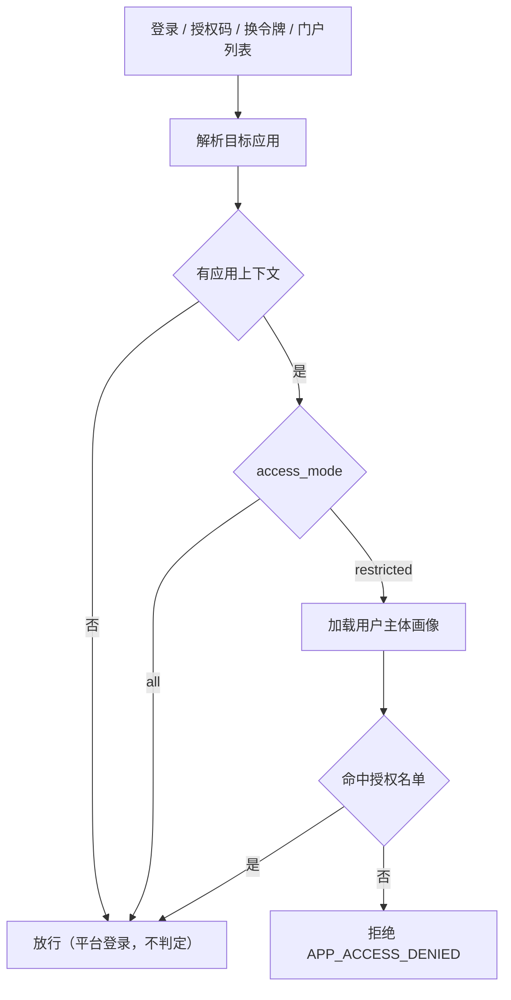
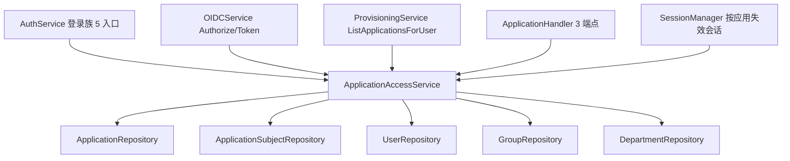

# 应用访问授权（谁能使用该应用）· 第六阶段 Spec

**Created**: 2026-10-15
**Version**: 1.8（验收期缺陷修复：保存访问授权时提交了闭包里的旧值 → 选好的名单/受限模式没生效）
**Author**: Agent
**Status**: Completed（2026-10-15 实施完成：后端 `make test`/`make vet` 全绿、冒烟 201 PASS、前端 `pnpm test`（typecheck + 136 项 vitest + build）全绿）

> Status lifecycle: `Draft` → `Awaiting Confirmation`（Spec 已成文）→ `Confirmed`（用户批准）→ `In Progress` → `Completed`。确认后若范围/设计变化，请递增 Version。
> 参考实现：阿里云 IDaaS「应用 → 登录访问 → 应用授权」（授权范围「全员可访问」开关 + 授权类型 账户 / 组 / 组织机构 + 「添加授权」+ 名单表）；Casdoor 的应用可见性与权限模型。

## 1. 概述

今天 Polaris 的**任何一个本组织用户都能登录本组织的任何一个应用**：应用只声明"怎么登录"（`signin_methods`）与"从哪些 IP 登录"（`ip_restriction`），从不声明"**谁能用**"。企业接入一个内部应用（如"技术部 SSL VPN"）时，只能全组织开放，或干脆不接入——这正是用户的原始诉求。

本阶段为应用引入**访问授权**：默认「全员可访问」（与今天行为完全一致，存量应用零回归）；关闭后进入「受限」模式，只有被显式授权的**用户 / 用户组 / 部门**才能登录该应用、换取授权码与令牌，门户应用中心也只展示被授权的应用。部门与用户组遵循"授权父级 = 覆盖整个子树"的直觉语义（部门含子部门、用户组含子组）。受限模式**允许名单为空**（= 暂时无人可访问，随时回来补授权，见 Q4），且判定**对所有人一视同仁，没有任何豁免主体（含管理员，见 Q5）**。

**判定作用域**（Q6）：应用授权约束的是"能否**以该应用为上下文完成认证**"，不是"能否登录平台"——不带应用上下文的登录不判定，因此任何误配都不会把人挡在平台之外，管理员随时可以进控制台补授权。

交付面：数据库（`applications.access_mode` 列 + `application_subjects` 表）、后端（`ApplicationAccessService` 判定与名单读写 + **9 个运行时生效点接线** + 3 个 API + 1 个业务码）、控制台（应用向导新增第 6 步「授权与访问」、应用列表新增「访问范围」列）、测试（判定矩阵单测 + 边界回归 + 冒烟 + 前端步骤隔离测试）与 `docs/api-reference.md`。

## 2. 背景

### 2.1 用户诉求（原话）

> 接下来我们需要规划一下 每个应用 应该可以 授权 哪些部门/用户组/用户可以使用吧，你可以参考下 阿里云 IDaaS 这个东西， 我们应该也需要类似的能力

随附截图：阿里云 IDaaS 应用详情 → 「登录访问」→「应用授权」页签，左侧「授权类型」为 **账户 / 组 / 组织机构**，右侧为「添加授权」+ 名单表（列：账户 / 外部 ID / 操作），顶部为「授权范围：全员可访问」开关。

### 2.2 代码研究小结（澄清前已核实的代码事实）

- **应用实体没有任何"主体名单"概念**：`repository.Application`（`internal/repository/models.go:240`）与访问相关的字段只有 `OrgChoiceMode` / `IPRestriction` / `IPWhitelist` / `SigninMethods`——全是"怎么登录"，没有"谁能登录"。全仓无 `application_subjects` 之类的表，`migrations/` 到 030 为止。
- **登录链路不看用户是谁**：`AuthService.Login`（`internal/service/auth_service.go:90`）只做「组织禁用登录 → 应用禁用登录 / IP 限制 → 密码方式开关 → 人机校验 → 失败限流 → 凭证校验 → MFA」；`CodeLogin`（`auth_code.go:170`）、`VerifyMagicLink`（`auth_magic_link.go:160`）、`Signup`（`auth_signup.go:45`）、SSO `Callback`（`auth_service.go:704`）同构，均无主体判定。
- **作为 IdP 的链路同样不判定**：`OIDCService.Authorize`（`oidc_service.go:90`）只校验 `client_id` / `redirect_uri` / `response_type` / `scope`；`grantPassword`、`grantRefreshToken` 亦然。
- **门户应用中心与授权无关**：`ProvisioningService.ListApplicationsForUser`（`provisioning_service.go:813`）按"已有有效下游账号 + 启用的 JIT 连接器"列应用，是"按供给结果"而非"按授权"。
- **SSO 登录路径当前拿不到应用上下文**：`ssoState`（`auth_service.go:422`）只有 `InstitutionID / Provider / From / RedirectURI / LinkSession / PKCEVerifier`，`Callback` 创建会话时 application 传的是空串（`auth_service.go:732`）。要在 SSO 路径判定，必须先给 state 补上 `Application`。
- **可复用的积木都已就绪**：
  - 主体三类齐全：`users.department_id`（部门树；`departments.code_path` 前缀即子树，`department_service.go:107` 已有 `isDescendant` 判定）、`group_members`（`groups.parent_id` 支持嵌套）、用户本身。
  - 关系表范式成熟：`role_users` / `role_groups` / `permission_users` / `permission_groups`（`migrations/001_init.up.sql:190-265`）；"整体替换 + 事务 + 会话失效 + 审计"在 `GroupService.SetMembers`（`group_service.go:125`）与 `PermissionService.SetSubjects`（`permission_service.go:169`）已跑通。
  - 「权限变更即失效会话」已有工具：`SessionManager.InvalidateUser`（`internal/auth/session.go:181`），且 `auth.Session` 已带 `Application` 字段（`internal/auth/model.go:25`）。
  - 前端：`FormWizard` / `FormSection` / `SwitchField` / `MultiSelect`（含 `onSearch` 远程搜索，`shared/ui`）、`UserPicker`（`iam/components/user-picker.tsx`）、应用向导现为 **5 步**（basic / signin / signup / client / security，`application-wizard.tsx:46`）。
- **权限是自由字符串**，无固定目录（`internal/app/seed.go:135` 仅种子 `permission-all` 与 `permission-self`）→ 授权管理沿用 `application:read` / `application:update`，**不需要新权限码**。
- **`applications` 是 60+ 列实体**，仓库已走 `mapper.go` 反射映射（`application_repo.go:9`），新增列不需要手写列清单（§3.6）；但 `ApplicationService.Update` 是**整行 UPDATE**，已有从 `existing` 继承 `Order`/`Name` 的先例（`application_service.go:80-86`）。
- **`GroupsForUser` 只返回直接归属**（`group_repo.go:159`，无祖先展开）→ 组递归需要新增查询。

### 2.3 范围外（本阶段不做，已记录理由）

| 项 | 理由 |
|---|---|
| 应用内角色 / scope 授权（把应用自定义角色授给主体并写进 id_token claims） | 需要在 `Application` 上再建一层"应用角色"模型并接线 claims 生成；本阶段的诉求是"谁能用"。收敛为独立阶段，避免一次交付两个新模型。 |
| 条件表达式 / 规则引擎（按属性、时间、IP 动态判定） | 引入规则语言、调试面与误配风险；`ip_restriction` 已覆盖最常见的 IP 维度。 |
| 「外部 ID」列（IDaaS 截图中的列） | 该列服务于"从外部 IdP 同步来的账号标识"，Polaris 的身份绑定在 `user_identities`，与本次准入无关。 |
| 主体被授权后自动建下游账号（供给联动） | 供给是既有独立链路（`provisioning`）；本次只改"准入"，不隐式触发建号。若需要，后续在连接器策略里显式开启。 |
| 组织级"应用访问总览"页（谁被授权了哪些应用） | 需要反向索引的聚合页；表结构已预留反向索引（见 §5.4.1），界面留到有诉求时做。 |

## 3. 澄清记录

> 本轮尝试以交互式选择器提问，但当前会话为 Default 模式、该工具不可用，故按"给出推荐默认值并成文"的方式记录；**下列 Q1–Q3 的推荐项即 Spec 采用的方案，用户可在确认环节逐条否决**。

- **Q1**：授权范围只做「准入」（能不能进这个应用），还是要一并做「应用内权限」（把应用定义的角色 / scope 授予名单主体并写进 id_token claims）？
  **Recommendation**：仅准入名单。理由：与 IDaaS「应用授权」页语义一致；应用角色模型当前完全不存在，加进来会让本阶段变成两个新模型 + claims 生成改造，违反"一次交付一件事"。
  **User response**：待确认（成文按推荐项）。
  **Date**: 2026-10-15

- **Q2**：不在授权名单内的用户，应该在哪个环节拒绝？
  **Recommendation**：**登录即拒**（错误码 `APP_ACCESS_DENIED`），授权 / 发令牌 / 刷新链路一并拦截。理由：与今天的组织级 `DisableSignin`、应用级 `signin_methods` 拦截位置一致；用户不会"登录成功却用不了"，减少支持成本。
  **User response**：待确认（成文按推荐项）。
  **Date**: 2026-10-15

- **Q3**：授权某个部门 / 用户组时，是否自动覆盖其下级？
  **Recommendation**：**部门含子部门、用户组含子组**（"授权技术部 = 整个技术部"）。理由：`departments.code_path` 与 `groups.parent_id` 都已支持递归展开；仅精确匹配会让每个新建子部门/子组都要回头补授权，是必然的运维事故。
  **User response**：待确认（成文按推荐项）。
  **Date**: 2026-10-15

- **Q4**（用户主动提出的修正，覆盖本 Spec 初稿中"空名单拒绝保存"的防呆设计）：受限模式下**授权名单为空**时，是否允许保存？
  **Recommendation**：初稿为"拒绝保存（`INVALID_PARAMS`，提示'受限模式至少需要一个主体'）"，理由：避免管理员把应用（尤其是**组织默认应用**——控制台登录也走它）改成无人可访问，导致全员无法登录、只能改库恢复。
  **User response**（原话）：如果 没有配置可访问的人员 也可以保存的，不做限制，后续再编辑就可以了
  **采纳结论**：**允许保存空名单**（语义 = 暂时无人可访问，后续再编辑）。防呆改由两条**非拦截式**手段承担：① 组织管理员直通判定（FR-2）——**该条随后被 Q5 否决，改为"平台登录不判定"（见 Q6）**；② 界面以「当前无人可访问」警示徽标 + 应用列表「受限（0）」显式表达状态，但**不阻止提交**。
  **对"不做限制"的解释（若理解有偏请指出）**：本 Spec 把它读作**不限制"保存"**；空名单的**访问语义仍为"拒绝"**。反读（空名单 = 不限制任何人访问）会使「全员可访问」开关在空名单下退化为恒真、开关失去意义，故不采用。要翻转该分支只需改 §5.5 ③ 一行判定。
  **Date**: 2026-10-15

- **Q5**（用户否决 v1.1 的防呆设计）：是否给组织管理员开"直通"通道（管理员不受应用授权限制）？
  **Recommendation**：v1.1 曾建议"管理员直通"，理由是它能兜住"误配后管理员自己也进不来"。
  **User response**（原话）：管理员不需要直通...
  **采纳结论**：**取消管理员直通**。判定对所有人一致——管理员从受限应用入口登录时同样被拒。兜底改为"判定作用域收敛"（Q6），不再靠给某类人开后门。
  **Date**: 2026-10-15

- **Q6**（用户对"锁死"风险的处置意见）：误配成"受限 + 无人被授权"之后，怎么恢复？
  **User response**（原话）：锁死没事啊， 后续 管理员 可以 配置 应用授权啊
  **采纳结论**：**接受"该应用暂时无人可访问"这一状态**，恢复动作＝管理员事后在控制台补授权。要让这句话成立，必须先保证**管理员在任何误配下都能登录平台**，因此本 Spec 明确：
  **应用授权只在请求携带"应用上下文"（`client_id` 或 `application`）时判定；不带应用上下文的登录＝"登录平台"，不做应用授权判定**（平台准入由组织级 `disable_signin` 与权限体系负责）。
  由此得到三条性质：① 误配永不锁死平台，管理员随时能进来改配置；② 受限应用的**所有**入口（含管理员）严格判定，无人绕过；③ 代价是"受限"只约束该应用、不约束平台登录（见 §8 风险 5）。
  **Date**: 2026-10-15

- **其余按推荐默认值成文（可在确认环节否决）**：
  1. 授权主体＝**用户 / 用户组 / 部门**三类，**不含角色**（角色在本仓是控制台侧的授权载体，语义不同，混入会让"角色"同时承担两种含义）。
  2. 存量应用与新建应用一律默认 `access_mode = all`（全员可访问），保证零回归；受限必须由人显式打开。
  3. 运行时生效点＝登录族（5 处）+ IdP 族（2 处令牌链路 + 1 处 authorize）+ 门户应用中心，**单一判定入口**，不做"配了不生效"；判定仅在请求携带**应用上下文**（`client_id` / `application`）时启用（见 Q6）。
  4. 控制台入口＝应用第 6 步向导（不新增独立菜单页），与 IDaaS 的「应用授权」在应用详情内的位置一致。
  5. **不把「授权名单为空」当作"全员可访问"**：两种状态各有明确语义（详见 §5.5 ③）；但**空名单允许保存**——该点在成文后由用户修正，见 Q4。

## 4. 功能需求

### FR-1 访问模式与授权名单的数据模型 + API

- Description: 应用新增 `access_mode`（`all` 全员可访问 | `restricted` 受限），受限时以 `application_subjects` 表承载三类主体名单；提供读取 / 整体替换两个端点，写入为单事务。
- Input / Output: `GET /api/v1/applications/:id/access`（`application:read`）、`PUT /api/v1/applications/:id/access`（`application:update`）；路径 `:id` 沿用既有约定（对外路径用**主键 id**，服务层解析为应用标识 code）。
- Acceptance: 新建 / 存量应用读到的 `access_mode` 均为 `all` 且名单为空集合（`[]`，非 `null`）；`PUT` 后重复 `GET` 结果一致；改名 / 改表单不改变 `access_mode`（回归测试锁定）。

### FR-2 三类主体 + 递归语义

- Description: 主体类型 `user` / `group` / `department`；`department` 隐式覆盖其全部子部门，`group` 隐式覆盖其全部子组。主体以**组织内标识名**（`users.name` / `groups.name` / `departments.name`，均满足组织内唯一）落库。**无任何豁免主体**（Q5）：判定对管理员与普通用户一视同仁，管理员从受限应用入口登录时同样被拒。"管理员永远能进来修配置"这件事由**判定作用域**保证（平台登录不判定，见 FR-3），而不是靠给某类人开后门。
- Input / Output: `PUT` 请求体 `{access_mode, users[], groups[], departments[]}`。
- Acceptance: 授权父部门后，仅归属子部门的用户通过判定；授权父组后，仅归属子组的用户通过判定（单测矩阵锁定）；跨组织同名主体不串（组织 A 的授权对组织 B 无效，单测锁定）；`restricted` + 空名单时所有用户（**含 `is_admin`**）一律被拒（单测锁定，Q5）。

### FR-3 认证链路准入判定（判定作用域 + 客户端契约）

- **判定作用域（Q6 的核心约定）**：应用授权只约束"**以该应用为上下文完成认证**"的请求；**不带应用上下文的登录＝"登录平台"，不做判定**。
  - 判定启用条件：请求携带**应用上下文**——`client_id`（应用驱动入口的标准形态）优先，其次 `application`（应用标识，兼容旧链接）。
  - 未携带（用户直接打开 `/login`、走组织级通用登录）→ 仍回退解析到组织默认应用（**保持今天的既有行为**），但**跳过授权判定**；平台登录的准入由组织级 `disable_signin` 与权限体系负责。
  - 由此保证：误配（受限 + 空名单 / 把管理员排除在外）**永远不会把人挡在平台之外**，管理员随时能登录控制台补授权（Q6）；同时受限应用的**全部**入口对**所有人（含管理员）**一视同仁（Q5）。
- Description: 在 5 个登录入口统一判定并拒绝：`Login`（密码）、`CodeLogin`（邮箱/短信验证码）、`VerifyMagicLink`（魔法链接）、`Signup`（自助注册——受限应用下注册即被拒，避免"注册完用不了"）、SSO `Callback`（第三方登录）。
- **客户端契约改造（必须同批交付，否则判定永不生效＝死配置）**：
  1. `auth.LoginRequest` 与 `CodeLoginRequest` 增加 `ClientID`（`json:"client_id"`），handler 绑定并向服务层透传；
  2. 应用上下文解析收敛为**一个**函数（`client_id` → `application` → 无），供 `Login` / `CodeLogin` / `VerifyMagicLink` / `Signup` / SSO `Authorize`+`Callback` 共用；
  3. `frontend/web/src/features/auth/login-page.tsx` 在 `appDriven`（URL 带 `client_id`）时，把 `client_id` 透传到 `login` / `sendCode` / `codeLogin` 请求——**今天密码登录请求完全不带应用上下文**（`authApi.login` 只发 `institution_id`），后端一律回退默认应用；
  4. `frontend/web/src/features/auth/auth-api.ts` 的 `LoginPayload` / `codeLogin` / `sendCode` 增加 `client_id`；
  5. SSO 路径：`ssoState` 增加 `Application`（现只有 `InstitutionID` / `Provider` / `From` / `RedirectURI` / `LinkSession` / `PKCEVerifier`），`Authorize` 接受并透传。
- **副作用（语义修正，必须回归锁定）**：应用驱动登录页的**其它**应用级策略（`signin_methods` / IP 限制 / `max_sessions` / 失败限流）会从"按组织默认应用"变为"按本应用"。今天应用驱动页把 `client_id` 只用于渲染（`app-info` / `providers`），登录请求却落到默认应用，于是"登录页显示的方式"与"后端真正放行的方式"可能不一致——属既有缺陷，本阶段一并修正。
- Input / Output: 拒绝时返回业务码 `APP_ACCESS_DENIED`（HTTP 403；`message` 为英文 `you are not authorized to access this application`，前端按 code 走 i18n）。
- Acceptance: 未授权用户从应用入口（`?client_id=`）登录受限应用 → 403 `APP_ACCESS_DENIED` 且**不产生会话**（Redis 无该会话）；加入名单后同一请求 200；`access_mode=all` 的应用行为与今天逐字一致（回归测试锁定）；**不带应用上下文**的登录在受限应用配置下仍可成功（平台登录不判定，Q6）；应用驱动登录的应用级策略按**本应用**生效（回归测试锁定）。

### FR-4 作为 IdP 的授权 / 令牌链路判定

- Description: `OIDCService.Authorize`（发授权码）与 `grantPassword`、`grantRefreshToken` 三个链路实时判定；命中拒绝时：
  - `authorize`：因 `redirect_uri` 已校验通过，**按 OAuth2 规范回跳** `redirect_uri?error=access_denied&state=...`（否则第三方应用看到的是 Polaris 的 JSON 错误页）；
  - `token`：沿用现有错误渲染（Polaris 信封 + `APP_ACCESS_DENIED`，403）。
- Acceptance: 未授权用户已持有会话时访问 `authorize` → 302 回跳带 `error=access_denied`；被移出名单后，旧 `refresh_token` 换新 token 被拒（实时判定，单测锁定）；`client_credentials` 流程不受影响。

### FR-5 门户应用中心按授权过滤

- Description: `ListApplicationsForUser` 在原有"有效下游账号 / 启用 JIT"条件之上，追加"该用户对应该应用的授权判定"，未授权应用不出现在 `/me/applications`。
- Acceptance: 受限应用未授权 → 门户应用中心不显示且无"一键 SSO"入口；授权后立即出现（同一会话内，无需重新登录）。

### FR-6 控制台：应用向导第 6 步「授权与访问」

- Description: 应用向导新增第 6 步 `access`（位于「安全与令牌」之后），内容为独立的 `ApplicationAccessEditor`：
  - 顶部 `SwitchField`「全员可访问」（开 = `all`）；关闭后直接进入受限模式；
  - 下方是**左授权类型 / 右授权名单**的主从布局（对齐 IDaaS「应用授权」页）：左侧列出 `用户 / 用户组 / 部门` 及各自**已授权数量**，右侧是该类型的名单**表格**（名称 / 标识 / 层级路径 / 行内移除），带「添加授权」与本地筛选（按名称、标识、路径）；
  - 「添加授权」弹出候选选择弹窗（对齐 IDaaS「添加授权」）：**弹窗内左侧切换授权类型**，右侧是该类型的**勾选式候选区**，顶部一行后果提示与「已选 N 项 · 展开」（展开后按 chips 列出已勾选项、可单条取消），筛选框按类型换占位文案（服务端搜索，输入防抖 300ms）；**勾选可跨类型累积**，底部「取消 / 确认」一次性批量写入名单（打开弹窗时停在调用方正查看的类型，关闭即丢弃草稿）。右侧三种形态：
    - 用户 / 用户组：**服务端分页的扁平列表**（每页 10 条 + 分页器，列：名称 / 标识 / 层级路径）；
    - 部门 + 关键词：跨层级扁平搜索结果（带层级路径，同样分页）；
    - 部门 + 无关键词：**按层懒加载的部门树**——先出顶层，展开某节点才取它的下一层，顶层与每层都有「加载更多」（大组织的部门树不可能一次拉全）；树里已授权的节点保留显示（不破坏导航）但勾选框禁用并标「已授权」；
  - 已授权的主体不进候选（在右侧名单里管理），确定加入后**立刻以展示名显示**（不必先保存）；
  - 名单为空时由右侧**空态**（"还没有授权任何主体 / 点「添加授权」…"）表达，**不阻止保存**（Q4）。
  - **不写"解释性段落"**（v1.5，用户反馈"没用的废话去掉"）：作用域说明（受限只影响该应用的登录与令牌入口）与"当前无人可访问"红色警示都从界面移除——它们讲的是背景与后果，不是用户此刻要做的动作；背景信息留在本文档与 `docs/api-reference.md`，界面上只保留可操作信息（空态引导 + 各类型计数）。
  - **为什么不用下拉多选**（v1.3 的初版实现）：三个 `MultiSelect` 把"已授权了谁"整体藏在控件里——看不到全局、没法逐条核对、也不能单条移除，且新增授权要先在下拉里搜半天。名单类授权必须是"一眼看全 + 行内动作"的形态。
- Input / Output: 保存时调用 `PUT /applications/:id/access`（创建流程在应用创建成功、拿到 id 之后再提交；与现有"创建后停留完成页"流程一致）。候选读取走 `GET /applications/subject-options`（`type` / `keyword` / `parent_id` / `offset` / `limit` → `{items, total}`；部门的 `id` 与 `has_child` 供树逐层懒加载，`parent_id` 只对部门有意义且与 `keyword` 互斥）。
- Acceptance: 步骤内容**只在第 6 步渲染**（`application-wizard.test.tsx` 锁定，沿用"向导每一步都出现品牌主题"的教训）；`restricted` + 空名单**允许保存**且界面无任何拦截/解释性段落，仅由空态与计数表达（`application-access-editor.test.tsx` 锁定"不出现「无人可访问」这类警示"）；添加授权必须能"跨类型勾选 → 确认一次性写入"（`application-access-editor.test.tsx` 锁定计数、全选、已授权项不进候选）；中英词条 key 集合一致且被引用（`i18n.test.ts` / `usage.test.ts`）。

### FR-7 撤销授权的即时生效（应用范围内会话失效）

- Description: 名单变更时计算"被移除主体展开出的用户集合"，对这些用户名下 **`Application == 本应用` 的会话**执行失效（`internal/auth/session.go` 新增按应用过滤的方法），并写审计 `application.access_update`。管理员控制台会话不受影响——只失效该应用的登录态。
- Acceptance: 用户 A 已登录受限应用 X 并被移出名单 → A 在 X 的会话消失；A 的控制台 / 门户会话仍在；审计含 `access_mode` 与三类主体数量快照。

### FR-8 应用列表「访问范围」列

- Description: 应用列表新增一列展示「全员可访问」或「受限（N 个主体）」；由列表 DTO 的 `access_subject_count` 提供（服务层在 `List` 后一次 `GROUP BY` 批量装配，不做 N 次查询）。
- Acceptance: 列表页不发额外请求即可显示；`all` 的应用不查计数（计数为 0 且不参与展示）。

### FR-9 可授权主体目录端点

- Description: 新增 `GET /api/v1/applications/:id/subject-options?type=user|group|department&keyword=&limit=`，返回主体标识 + 展示名（部门含 `name_path`、用户组含父组路径），权限 `application:read`。动机：**应用管理员通常没有 `user:read` / `group:read` / `department:read`**，直接复用现有列表接口会让选择器空转（"配了但选不出人"）。
- Acceptance: 仅有 `application:read` 的角色可以拉到三类候选；无 `application:read` 时 403；`limit` 上限固定（默认 50、最大 200），关键词为空时返回前 N 条。

## 5. 设计

### 5.1 总体架构

新增一个**唯一判定入口** `ApplicationAccessService`（`internal/service/application_access.go`），所有链路只调它，避免判定逻辑散落：

| 变更点 | 内容 |
|---|---|
| `internal/repository/models.go` | 新增 `ApplicationSubject` 实体；`Application` 增加 `AccessMode string`（`db:"access_mode"`）与常量 `AccessModeAll` / `AccessModeRestricted` |
| `internal/repository/iface.go` | 新增 `ApplicationSubjectRepository` 接口；`GroupRepository` 增加「含祖先组」查询 |
| `internal/repository/postgres/application_subject_repo.go` | 名单读写（整体替换事务）+ 判定所需的画像查询 |
| `internal/repository/postgres/group_repo.go` | 新增 `GroupsForUserWithAncestors`（`WITH RECURSIVE` 一条 SQL） |
| `internal/service/application_access.go` | `ApplicationAccessService`：`Allowed` / `Enforce` / `Access` / `SetAccess` / `SubjectOptions` |
| `internal/service/application_service.go` | `Update` 从 `existing` 继承 `AccessMode`（防整行覆盖）；`Create` 归一化空值为 `all` |
| `internal/service/auth_service.go`、`auth_code.go`、`auth_magic_link.go`、`auth_signup.go` | 5 个登录入口接线；`ssoState` 增加 `Application` |
| `internal/service/oidc_service.go` | `Authorize` / `grantPassword` / `grantRefreshToken` 接线；`authorize` 按 OAuth2 规范回跳 |
| `internal/service/provisioning_service.go` | `ListApplicationsForUser` 追加授权过滤 |
| `internal/auth/session.go` | 新增「按应用失效某用户会话」方法（FR-7） |
| `internal/errors/codes.go` | 新增 `CodeAppAccessDenied`（全局唯一，由 `codes_test.go` 锁定） |
| `internal/handler/application_handler.go` + `dto_resource.go` | 3 个端点 + DTO（`access_mode` / 三类主体 / `missing` 标记 / `access_subject_count`） |
| `internal/app/app.go` | 唯一装配点：构造仓库与服务，经 `SetApplicationAccess(...)` 注入 `AuthService` / `OIDCService` / `ProvisioningService`（与既有 `SetProvisioning` / `SetBackchannelLogout` 同模式，避免构造期循环依赖） |
| `frontend/web/` | 向导第 6 步、列表列、`iam/api.ts`、`shared/api/types.ts`、i18n（中英） |

### 5.2 流程



### 5.3 模块关系



### 5.4 数据设计

#### 5.4.1 数据库变更（新增迁移 `031_application_access`，不改历史迁移）

```sql
-- 031 应用访问授权（第六阶段）
-- 1) 访问模式：默认 all —— 存量与新建应用行为与今天完全一致（零回归），受限必须显式打开。
ALTER TABLE applications ADD COLUMN IF NOT EXISTS access_mode TEXT NOT NULL DEFAULT 'all';
ALTER TABLE applications DROP CONSTRAINT IF EXISTS applications_access_mode_check;
ALTER TABLE applications ADD CONSTRAINT applications_access_mode_check
    CHECK (access_mode IN ('all', 'restricted'));

-- 2) 授权名单：三类主体统一落一张表，subject_name 是**组织内唯一标识名**
--    （users.name / groups.name / departments.name），展示名在读取时 JOIN 回实体装配。
CREATE TABLE IF NOT EXISTS application_subjects (
    id             BIGSERIAL   PRIMARY KEY,
    institution_id BIGINT      NOT NULL REFERENCES institutions(id) ON DELETE CASCADE,
    application_id BIGINT      NOT NULL REFERENCES applications(id) ON DELETE CASCADE,
    subject_type   TEXT        NOT NULL,
    subject_name   TEXT        NOT NULL,
    created_at     TIMESTAMPTZ NOT NULL DEFAULT NOW(),
    CONSTRAINT application_subjects_type_check CHECK (subject_type IN ('user', 'group', 'department')),
    CONSTRAINT application_subjects_app_type_name_key UNIQUE (application_id, subject_type, subject_name)
);

-- 判定主查询：按应用取名单
CREATE INDEX IF NOT EXISTS application_subjects_app_idx ON application_subjects (application_id, subject_type);
-- 反向查询：某主体被哪些应用授权（组织级总览 / 删除主体前的提示，界面本阶段不做）
CREATE INDEX IF NOT EXISTS application_subjects_subject_idx ON application_subjects (institution_id, subject_type, subject_name);
```

`down`：`DROP TABLE IF EXISTS application_subjects;` + 删约束 + `DROP COLUMN IF EXISTS access_mode;`

> 说明：`applications` 已是 60+ 列实体且走反射映射（§3.6），新增列无需手写列清单；`insertColumns` 排除 `created_at`/`updated_at` 的约定同样适用本表（本表只有 `created_at`，由数据库默认值生成）。

#### 5.4.2 API 设计

| Method | Path | Permission | Description |
|---|---|---|---|
| GET | `/api/v1/applications/:id/access` | `application:read` | 读取访问模式与三类授权主体（含展示名与失效标记） |
| PUT | `/api/v1/applications/:id/access` | `application:update` | 整体替换访问模式与名单（单事务） |
| GET | `/api/v1/applications/:id/subject-options` | `application:read` | 可授权主体候选（关键词 + 上限） |

**GET 响应示例**：

```json
{
  "code": "OK",
  "message": "ok",
  "data": {
    "access_mode": "restricted",
    "users": [{ "name": "zhangsan", "display_name": "张三", "email": "z@example.com", "missing": false }],
    "groups": [{ "name": "svpn-users", "display_name": "VPN 用户", "path": "研发中心 / VPN 用户", "missing": false }],
    "departments": [{ "name": "tech", "display_name": "技术部", "path": "技术部", "missing": false }]
  }
}
```

**PUT 请求示例**（整体替换；空数组 = 清空该类型）：

```json
{
  "access_mode": "restricted",
  "users": ["zhangsan"],
  "groups": ["svpn-users"],
  "departments": ["tech"]
}
```

`subject-options` 响应示例：

```json
{
  "code": "OK",
  "message": "ok",
  "data": {
    "items": [
      { "name": "tech", "display_name": "技术部", "path": "技术部" },
      { "name": "fe", "display_name": "前端组", "path": "技术部 / 前端组" }
    ]
  }
}
```

### 5.5 关键实现细节

**① 判定算法（Go 侧集合运算，单测友好）**

```
profile = {
  name:            user.Name
  department_path: departments[user.department_id].code_path   // 无部门 → ""
  groups:          GroupsForUserWithAncestors(user)            // 直接归属 ∪ 全部祖先组
}

allowed(user) =
     user ∈ S.users
  ∨  S.groups ∩ profile.groups ≠ ∅
  ∨  ∃ d ∈ S.departments:
         d.code_path == profile.department_path
       ∨ strings.HasPrefix(profile.department_path, d.code_path + "/")
```

`access_mode == "all"` 或 `未解析到应用（app == nil）` 直接放行，不查库。

**② "配置即生效"接线清单（必须同批交付，缺一即为死配置）**

| # | 位置 | 判定时机 |
|---|---|---|
| 1 | `AuthService.Login` | 密码校验通过后、MFA 之前（避免让不可用的用户白做二次验证）；**仅当请求携带应用上下文时判定** |
| 2 | `AuthService.CodeLogin` | 验证码校验通过后、`sessions.Create` 之前 |
| 3 | `AuthService.VerifyMagicLink` | 同上 |
| 4 | `AuthService.Signup` | 解析出注册应用后立即判定（受限应用不允许自助注册） |
| 5 | `AuthService.Callback`（SSO） | `provision` 之后、`sessions.Create` 之前；**前置改造**：`ssoState` 增加 `Application`，`Authorize` 接受并透传 |
| 6 | `OIDCService.Authorize` | 用户解析之后、写授权码之前；拒绝按 OAuth2 规范回跳 `error=access_denied` |
| 7 | `OIDCService.grantPassword` | 凭证校验后立即判定 |
| 8 | `OIDCService.grantRefreshToken` | 换新令牌前实时判定（这是"撤销授权立即生效"的关键点） |
| 9 | `ProvisioningService.ListApplicationsForUser` | 门户应用中心列表过滤 |

> 上表 1–5 全部遵守 FR-3 的作用域约定：**未携带应用上下文的登录（= 登录平台）不做判定**；6–8 天然带应用上下文（`client_id` + 会话用户）；9 由"当前登录用户"这一上下文触发。

**③ 三种状态的语义（空名单**不拦截保存**，兜底是"判定作用域 + 界面警示"）**

| `access_mode` | 名单 | 语义 | 是否允许保存 |
|---|---|---|---|
| `all` | 任意（忽略但保留） | 全员可访问（与今天行为一致） | 允许（名单保留，重新打开受限时复用，避免误删配置） |
| `restricted` | 非空 | 仅名单内主体（含其子树）可访问 | 允许 |
| `restricted` | 空 | **暂时无人可访问**（无人被豁免，Q5） | **允许**（Q4：不做限制，后续再编辑） |

- **禁止把空名单当作"全员可访问"**——这正是"配了但不生效"的高危方向（§1）：空名单必须判定为**拒绝**，不得回退成放行（判定分支上，"名单为空"与"未命中"走同一条拒绝路径）。
- 兜底同样不拦截保存，共两条：① **平台登录不参与判定**（FR-3 作用域）——"没有人能进这个应用"永远不会升级成"没有人能进平台"，管理员总能登录控制台补授权；② **界面警示**（FR-6 徽标 / FR-8 列表列）让状态始终可见。
- **没有管理员直通**（Q5）：管理员进受限应用走同一条判定，被拒时拿到同一条 `APP_ACCESS_DENIED`。这与仓库既有的"管理员直通"（§4 权限判定）不冲突——那条说的是**平台资源的管理权限**，本阶段说的是**应用的准入**，作用域不同。
- 因此不需要"改库恢复"这类兜底：任何误配都能由管理员在控制台自助修复（Q6）。

**④ 四个必须写进回归测试的陷阱**

1. `ApplicationService.Update` 是**整行 UPDATE**：请求体不带 `access_mode` 时零值 `""` 会违反 CHECK 约束（`DB_ERROR`），若在仓库层把 `""` 归一化为 `all` 则会**静默放宽访问**（受限应用被悄悄改成全员可访问）。→ 必须在服务层从 `existing` 继承 `AccessMode`（与既有 `Order` / `Name` 的继承同处），**且仓库层不得做 `""`→`all` 的兜底**。`Create` 路径另行把空值设为 `all`。
2. 主体存在性校验不得静默忽略：名单里出现本组织不存在的主体 → `INVALID_PARAMS`（附 `subject_type` / `subject_name` 明细），避免"以为加了却不生效"。
3. 跨组织隔离：`application_subjects.institution_id` 必须等于应用的 `institution_id`；主体必须在同一组织内存在。
4. **判定条件写反 = 死配置或锁死**：若把判定挂在"回退解析出的应用"上（而不是"请求是否携带应用上下文"），平台登录会被组织默认应用拦住 → 全员（含管理员）锁死、只能改库；若只看 `application` 字段而忽略 `client_id`，则应用驱动登录页（前端只传 `client_id`）永远不判定 → "配了不生效"。两侧都要有单测：① 服务层"带/不带应用上下文"的分支；② `login-page-requests.test.tsx` 断言 `?client_id=` 时登录 / 发码请求体确实携带 `client_id`。

**⑤ 主体删除 / 改名导致的悬空条目**：判定时自然不命中（不会误放行），读取时 JOIN 不到实体则 `missing: true`，前端在该条上显示「已失效」并提供一键清理。部门移动会重算子树 `code_path`，判定取的是**当前**路径比对，因此移动后语义依旧正确。

**⑥ 会话失效（FR-7）**：只失效 `Application == 本应用` 的会话；实现放在 `internal/auth/session.go`（`UserSessions` + `Application` 字段过滤后删除），由 `ApplicationAccessService.SetAccess` 在事务提交后触发，逐个受影响用户执行。审计 `application.access_update` 记录 `access_mode` 与三类主体数量快照。

**⑦ 错误码**（`internal/errors/codes.go`，全局唯一由 `codes_test.go` 锁定）：

```go
CodeAppAccessDenied = defineCode("APP_ACCESS_DENIED", "you are not authorized to access this application",
    http.StatusForbidden, "authenticated user is outside the application access scope")
```

**⑧ 前端**

- `application-wizard.tsx`：新增步骤 `access`（`applications.stepAccess` / `applications.stepAccessHint`），步骤内容写在**步骤条件之内**（教训：分区写在条件外会让每一步都重复渲染）。
- `application-form.ts`：`ApplicationFormValue` 增加 `accessMode` 与三类名单字段；`formToApplication` 不把 `accessMode` 放进应用主表单提交体（避免与 `/access` 端点形成两个写入点）。
- `login-page.tsx` / `auth-api.ts`：`appDriven` 时把 `client_id` 透传到 `login` / `sendCode` / `codeLogin`（FR-3 契约改造 ③④），并由 `login-page-requests.test.tsx` 锁定请求体含 `client_id`。
- 部门 / 用户组候选来自 FR-9 的 `subject-options`，不与 `department:read` 等权限耦合；用户候选沿用 `UserPicker` 的远程搜索模式。
- 列表页 `applications-page.tsx` 增加「访问范围」列（`applications.accessRangeAll` / `applications.accessRangeRestricted`）。
- i18n 中英双语同步新增；`shared/i18n/i18n.test.ts` 锁 key 集合一致、`usage.test.ts` 锁引用有效。

**⑨ 测试清单（§3.1-9：修复与新能力都必须带测试）**

- `internal/service/application_access_test.go`：判定矩阵（all / restricted / 用户命中 / 组含子组 / 部门含子部门 / 无部门用户 / 空名单判为拒绝且**管理员同样被拒** / 跨组织隔离 / 悬空主体）。
- `internal/service/application_service_test.go`：`Update` 保留 `AccessMode` 的回归（撤掉继承 → 失败）。
- `internal/handler/application_handler_test.go`：`/access` 请求体校验（未知主体类型、超长名单上限、跨组织主体拒绝）与 DTO 字段（集合归一化为 `[]`、`has_*` 风格不引入敏感信息）。
- 登录拒绝与作用域用例（`internal/service` 登录相关测试文件）：受限应用未授权 → 403 且无会话；**带 `client_id` / `application` 触发判定、两者都不带则不触发**（Q6 作用域）；应用驱动登录的应用级策略按本应用生效（`signin_methods` / IP / 会话数回归）。
- `internal/service/oidc_service_test.go`：`authorize` 回跳 `error=access_denied`、`refresh_token` 实时判定。
- 前端：`application-wizard.test.tsx`（第 6 步内容隔离 + 提交体形状）、`applications-page.test.tsx`（访问范围列）。
- `scripts/smoke-test.sh`：受限应用未授权登录 403 → 加入授权后 200 → 移出后 403（端到端锁定"配置即生效"）。

## 6. 实施计划

- [x] **Task 1**：迁移 031 + 实体与仓库
  - Owner: Agent
  - Estimated effort: 0.5 天
  - Completion criteria: `make migrate-up` / `migrate-down` 往返通过；`ApplicationSubject` 实体 + 仓库 CRUD（整体替换走 `WithTx`）；`GroupsForUserWithAncestors` 单测通过（含多层嵌套组）
  - Depends on: none

- [x] **Task 2**：`ApplicationAccessService`（判定 + 名单读写 + 审计 + 会话失效 + 主体候选）
  - Owner: Agent
  - Estimated effort: 1 天
  - Completion criteria: `application_access_test.go` 判定矩阵全绿；空名单可保存且所有用户（**含 `is_admin`**）被拒；跨组织主体被拒；审计写入
  - Depends on: Task 1

- [x] **Task 3**：`ApplicationService` 的 `AccessMode` 继承与新建归一化
  - Owner: Agent
  - Estimated effort: 0.2 天
  - Completion criteria: 更新应用表单后 `access_mode` 不变（回归测试先失败后通过）
  - Depends on: Task 1

- [x] **Task 4**：9 个生效点接线 + 应用上下文契约改造（`client_id` 透传、`ssoState.Application`）
  - Owner: Agent
  - Estimated effort: 1.2 天
  - Completion criteria: §5.5-② 清单逐条有对应用例；应用上下文解析收敛为单函数且 `client_id` 优先（FR-3 契约改造 ①②）；`authorize` 回跳 `error=access_denied`；`refresh_token` 实时判定；不带应用上下文的登录在受限应用配置下仍成功（Q6）
  - Depends on: Task 2

- [x] **Task 5**：Handler + DTO + 路由 + 权限 + 业务码
  - Owner: Agent
  - Estimated effort: 0.5 天
  - Completion criteria: 3 个端点按 §5.4.2 契约返回；`application:read` / `application:update` 命中；DTO 集合归一化；`codes_test.go` 唯一性通过
  - Depends on: Task 2

- [x] **Task 6**：前端向导第 6 步 + 列表列 + i18n
  - Owner: Agent
  - Estimated effort: 1 天
  - Completion criteria: 第 6 步可读可写（含全员开关、三类选择器、**作用域说明**）；`restricted` + 空名单以警示表达且**不阻止提交**；`login-page.tsx` 在应用驱动时透传 `client_id`（FR-3 契约改造 ③④，`login-page-requests.test.tsx` 锁定）；中英词条齐备；`pnpm test` 通过；任一分包 < 500KB
  - Depends on: Task 5

- [x] **Task 7**：端到端冒烟与文档
  - Owner: Agent
  - Estimated effort: 0.5 天
  - Completion criteria: `./scripts/smoke-test.sh` 新增用例通过；`docs/api-reference.md` 补 3 个端点；`AGENTS.md` §8 教训表按需追加（仅在实施中真的踩到新坑时）
  - Depends on: Task 4, Task 6

**Progress log**（实施期间追加，不改写历史）：

- 2026-10-15: Spec 成文（Status: Awaiting Confirmation），未开始实施
- 2026-10-15: 用户确认（原话：按照这个实施吧）→ Status: Confirmed → In Progress
- 2026-10-15: 验收期缺陷修复 v1.8（用户反馈："选了一批用户，保存后再次编辑，进去发现还是允许所有人"）
  - 定位：后端两条写入路径用 curl 复现均正常（`setAccess` → 回读 → 主表单更新后仍为 restricted）；
    根因在前端——编辑页 `save` 的 `useCallback` **漏了 `access` 依赖**，React 复用首次创建的闭包，
    于是**一直提交初始值**（`all` + 空名单）。页面回显正确、保存也"成功"（主表单确实写进去了），
    只有授权被旧值覆盖 → 表现成"配了但没生效"。
  - 修复：把 `access` 加进依赖数组（创建路径的 `setAccess` 同在一个闭包里，一并修好）。
  - 回归测试：新增 `application-edit-page.test.tsx`（回显受限名单 → 弹窗再加一个用户 → 保存 →
    断言提交体为 `{access_mode: 'restricted', users: ['zhangsan','lisi']}`）；**已按"撤掉依赖该用例必红"验证过**。
- 2026-10-15: 验收期补做 v1.7（用户决定："1 要做，2 要做，3 不用"）
  - 后端：候选端点改为 `{items, total}` 且支持 `offset`；部门新增"按层取直接子节点"（`parent_id`，省略=顶层），候选项带 `id` / `has_child`；`parent_id` 用于非部门类型或与 `keyword` 同传一律 400（不静默忽略）；用户候选排除软删除账号
  - 新增仓库方法 `DepartmentRepository.Children`（按层取子 + 该层总数）；`ApplicationAccessService.SubjectOptions` 收敛三类形态（扁平分页 / 部门搜索 / 部门按层）
  - 前端：部门改**按层懒加载的树**（展开箭头 + 每层「加载更多」+ 已授权节点禁用并标注）；用户与用户组改为**服务端分页表格**（复用 `ListPagination`）；搜索时部门退化为扁平结果
  - **顺带修掉一个既有 bug**：删掉最后一个子部门后父部门 `has_child` 仍为 true，导致父部门**永远删不掉**（409），只能先移动一次层级才刷新——现在删除路径同步复位父节点标记，并补回归测试 `TestDepartmentDeleteRefreshesParentHasChild`
  - 冒烟：新增 12 条断言（total / 顶层不含子 / 展开只含直接子 / parent_id 校验 / 搜索带路径 / 父子部门删除），全量 **213 PASS / 0 FAIL**
  - 未做（用户明确不需要）：候选搜索的"字段选择器"（按账号名/显示名/邮箱切换搜索字段）（用户反馈："添加授权的弹窗按照这个交互逻辑来"，附 IDaaS 三张截图）
  - 弹窗重构为：左侧类型切换 + 右侧勾选式候选表格 + 表头全选 + 「已选 N 项 · 展开」+ 按类型筛选 + 「加载更多」（50/页，上限 200）+ 顶部一行后果提示 + 底部「取消 / 确认」批量写入
  - 勾选可跨类型累积；打开弹窗停在调用方正查看的类型；关闭丢弃草稿；已授权项不进候选
  - 词条：新增 9 条中英（后果提示 / 已选计数 / 展开收起 / 全选 / 行选择 / 取消选择 / 加载更多 / 候选空态），删除 3 条已无引用的旧词条（`accessAddOne` / `accessAddHint` / `accessNoCandidates`）
  - 复测：`pnpm test`（typecheck + 146 项 vitest + build）全绿
- 2026-10-15: 验收期文案精简 v1.5（用户反馈："这两段没用的废话去掉"）
  - 移除第 6 步的两段解释性文案（作用域说明 / 空名单红色警示），只保留可操作信息：空态引导 + 左栏各类型计数
  - 连带删除 3 处死代码：词条 `accessScopeNote` / `accessEmptyWarning`（中英）与仅服务于警示的 `accessListEmpty()`
  - 测试同步：编辑器用例改为"只给可操作引导空态、不出现警示文案"，向导用例的步骤隔离标记改用「授权类型」
  - 复测：`pnpm test`（typecheck + 145 项 vitest + build）全绿
- 2026-10-15: 验收期交互返工 v1.4（用户反馈："授权与访问的交互一点都不好用，参考 IDaaS 的左右布局"）
  - 新增 `features/iam/components/application-access-editor.tsx`（左授权类型含数量 / 右授权名单表格 / 添加授权弹窗 / 本地筛选 / 行内移除），向导第 6 步只负责挂载它
  - 新增 `application-access-editor.test.tsx`（9 项：默认全员、三类类型与计数、切换类型、空名单警示、添加即入名单且候选去重、行内移除与「已失效」标记、筛选空态、关闭开关不丢名单、覆盖语义文案）
  - 词条：新增 15 条中英（授权类型 / 添加授权 / 各类搜索占位 / 标识 / 层级路径 / 空态 / 移除等），删除 3 条已无引用的旧词条（`accessSummary` / `accessSelectPlaceholder` / `accessRestricted`）
  - 复测：`pnpm test`（typecheck + 145 项 vitest + build）全绿
- 2026-10-15: 实施完成（Task 1–7）
  - 迁移 `031_application_access`（up/down 往返验证通过；存量应用 `access_mode` 全为 `all`）
  - `ApplicationAccessService`（唯一判定入口）+ 判定矩阵单测 12 项 + `access_mode` 继承/新建回归 + 判定作用域回归
  - 10 个生效点接线（Spec 列 9 点 + `grantAuthorizationCode` 收口授权码窗口）+ 客户端契约（`LoginRequest`/`CodeLoginRequest` 增 `client_id`、`login-page` 透传、`ssoState.Application`）
  - 3 个 API + DTO（`access_mode` / `access_subject_count`）+ 路由与权限
  - 前端：向导第 6 步「授权与访问」、列表「访问范围」徽标、中英词条、登录页 `client_id` 透传
  - `scripts/smoke-test.sh` 新增 12e 段（20 条断言）：默认 all → 受限 + 空名单仍可保存 → 未授权带 client_id 登录 403 → **不带应用上下文的平台登录 200** → 加入名单后 200 → 主表单更新不重置模式 → 列表计数 → 未知主体 400 → authorize 回跳 `error=access_denied` → 复位；**全量冒烟 201 PASS / 0 FAIL**
  - 设计微调（相对 v1.2）：① 主体候选端点由 `/applications/:id/subject-options` 改为 **`/applications/subject-options`（按组织）**——新建应用时还没有主键，选择器不能空转；② 判定点由 9 个增至 10 个（多一处 `grantAuthorizationCode`）。
  - 补测：FR-5 门户应用中心按授权过滤（`TestPortalApplicationsFilteredByAccess`，覆盖"受限 + 空名单 → 不出现在应用中心"）。
  - 中途观察：前端 typecheck 一度被工作区里**并发进行的无关重构**（`components/{security-subnav,settings-subnav}.tsx` 被删除、`subnav-pills*` 引入中）阻断；该重构落地后复测 `pnpm test` 全绿（136 项），本阶段改动无残留问题。
- 2026-10-15: 澄清期返工 v1.2 —— Q4 允许保存空名单；Q5 取消管理员直通；Q6 判定作用域收敛为"以应用为上下文的认证"（平台登录不判定），并补出客户端契约改造项（`client_id` 透传 / `ssoState.Application`）

## 7. 非功能需求

- **性能**：判定在 `restricted` 应用下增加 3 次点查（用户主体画像）；`all`（默认）应用零额外查询。门户应用中心对每个候选应用做一次判定，当前实现已是"按供给结果列举"，规模受单用户下游账号数限制（≤200），可接受；若后续出现热点，在请求级缓存主体画像。
- **安全**：不向未授权用户泄露额外信息（统一 `APP_ACCESS_DENIED`，不区分"名单里没有你"与"名单为空"）；跨组织强隔离（外键 + 服务层双校验）；名单变更写审计；响应不下发任何敏感字段（§3.1-7）。
- **可用性**：授权变更**不**要求重启服务（§2.3 提供商模块同款"改配置无需重启"）；受限 + 空名单**允许保存**（Q4）。任何误配都不会把任何人挡在平台之外（判定作用域：平台登录不判定，Q6），管理员总能登录控制台自助修复；界面以警示徽标 / 列表列「受限（0）」保证状态可见。
- **作用域边界（必须与客户预期对齐）**：本能力是**应用准入**，不是**平台准入**。它保证"未授权用户拿不到该应用的授权码与令牌"，但**不**限制"谁能登录平台"——后者属于组织级策略（`disable_signin`）与权限体系的职责。该边界必须写进向导文案（FR-6）与产品文档，否则会被读成"启用了受限却还能登录平台"。
- **可维护性**：判定逻辑单一入口、单一实现，禁止在 handler 或前端复制一份判定（前后端判定语义必须一致：前端只用于展示提示，不做放行决策）。

## 8. 假设与风险

- **假设**：主体标识名（`users.name` / `groups.name` / `departments.name`）在组织内稳定且不可改名；若后续引入改名能力，需同步迁移 `application_subjects.subject_name`（本阶段不改名路径）。
- **已知风险**：
  1. **已签发的 access_token 在有效期内仍可用**（撤销授权无法回收已发令牌）→ 缓解：授权码 / 刷新链路实时判定；应用令牌默认有效期短；向导文案提示"撤销在下次刷新令牌前不会回收已签发令牌"。
  2. **应用暂时无人可用**：开启受限却忘加主体 → **有意接受**（Q4：空名单可保存；Q6：管理员事后补授权即可）。缓解：判定作用域保证平台登录不被影响（管理员总能进控制台修配置）+ 界面警示徽标与列表列「受限（0）」+ `application.access_update` 审计留痕。残余影响：该应用的**所有**入口对**所有人（含管理员）**不可用，直到补授权——这是用户明确选择的行为。
  3. **SSO 路径的旧 state**：改造前签发的 `state` 无 `Application` 字段，回调时视为"无应用上下文"放行 → 影响仅限改造瞬间的在途登录（state 一次性、TTL 短），可接受；单测覆盖"无 application 的 state 不判定"。
  4. **主体悬浮**：组 / 部门被删除后名单留悬空条目 → 判定不命中（安全侧无风险），界面标 `missing` 并支持一键清理。
  5. **"受限"不约束平台登录**（Q6 的代价）：用户不带应用上下文直接打开 `/login` 仍可登录平台（只是门户里看不到未授权的应用）。若某客户希望"某些人连平台都不能登录"，需要组织级 `disable_signin` 或后续的"平台准入"能力——本阶段不提供，必须在向导文案与文档中讲清（FR-6）。
  6. **应用驱动登录的策略来源发生变化**（FR-3 副作用）：今天应用驱动登录页的密码登录落在"组织默认应用"的策略上，契约改造后落在"本应用"上。可能让某些此前"能登录"的组合变为被拒（例如该应用禁用了密码登录）——属语义修正，需回归用例锁定并写入文档/变更记录。
- **风险缓解**：本阶段所有新字段都有运行时读取点与对应测试；范围外项已在 §2.3 显式记录，不做"半成品字段"。

## 9. 验收标准

- [x] 存量应用升级后 `access_mode` 均为 `all`，登录 / 授权 / 门户行为与升级前逐字一致（回归测试 + 冒烟锁定）。
- [x] 关闭「全员可访问」并授权"技术部"后：技术部及其**子部门**成员从应用入口（`?client_id=`）可登录该应用；其他部门成员（**含管理员**）从应用入口登录返回 403 `APP_ACCESS_DENIED` 且不产生会话。
- [x] 授权某用户组后，其**子组**成员同样可登录（单测矩阵锁定）。
- [x] 未授权用户直接访问 `/oauth/authorize` → 302 回跳 `redirect_uri` 且带 `error=access_denied` 与 `state`（不出现 Polaris 错误页）。
- [x] 用户被移出名单后：其刷新令牌无法换取新令牌；其在该应用下的会话失效，控制台会话不受影响。
- [ ] 门户应用中心对未授权应用不展示，授权后同一会话内即出现。
- [x] `restricted` + 空名单**可以保存**；保存后该应用的**全部入口**对所有人（**含管理员**）返回 403 `APP_ACCESS_DENIED`（文案可读，中英各一条词条）；而**不带应用上下文**的平台登录仍然成功——管理员因此总能进控制台补齐授权（Q6）。
- [x] 更新应用主表单（改名称 / 登录方式等）后 `access_mode` 与名单不变（回归测试 + 冒烟锁定）。
- [x] 应用驱动登录页（`?client_id=`）的登录 / 发码 / 验证码登录请求均携带 `client_id`，且后端按**本应用**（而非组织默认应用）判定其策略（`login-page-requests.test.tsx` + 服务层回归锁定）。
- [x] 仅有 `application:read` 权限的角色能打开第 6 步并拉到三类候选主体（`/applications/subject-options` 冒烟通过）。
- [x] 第 6 步内容只出现在第 6 步（`application-wizard.test.tsx` 锁定）；`make test` / `make vet` 全绿；冒烟全量 201 PASS。
- [x] `pnpm test`（typecheck + 136 项 vitest + build）全绿；构建产物最大分包 231KB < 500KB。（实施中途曾被工作区里并发进行的一处无关重构短暂阻断，该重构落地后已复测通过。）

---

*Auto-generated via Spec Mode from user clarification and Agent analysis. Update this document when scope or design changes.*
*Do not start implementation until Status is Confirmed.*
