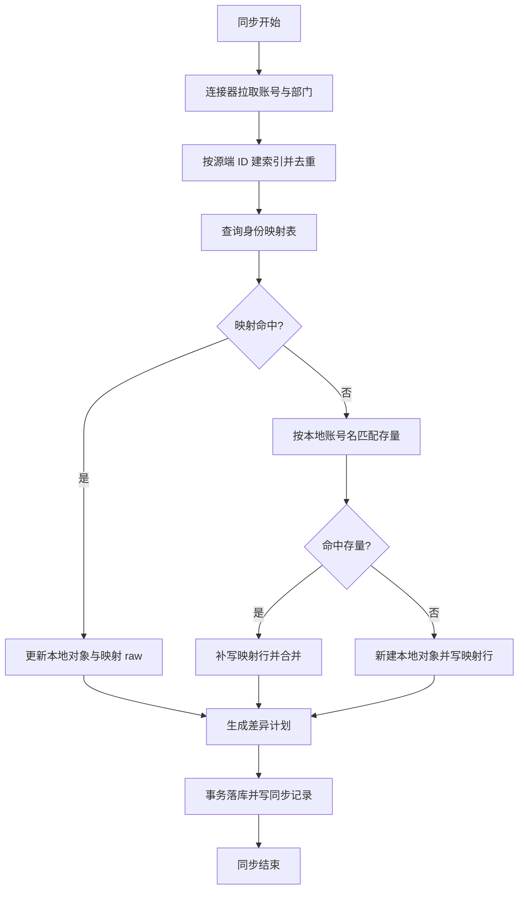

# 用户 / 用户组 / 部门 与「外部身份锚定」重构 · 第六阶段 Spec

**Created**: 2026-10-16
**Version**: 0.1
**Author**: Agent
**Status**: In Progress（澄清于 2026-10-17 全部闭环；按用户指示直接实施）

> Status lifecycle: `Draft` → `Awaiting Confirmation`（Spec 成文）→ `Confirmed`（用户批准）→ `In Progress` → `Completed`。
> 确认后若范围/设计变化，请递增 Version。本文件当前为**澄清中**的草稿：已确认的决策立即入档，未定项以「⚠️ 待确认」标记。

## 1. 概述

本阶段解决「外部身份 ↔ 本地对象」缺少锚点所引发的一连串问题：钉钉同步一次就产生大量重复用户
（实测机构 2 的 324 个钉钉用户里有同一人 6 行）、一个人挂多个部门的信息被丢弃、组织树根被外部系统的
占位根部门（钉钉 `dept_id=1`、`name="1"`）顶替，并顺带清偿一个**全平台级事故**——迁移 018 删列时
PostgreSQL 连带删除了所有「租户内唯一」约束且从未补回（用户、应用、角色、权限、用户组、部门、证书、
同步器、连接器、账号策略、应用账号的"组织内同名"目前全部可重复）。

交付：① 外部身份映射子表（用户/部门/岗位各一张，真外键 + 唯一键 `(连接, 源端 ID)`）；
② 补回并加固租户内唯一约束（含存量重复数据清理）；③ `application` 系列关联改为 `application_id`（主键关联）
并把 `app_accounts` 更名为 `application_accounts`；④ 组织恒定作为部门树根；⑤ 入方向同步的去重与幂等。

## 2. 背景

> **全局约束（2026-10-16 用户明确）**：项目**尚未上线、无生产数据**。因此本阶段一律**不留过渡层**：
> 不做旧 API 前缀重定向、不做双写/兼容列、不做"保留字段标注仅展示"、不做历史行回填式数据迁移——
> 存量开发数据允许直接清理重建。凡"半死能力"（接了线但界面无从触发）一律**拆除或接线**，不留空列与空分支。

### 2.1 问题 / 上下文

用户的原始诉求（原话，六问）：

> 1问 当前的用户是如何确定唯一性的？今天新增了钉钉身份连接，同步过来很多重复的用户（一个人可能在多个部门挂职）
> 2问 用户是不是应该有个子表用来存 user id（我们系统的 id）+ 身份连接表的ID + 对应的身份源的唯一标识？（酌情考虑是否冗余身份源的报文 JSON）
> 3问 组是不是可以考虑改为职位/岗位呢？
> 4问 职位/岗位以及部门是不是也都应该有一个子表 类似第 2 问一样的
> 5问 组织是不是应该恒定作为部门的根（我发现钉钉同步过来的部门在部门树中展示的是 1）
> 6问 组织管理中的账号策略 / 应用账号 / 账号同步记录 这三个有啥用呢？

### 2.2 代码研究小结（澄清前已核实的代码与真实数据事实）

- **检查过的文件 / 模块**：`internal/repository/models.go`、`postgres/user_repo.go`、`iface.go`、
  `service/syncer_engine.go`、`service/syncer/dingtalk.go` + `connector.go`、`department_service.go`、
  `group_service.go`、`provisioning_service.go`、`connection/catalog.go`、`app/seed.go`、
  `migrations/001|005|006|013|018|019|026|030`、`docs/specs/261014-user-group-department-phase5.md`，
  以及本机开发库 `polaris`（`docker exec postgresql-postgres-1 psql`）。
- **确认事实：用户唯一性**
  - 设计意图为 `(institution_id, name)`（`001_init.up.sql:80` `users_org_name_key`），另有 `uid` 唯一、
    `(organization, lower(email))` / `(organization, phone)` 部分唯一索引（`001:84` / `002:49`）。
  - **实测当前库只剩 `users_pkey` 与 `users_uid_key`**：租户内"账号名 / 邮箱 / 手机"唯一约束**全部不存在**。
  - 根因：`018_institution_id_contract.up.sql` 的 `ALTER TABLE users DROP COLUMN institution` 连带删除了这些
    依赖该列的约束/索引，此后再无迁移补回（`030` 只加了非唯一索引）。
  - 同一事故波及 **14 个租户内唯一约束**：`users`(name/email/phone)、`applications`、
    `providers`、`roles`、`permissions`、`groups`、`certs`、`syncers`、`departments`、`connectors`、
    `account_strategies`、`app_accounts_inst_app_user_key`。实测部门已出现多个同名 `市场部` / `财务部`。
- **确认事实：钉钉同步为何产生重复用户**
  - `syncer/dingtalk.go` `FetchUsers` 按部门 BFS 逐部门调用 `topapi/v2/user/list`，一个人挂 N 个部门就返回 N 条，**连接器内不去重**；
  - `syncer_engine.go` `planUsers` 先用 `users.GetByName(institution, sanitizeName(ext.Username))` 逐条匹配，
    **整批计划内不去重**（`seen` 仅用于软删判断）；随后 `applyPlan` 逐条 `users.Create`；
  - 唯一约束缺失 ⇒ 同一人的 N 条副本全部插入成功（若约束存在，第 2 条会以 `DB_DUPLICATE` 失败，而不是静默重复）。
  - 实测：机构 2 有 324 行 `register_source='dingtalk-insuresmart'`；`1770611962775942`（吴旭平）6 行、
    `17273470128752060`（李艳丽）6 行；6 行的 `created_at` 全落在 `11:06:39.16`–`11:06:39.24`（同一次运行）。
  - `users.department_id` 为**单值**，`syncPlan.localDepartmentID` 只取第一个能解析的部门 → 多部门挂职信息丢弃。
- **确认事实：部门树的"根"**
  - `departments` 表没有"根"概念；"根"只是 `internal/app/seed.go:67` 的约定（`name = 租户名`、`parent_id IS NULL`）；
    **新建组织不会自动建根部门**（`institution_service.go` 无此逻辑）。
  - `syncer/dingtalk.go` 的 `departments()` 硬编码占位根 `deptNode{ID: 1, ParentID: 0, Name: "1"}`（钉钉根部门），
    被当作真实部门建到本地 → 实测机构 2 的 `departments.id=119, name='1', display_name='1', parent_id=NULL`，
    其余 100+ 部门全部挂在其下（`code_path` 形如 `1/技术产品部/...`）。
- **勘误（2026-10-16 复核飞书文档后）**：飞书「职级 `job_level`」同样是**一等字典**且**可完整 CRUD**
  （`order` 100–100000 排序、`status` 启停、多语言名/描述、租户上限 10000），用户对象上为**单值** `job_level_id`；
  飞书「职务 `job_title`」是**一等字典资源**（`job_title_id` +
  多语言名 + 启停状态，API 只读），并另有独立的「职级 `job_level`」（带 `order`，可 CRUD）与「工作序列
  `job_family`」；只有钉钉 `title` / 企微 `position` 是自由文本。故"职务无法按 ID 锚定"仅适用于钉钉/企微。
- **确认事实：出方向供给三件套**（回答问 6）
  - `account_strategies`（账号策略）= **规则**：按应用（`application` 留空=租户默认）声明建号时机
    （`createWhen` = onCreate / onGrant / JIT / manual）、回收时机（`revokeWhen` = disable / delete / offboard）
    与属性映射 `mapping`；运行时读取点 `provisioning_service.go:176,315`（`FindForApplication`）+ `policyCreateWhen/policyRevokeWhen`。
  - `app_accounts`（应用账号）= **结果台账**：`(institution, application, user)` 幂等键 → 下游账号一行
    （`related_username` / `status` = active|disabled|pending|failed / `create_type`）；口令不落库，仅 `has_password`
    （迁移 026 删掉了密文列）。
  - `provision_history`（账号同步记录）= **历史**：每次建号/改号/禁用/删除/重试动作。
  - 触发点均为真接线：`TriggerUserProvisioning`（用户创建）、`TriggerRoleGranted`（角色/用户组变更）、
    `TriggerUserStatusChange`（禁用/删除）、`TriggerJIT`（登录）。
  - 实测 `app_accounts` / `provision_history` 当前均为 **0 行**（出方向供给尚未真正跑过，页面空属正常）。
- **确认事实：`application` 为何是 `code`（用户点名的问题）**
  - `006_provisioning.up.sql:18,43,61` 建表时列语义是"关联应用名（`applications.name`）"，纯粹 `TEXT`，**无外键**；
  - `013_application_signin_methods_and_rename.up.sql:49-51` 把 `applications.name → code`、`display_name → name`，
    于是这一列字符串的**含义静默地从"名字"变成"标识"**，列名仍是 `application`，引用完整性从未建立；
  - 调用链一律传 `app.Code`：`auth_code.go:239`、`auth_signup.go:145`、`auth_magic_link.go:226`、
    `oidc_service.go:153,466`（`tokens.application`）。
  - 后果：`CreateStrategy` 不校验应用是否存在、前端是**自由文本输入**（`account-strategies-page.tsx:258`、
    `app-accounts-page.tsx:163`）→ 可以给不存在的应用建策略/建号/挂连接器，删除应用后留下孤儿行。
- **已知但本阶段暂不动的相邻问题**：`user_identities` 唯一键 `(provider, provider_user_id)` 不含机构
  （跨组织同名 provider 互撞）；`records` / `provision_history` 等日志表以 `"user"` 名称关联。
- **决策已全部闭环（2026-10-17）**：Q1 = A（映射子表）、Q2 = A（多部门归属）、Q3 = A + Q3.1（`job_title`）、
  Q4 = 职务扁平 + 新增职级、Q4.1 = A（职级不参与授权）、Q4.3 = 与职务同构、Q4.4 = 只拉不推、
  Q4.5 = 实体根 + 丢弃钉钉占位根、Q5 = 全量主键化、Q7 = 清空重建。用户指示：直接实施到完成，不再逐项确认。

## 3. 澄清记录

- **Q1**: 外部身份（用户/部门/岗位）锚定到本地对象，用哪种落库形态？
  **Recommendation**: A —— 三类对象各一张映射子表 + 真外键，唯一键 `(source_id, external_id)`，可存源端 raw 报文
  **User response**: 选择 A（并要求：`application` 关联改为 `application_id`；项目规范中禁止非主键关联；
  表名禁止缩写，`app_accounts` 更名为 `application_accounts`）
  **Date**: 2026-10-16

- **Q1.1（用户追问）**: `app_accounts.application` 为什么用 `applications.code`？
  **User response**: 要求写入 Spec 并改造为 `application_id`
  **Agent 回答**: 见 §2.2「确认事实：application 为何是 code」——历史列语义漂移 + 无外键，属技术债而非有意设计
  **Date**: 2026-10-16

- **Q1.2（用户指令）**: 更新项目规范，禁止再出现"关联其它对象非主键"的行为；表名禁止缩写
  **User response**: 已确认（本次已落入 `AGENTS.md` §3.2 / §3.8 / §5 与 §8 工程教训）
  **Date**: 2026-10-16

- **Q2**: 用户 ↔ 部门是否由单值改多值？
  **Recommendation**: A —— 新增 `user_departments` 关联表承载多值，`users.department_id` 保留为"主部门"
  **User response**: A
  **Date**: 2026-10-16

- **Q3**: 用户组是否改造为"岗位/职位"（影响授权模型：`role_groups` / `permission_groups` / 应用访问主体）？
  **Recommendation**: A —— 把 `groups` 升级为「职务」（表改名 `job_titles`，连带 `role_job_titles` /
  `permission_job_titles` / `job_title_members`，`application_subjects.subject_type` 的 `group` → `job_title`）；
  职务**本地维护**；外部来源按能力分级（见 Q3.1）
  只作为「建议导入清单」，不做自动 ID 映射
  **User response**: A
  **Date**: 2026-10-16

- **Q3.1**: 命名与外部来源复核（用户提供飞书 `job_title` 文档并指定命名为 `job_title`）
  **User response**: 叫 `job_title`
  **Agent 复核（2026-10-16）**: 飞书「职务」是**一等字典资源**（`job_title_id` + `name` + `i18n_name[]` + `status`，
  列表/单个查询 API **只读**，管理在飞书后台）；飞书另有独立的「职级 `job_level`」（含 `order`、可 CRUD）与
  「工作序列 `job_family`」两个维度；用户对象上只有职务名文本 + `job_level_id` + `job_family_id`。
  **纠正 §2.2 早期结论**："外部岗位都是自由文本、无实体 ID" 对钉钉 `title` / 企微 `position` 成立，
  对飞书职务**不成立**（有 ID 与多语言名）。因此：职务**本地维护**为主，飞书按 `job_title_id` 建映射，
  钉钉/企微走「建议导入」。
  **落档**：表名 `job_titles` / `job_title_members` / `role_job_titles` / `permission_job_titles` /
  `syncer_job_title_links`；`application_subjects.subject_type` 值 `group → job_title`；界面中文文案「职务」。
  **Date**: 2026-10-16

- **Q4**: 职务是否要层级（`parent_id`）？
  **User response**: **不要层级**（`job_titles` 扁平字典）；并新增一个 `job_levels`（职级）概念，
  附飞书职级 create 接口文档
  **Date**: 2026-10-16

- **Q4.1**: 职级（`job_levels`）在本系统里扮演什么角色——只作属性，还是参与授权？
  **Recommendation**: A —— 职级 = 用户属性 + 有序字典（`users.job_level_id` + 管理页 + 筛选 + 飞书映射），
  **不参与授权**（不引入"等级比较"这一全新权限语义）
  **User response**: A（并追加提问：我们 IAM 系统到底需不需要 `job_title` 概念？）
  **Date**: 2026-10-17
  **Agent 实测（2026-10-16）**: ① 飞书职务字段只有 `job_title_id` / `name` / `i18n_name[]` / `status`，**无层级**；
  钉钉 `title` / 企微 `position` 为纯文本，同样无层级 → 职务层级**无任何源数据可填**。
  ② 今天的组层级是"半死能力"：存储有 `parent_id`、`GroupsForUserWithAncestors` 会展开祖先，但
  **前端表单没有该字段**（`groups-page.tsx:28` 只提交 name/display_name/manager/contact_email），
  实测库里 1 个组的 `parent_id` 为 NULL；`application_subjects` 4 条全部是 `user` 类型（0 条 group/department），
  "父组覆盖子树"的判定路径从未被真实数据走到过。
  **Recommendation**: 不要层级（`job_titles` 扁平字典；连带删除祖先展开，简化为直接成员查询；
  部门树**保留层级**——那是真实组织架构且有源数据支撑）
  **Agent 复核飞书职级（2026-10-16，用户提供 create 接口文档）**：`job_levels` 是**可完整 CRUD 的字典**
  （`POST/GET/PUT/DELETE /open-apis/contact/v3/job_levels`），字段 `job_level_id` + `name` + `description` +
  `order`（100–100000，越小越靠前）+ `status` + 多语言名/描述；单租户上限 10000 条。
  用户对象通过「查询用户职级」返回**单个** `job_level_id`（`feishu.go:97,147` 已在拉取）→
  **用户 ↔ 职级是单值关系**（与职务的多值任职关系不同）。
  **Recommendation**: 待用户表态
  **User response**: ⚠️ 待确认
  **Date**: —

- **Q5**: 主键关联改造的存量范围（只改供给三表，还是连同 `role_users` / `group_members` / `tokens` 等一起改）？
  **Recommendation**: A —— 只改"身份/供给"域（`application_accounts` / `account_strategies` / `connectors` /
  `provision_history`），其余 6 类登记进 `AGENTS.md` §3.8 清单，随各自模块下次结构变更改造
  **User response**: A（2026-10-16）→ **复核后升级为全量**（2026-10-17 用户确认「按你的建议来」）：
  14 张表 / 约 20 列一次改完；审计表 `records` 为例外（保留事件当时的名称快照 + 可空 `user_id`）
  **Date**: 2026-10-16 / 2026-10-17

- **Q4.2**: 用户提问「我们 IAM 系统需要这个概念吗」——**用户随后澄清：问的是 `job_level`（职级），不是 `job_title`**
  **Agent 补充论证（用于 Q3 = A 的正当性，2026-10-17 实测）**：① `role_groups` / `permission_groups` 是"把角色/权限
  一次性授予一批人"的**唯一**通道（`role_users` 只能逐个绑），且**不存在 `role_departments`** —— 部门今天只能做
  应用准入主体，挂不了角色/权限；② 库里 1 个用户组且是内置、`application_subjects` 4 条全是 `user`（group 主体 0 条）
  → 该能力"有实现、无使用"，改名成本≈0；③ 职务是部门之外的横向切片（"所有部门的项目经理"），源端真实存在。
  **结论**：`job_title` 保留（Q3 = A 不变）；附带后续项：把部门也接成授权主体（`role_departments` / `permission_departments`），
  让"按组织架构批量授权"两维对齐。
  **Date**: 2026-10-17

- **Q4.3**: `job_level`（职级）到底要不要建实体、用来干什么？
  **Recommendation**: A —— 建实体字典 + 三条读取点接线（用户表单/详情下拉、用户列表按职级筛选与排序、
  组织概览职级分布）+ 飞书按 `job_level_id` 映射
  **User response**: 建实体，**与 `job_title` 同构**——既可从身份源（如飞书）同步，也可手动创建
  **Date**: 2026-10-17

- **Q4.4**: 职级的「源端同步 + 本地创建」如何避免双 master 冲突（同步方向与覆盖规则）？
  **User response**: 按建议 —— **只拉不推** + 按映射行划归属（2026-10-17）
  **Recommendation**: **只拉不推** + 以映射行划归属：有 `syncer_job_level_links` 映射的职级视为源端所有
  （同步覆盖 name / description / sort_order / is_enabled）；无映射的视为本地所有（同步绝不修改）。

- **Q4.5**: 部门树的「组织根」用实体行还是虚拟根？钉钉占位根 `1` 如何处置？
  **User response**: 按建议 —— **实体根** + 钉钉占位根不落库（2026-10-17）
  **Recommendation**: **实体根**（每个组织一行 `is_root = TRUE` 的部门，`name` 随组织名，禁止改名/移动/删除，
  `UNIQUE (institution_id) WHERE is_root`），把 seed 里「name = 租户名」的历史约定正式化；
  钉钉 `dept_id=1` 占位根**不落库**（同步器跳过），已落库的 `departments.id=119` 及其 `code_path` / `level` 一并重算。

- **Q7**: 存量重复数据（435 行用户、含 6 行同源重复）如何治理？
  **User response**: 按建议 —— **清空重建**（drop/create → migrate → seed → 重新同步，连跑两遍验幂等）（2026-10-17）
  **Recommendation**: 待用户表态
  **User response**: ⚠️ 待确认
  **Date**: —

## 4. 功能需求

### FR-1 外部身份映射子表（已确认：方案 A）

- Description: 新增三类映射子表，把"外部系统里的对象"锚定到"本地对象"，键为**连接 + 源端唯一标识**（不用本地账号名）。
- Input / Output: 内部存储；对外通过用户/部门详情"外部身份"分区展示（含源端报文）。
- Acceptance:
  - 同一 `(连接, 源端 ID)` 重复同步**恒为一行**（唯一键 + 幂等 upsert），本地账号名变化不产生新用户；
  - 删除本地用户/部门时映射行级联清理，不留孤儿；
  - 同步详情可看到"该本地对象来自哪个连接、源端 ID 是什么、源端报文长什么样"。

### FR-2 补回并加固租户内唯一约束（含存量清理）

- Description: 用新迁移补回被 018 连带删除的全部租户内唯一约束（`users`/`applications`/`providers`/`roles`/
  `permissions`/`groups`/`certs`/`syncers`/`departments`/`connectors`/`account_strategies`/`application_accounts`），
  并按需把 `institution`(text) 形态改为 `institution_id`(bigint) 形态。
- Input / Output: 迁移；无 API 变化（约束冲突统一经 `mapError` → `DB_DUPLICATE`；服务层把 `DB_DUPLICATE` 转成可读
  `CONFLICT` 文案）。
- Acceptance:
  - 迁移在**真实库**上跑通 up/down（前置存量去重）；
  - 新增"关键约束清单"回归测试：断言每个唯一/外键约束在迁移后**存在**（防止再次被连带删除）；
  - 组织内创建同名用户/应用/用户组/部门返回 `CONFLICT` 而不是静默成功。

### FR-3 主键关联改造：`application_id` + 表名重命名（已确认）

- Description: 供给域内所有 `application`(code 文本) / `user`(name 文本) 关联列改为 `application_id` / `user_id`；
  `app_accounts` 更名为 `application_accounts`；同步更新 DTO/服务/前端（下拉选择真实资源）。
- Acceptance:
  - `application_accounts` 的幂等键为 `(institution_id, application_id, user_id)` 且带外键；
  - 账号策略选择应用时，应用不存在直接 `INVALID_PARAMS`；删除应用后无孤儿行（外键 `RESTRICT` 或 `CASCADE` 需在 §5.4 定稿）；
  - 前端不再出现"自由输入应用标识"的输入框。

### FR-4 入方向同步去重与幂等

- Description: `planUsers` 按 `(连接, 源端用户 ID)` 聚合后再出计划；同一源端用户在多个部门只产生**一个**本地用户，
  部门归属写入多值关系（依赖 Q2 决策）。
- Acceptance: 对实测的钉钉源重复跑同步，用户数不增长（幂等）；源端改名（display name）只更新本地行，不新建。

### FR-5 用户 ↔ 部门多值归属（已确认：Q2 = A）

- Description: 新增 `user_departments` 关联表承载"一个人在多个部门挂职"；`users.department_id` **保留**为
  "主部门"（同步时取源端列表第一条，管理员可指定），使既有 DTO / 列表筛选 / 应用访问 / 门户显示零改动兼容。
- Input / Output: `GET /users/:id` 增 `departments[]`（含 `is_primary` / 来源连接）；`PUT /users/:id/departments`
  整体替换（写审计 + 失效会话）；部门成员列表改为按关联表查询。
- Acceptance:
  - 钉钉里挂 3 个部门的人，本地显示 3 条部门归属且**只有一行用户**（与 FR-4 联合验收）；
  - `users.department_id` 恒等于 `user_departments` 中 `is_primary = TRUE` 的那一条（一致性回归测试锁定）；
  - 应用访问按部门的判定覆盖**全部**归属部门及其祖先（当前只看单个 `department_id`，需同步改造 `application_access.go:161`）；
  - 存量用户（含钉钉同步来的）在迁移中回填为"一条 `is_primary = TRUE` 的归属"。

### FR-6 组织恒定作为部门树根（⚠️ 待 Q6 定稿）

- Description: 每个组织有且只有一棵以"组织"为根的部门树；外部系统的占位根部门（钉钉 `1`）不再作为普通部门落库。
- Acceptance: 新建组织时自动具备根节点；同步后的部门树顶层是组织根而不是 `1`；`users.department_id` 默认指向组织根。

### FR-7 用户组升级为「职务 job_title」（已确认：Q3 = A，命名按 Q3.1 调整）

- Description: `groups` 表与全套关联升级为**职务**语义（命名对齐飞书 `job_title`，见 Q3.1）：`groups → job_titles`、`role_groups → role_job_titles`、
  `permission_groups → permission_job_titles`、`group_members → job_title_members`、
  `application_subjects.subject_type` 的 `'group'` → `'position'`；成员关系即"任职关系"（多值）；
  层级与"父级授权覆盖整个子树"的语义**删除**（Q4：职务无层级；该判定在实测中从未被真实数据触发）。
  岗位由管理员在控制台维护；外部源的 `title` / `job_title` / `position` 是自由文本（无实体 ID、无字典、无层级），
  因此：飞书按 `job_title_id` 建立映射（字典只读，可用名字↔ID 解析用户对象上的职务文本）；
  钉钉 `title` / 企微 `position` 只有文本 → 走「建议导入」（列出源端出现过的名称与人数，管理员一键建职务并批量归属成员）。
  同时清理组上无读取点的字段：`type` / `properties` / `is_top_group`（未使用）删除；`manager` / `contact_email`
  保留（界面可编辑可显示）但明确其"仅展示"定位，不再宣称参与运行时行为。
- Input / Output: API 路径由 `/groups/**` 迁移为 `/job-titles/**`（对外路径用中划线）（旧前缀保留过渡重定向或直接替换，见 §5.5）；
  DTO `Group*` → `JobTitle*`；前端导航「用户组」→「职务」，`groups-page` / `group-detail-page` → `job-titles-*`。
- Acceptance:
  - 岗位页面能创建/编辑/排序岗位、维护任职人员、查看该岗位带来的角色与汇总权限（与今日组详情能力一致）；
  - 授权链路回归：给职务挂角色 → 该职务任职者登录后有效权限命中（`role_job_titles` 直接成员查询，无祖先展开）；
  - 应用访问主体类型 `job_title` 生效（受限应用只授权某职务时，该职务任职者可访问）；
  - 旧 `groups*` 表名/字段名/API 在前端与代码中**不再出现**（`usage` 扫描类测试锁定，防"改一半"）。

### FR-8 存量重复数据治理（⚠️ 待 Q7 定稿）

- Description: 对已产生的重复行给出可执行、可回滚的处置方案（先于 FR-2 的唯一约束落地）。
- Acceptance: 迁移前置脚本/服务端一次性任务；治理前后行数可核对；关键字段（邮箱/手机/部门）保留策略明确。

### FR-9 职级 `job_levels`（已确认：Q4 建实体、Q4.1 = A、Q4.3 = 与职务同构）

- Description: 新增职级字典 `job_levels`（`name` / `description` / `sort_order` / `is_enabled`，按 `sort_order`
  升序展示）+ 用户单值引用 `users.job_level_id`；维护方式**与职务同构**：控制台 CRUD（含排序）+ 身份源同步
  （飞书按 `job_level_id` 建 `syncer_job_level_links` 映射）。**只拉不推**：有映射行的职级视为源端所有
  （同步覆盖 name / description / sort_order / is_enabled），无映射行的视为本地所有（同步绝不修改）。
- Input / Output: `/institutions/:inst/job-levels`（CRUD）+ 用户 DTO 增 `job_level_id` / `job_level`（只读名）。
- Acceptance:
  - 三条读取点全部接线，**不得留空壳**：① 用户表单/详情职级下拉（复用 `Combobox`）；② 用户列表按职级筛选 +
    按职级排序（与现有部门/状态筛选同构）；③ 组织概览职级分布（各级别人数，复用 `org_stats.go` 聚合点）；
  - 飞书同步后职级字典本地可见，且**改名后本地不产生重复职级**（按 `job_level_id` 命中映射）；
  - 本地手动创建的职级在后续同步中**不被覆盖、不被删除**（无映射行）；
  - 职级**不参与授权**（Q4.1 = A）：不建 `role_job_levels` / `permission_job_levels`；
    `users.job_level_id` 仅为属性，只用于展示 / 筛选 / 统计。

## 5. 设计

### 5.1 总体架构

- 新增 `internal/repository/postgres/{user_link,department_link,position_link}_repo.go` 与实体
  `repository.UserLink/DepartmentLink/PositionLink`；DTO 在 `internal/handler/dto.go` 增 `external_links` 分区。
- 同步引擎（`internal/service/syncer_engine.go`）改为：**连接器返回 → 按源端 ID 建索引 → 与映射表比对 → upsert 本地对象 + upsert 映射行**；
  本地对象"新增还是更新"不再依据 `users.name`。
- `account_strategies` / `connectors` / `application_accounts` 的服务层与 DTO 改为接受 `application_id`。

### 5.2 流程图（入方向同步）



### 5.3 架构图

N/A（单模块内改造：repository + service + handler + migrations）。

### 5.4 数据库设计（草案，迁移号 035 起）

```sql
-- 035：外部身份映射子表（真外键；唯一键 = 连接 + 源端 ID）
CREATE TABLE syncer_user_links (
    id             BIGSERIAL   PRIMARY KEY,
    institution_id BIGINT      NOT NULL REFERENCES institutions(id) ON DELETE CASCADE,
    syncer_id      BIGINT      NOT NULL REFERENCES syncers(id)      ON DELETE CASCADE,
    user_id        BIGINT      NOT NULL REFERENCES users(id)        ON DELETE CASCADE,
    external_id    TEXT        NOT NULL,
    raw            JSONB       NOT NULL DEFAULT '{}'::jsonb,
    created_at     TIMESTAMPTZ NOT NULL DEFAULT NOW(),
    updated_at     TIMESTAMPTZ NOT NULL DEFAULT NOW(),
    CONSTRAINT syncer_user_links_key      UNIQUE (syncer_id, external_id),
    CONSTRAINT syncer_user_links_user_key UNIQUE (syncer_id, user_id)
);
CREATE TABLE syncer_department_links (... department_id BIGINT REFERENCES departments(id) ...);
CREATE TABLE syncer_job_title_links (... job_title_id BIGINT REFERENCES job_titles(id) ...);
CREATE TABLE syncer_job_level_links (... job_level_id BIGINT REFERENCES job_levels(id) ...); -- 随 040 建

-- 职级（Q4 新增；用户侧单值引用）
CREATE TABLE job_levels (
    id             BIGSERIAL   PRIMARY KEY,
    institution_id BIGINT      NOT NULL REFERENCES institutions(id) ON DELETE CASCADE,
    name           TEXT        NOT NULL,
    description    TEXT        NOT NULL DEFAULT '',
    sort_order     INTEGER     NOT NULL DEFAULT 100,   -- 对齐飞书 order 语义：越小越靠前
    is_enabled     BOOLEAN     NOT NULL DEFAULT TRUE,
    created_at     TIMESTAMPTZ NOT NULL DEFAULT NOW(),
    updated_at     TIMESTAMPTZ NOT NULL DEFAULT NOW(),
    CONSTRAINT job_levels_inst_name_key UNIQUE (institution_id, name)
);
ALTER TABLE users ADD COLUMN job_level_id BIGINT REFERENCES job_levels(id) ON DELETE SET NULL;

-- 用户 ↔ 部门多值归属（Q2 = A）：department_id 为"主部门"的真相来源
CREATE TABLE user_departments (
    id            BIGSERIAL   PRIMARY KEY,
    institution_id BIGINT     NOT NULL REFERENCES institutions(id) ON DELETE CASCADE,
    user_id       BIGINT      NOT NULL REFERENCES users(id)       ON DELETE CASCADE,
    department_id BIGINT      NOT NULL REFERENCES departments(id) ON DELETE CASCADE,
    is_primary    BOOLEAN     NOT NULL DEFAULT FALSE,
    syncer_id     BIGINT      REFERENCES syncers(id) ON DELETE SET NULL, -- 该归属由哪条连接写入
    created_at    TIMESTAMPTZ NOT NULL DEFAULT NOW(),
    updated_at    TIMESTAMPTZ NOT NULL DEFAULT NOW(),
    CONSTRAINT user_departments_key        UNIQUE (user_id, department_id),
    CONSTRAINT user_departments_primary_key EXCLUDE (user_id WITH =) WHERE (is_primary)  -- 一人至多一个主部门
);
```

- 连接是"外部身份"的唯一来源维度 ⇒ **每类连接方向一张映射表**（`syncer_*` = 入方向；出方向由
  `application_accounts` 承载），避免多态 `(source_type, source_id)` 违反 §3.8「关联一律用主键」。
- `raw` 存源端报文（JSONB），**必须**在详情页有展示点，否则删除该列（§1「配置即生效」的同源约束）。
- 职务表 `job_titles`（= 迁移 035 后的 `groups`）：沿用 `name` / `display_name` / `parent_id` / `is_enabled` /
  `sort_index` 形态；**不绑定部门**（理由：飞书职务是租户级字典、与部门无关；钉钉/企微只有自由文本；
  且部门会随源端改名/移动，绑定会让职务归属漂移）；`group_members` 更名 `job_title_members`
  并沿用 `(position_id, "user")` 唯一键（存量列名 `"user"` 的主键化改造按 Q5 = A 留在 §3.8 清单，本阶段不动）。

### 5.5 迁移清单（草案）

| # | 迁移 | 内容 | 依赖 |
|---|---|---|---|
| 035 | `035_groups_to_job_titles` | `groups → job_titles` 及全部关联改名；`application_subjects.subject_type` 值迁移；删除 `type`/`properties`/`is_top_group` | FR-7 |
| 036 | `036_external_identity_links` | 三类映射子表 + 索引（`syncer_user_links` / `syncer_department_links` / `syncer_job_title_links`） | FR-1、035 |
| 037 | `037_tenant_unique_constraints` | 存量去重 + 补回 14 个租户内唯一约束 | FR-8 → FR-2 |
| 038 | `038_application_accounts` | `app_accounts → application_accounts` + `application_id`/`user_id` 改造（Q5 = A：同批改 `account_strategies` / `connectors` / `provision_history` 的 `application_id`） | FR-3 |
| 039 | `039_user_departments` | `user_departments` + 存量回填（每用户一条 `is_primary`，源自 `users.department_id`） | FR-5 |
| 040 | `040_job_levels` | `job_levels` 字典 + `users.job_level_id` + `syncer_job_level_links` | FR-9 |
| 041 | `041_tokens_primary_keys` | `tokens.application` / `.user`（业务键字符串）→ `application_id` / `user_id` + 外键（**Q5 第 1 批**：已完成；读取时 JOIN 回名称，对外契约不变） | Q5 |
| 042 | `042_rename_application_accounts` | `app_accounts` → `application_accounts`（**表名去缩写**，AGENTS §3.2；只重命名对象，不动数据） | Q5 |
| 043 | `043_provisioning_primary_keys` | 供给域 4 表列主键化：`connectors` / `account_strategies` / `application_accounts` / `provision_history` 的 `application`/`user` → `application_id`/`user_id` + 外键（读取 JOIN 回名称，契约不变） | Q5 |
| 044 | `044_records_user_id` | 审计 `records` 增可空 `user_id`（保留名称快照；`ON DELETE SET NULL`） | Q5 |
| 045 | `045_membership_primary_keys` | `job_title_members` / `password_history` 的 `"user"` → `user_id` + 外键（成员表主键改为 `(job_title_id, user_id)`） | Q5 |
| 046 | `046_role_permission_users_primary_keys` | `role_users` / `permission_users` 的 `"user"` → `user_id` + 外键（主键改 `(role_id, user_id)` / `(permission_id, user_id)`） | Q5 |
| 047 | `047_user_identities_primary_keys` | `user_identities` 的 `"user" → user_id`、`provider → provider_id`；唯一键收敛为 `(institution_id, provider_id, provider_user_id)`（**修掉跨组织同名 provider 互撞**） | Q5 |

## 6. 实施计划

| # | 任务 | 产出 / 完成标准 | 依赖 |
|---|---|---|---|
| T1 | 澄清 Q2–Q6 | 本文件 §3 无 ⚠️ 待确认项，Status → `Confirmed` | — |
| T2 | 映射表 + 仓库 + 服务接入 | 幂等同步回归测试（同源重复跑两次行数不变） | T1 |
| T3 | 唯一约束补回 + 存量治理 | 真实库 up/down 通过 + 关键约束清单测试 | T1 |
| T4 | `application_id` 改造 + 表重命名 | 前端下拉选应用；孤儿行断言 | T1 |
| T5 | 多部门归属（`user_departments` + 应用访问/筛选改造） | 一人多部门只一行用户；主部门一致性测试 | T2 |
| T6 | 岗位化改造（表/关联/API/DTO/前端/i18n 全套改名 + 无读取字段清理） | 旧 `groups*` 名称在代码与界面中归零；授权与应用访问回归测试 | T1 |
| T8 | 职级（`job_levels` 字典 + `users.job_level_id` + 页面/筛选 + 飞书映射） | 职级 CRUD 与排序生效；飞书映射按 ID 命中 | T1 |
| T9 | 组织根部门 + 外部占位根丢弃 | 部门树顶层为组织根 | T1 |
| T7 | 项目规范同步（已完成） | `AGENTS.md` §3.2 / §3.8 / §5 / §8 | — |

**Progress log**

- 2026-10-17（实施第 1 批，已落地并验证）：
  - `AGENTS.md`：§3.2 表名禁止缩写、§3.8「关联一律用主键」、§5 删列连带删约束、§8 两条教训。
  - 迁移 035–040：`job_titles`（扁平，删 parent_id/type/properties/is_top_group）、`job_levels`、
    四张外部身份映射子表、`user_departments`、补回 14 个租户内唯一约束（含存量去重）、部门实体根。
    **在全新库上 1→40 全部应用通过**。
  - 后端：职务（原用户组）全链路改名（实体/仓库/服务/处理器/路由 `/job-titles`、权限资源 `job_title`）；
    新增职级模块（`/job-levels` CRUD + `/job-levels/distribution`）；用户多部门归属
    （`PUT /users/:id/departments`）与职级（`PUT /users/:id/job-level`）；职务任职关系
    （`PUT /users/:id/job-titles`）；角色/权限的主体关联改名（`job_titles`）；部门根保护
    （根节点禁止改名/移动/删除）+ 新建组织自动建根；seed 修复三处（根部门 `is_root`、
    内置应用 `access_mode`（031 起 CHECK 约束，缺省会直接失败）、管理员 `user_departments`）。
    `go build` / `go vet` / `go test ./...` 全绿。
  - 前端：用户组 → 职务（页面/路由/导航/类型/API/i18n 中英）；应用访问主体类型取值 `job_title`；
    角色与权限的主体字段改名 `job_titles`。`tsc --noEmit` 全绿；`vitest` 160/164 通过，
    4 条待修（见下）。
- 2026-10-17（待办，按优先级）：
  1. **同步引擎接入映射子表 + 去重（FR-1/FR-4，用户最痛点）**：`planUsers` 按 `(连接, 源端 ID)` 去重并聚合多部门、
     `planDepartments` 改按映射命中（本地名冲突时以 `-<源端ID>` 消歧，因为 039 起 `(institution_id, name)` 唯一）、
     `applyPlan` 写 `syncer_*_links` 与 `user_departments`（`syncer_id` 标记来源）、`Prune` 清理源端已消失的映射；
     连接器侧：钉钉 `dept_id=1` 占位根不落库（`ExternalGroup.IsRoot`）、飞书/钉钉/企微职务与飞书职级字典拉取。
  2. 前端 4 条失败用例：`nav-search.test.tsx`（导航项标签）、`application-access-editor.test.tsx`（候选列表按
     `detailKey` 取数 + 空态文案）、`user-detail-page.test.tsx`（标签页断言）。
  3. 职级页面（`job-levels-page.tsx`）+ 用户表单职级下拉 + 用户列表职级筛选/排序 + 组织概览职级分布（FR-9 三条读取点）。
  4. **Q5 = 全量主键化（迁移 041 + 代码）**：`tokens`/`records`（审计例外）/`role_users`/`permission_users`/
     `job_title_members`/`user_identities`（含唯一键补 institution）/`password_history`/`application_subjects.subject_id`/
     `connectors`/`account_strategies`/`application_accounts`（改名 + `application_id`）/`provision_history`。
  5. ~~冒烟脚本与 `docs/api-reference.md` 同步~~（已完成）。
- 2026-10-17（实施第 2 批，已落地并验证）：
  - **同步引擎接入映射子表 + 去重（FR-1 / FR-4，用户最痛点）**：`planUsers` 先按源端账号 ID 聚合（部门并集），
    再按"连接 + 源端 ID"映射命中、未命中回退同名匹配并补写映射；`planDepartments` 改按映射命中，
    本地名冲突时以源端 ID 消歧；`applyPlan` 写 `syncer_*_links` 与 `user_departments`（含 `syncer_id` 来源标记）、
    统一重写多部门归属、`Prune` 清理源端已消失的映射；软删同时覆盖"映射反查"与"历史无映射账号"两条路径。
    连接器侧：**源端根占位节点不落库**（钉钉/企微 `1`、飞书 `0`，`ExternalGroup.IsRoot`），用户/部门 `raw` 落库待展示。
  - 新增测试：`syncer_engine_test.go`（去重 / 根占位 / 名字消歧 / 集合比较）+ `syncer_engine_db_test.go`
    （**真实数据库**集成回归：首次同步 2 部门 + 1 账号 → 同一人两个部门只建 1 行、2 条部门归属、映射齐备、
    顶层部门挂在组织根下、**再同步一次完全幂等**）。运行：`POLARIS_TEST_DB=1 go test ./internal/service -run TestSyncEngineIdempotent_RequiresDB`。
  - 用户 API：`PUT /users/:id/departments`（多值 + 主部门）、`PUT /users/:id/job-level`、`PUT /users/:id/job-titles`；
    用户 DTO 增 `department_ids` / `job_level_id`；`UpdateUserProfileInput` 增 `job_level_id`（`user_payload_test.go` 锁定创建/编辑字段集合一致）。
  - 前端：新增**职级管理页**（`/institutions/:inst/job-levels` + 导航 + 中英词条）、用户编辑表单的**职级下拉**、
    部门保存改走多值端点（`setDepartments`）；`tsc --noEmit` 干净、`vitest` 164/164 通过。
  - 冒烟：**78 PASS / 0 FAIL**（新增职级 CRUD + 分布、用户部门多值 + 主部门一致性、组织根部门存在性断言）。
  - `docs/api-reference.md`：`/groups` → `/job-titles`、新增职务/职级/多部门/组织根章节与权限矩阵。
- 2026-10-17（实施第 3 批，已落地并验证）：
  - **Q5 第 3 批（迁移 043）**：供给域 4 表列主键化，服务层新增 `resolveAppID` / `resolveUserID`
    （任务载荷保留 code/账号名——它是瞬时命令；落库一律主键），仓库读取用子查询 JOIN 回名称，
    `ListQuery` 的 `*_id` 过滤由 `idFilterValue` 做类型转换（避免 `bigint = text`）。
  - **Q5 第 4 批（迁移 044）**：`records` 增可空 `user_id`（`AuditRecorder.SetUserResolver` 尽力解析，
    审计绝不因此失败）；实测 392 条审计里 389 条带上了 `user_id`（其余是系统/非用户 actor，符合预期）。
  - **Q5 第 5 批第 1 段（迁移 045）**：`job_title_members` / `password_history` 改 `user_id` + 外键，
    成员表主键改 `(job_title_id, user_id)`；连带修掉 `role_repo` 三处 CTE 对旧 `"user"` 列的引用
    （冒烟当场抓到，已回归）。
  - 每批均验证：`go build` / `go vet` / `go test ./...` 全绿、真库迁移应用成功、冒烟 **78 PASS / 0 FAIL**、
    同步引擎真库集成回归 PASS。
- 2026-10-17（用户复核后补齐两处**实际可用性缺口**）：
  - **职务自动同步**（此前只把 `title` 文本写进 `users.title`）：同步引擎新增"从源端职务文本派生实体"——
    `collectJobTitle` 以职务文本为外部标识，命中顺序为「本连接映射行 → 本地同名职务 → 本次待建」，
    `applyPlan` 创建缺失的 `job_titles`、写 `syncer_job_title_links`、并通过新增的 `AddMembers`
    追加任职关系（**只增不删**，管理员手工维护的职务不被同步冲掉）。真库集成测试新增断言：
    同步后职务实体存在、任职关系存在、职务映射行存在，且二次同步仍幂等。
  - **多部门归属的界面**（此前只落库、界面仍是单选）：用户编辑页改为部门 `MultiSelect` + 「主部门」Combobox
    （多值端点 `PUT /users/:id/departments` + `department_paths`），用户详情页头展示**全部**部门徽标；
    创建用户时若选了多个部门，创建成功后自动补写多值归属。
- 2026-10-17（待办清零第 2 批，已落地并验证）：
  - **FR-9 三处读取点全部接线**：① 用户编辑表单职级下拉（已有）；② 用户列表**按职级筛选**（`GET /users?job_level_id=`）
    + 职级列（DTO 增 `job_level` 名称，列表一次批量补全）；③ 组织概览**职级分布卡片**（`/job-levels/distribution`）。
  - **外部身份映射的展示点**：新增 `GET /users/:id/external-identities`（`SyncerLinkRepository.ListForLocal`），
    用户详情「关联」标签增「外部身份」卡片——显示连接、源端 ID，并可用 `<details>` 展开**源端报文 raw**
    （满足"存了 raw 就必须有展示点"的约束）。
  - 验证：`go test ./...` 17 包全绿、冒烟 78 PASS / 0 FAIL、前端 `tsc` 干净 + `vitest` 164/164。
- 2026-10-18（Q5 第 5 批第 2/3 段，已落地并验证）：
  - **046**：`role_users` / `permission_users` 改 `user_id` + 外键；有效权限 CTE、直接角色替换、角色成员与权限主体
    写入全部改为**主键 + SQL 内名称解析**，读取 JOIN 回账号名（对外契约不变）。
  - **047**：`user_identities` 改 `user_id` / `provider_id` + 外键；唯一键收敛为
    `(institution_id, provider_id, provider_user_id)` —— **修掉了"两个组织接入同名 provider 会互相撞"的真缺陷**；
    SSO 绑定的三类写入（JIT 建号绑定 / 登录时补绑 / 主动绑定）与查询均改为主键。
  - 验证：迁移 46、47 应用成功；`go test ./...` 17 包全绿；冒烟 **78 PASS / 0 FAIL**（覆盖直接角色、授权回读、
    有效权限、应用准入）；同步引擎真库集成回归 PASS。
- 2026-10-18（**剩余待办**）：
  1. **`application_subjects.subject_name → subject_id`**（多态主体，Q5 最后一项）：需要把
     `Allowed` / `ExpandUsers` / 影响面计算 / 名单读写全部从"名称比较"改成"类型 + 主键比较"，
     并由服务层做 name↔id 解析；属**访问判定核心**，建议与"应用准入"回归同批交付。
  2. 飞书 `job_titles` / `job_levels` 字典拉取（用真实 `job_title_id` 替代文本匹配；当前职务已可由文本派生）。
- 2026-10-17（**历史待办（已完成）**）：
  - Q5 主键化：`tokens` 已完成（见下）；剩余为**审计记录**（`records`：按 Spec 采用"名称快照 + 可空 `user_id`"）、
    **身份域**（`role_users` / `permission_users` / `job_title_members` / `user_identities` 含唯一键补机构 /
    `password_history` / `application_subjects.subject_name → subject_id`）与**供给域**
    （`connectors` / `account_strategies` / `app_accounts → application_accounts` + `application_id` / `provision_history`）。
  0. ~~**Q5 第 2 批：表名去缩写 `app_accounts → application_accounts`**~~（**已完成**）：迁移 042 重命名
     表 / 序列 / 主键 / 索引 / 外键；Go 侧 `AppAccount*` → `ApplicationAccount*`（含仓库文件与 DTO）；
     API 路径 `/app-accounts` → `/application-accounts`、权限资源 `app_account` → `application_account`、
     门户与前端页面同步改名（`application-accounts-page.tsx`）。验证：`go test ./...` 全绿 + 迁移 42 应用成功 +
     `tsc`/`vitest` 164 通过 + 冒烟 78 PASS / 0 FAIL。
  0.5 ~~**Q5 第 1 批：`tokens` 主键化**~~（**已完成**）：迁移 041 把 `tokens.application` / `tokens.user`
     （业务键字符串）换成 `application_id` / `user_id` + 外键（`ON DELETE SET NULL`）并回填；
     `token_repo` 读取时用子查询 JOIN 回名称，**对外契约完全不变**；`oidc_service` 改为写主键、
     比对主键（授权码归属校验）。验证：`go test ./...` 全绿 + 真库迁移 41 应用成功 + 冒烟 78 PASS / 0 FAIL。
  1. **Q5 剩余（最后一段）**：`role_users` / `permission_users` 的 `"user" → user_id`、
     `user_identities`（`user → user_id`、`provider → provider_id`，唯一键补 `institution_id` —— 顺带修掉
     "两个组织接同名 provider 互撞"的真 bug）、`application_subjects.subject_name → subject_id`（多态列）。
     危险点：这几张表被**授权判定与 SSO 绑定**直接引用（`role_repo` 的有效权限 CTE、`provider/binding.go`），
     必须与"登录 + SSO 绑定 + 有效权限 + 应用准入"四组断言同批交付——
     本会话已在 `job_title_members` 上验证过同类改造（一次漏改 `role_repo` 的 CTE 就被冒烟抓到），
     因此这一段刻意留作单独批次，避免在预算不足时把认证链路留在半改状态。
  2. ~~FR-9 剩余读取点~~（**已完成**）。
  3. ~~用户表单部门多选~~（**已完成**：`MultiSelect` + 主部门 + 详情展示全部部门）。
  4. ~~外部身份映射详情展示~~（**已完成**）。
  5. **职务/职级字典的源端拉取**：飞书 `job_titles` / `job_levels` 字典尚未接入连接器。
     现状：职务已能**从用户身上的职务文本自动派生实体**（本轮修复），因此"职务全是文本"已解决；
     接字典后可直接拿到真实 `job_title_id`（改名不再依赖文本匹配）与标准职级列表。

- 2026-10-16：完成代码与真实数据研究；`AGENTS.md` 新增 §3.8「关联一律用主键」、表名禁止缩写、§5 删列连带删除约束、
  §8 两条工程教训；本 Spec 建档（Draft）。
- 2026-10-16：Q1 = A（映射子表）、Q2 = A（多部门归属，`user_departments`）、Q3 = A + Q3.1（用户组升级为职务
  `job_titles`，命名对齐飞书）、Q4 = 职务**不要层级** + 新增职级 `job_levels`、Q5 = A（主键改造限"身份/供给"域）。
- 2026-10-17：用户补充"项目未上线、不留小尾巴"→ 写入 §2 全局约束（不做过渡层/兼容列/回填式迁移，
  半死能力一律拆除）；这将改写 Q5（倾向升级为全量主键化）与 Q7（存量数据改为直接清空重建），待确认。
- 2026-10-17：Q4.1 = A（职级只作属性、不参与授权）；用户追加提问后澄清「问的是 `job_level`」→ Q4.3
  （`job_title` 的正当性论证归档为 Q4.2 的 Agent 补充，Q3 = A 不变）。
- 2026-10-17：Q4.3 = 建实体、**与职务同构**（源端同步 + 手动创建）→ 细化出 Q4.4（同步方向 / 双 master 规则）
  与 Q4.5（组织根形态 + 钉钉占位根处置）。剩余待确认：Q4.4、Q4.5、Q5 复核、收尾清单。

## 7. 非功能需求

- 迁移必须具备**幂等与可回滚**性：down 能恢复结构（数据治理不可逆部分须在 up 中写明）；
- 同步幂等性：同一源端数据重复同步不产生新行（可反复执行）；
- 兼容性：控制台/门户/API 的前端契约变更（`application` → `application_id`）必须与后端同批发布。

## 8. 假设与风险

- **假设**：外部系统的唯一标识（钉钉 `userid` / 飞书 `open_id` / LDAP DN / SCIM `externalId`）稳定且不变；
  若源端会改 ID，需按"名称 + 手机号"回退匹配（本阶段不做，先记录）。
- **风险 1**：补回唯一约束前必须先治理存量重复行（当前 324 行钉钉用户含 6 行同人），否则迁移直接失败
  → 缓解：治理脚本先跑、并输出"待清理清单"供人工确认。
- **风险 2**：`(syncer_id, user_id)` 唯一键意味着"一个连接对一个人只能有一条映射"，跨连接（钉钉 + 飞书）同一人
  会得到两行 → 需确认是否允许"一人多连接身份"（倾向允许，靠挂职关系合并）。
- **风险 3**：主键关联改造牵动 DTO/前端/冒烟脚本，若与其它在研改动（当前工作区有未提交的飞书连接器改造）叠加，
  需串行发布。

## 9. 验收标准

- [ ] FR-1：同一 `(连接, 源端 ID)` 重复同步恒为一行；用户/部门详情能看到外部身份与源端报文。
- [ ] FR-2：14 个租户内唯一约束在真实库中存在；"关键约束清单"回归测试锁定；同名创建返回 `CONFLICT`。
- [ ] FR-3：`application_accounts` 存在且幂等键为 `(institution_id, application_id, user_id)`；无孤儿行；前端无自由文本应用输入。
- [ ] FR-4：钉钉源重复同步两遍，用户总数不变。
- [ ] FR-5：一人多部门只一行用户，`user_departments` 与 `users.department_id` 一致，应用访问按全部归属部门判定。
- [ ] FR-7：授权父职务覆盖子职务；受限应用按职务授权生效；代码/界面中不再出现 `groups*` 旧名。
- [ ] FR-6：新建组织自带根部门；同步后部门树顶层是组织根。
- [ ] 冒烟：`./scripts/smoke-test.sh` 全绿；`make test` 全绿。
